<div align="center">


# CloudNova Revenue Intelligence Copilot

**Ask finance questions in plain English. Get the number, the exact SQL behind it, and the caveats that apply.**

Track B take-home · spec-driven cleaning pipeline + natural-language query agent · DuckDB + local Qwen · no API keys

`6/6 stakeholder questions verified` · `33 evals pass, 0 fail (3 documented expected failures)` · `114 unit tests` · `READY in 2.0 s`

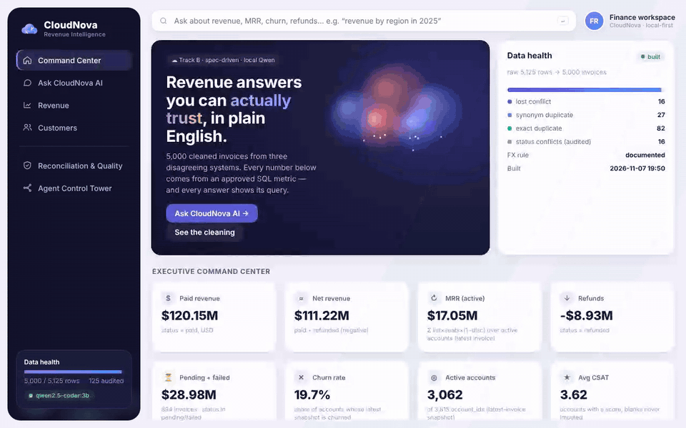

</div>

> **3-minute summary for a CloudNova stakeholder**
> * Your export had **5,125 rows**; it describes **5,000 invoices**. The other 125 are duplicates or conflicting
>   copies from your three systems. Counting them naively would overstate paid revenue by **$2,121,660.87**.
>   Every removed row is kept in an audit table with its reason.
> * All six of your questions are answered and **checked against an independent re-computation** ([§3](#3-the-six-stakeholder-questions--verified)).
> * Two things need *your* decision; the tool shows both answers until you decide: the **FX direction** in the
>   export (EUR/GBP amounts look already converted) and **what "customer" means** (3,815 account ids vs 200 names).
> * The AI never invents numbers: approved metrics compile to SQL deterministically; the local LLM only writes SQL
>   for questions outside the catalog, and that SQL is guarded, read-only and labelled "check this query".

All screenshots and GIFs below were captured from the running app on 2026-11-07. Terminal GIFs replay the **real**
captured output (each line at its recorded time; the eval run, which takes 0.9 s, is replayed line by line).

---

## Contents
1. [Quick start](#1-quick-start) · 2. [How it was built, step by step](#2-how-it-was-built-step-by-step) ·
3. [The six questions](#3-the-six-stakeholder-questions--verified) · 4. [Evaluation](#4-evaluation) ·
5. [Production instincts](#5-production-instincts) · 6. [Design decisions](#6-design-decisions--trade-offs) ·
7. [Startup verification](#7-startup-verification) · 8. [Limitations](#8-known-limitations--failure-modes) ·
9. [Another day](#9-what-id-do-with-another-day) · 10. [How AI was used](#10-how-ai-was-used)

---

## 1. Quick start

**Prerequisites:** Python 3.11+ (tested on 3.13). Optional: a local Qwen server (~2 GB model).

```bash
cd cloudnova
pip install -r requirements.txt
```

```bash
python -m app
```

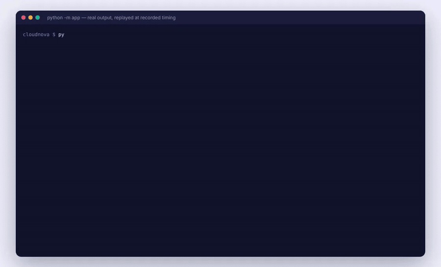

One command validates config, builds (or reuses) the cleaned DuckDB, connects to local Qwen (or starts it via
`LLM_START_CMD`), answers the six stakeholder questions as a readiness check, then serves the dashboard at
**http://127.0.0.1:8000/** and the API at `/api/v1/*` (docs at `/docs`).

| Other commands | |
|---|---|
| `python -m app demo` | terminal only: the six questions with answers, SQL and caveats, then exit |
| `python -m app ask "revenue by region in 2025"` | one question (`--session ID` keeps follow-up context) |
| `python -m app chat` | multi-turn terminal chat ("only Enterprise", "as a chart", "explain the calculation") |
| `python -m pytest` | unit tests, no LLM needed |
| `python -m evals` · `python -m evals --llm` | eval harness (deterministic / including local-Qwen cases) |
| `python -m evals.compare_modes` | hybrid vs Qwen-only measurement (needs Qwen) |

<details>
<summary><b>Local Qwen setup (optional — only general chat and free-form SQL need it)</b></summary>

Any OpenAI-compatible local server works. **Ollama:** `ollama pull qwen2.5-coder:3b` — defaults already match.
**llama.cpp** (what this was built and measured with; Ollama's binary couldn't be downloaded in the build container):

```bash
pip install "llama-cpp-python[server]" huggingface_hub
```

```bash
python -c "from huggingface_hub import hf_hub_download as d; print(d('Qwen/Qwen2.5-Coder-3B-Instruct-GGUF','qwen2.5-coder-3b-instruct-q4_k_m.gguf',local_dir='models'))"
```

Start it on port 11434 yourself, or set `LLM_START_CMD=...` in `.env` (see `.env.example`) and `python -m app` will
start it, health-check it and stop it on shutdown. **Without Qwen the app still starts** ("deterministic mode"):
approved-metric analytics, data quality, dashboard and evals all work; general chat returns a clear
`llm_unavailable` error instead of a guess.
</details>

---

## 2. How it was built, step by step

```mermaid
flowchart LR
  A["① Read the brief<br/>& profile the data"] --> B["② Write the spec<br/>(before code)"] --> C["③ Clean & dedup<br/>from the spec"] --> D["④ Reconcile<br/>5,125 → 5,000"]
  D --> E["⑤ Model metrics<br/>in DuckDB"] --> F["⑥ Query agent<br/>NL → SQL"] --> G["⑦ Guard it<br/>read-only"] --> H["⑧ Evaluate vs<br/>independent oracle"] --> I["⑨ Measure Qwen<br/>vs hybrid"] --> J["⑩ Ship: one command,<br/>dashboard, CI"]
```

### ① Read the brief and profile the data — *decisions come from evidence*
Before writing a rule, small scripts tested each hypothesis against the CSV:

| Question | Finding | Decision |
|---|---|---|
| `01/05/2024` — month or day first? | first part **never** > 12 in 1,320 rows; second part > 12 in 786 | `NN/NN/YYYY` = **MM/DD** |
| `05-01-2024`? | first part > 12 in 151 rows; second **never** | `NN-NN-YYYY` = **DD-MM**; still-ambiguous rows flagged |
| 43 duplicated `invoice_id`s — how many really conflict? | 27 differ only by status *spelling* | only **16** real conflicts |
| Do amounts match the price book? | **every** row = list × seats × months × (1−disc) × FX | 0 pricing errors — but EUR/GBP look *already converted* → **open question** |
| Is `account_id` a customer? | 3,815 ids, only 200 names | ids are the key; name ambiguity documented |

### ② Write the spec first
Five specs were committed **before** any pipeline code (check `git log`): data contract, financial metrics, query
interface, agent contracts, evaluation plan → [`specs/`](specs/). When code needed to differ, the spec changed
first (see the change logs, e.g. v1.1 "revenue" = net of refunds).

### ③ Clean and deduplicate — generated from the spec, rule by rule
[`app/pipeline/rules.py`](app/pipeline/rules.py) holds every rule as a pure, unit-tested function (lookup maps, no
fuzzy matching; unknown values are quarantined, never defaulted; nulls never imputed).
[`clean.py`](app/pipeline/clean.py) applies them: exact duplicates → synonym duplicates → status conflicts resolved by
**refunded > paid > failed > void > pending**.

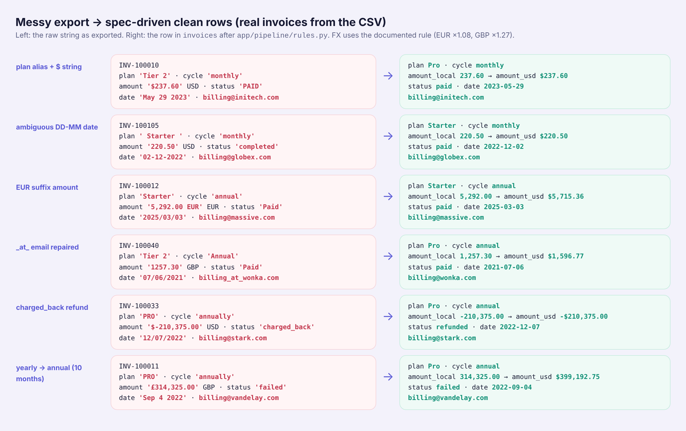

### ④ Reconcile — prove where every row and dollar went
Every raw row ends up in exactly one place: `invoices` (5,000) or `rejected_rows` (125, with reason and full raw
record). The reconciliation view shows what keeping them would have cost — click a bar for the explanation:

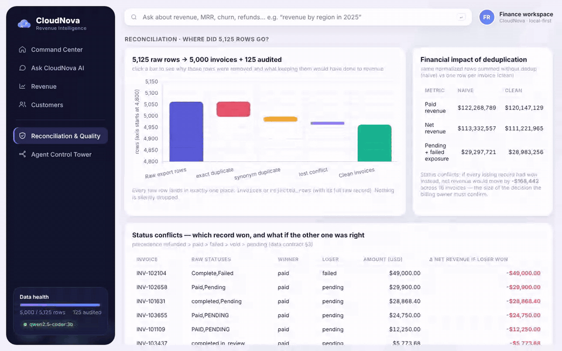

| | Naive (no dedup) | Clean | Overstatement avoided |
|---|---|---|---|
| Paid revenue | $122,268,789.42 | $120,147,128.55 | **$2,121,660.87** |
| Net revenue | $113,332,556.52 | $111,221,964.75 | $2,110,591.77 |
| Pending + failed exposure | $29,297,720.97 | $28,983,255.91 | $314,465.06 |

The 16 status conflicts would swing net revenue by **−$168,441.54** if every losing record had won — a decision
surfaced to the billing owner, not hidden.

### ⑤ Model the metrics in DuckDB
[`build.py`](app/pipeline/build.py) writes typed tables (`invoices`, `accounts` snapshot, audit tables, a monthly
view). Every metric is defined **once** as SQL in [`app/semantic/catalog.py`](app/semantic/catalog.py):
MRR = `list_price × seats × (1 − discount/100)` (never from the annual lump sum), recognized revenue =
`paid + refunded(negative)`, exposure = `pending + failed`.

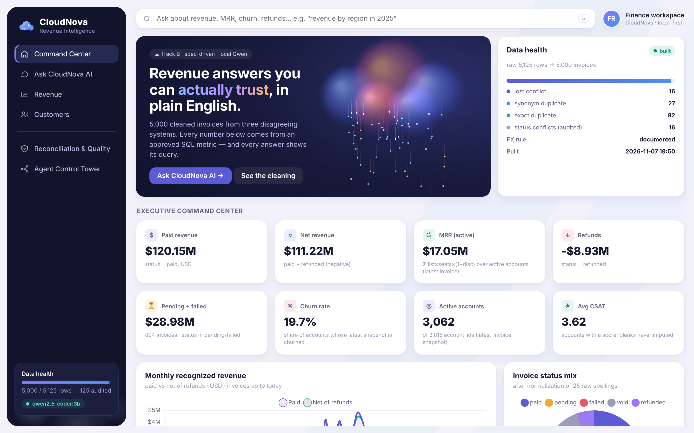

### ⑥ Ask in plain English — the query agent
One agent ([`supervisor.py`](app/agent/supervisor.py), harness adapted from FloPilot) routes each question:
approved metric → **deterministic semantic planner** (metric × dimension × filter → SQL); measure outside the
catalog → **local Qwen text-to-SQL**; cleaning questions → data-quality tool; concepts/greetings → Qwen chat.
Follow-ups patch the previous query plan.

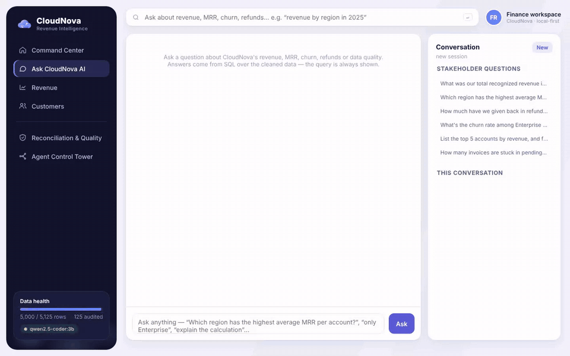

Every answer shows the **generated SQL** (executed read-only), result rows, metric definitions, caveats that apply
to *those* rows, and an agent trace:

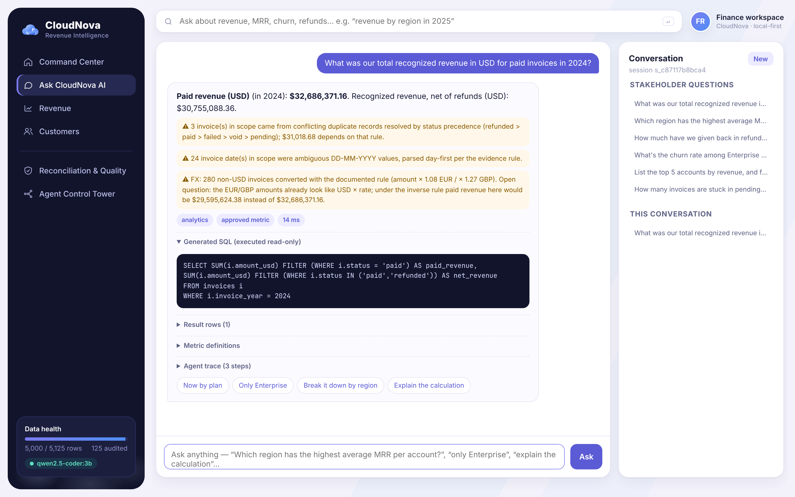

### ⑦ Guard it
* **Structural SQL guard** ([`sql_guard.py`](app/governance/sql_guard.py), sqlglot): one SELECT, allow-listed tables
  and columns, no table functions / COPY / ATTACH / PRAGMA — not a keyword blacklist.
* **Database-level read-only:** DuckDB opened `read_only`, external access disabled, config locked — tested to
  refuse writes *even if the guard were bypassed*.
* Timeout, row cap, PII masking, prompt-injection flagging, write requests refused, "why did X churn" declined.
* Qwen narratives are rejected if they contain a number not present in the result rows.

### ⑧ Evaluate against an independent oracle
[`evals/oracle.py`](evals/oracle.py) re-implements the spec with the standard library, reads the **raw CSV**, and
**does not import the app** — so a misreading in either shows up as a disagreement. 36 cases in
[`evals/cases.yaml`](evals/cases.yaml), including 3 documented expected failures.

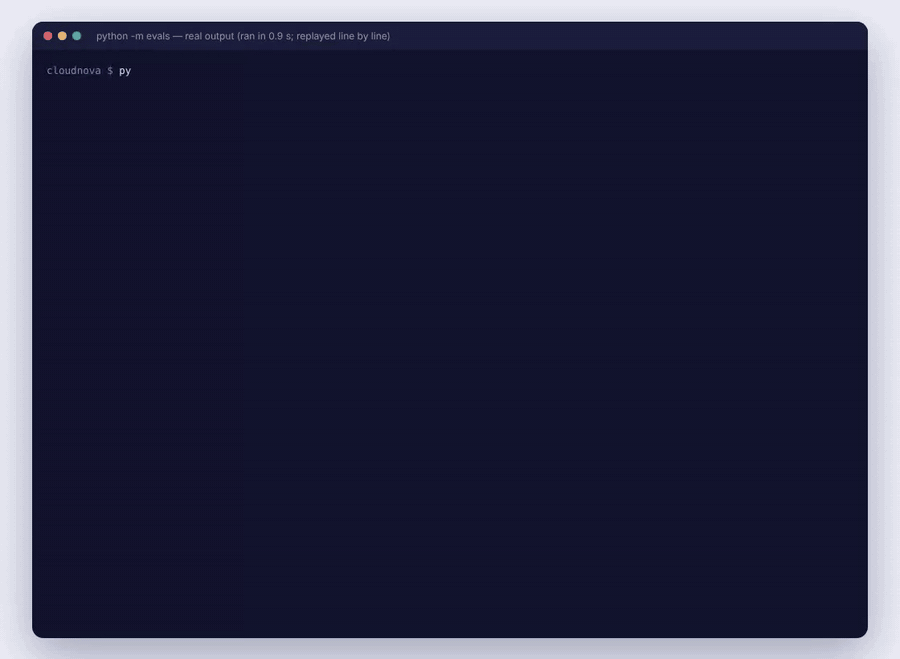

### ⑨ Measure the LLM honestly — hybrid vs Qwen-only
`QUERY_MODE=llm` sends every question to Qwen text-to-SQL; [`compare_modes.py`](evals/compare_modes.py) scores both
modes against the oracle ([full report and Qwen's SQL](evals/results/mode_comparison.md)):

| Mode | Correct on the six | Median latency | Max |
|---|---|---|---|
| **Hybrid** (default) | **6/6** | 10 ms | 61 ms |
| **Qwen-only** (Qwen2.5-Coder-3B, CPU) | **2/6** | 20.6 s | 42.9 s |

Qwen invented `status = 'churned'` (Q4), ranked by paid instead of net revenue (Q5), and wrote ambiguous joins (Q2) —
the evidence for "deterministic metrics first, LLM as fallback".

### ⑩ Ship it
One command with readiness checks and graceful shutdown, a versioned API, a dashboard with an Agent Control Tower
(traces, execution graph, eval results), and CI running build → tests → evals → demo on every push.

<table><tr>
<td>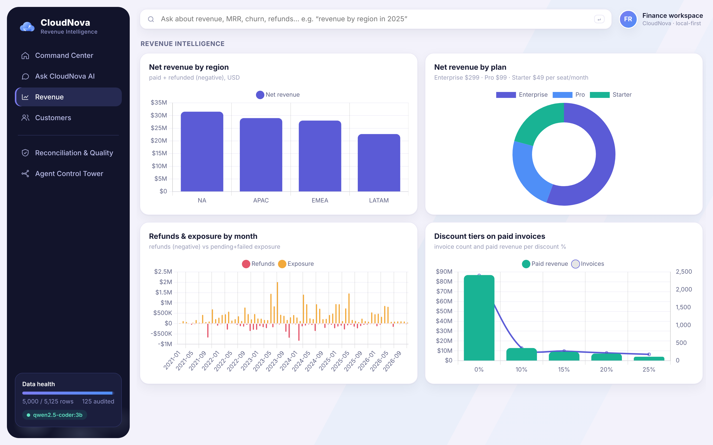</td>
<td>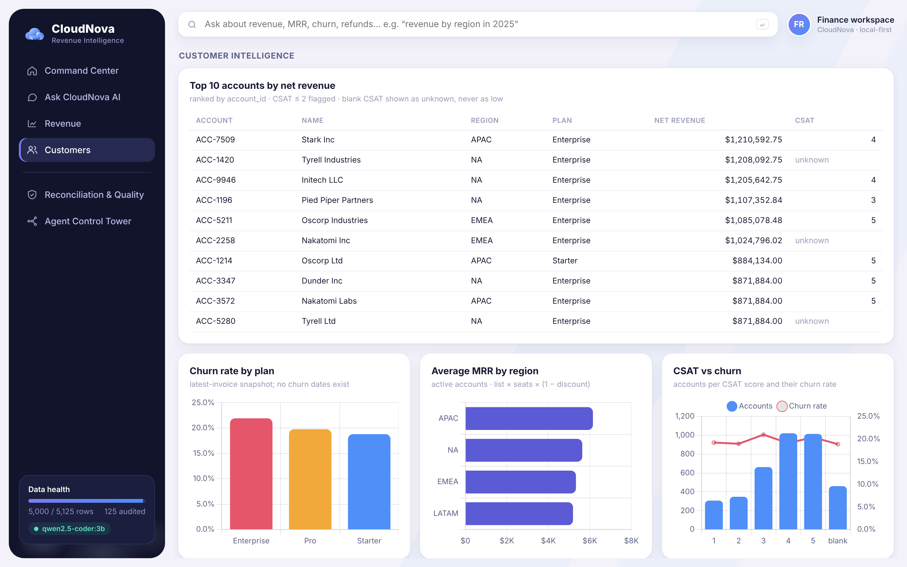</td>
</tr><tr>
<td>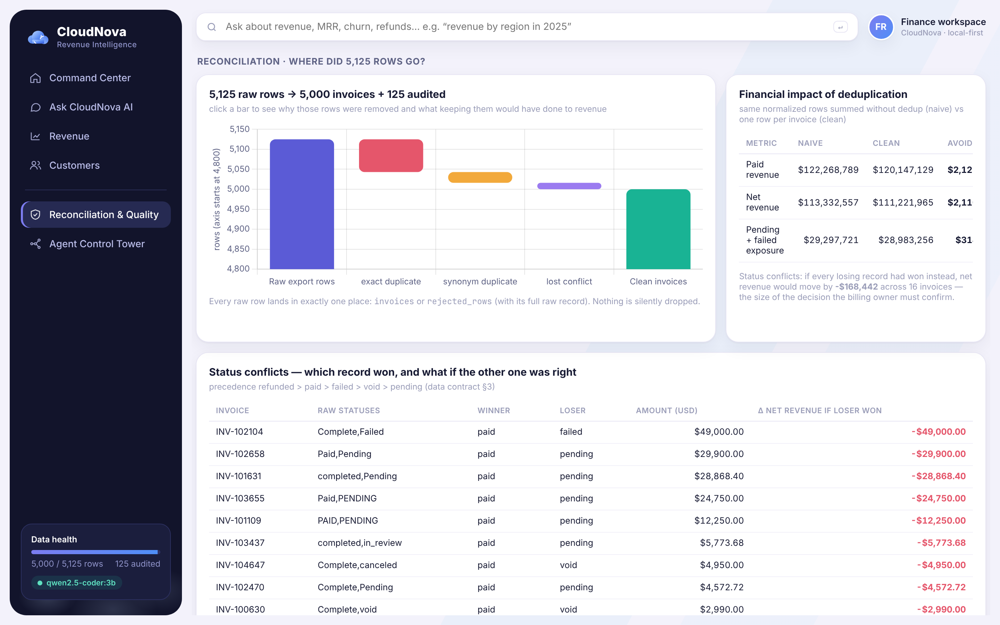</td>
<td>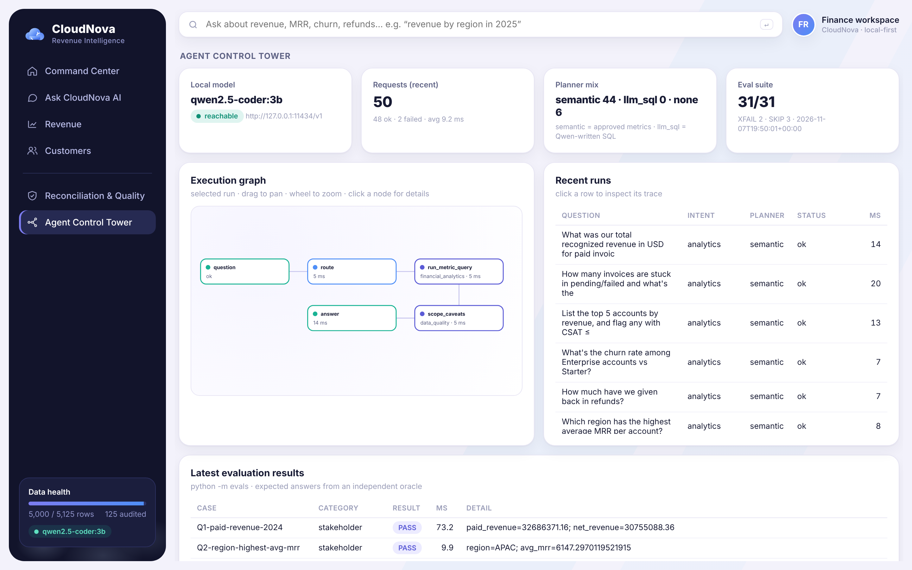</td>
</tr></table>

Architecture (every box is a real module): [`docs/architecture.md`](docs/architecture.md).

---

## 3. The six stakeholder questions — verified

Expected values come from the independent oracle; all six match to the cent.

| # | Question | Answer (`python -m app demo`) | Oracle | SQL (abridged) |
|---|---|---|---|---|
| 1 | Recognized revenue in USD for **paid** invoices in 2024 | **$32,686,371.16** (net of 2024 refunds: $30,755,088.36) | ✓ | `SUM(amount_usd) FILTER (WHERE status='paid') … WHERE invoice_year = 2024` |
| 2 | Region with highest average MRR per account | **APAC, $6,147.30** (NA 5,632.84 · EMEA 5,327.66 · LATAM 5,187.55; active accounts) | ✓ | `AVG(current_mrr_usd) FILTER (WHERE is_active) FROM accounts GROUP BY region` |
| 3 | How much given back in refunds | **$8,925,163.80** across 292 refunded invoices | ✓ | `SUM(amount_usd) FILTER (WHERE status='refunded')` |
| 4 | Churn rate, Enterprise vs Starter | **Enterprise 21.92%** (171/780) vs **Starter 18.81%** (354/1,882) | ✓ | `AVG(churned) … FROM accounts WHERE plan IN ('Enterprise','Starter') GROUP BY plan` |
| 5 | Top 5 accounts by revenue, flag CSAT ≤ 2 | Stark Inc ACC-7509 $1,210,592.75 · Tyrell Industries ACC-1420 $1,208,092.75 (CSAT blank → "unknown") · Initech LLC ACC-9946 · Pied Piper Partners ACC-1196 · Oscorp Industries ACC-5211 — **none has CSAT ≤ 2** | ✓ | `… JOIN accounts a … GROUP BY i.account_id ORDER BY net_revenue DESC LIMIT 5` |
| 6 | Invoices stuck in pending/failed and $ exposed | **894 invoices, $28,983,255.91** (pending 498 / $15.83M · failed 396 / $13.16M) | ✓ | `COUNT(*), SUM(amount_usd) FILTER (WHERE status IN ('pending','failed'))` |

**Where we may be wrong (and say so):** Q1 depends on the FX open question (−$3.09M if the inverse rule is right).
Q5 changes if "account" means company name. Q2/Q4 depend on the latest-invoice snapshot (980 of 3,815 accounts have
conflicting attributes across invoices).

## 4. Evaluation

```text
python -m evals --llm      (2026-11-07, local qwen2.5-coder:3b on 4 CPU threads)
PASS=33  FAIL=0  XFAIL=3  XPASS=0  SKIP=0
```
6 stakeholder · 10 open-ended · 4 multi-turn · 2 data-quality · 8 governance · 1 boundary · 2 local-Qwen ·
**3 documented expected failures:**
1. *"Top 5 customers by revenue"* — if "customer" = company name, the top 5 differs. Needs CloudNova's decision.
2. *Q1 under the inverse FX rule* — flips to XPASS once `FX_DIRECTION=inverse` is confirmed.
3. *Qwen text-to-SQL, "support tickets churned vs active"* — valid-but-wrong SQL. The guard checks safety, not meaning.

Without Qwen (the CI default): `PASS=31 FAIL=0 XFAIL=2 SKIP=3`. Unit tests: **114 passed**.

## 5. Production instincts
* Read-only by construction (guard + DB-level), 20 attack queries tested.
* Structured errors `{code, message, retryable}`, versioned API `/api/v1/*`, config via env, no secrets, pinned deps.
* Idempotent build keyed on the raw file's sha256; health/readiness checks; graceful SIGINT/SIGTERM.
* Every request's trace persisted and shown in the Agent Control Tower.
* Integration seam: [`app/sources/`](app/sources/) adapters emit the raw contract — see
  [`docs/INTEGRATION_ARCHITECTURE.md`](docs/INTEGRATION_ARCHITECTURE.md).

## 6. Design decisions & trade-offs

| Decision | Why | Cost |
|---|---|---|
| Track B over RAG | aggregation questions need SQL, not retrieval | no free-text search (there's no free text in the data) |
| Hand-rolled semantic layer instead of LangChain/dbt metrics | auditable, testable, zero deps; measured 6/6 | phrasing outside the catalog falls back to Qwen |
| pandas for cleaning, DuckDB for serving | rule functions are easy to unit-test; DuckDB gives typed, read-only SQL | would move to SQL/dbt at scale |
| Conflict precedence instead of "drop both" | keeps revenue complete and shows $ at stake | a rule the billing owner must confirm |
| Static dashboard (vanilla JS + vendored Chart.js) | no Node toolchain for reviewers | less component reuse than the React apps |
| Copy-and-adapt from FloPilot/ConvoLens | those packages depend on their own DB/auth/settings | small duplicated helpers, each with a source header |
| Isolation Forest **not** shipped | the deterministic pricing check finds **0** violations; a model would mostly flag big Enterprise invoices | see `docs/ROADMAP.md` on the enhancements branch |

Reuse: [`docs/REUSE_MATRIX.md`](docs/REUSE_MATRIX.md) · Requirement evidence: [`docs/REQUIREMENTS_TRACEABILITY.md`](docs/REQUIREMENTS_TRACEABILITY.md).

## 7. Startup verification
Run from a clean shell (`env -i … python -m app`), 2026-11-07:

| Scenario | Result |
|---|---|
| Fresh clone, Qwen already running | data built in 0.6 s · Q1–Q6 ✓ · Qwen check 582 ms · **READY in 2.0 s** · Ctrl+C → stopped cleanly |
| Data present, Qwen down | data **reused** · deterministic mode · **READY in 0.8 s** · analytics ✓, chat → `llm_unavailable` |
| Qwen down, `LLM_START_CMD` set | Qwen started in 3.0 s · **READY in 4.5 s** · SIGTERM stops the Qwen it started |
| Port in use | exit code 2 with a clear message |

Qwen-backed answers take 5–30 s on 4 CPU threads; approved-metric answers take < 100 ms.

## 8. Known limitations & failure modes
See [`docs/LIMITATIONS.md`](docs/LIMITATIONS.md). Headlines: FX direction unresolved; "account" identity ambiguous;
churn is a snapshot flag (no dates → no period churn rate, no "why"); 111 future-dated invoices included and flagged;
the keyword planner is literal; Qwen-3B writes plausible-but-wrong SQL and occasionally wrong definitions.

## 9. What I'd do with another day
1. Get CloudNova's two decisions (FX direction, account identity) and flip the expected failures.
2. Qwen → *QueryPlan JSON* constrained to the catalog, instead of keyword routing; re-run the evals.
3. Add `support_tickets`, tenure and cohort metrics (the most common Qwen fallbacks).
4. Move cleaning to SQL/dbt models with the same tests.
5. Re-measure with a larger local model via `python -m evals.compare_modes`.

## 10. How AI was used
Claude Code built this from the specs, steered by [`CLAUDE.md`](CLAUDE.md). The session log — prompts, decisions and
the places the AI was wrong and corrected — is in [`.claude/prompt-history.md`](.claude/prompt-history.md).
Demo walkthrough: [`docs/DEMO_SCRIPT.md`](docs/DEMO_SCRIPT.md).

<details>
<summary><b>Repository map</b></summary>

```
cloudnova/
  app/            pipeline/ (rules, clean, build) · semantic/ (catalog, planner) · agent/ (supervisor, tools, harness,
                  memory, render) · governance/ (sql_guard, guards) · llm/ (Qwen provider) · sources/ (adapters)
                  reconciliation.py · api.py · startup.py · __main__.py · web/static (dashboard)
  specs/          five specs (written before code)
  evals/          oracle.py · cases.yaml · __main__.py · compare_modes.py · results/
  tests/          unit tests
  docs/           architecture · traceability · reuse matrix · limitations · integration · demo script · media/
  data/raw/       the CSV + BUSINESS_CONTEXT.md (inputs, unchanged)
  .claude/        prompt-history.md (AI development log)
```
</details>

**Enhancements** (separate branch `claude/great-hamilton-8s8wk9-enhancements`): Revenue Leakage Investigator,
what-if simulator, simulated legacy-billing integration — see `docs/enhancements/README.md` on that branch.
