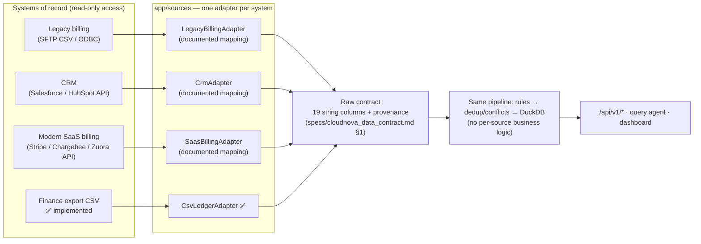

# Integration architecture — how other systems feed the same pipeline

CloudNova's export is stitched from **three systems** (old billing tool, CRM, finance spreadsheet). The pipeline is
built so that replacing the stitched CSV with direct, read-only feeds does not touch the business logic.

## The contract every adapter must meet (`app/sources/base.py`)
* `extract() -> Extract(rows: DataFrame[19 raw-contract columns, all strings], provenance: dict)`.
* **Strings only, nothing coerced** — parsing and normalization happen once, in `app/pipeline/rules.py`, so all
  sources get identical treatment and the same tests.
* Provenance (`adapter`, `system_type`, file/endpoint, sha256 or cursor, row count) is stored in the build manifest
  and exposed at `GET /api/v1/sources`.
* Read-only credentials; adapters never write back to a source.

**Implemented and tested:** `CsvLedgerAdapter` (`tests/test_reconciliation_api.py` checks contract enforcement on a
malformed file). The three other adapters below are **mappings, not shipped code**.

## Field mappings (design, not implemented)
| Raw contract column | Legacy billing (CSV/ODBC) | CRM (Salesforce) | SaaS billing (Stripe) |
|---|---|---|---|
| invoice_id | `INV_NO` | — | `invoice.id` |
| account_id / account_name | `CUST_ID` / `CUST_NAME` | `Account.Id` / `Account.Name` | `customer.id` / `customer.name` |
| region / industry | — | `Account.Region__c` / `Account.Industry` | `customer.address.country` → region map |
| plan / billing_cycle / seats | `PLAN_CODE` / `CYCLE` / `QTY` | `Opportunity.Product` | `subscription.items.price.nickname` / `.recurring.interval` / `.quantity` |
| currency / amount / discount_pct | `CCY` / `AMT` / `DISC` | — | `invoice.currency` / `invoice.total` (minor units ÷ 100) / `discount.coupon.percent_off` |
| status | `STATUS` (codes) | — | `invoice.status` (`paid`/`open`/`void`/`uncollectible`) + refunds from `charge.refunded` |
| invoice_date / signup_date | `INV_DT` / — | `Account.CreatedDate` | `invoice.created` (epoch) / `customer.created` |
| churned / csat_score / support_tickets | — | `Account.Churned__c` / survey object / Case count | `subscription.status = canceled` |

New status vocabularies (e.g. Stripe `uncollectible`) are added to the **status map in the spec first**, then
`rules.py`, then a test — unknown values are quarantined, never defaulted.

## Cross-system conflicts
When two adapters report the same `invoice_id`, the existing dedup stage applies unchanged: synonym duplicates
collapse; real conflicts follow the documented precedence and land in `dedup_conflicts` with dollars at stake.
With direct feeds, `source_system` would be added to the raw contract so the precedence can become
"system of record wins" (e.g. billing over CRM for status) — a change to spec §3 first.
