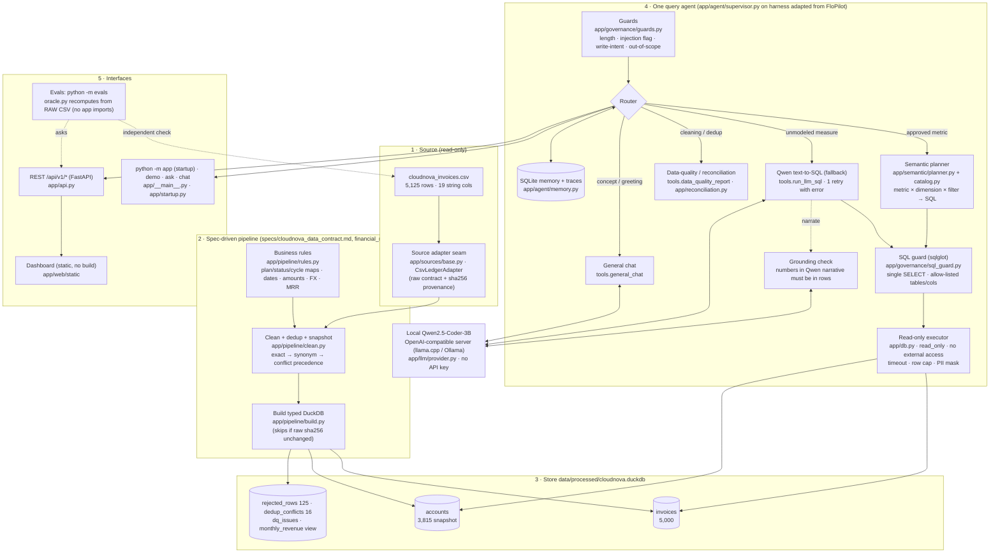

# Architecture — CloudNova Revenue Intelligence Copilot (Track B)

Every box below is a real module; the path is in the label. Data flows top to bottom: raw input → processing →
store → query/answer.

## Answer contract
Every analytics answer carries: natural-language answer (numbers formatted from result rows), the **exact SQL
executed**, metric definitions, filters, result rows, caveats (dedup conflicts, ambiguous dates, FX question in scope),
chart spec, and a step trace. See `specs/query_interface.md`.

## Why this shape
* **Deterministic first, LLM second.** Financial numbers come from approved SQL metrics; Qwen handles what the
  catalog cannot express and general conversation. Measured: hybrid 6/6 vs Qwen-only 2/6 on the stakeholder
  questions (`evals/results/mode_comparison.md`).
* **One store, read-only.** The chat path cannot write: DuckDB is opened `read_only` with external access disabled
  and the configuration locked, *and* every statement is parsed and allow-listed before it runs.
* **Audit tables, not deletes.** Every raw row is in `invoices` or `rejected_rows`; the reconciliation view is
  computed from them.

## Enhancement branch additions
`app/enhancements/leakage.py` and `simulator.py` read the same DuckDB tables through the same read-only connection;
`app/sources/legacy_billing.py` feeds the same `pipeline.clean()` in memory. Diagrams: `docs/enhancements/README.md`.
