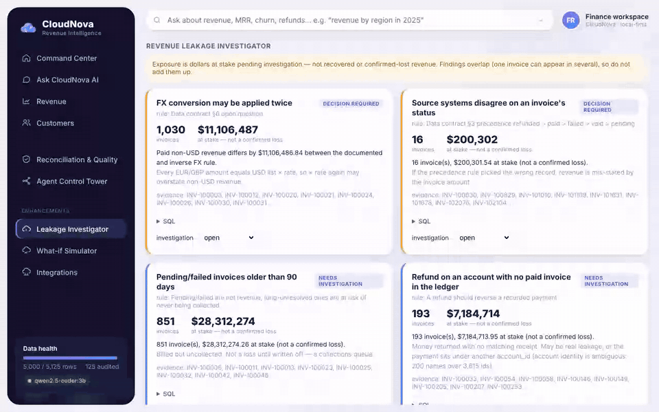
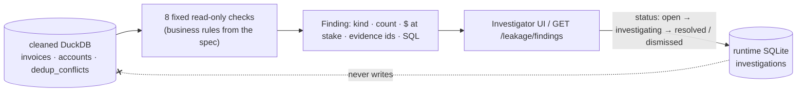
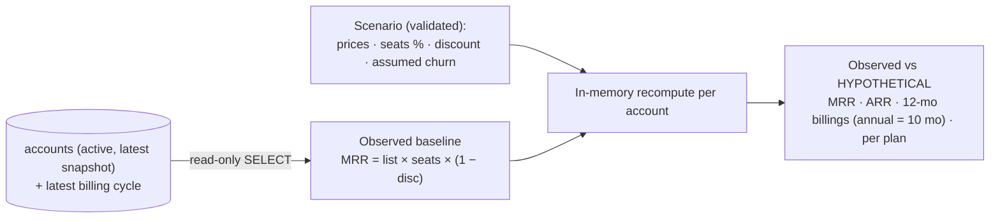
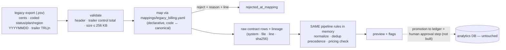

# Enhancements (branch `claude/great-hamilton-8s8wk9-enhancements`)

Built **after** the Track B submission was verified and pushed on `claude/great-hamilton-8s8wk9`. They reuse the
same pipeline, DuckDB tables, business rules, governance and harness; the core eval suite is unchanged and still
passes on this branch (see bottom). One query agent; no new LLM paths.



| # | Enhancement | Code | API | Dashboard | Tests |
|---|---|---|---|---|---|
| 1 | Revenue Leakage Investigator | `app/enhancements/leakage.py` | `GET /api/v1/leakage/findings` · `PATCH /api/v1/leakage/findings/{id}` | Leakage Investigator | `tests/test_enhancements.py` (4) |
| 2 | Financial Digital Twin — what-if simulator | `app/enhancements/simulator.py` | `POST /api/v1/simulator/scenarios` | What-if Simulator | `tests/test_enhancements.py` (5 + 5 validation cases) |
| 3 | Enterprise integration — simulated legacy billing | `app/sources/legacy_billing.py`, `mappings/legacy_billing.yaml`, `data/samples/legacy_billing_export.psv` | `POST /api/v1/integrations/legacy-billing/preview` | Integrations | `tests/test_enhancements.py` (3) |

---

## 1. Revenue Leakage Investigator

**Business use case.** A finance lead asks: "Where could we be leaking or mis-stating revenue, how much is at stake,
and who is looking at it?" Today that is a quarter-end spreadsheet exercise.



**What it finds on CloudNova's data (actual run):**

| Finding | Kind | Invoices | $ at stake |
|---|---|---|---|
| FX may be applied twice (non-USD paid) | decision required | 1,030 | $11,106,486.84 |
| Source systems disagree on status | decision required | 16 | $200,301.54 |
| Pending/failed older than 90 days | needs investigation | 851 | $28,312,274.26 |
| Refund on an account with no paid invoice | needs investigation | 193 | $7,184,713.95 |
| Paid invoices dated after today | needs investigation | 74 | $2,420,362.79 |
| Refund dated before the account's first payment | needs investigation | 36 | $1,130,634.91 |
| Discounts above policy | **needs policy** (brief gives none) | — | — |
| Price-book discrepancy | **control passed** | 0 | $0 |

**Guard-rails on language.** "At stake", never "lost" or "recovered". Findings overlap, so they are never summed.
Statistical anomalies are not presented as losses (no anomaly model is shipped). A discount check returns
`needs_policy` until `DISCOUNT_POLICY_MAX_PCT` is set; with it, it becomes a deterministic rule.

**Demo (60 s).** Open *Leakage Investigator* → "Price book: control passed — every invoice matches list × seats ×
months × discount" → "193 refunds with no recorded payment, $7.18M at stake — likely the account-identity split, not
fraud; here are the invoice ids and the SQL" → set it to *investigating* → show the ledger fingerprint is unchanged
(tested).

---

## 2. Financial Digital Twin — what-if simulator

**Business use case.** "What happens to MRR, ARR and next-12-month billings if we raise Pro to $109, add 5% seats,
and assume 8% churn?" — answered from the observed customer base, not a spreadsheet copy.



* Baseline reconciles exactly to the core `mrr` metric ($17,045,461.40) — a no-op scenario has Δ = 0 (tested).
* Example (actual): Pro $99 → $109 → MRR **+$443,137.00** (hypothetical); 10% assumed churn → MRR −$1,704,546.14.
* Not modelled (stated in every response): price elasticity, upgrades/downgrades, new logos, timing, FX.
* Validation: unknown plans, discount ≥ 100%, seats < −100%, churn > 100% → structured 422.

**Demo (45 s).** Move the Pro price slider → the table and chart show observed vs hypothetical; point at the banner
"Hypothetical … never changes the ledger"; move churn to 10% → MRR scales by exactly 0.9.

---

## 3. Enterprise integration — simulated legacy billing system

**Business use case.** CloudNova's export is stitched from an old billing tool. A direct feed must prove, before it
touches any number: the mapping, the rejects and why, and where every row came from.



**Actual result on the bundled sample (12 rows):** control total ✓ · 9 mapped · 3 rejected with reasons (unknown
status code `ZZ`, amount `N/A`, date `20241341`) · 1 rejected by the ledger's own dedup precedence (LB-9010 paid vs
pending) · the planted 10× over-billing (LB-9006: $25,000 billed vs $2,990 list) flagged `pricing_violation` · one
`_at_` email repaired. Errors: missing columns → `schema_mismatch`; trailer mismatch → `control_total_mismatch`;
oversize → `payload_too_large`.

**Simulated, not production:** the source system and its file are fabricated for the demo and labelled so in the
code, UI and docs. No external system is called.

**Demo (45 s).** Open *Integrations* → pipeline strip (12 → 9 mapped → 8 clean) → rejected-with-reasons table →
LB-9006 flagged → lineage column → "ledger: not written".

---

## Verification on this branch (2026-11-07)

```
python -m pytest          → 130 passed
python -m evals           → PASS=31 FAIL=0 XFAIL=2 XPASS=0 SKIP=3   (core Track B suite unchanged)
```
