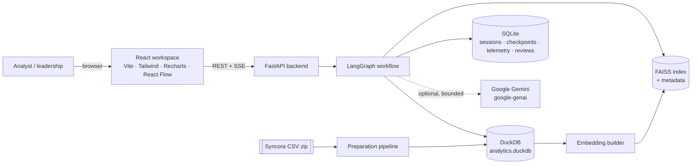
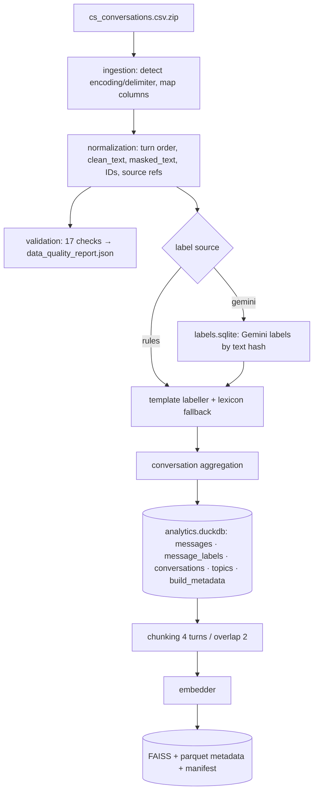
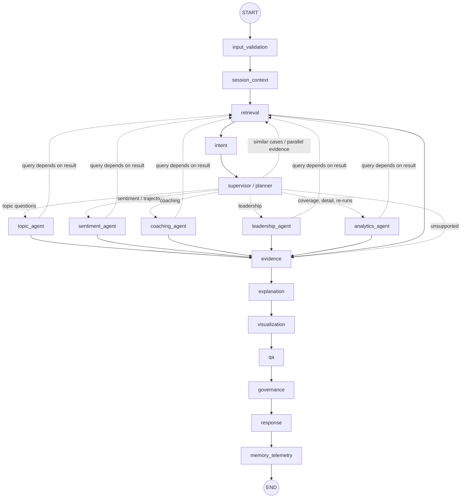
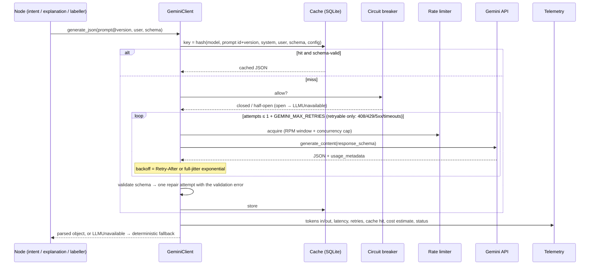
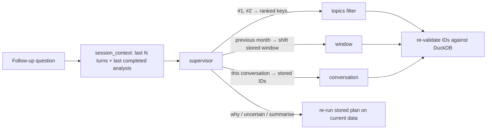
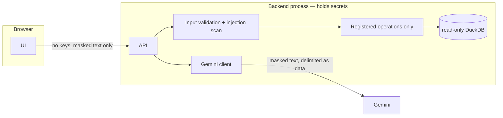

# Architecture

**Analyst question → LangGraph supervisor → registered deterministic analytics (+ retrieval) → evidence → grounded explanation → validated charts → QA + governance → response → memory + telemetry.**

The design rule that shapes everything: *numbers are computed, never generated.* The model may interpret questions and phrase answers; every count, rate, rank and chart value comes from a registered DuckDB operation, and a QA gate checks the final answer against those results.

## 1. System context



## 2. Components

| Layer | Modules | Responsibility |
|---|---|---|
| Data | `app/data/{ingestion,normalization,validation,pipeline}.py` | Schema discovery and mapping, filler removal, PII masking, quality report, atomic DuckDB build, manifests |
| Labelling | `app/labeling/{taxonomy,rules,store,gemini_labeler}.py` | Versioned taxonomy; deterministic labeller; resumable Gemini labelling with a content-hash cache |
| Analytics | `app/analytics/*` | Registered operations (`query_registry.py`): topics, sentiment, trend, trajectory, coaching, leadership priorities, resolution quality, coverage; Wilson intervals, chi-square, two-proportion tests |
| LLM | `app/llm/*`, `app/prompts/*` | Gemini adapter: structured output, bounded repair, rate limiter, retries with jitter and Retry-After, circuit breaker, cache, token/cost accounting; versioned prompt registry |
| Retrieval | `app/retrieval/*` | Conversation-aware chunking, embedder adapter (MiniLM → LSA fallback), FAISS with metadata filters, evidence assembly |
| Agents | `app/agents/*` | LangGraph graph, typed state, supervisor/planner, specialists, explanation, QA, governance, tracing |
| Memory | `app/memory/store.py` | Session turns with deterministic references; retention and clear |
| Visualisation | `app/visualization/*` | Declarative, validated chart and graph contracts |
| Governance | `app/governance/*` | PII, prompt-injection heuristics, blind human review |
| Observability | `app/observability/store.py` | Requests, node events, LLM calls, audit and UI events |
| API | `app/api/*`, `app/main.py`, `app/startup.py` | REST + SSE, dashboards, startup validation |
| Frontend | `frontend/src/*` | Chat-first workspace, nine pages, chart renderer, evidence drawers, agent harness |

## 3. Data flow



## 4. Agent orchestration



* **Conditional routing.** The supervisor picks exactly one specialist (or none) and a retrieval mode: `none`, `parallel` (query known up front, e.g. coaching evidence — runs in the same LangGraph superstep as the specialist), `after_analysis` (query depends on the result, e.g. examples for the top concern) or `only` (similar-case search). Unused nodes are recorded as *skipped*.
* **Execution limits.** ≤ 4 registered operations per request, retrieval k ≤ 10, 5,000-row result cap, 90 s request budget (the explanation node drops to the deterministic narrative if 60% of it is used), per-call model timeouts.
* **Failure handling.** Each node is wrapped by `agents/tracing.py`: a non-critical failure is recorded and the run continues (e.g. a corrupt index leaves the answer without retrieved evidence and says so); input validation is critical and returns a non-retryable error. A client disconnect cancels the run at the next node boundary and is recorded as *cancelled*.
* **Typed state** (`agents/state.py`): request/session IDs, question, history, resolved intent, plan, scope, tool results, retrieved evidence, evidence, facts, explanation, charts, graphs, recommendations, uncertainty, governance findings, QA, trace (reducer), errors (reducer), final response.
* **Checkpointing.** LangGraph `SqliteSaver`; each request runs on its own thread (`thread_id = request_id`) so every intermediate state is persisted for replay and audit. Cross-turn memory lives in the session store (§7).

### Agent responsibilities

| Node | Does | Never does |
|---|---|---|
| router | Zero-LLM decision: does this question need a model at all (AUTO / ANALYTICS ONLY / HYBRID AI) | Call a model |
| intent | Confidence-aware routing: policy → high-precision rules → calibrated semantic match → vague-question guard → model (category only, constrained JSON) → weak rules → clarify; entities always from deterministic extractors ([INTENT_ROUTING.md](docs/evaluation/INTENT_ROUTING.md)) | Produce numbers or SQL; invent a confidence score |
| supervisor | Resolve follow-up references and date window, authorise dataset mode, validate IDs, choose operations / specialist / retrieval mode | Compute results |
| specialists | Run registered operations with validated arguments; resolve dependencies (e.g. compare the top two topics when none named) | Free-form SQL |
| retrieval | Filtered FAISS search, one passage per conversation, optional lexical rerank | Treat similarity as confidence |
| evidence | Resolve IDs to source messages with CSV line references; drop and report invalid or out-of-scope IDs | — |
| explanation | Deterministic narrative always; Gemini narrative if available, **rejected if it contains any number not in the verified facts** | Add statistics |
| visualization | Choose charts from result shape; copy data from tables into validated `ChartSpec`s | Generate code |
| qa | Registered ops, filters applied, denominators, ranking order, proportions, chart-to-table consistency, evidence validity, numeric grounding, uncertainty, coaching sample-size gate | — |
| governance | PII re-check, injection flags, coaching safeguard, human-review flag, tool-safety and dataset-authorisation records, audit | — |

## 5. Model request lifecycle



Auth/permission errors (401/403/`API_KEY_SERVICE_BLOCKED`) are permanent: no retry, circuit opens immediately. Streamed responses carry **cumulative** usage on each chunk, so usage is the per-field maximum, not the sum (`llm/usage.py`, tested).

## 6. Retrieval

* Chunks: 4-turn windows, overlap 2, speaker-labelled, opening complaint prefixed; 18,639 chunks for the original data.
* Embeddings: `EMBEDDING_BACKEND=auto` tries `sentence-transformers/all-MiniLM-L6-v2`; on failure uses LSA (TF-IDF 1–2-grams + 192-dim SVD), recording the reason in the manifest. `IndexIDMap2(IndexFlatIP)` over L2-normalised vectors = exact cosine search.
* Search: metadata pre-filter (dataset mode, window, topics, products, sentiments, agents, IDs) via `IDSelectorBatch` → top candidates → optional rerank `0.85·cosine + 0.15·token overlap` → one passage per conversation → evidence with message IDs and turn ranges.
* Triggers: similar-case questions, coaching evidence (parallel), leadership/negative-topic examples (after analysis), explicit evidence requests. Pure aggregations skip retrieval.

## 7. Memory



Stored per turn: question, resolved intent, scope (window, filters, mode), plan (operations + window spec) and **references** (ranked keys/names/dimension, conversation IDs). Not stored as truth: model prose. Retention: sessions older than `SESSION_RETENTION_DAYS` are purged at startup; `DELETE /api/sessions/{id}` clears one. Sessions are isolated by ID.

## 8. Security boundaries



Details in [SECURITY.md](SECURITY.md).

## 9. Deployment

* Local: `make install prepare index dev` (API :8000, UI :5173 with proxy).
* Docker Compose: `backend` (Python 3.13 slim, uv-locked dependencies; prepares data and index on first start into named volumes; health-checked) and `frontend` (static build served by nginx, `/api` proxied with buffering off for SSE) on :8080. *Note: the images could not be built in the development sandbox because Docker Hub and the ECR mirror rate-limited anonymous pulls (HTTP 429); the Dockerfiles are therefore not verified end to end.*

## 10. The four assignment workflows

```mermaid
sequenceDiagram
  autonumber
  participant U as Analyst
  participant S as Supervisor
  participant A as Specialist
  participant R as Retrieval
  participant E as Evidence/Explain/QA
  Note over U,E: Q1 "top 5 negative topics last month"
  U->>S: question
  S->>S: intent negative_topics; window = latest month in data (Nov 2025)
  S->>A: topic_agent: rank_negative_topics, sentiment_distribution(by topic), sentiment_trend
  A->>E: counts, rates, Wilson CIs, chi-square, representative IDs
  E-->>U: ranked answer + count-vs-rate caveat + charts + evidence
  Note over U,E: Q2 "agents who may need empathy coaching"
  U->>S: question
  S->>A: coaching_agent: agent_coaching_review (min 3 conversations)
  S->>R: parallel: negative-sentiment passages
  A->>E: sample-size gate → conversation review queue + workforce patterns
  E-->>U: decision-support answer, heatmap, evidence, human-review flag
  Note over U,E: Q3 "sentiment over a selected conversation"
  U->>S: question (+ selected ID, or ID in text, or from memory)
  S->>A: sentiment_agent: sentiment_trajectory(ID) — or suggestions if none
  A->>E: per-turn scores, turning points with preceding agent turn
  E-->>U: trajectory chart + annotated transcript
  Note over U,E: Q4 "recurring concerns leadership should review first"
  U->>S: question
  S->>A: leadership_agent: leadership_priorities, sentiment_trend, resolution_quality
  A->>R: after analysis: passages for the #1 concern
  A->>E: scores, contributions, sensitivity, recommendations with owners
  E-->>U: priority matrix, drivers, actions, uncertainty, human-review flag
```

## 11. Trade-offs

| Choice | Why | Cost |
|---|---|---|
| LangGraph over a single prompt or free agent loop | Explicit, testable routing; real parallel branches; checkpointing; every node observable | More code than one prompt |
| Registered operations instead of text-to-SQL | No fabricated or unsafe queries; exact, testable numbers | New question types need a new operation |
| Deterministic labeller as default | The data is templated (426 unique texts), so rules are exact, free and reproducible; Gemini was unavailable during development | The mapping is a developer judgement; validated only by agreement checks and (optionally) human review |
| Rules first, model only when needed | 90.4% held-out with no model, 95.9% with the local model, model called for 6.9% of questions | Rules are hand-written by the benchmark's author; a semantic stage was built but calibration left it off (precision below 95%) |
| MiniLM embeddings with LSA fallback | MiniLM: topic P@5 62% on paraphrases; LSA keeps retrieval working fully offline | MiniLM needs a model download and is slower (≈35 ms vs 20 ms); LSA is weak on paraphrases (37%) |
| DuckDB + SQLite + FAISS in-process | Zero infrastructure, reproducible | Single-node; see production notes in README |
