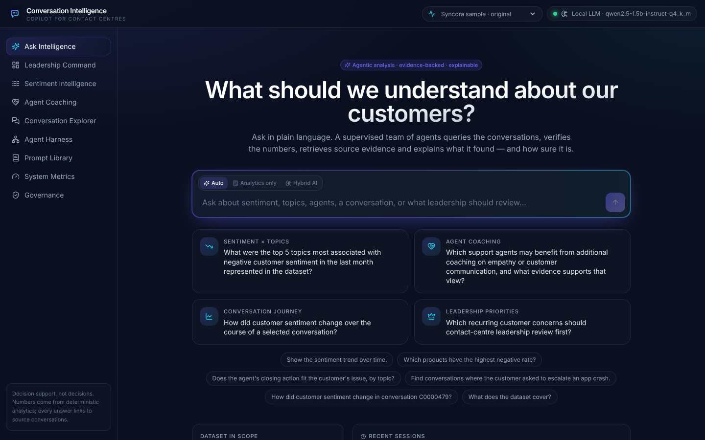
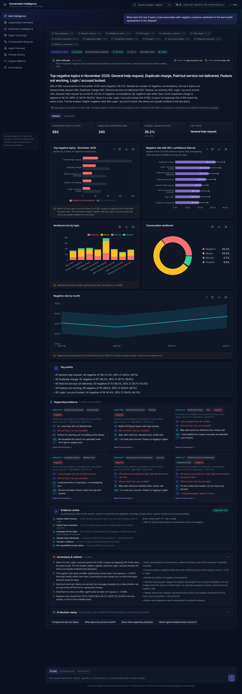
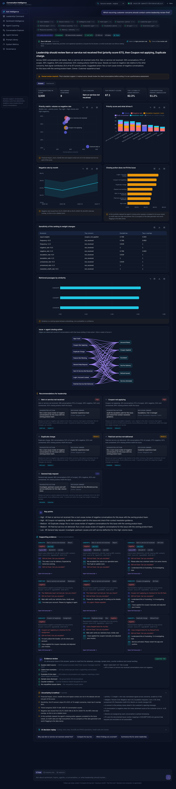
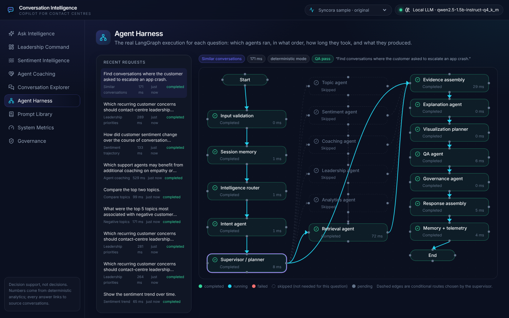
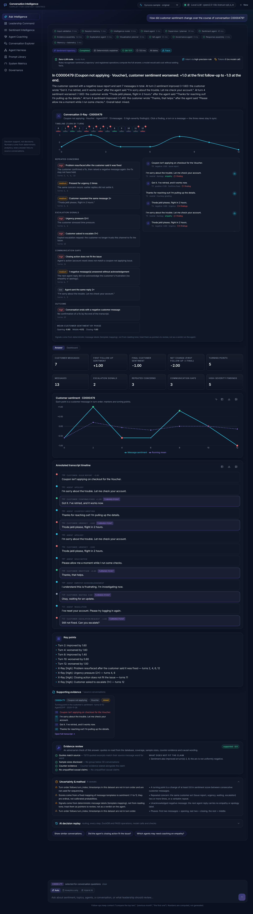
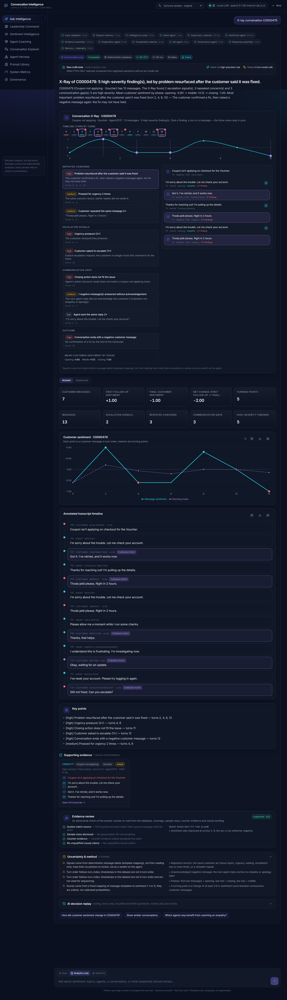
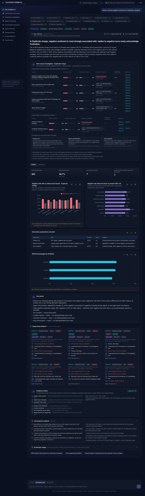
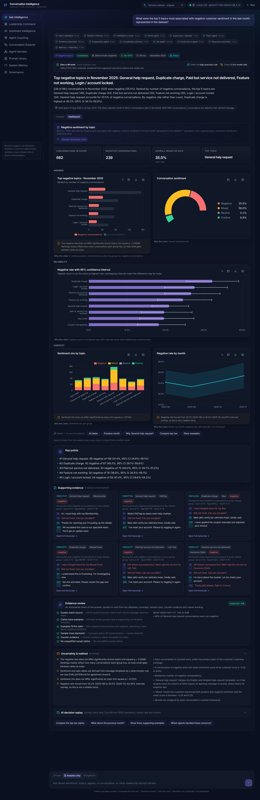
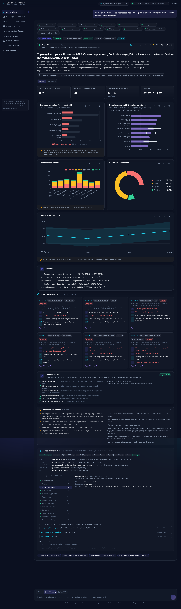

# Conversation Intelligence Copilot

**An agentic decision-intelligence workspace for contact-centre analysts and leadership.** Ask a question in plain language; a LangGraph supervisor routes it to specialist agents that run deterministic analytics over the customer-support conversations, retrieve source evidence, explain the result (with Gemini when available), choose charts, verify the answer and record how it was produced.

> *Ask a question. Understand the evidence. Explore the visualisations. Make a decision.*



| Q1 · negative topics | Q4 · leadership priorities |
|---|---|
|  |  |
| **Agent Harness (real execution trace)** | **Q3 · sentiment trajectory** |
|  |  |

|  |  |
|---|---|
|  |  |

More screenshots: [`docs/screenshots/`](docs/screenshots) (coaching, memory follow-ups, retrieval, explorer, dashboards, prompt library, metrics, governance, drilldown, mobile).

## What it does

* **The four assignment questions**, end to end: top-5 negative topics in the last month *represented in the data*; agents who may benefit from empathy/communication coaching (with a sample-size gate and evidence); a selected conversation's sentiment trajectory; the recurring concerns leadership should review first (transparent priority score, sensitivity analysis, owners).
* **General analytical Q&A** over 15 registered operations (distribution, trend, frequency, comparisons, resolution fit, conversation lists and detail, agent profile, coverage), plus follow-ups ("compare the top two", "previous month", "the first one", "why was this ranked first?", "which findings are uncertain?", "summarise for leadership") — and honest refusals for what the data cannot answer.
* **All three bonus extensions**: knowledge retrieval (FAISS), a specialised LLM classification agent (resumable Gemini labelling), and session memory.
* **Six analytical enhancements** ([docs/ENHANCEMENTS.md](docs/ENHANCEMENTS.md)):
  * a Zero-LLM Intelligence Router (AUTO / ANALYTICS ONLY / HYBRID AI, with honest token reporting);
  * query-driven dashboards;
  * Conversation X-Ray with a synchronised timeline and transcript;
  * a Root Cause Investigator (associations, symptoms vs drivers, alternative explanations);
  * AI Decision Replay;
  * an Analytical Evidence Challenger.
* **Hybrid retrieval**: MiniLM and LSA, fused by weighted reciprocal rank fusion. The UI shows each method's rank.
* **Enterprise layer**: nine-page UI, validated dynamic charts with drilldown/export, Agent Harness, prompt library, system metrics, governance with blind human review, audit trail, dataset modes.

## How it works

```
Analyst question
  → input validation → session memory → Zero-LLM router → intent (policy → rules → semantic → model → clarify)
  → supervisor/planner (resolve references, date window, registered operations)
  → specialist agent (topic | sentiment | coaching | leadership | analytics)  ‖  retrieval (FAISS)
  → evidence assembly → explanation (Gemini, numeric-grounding check | deterministic)
  → visualisation planner → QA agent → governance agent → response → memory + telemetry
```

Numbers are **computed, never generated**: counts, rates, ranks and chart data come from registered DuckDB operations; the QA agent rejects answers whose numbers are not in the verified results. Full design: [ARCHITECTURE.md](ARCHITECTURE.md).

## Quick start

Prerequisites: Python 3.12+ with [uv](https://docs.astral.sh/uv/), Node 22+.

```bash
cd conversation-intelligence-copilot
cp .env.example .env          # nothing is required; see "Models" below for optional LLMs
make install                  # uv sync --extra transformers (MiniLM embeddings) + npm ci
make prepare                  # raw zip → data/processed/analytics.duckdb (≈30 s)
make index                    # FAISS index: MiniLM + LSA (≈2–3 min on CPU; downloads MiniLM from Hugging Face once)
make dev                      # API :8000 + UI :5173
```

Open http://localhost:5173. API docs: http://localhost:8000/docs.

This runs fully without any API key: every number comes from DuckDB, and the explanation is deterministic.

**Optional: a language model** (used only for questions that need interpretation; see the Zero-LLM router). Choose one:

* **Free local model, no key:** `make install-local-llm && make llm-download`. This installs `llama-cpp-python` (builds from source if no wheel exists for your platform: needs a C/C++ toolchain and CMake) and downloads Qwen2.5-1.5B-Instruct Q4_K_M (≈1.1 GB) into `data/models/`. It runs on CPU: first call ≈ 9 s, then ≈ 1 s per routing call; a model-written explanation takes tens of seconds.
* **Groq** (hosted, free tier available): set `GROQ_API_KEY` in `.env`.
* **Gemini**: set `GEMINI_API_KEY` in `.env` (`GEMINI_USE_VERTEX=true` for Vertex AI express keys).

With `LLM_PROVIDER=auto` (default) the first available is used, in this order: Groq key → Gemini key → downloaded local model → no model.

Docker: `docker compose up --build` → UI on http://localhost:8080 (the backend prepares data and the index on first start). *The images were written but could not be built in the development sandbox (Docker Hub / ECR anonymous-pull rate limits), so they are not verified end to end.*

### Commands

| Command | What it does |
|---|---|
| `make install-local-llm`, `make llm-download` | Optional: install llama.cpp bindings, then download the free local LLM (≈1.1 GB) |
| `make prepare` | Ingest, validate, label, build DuckDB + manifests |
| `make index` | Build the retrieval index |
| `make label` | Optional: label unique messages with Gemini (resumable); then `LABEL_SOURCE=gemini make prepare` |
| `make synthetic` | Optional: generate 120 tagged synthetic demo conversations (then `ENABLE_SYNTHETIC_DEMO=true make prepare index`; a default build contains only the supplied 3,000) |
| `make test` | Backend pytest (138) + frontend typecheck and Vitest (8) |
| `make e2e` | Playwright end-to-end (17) — starts the servers if needed |
| `make evaluate` | Evaluation on the real data → `docs/evaluation/EVALUATION_RESULTS.md` |
| `make screenshots` | Re-capture `docs/screenshots` from a running app |
| `make report` | Generate the submission DOCX and the engineering PDF |

## Configuration

All settings are environment variables (see [`.env.example`](.env.example)); nothing secret is hardcoded.

| Variable | Default | Purpose |
|---|---|---|
| `LLM_PROVIDER` | `auto` | `auto` (Groq key → Gemini key → local model → none), `groq`, `gemini`, `local`, or `none` (deterministic only) |
| `GROQ_API_KEY` | — | Enables Groq (OpenAI-compatible API). Optional. |
| `GROQ_MODEL`, `GROQ_BASE_URL` | `llama-3.3-70b-versatile`, `https://api.groq.com/openai/v1` | Groq model and endpoint |
| `GROQ_INPUT_COST_PER_MTOK`, `GROQ_OUTPUT_COST_PER_MTOK` | 0.59, 0.79 | Cost *estimates* (USD per 1M tokens, paid-tier list price; the free tier costs nothing) |
| `LOCAL_MODEL_REPO`, `LOCAL_MODEL_FILE`, `LOCAL_MODEL_DIR` | `Qwen/Qwen2.5-1.5B-Instruct-GGUF`, `qwen2.5-1.5b-instruct-q4_k_m.gguf`, `data/models` | Local model source and location (`make llm-download`) |
| `LOCAL_N_CTX`, `LOCAL_THREADS`, `LOCAL_MAX_OUTPUT_TOKENS` | 8192, 4, 600 | llama.cpp context, CPU threads, output cap |
| `GEMINI_API_KEY` | — | Enables Gemini. Optional. |
| `GEMINI_USE_VERTEX` | false | Route Gemini calls through Vertex AI express mode (for Google Cloud keys) |
| `GEMINI_MODEL` | `gemini-2.5-flash` | Any Flash / Flash-Lite model your key can use |
| `GEMINI_REQUESTS_PER_MINUTE`, `GEMINI_MAX_CONCURRENCY` | 10, 2 | Client-side rate limiting |
| `GEMINI_MAX_RETRIES`, `GEMINI_TIMEOUT_SECONDS` | 3, 45 | Retry and timeout budget |
| `GEMINI_INPUT_COST_PER_MTOK`, `GEMINI_OUTPUT_COST_PER_MTOK` | 0.30, 2.50 | Cost *estimates* (USD per 1M tokens) — set to your tier |
| `LLM_ENABLED` | true | Kill switch for all model calls |
| `LABEL_SOURCE` | rules | `gemini` uses Gemini labels where present |
| `EMBEDDING_BACKEND`, `EMBEDDING_MODEL` | auto, all-MiniLM-L6-v2 | auto falls back to local LSA if the model can't load |
| `RETRIEVAL_MODE` | hybrid | `hybrid` (MiniLM + LSA, reciprocal rank fusion), `dense`, or `lsa` |
| `RRF_K`, `HYBRID_LSA_WEIGHT` | 60, 0.15 | Fusion constant and LSA's vote relative to MiniLM (see EVALUATION.md for how it was chosen) |
| `DATASET_MODE`, `ENABLE_SYNTHETIC_DEMO` | original, false | Dataset modes |
| `MIN_AGENT_CONVERSATIONS` | 3 | Coaching sample-size gate |
| `SESSION_RETENTION_DAYS` | 30 | Memory retention |
| `ENABLE_LANGSMITH` | false | Turns on LangSmith tracing (needs `LANGSMITH_API_KEY`) |
| `DATABASE_PATH`, `MEMORY_DATABASE_PATH`, `FAISS_INDEX_PATH`, … | `data/…` | Storage locations |

## Models, dependencies and cost

| Component | Choice | Notes |
|---|---|---|
| LLM (optional) | Local Qwen2.5-1.5B-Instruct via `llama-cpp-python` (no key); Groq via its OpenAI-compatible API (key); Google Gemini via `google-genai` (key) | Category-only intent classification when rules are unsure, grounded explanation for interpretive questions, optional batch labelling (Gemini). **No key is needed to run the app.** |
| Orchestration | LangGraph (+ SQLite checkpointer) | |
| Analytics | DuckDB, pandas, SciPy | Exact, deterministic |
| Retrieval | FAISS; Sentence-Transformers MiniLM + LSA (scikit-learn), fused | Local, free; MiniLM weights downloaded from Hugging Face on first `make index` |
| Memory / telemetry | SQLite | |
| API | FastAPI, Pydantic v2 | |
| UI | React 18, TypeScript, Vite, Tailwind, Radix (shadcn-style), Recharts, React Flow, Framer Motion, Lucide | |
| Reports | python-docx, ReportLab, matplotlib | |

**External services.** None are required. Optional: Hugging Face (MiniLM weights on first index build; local model download), Groq or Google AI (only if their keys are set). No data leaves the machine unless a hosted LLM key is configured. In that case the question and the verified figures (and, for explanations, up to four masked excerpts) are sent to that provider.

**Cost assumptions.**
* **No key, or the local model:** $0.
* **Questions that need no model:** in AUTO mode the router answers fact questions, including all four assignment questions, without a model call, so they cost $0 with any provider.
* **When a model is used:** at most two calls per question.
  * Intent classification: measured at ≈ 660 tokens with the local prompt.
  * Explanation: ≈ 3–6k input / ≤ 1.2k output.
  * Groq at the paid list price (0.59 / 0.79 USD per 1M tokens): under $0.006 per interpretive question. The free tier costs nothing within its rate limits.
  * Gemini Flash at the default estimates: about $0.003–0.005.
* **Labelling:** the 426 unique texts take ~18 batched Gemini calls (≈ 50k tokens), under $0.10.

Costs are estimated per call from the provider's reported usage. Calls with no usage metadata are shown as "not reported", never as $0 (System Metrics → Token accounting).

## The dataset

Syncora.ai Customer Support Conversation sample (Kaggle), 3,000 synthetic conversations / 41,965 messages, Aug–Dec 2025 — details, preparation steps and data dictionary in [docs/dataset/DATASET.md](docs/dataset/DATASET.md); every interpretation is in [ASSUMPTIONS.md](ASSUMPTIONS.md). Key properties the app surfaces rather than hides: messages end in random filler tokens (removed); timestamps are not in turn order (turn index used); ~1 agent per conversation (no fair per-agent ranking); most topic differences in negative rate are not statistically significant.

## Evaluation (summary)

| | |
|---|---|
| Q1 vs an independent oracle | exact match (682 conversations, 240 negative, top-5 counts) |
| End-to-end QA pass rate | 88% of 51 requests; every critical check passes, the rest are Evidence Challenger warnings (see EVALUATION.md) |
| Unsupported questions refused | 6/6 |
| Intent routing (benchmark v2, 73 held-out questions, scored once) | **95.9%** confidence router + local Qwen · 90.4% with no model · previous router 61.6% — [details](docs/evaluation/INTENT_ROUTING.md) |
| Retrieval (hybrid MiniLM + LSA) | topic P@5 62.8%, hit@5 86.1% (MiniLM alone 62.2% / 83.3%, LSA alone 28.9% / 41.7%; random 12.5%) |
| Latency (deterministic, local) | p50 125 ms · p95 540 ms |

Details and limitations: [EVALUATION.md](EVALUATION.md).

## Sample requests and outputs

[`examples/requests/`](examples/requests) and [`examples/outputs/`](examples/outputs) — generated from real runs (`uv run python -m scripts.generate_examples`), as JSON and readable Markdown: Q1 with follow-ups, Q2, Q3, Q4 with "why" and "uncertain" follow-ups, retrieval, an unsupported question.

```bash
curl -s localhost:8000/api/chat -H 'Content-Type: application/json' \
  -d '{"question":"Which recurring customer concerns should contact-centre leadership review first?"}' | jq '.headline, .recommendations[0]'
```

## Status and limitations

* **Gemini was not reachable during development** (the provided credential returned `401 API_KEY_SERVICE_BLOCKED`). The adapter, prompts, labelling pipeline and grounding checks are implemented and tested against a scripted SDK, but live behaviour is unverified. Everything shown in the screenshots ran in deterministic mode.
* Retrieval uses `all-MiniLM-L6-v2` (install with `uv sync --extra transformers`; needs Hugging Face access on first run). Without it the app falls back to local LSA embeddings and records why in the index manifest.
* Sentiment/empathy mappings are developer judgements; human-agreement metrics need labels from the in-app review panel.
* No authentication/RBAC (see [SECURITY.md](SECURITY.md)); single-node storage.
* Intent routing: the 95.9% held-out figure comes from 73 questions written by the same author as the rules (3–9 per intent), so it is indicative rather than precise. Three known misroutes are listed, unfixed, in [INTENT_ROUTING.md](docs/evaluation/INTENT_ROUTING.md). The semantic routing stage is built but left disabled by its own calibration. Hosted-model routing (Groq/Gemini) was not evaluated.
* The local model (Qwen2.5-1.5B on CPU) answers a routing call in about 1 s once warm; the first call after start-up took 8.7 s in an idle process (30–55 s when other jobs were competing for the CPU).

Implementation status per feature: [docs/IMPLEMENTATION_MATRIX.md](docs/IMPLEMENTATION_MATRIX.md) · requirements traceability: [docs/requirements/REQUIREMENTS_MATRIX.md](docs/requirements/REQUIREMENTS_MATRIX.md) · reports: [docs/reports/](docs/reports) · demo script: [docs/interview/DEMO_SCRIPT.md](docs/interview/DEMO_SCRIPT.md).

## Repository layout

```
backend/   FastAPI app (app/), scripts/, tests/ (unit, integration, evaluation datasets, fixtures)
frontend/  React app (src/), Playwright e2e/
data/      raw/ (supplied zip), synthetic/, manifests/ (profile, quality, evaluation); processed/ and indexes/ are generated
docs/      architecture-adjacent docs, dataset, evaluation, interview, reports, screenshots, requirements
examples/  sample requests and outputs
```

## Production roadmap

Managed warehouse + vector store, job queue for labelling, SSO/RBAC/tenant isolation, secret manager, OpenTelemetry/LangSmith tracing, CI/CD with evaluation gates, prompt/model A/B with human-labelled sets, retention policies, horizontal API scaling. None of these are implemented here.

## License

MIT — see [LICENSE](LICENSE). The dataset remains subject to its original Kaggle/Syncora terms.
