<div align="center">

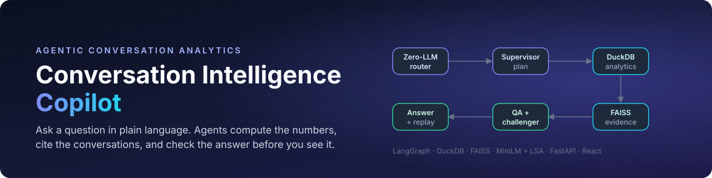

<br>


<h3>Ask a question about your customer conversations.<br>Get computed numbers, cited transcripts and a checked answer, with no LLM required.</h3>

<a href="#-quick-start"><b>Quick start</b></a> ·
<a href="#-the-four-questions-answered"><b>Results</b></a> ·
<a href="#-how-it-works"><b>How it works</b></a> ·
<a href="#-evaluation"><b>Evaluation</b></a> ·
<a href="#-run-it-in-your-ide"><b>IDE setup</b></a> ·
<a href="docs/reports"><b>Reports</b></a>

<br><br>

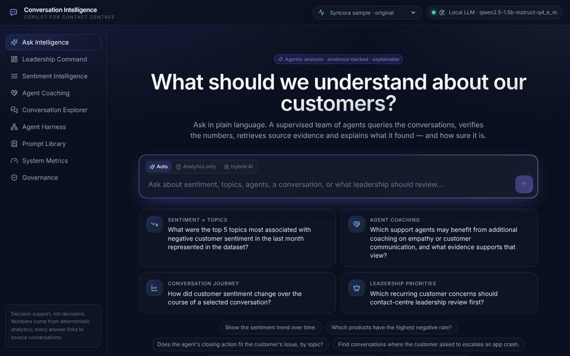

<sub><b>Live capture.</b> The question is answered in ~0.1 s on a laptop CPU, with zero model calls. Every figure comes from DuckDB.</sub>

</div>

<br>

<table>
<tr>
<td width="25%" align="center"><h2>4 / 4</h2><sub>assignment questions answered and independently re-computed</sub></td>
<td width="25%" align="center"><h2>95.9%</h2><sub>intent routing on 73 held-out questions, up from 61.6%</sub></td>
<td width="25%" align="center"><h2>125 ms</h2><sub>median answer time on the deterministic path (p95 540 ms)</sub></td>
<td width="25%" align="center"><h2>$0</h2><sub>to run: everything is local, and the optional model is too</sub></td>
</tr>
</table>

## ✦ Why it is built this way

Contact-centre analytics fails quietly when a language model is allowed to *produce* numbers. This copilot draws a hard line between computing and interpreting:

<table>
<tr>
<td width="50%" valign="top">

#### 🧮 Numbers are computed, never generated
Every count, rate and rank comes from one of 15 registered, parameterised DuckDB operations. No model writes SQL. If an explanation contains a number that is not in the verified result, it is rejected.

</td>
<td width="50%" valign="top">

#### 📎 Every claim has a source
Answers cite conversations with message IDs and CSV line numbers. Hybrid retrieval (MiniLM + LSA over FAISS) finds the transcripts that illustrate each finding.

</td>
</tr>
<tr>
<td width="50%" valign="top">

#### ⚖️ Checked before you see it
A QA agent and an **Evidence Challenger** re-read every quote from the database, disclose small samples, state counter-evidence, and rewrite causal wording as association.

</td>
<td width="50%" valign="top">

#### 🧭 A model only when it adds something
A **Zero-LLM router** answers fact questions, including all four assignment questions, without a model. A small local model (Qwen2.5-1.5B, CPU) helps only with questions the rules can't route.

</td>
</tr>
</table>

---

## ◆ The four questions, answered

| # | Question | Answer in one line |
|:-:|---|---|
| 1 | Top 5 topics associated with negative sentiment in the last month | **General help request** (49), Duplicate charge (42), Paid but service not delivered (30), Feature not working (28), Login / account locked (24, tied) |
| 2 | Agents who may benefit from empathy or communication coaching | **No individual ranking is fair** (≤ 2 conversations per agent). Instead: workforce patterns and a conversation review queue |
| 3 | How customer sentiment changed over a selected conversation | C0000479: **+1.0 → −1.0**, five turning points, the problem resurfaced after "it works now" |
| 4 | Recurring concerns leadership should review first | **Item or service not received** (67.1), Coupon not applying (60.8), Duplicate charge (59.8) |

<details open>
<summary><b>Q1 · Top 5 negative topics in the last month</b></summary>

<br>

<picture>
  <source media="(prefers-color-scheme: dark)" srcset="docs/readme/q1-negative-topics-dark.png">
  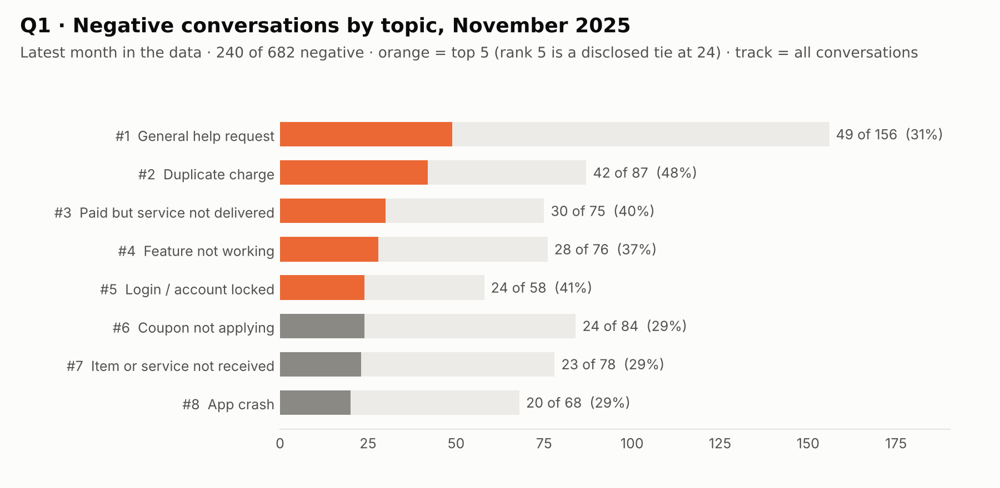
</picture>

**"Last month" means the latest month in the data** (November 2025), not today's date. **240 of 682** conversations that month were negative (35.2%).

| Rank | Topic | Negative | Of | Rate |
|:-:|---|--:|--:|--:|
| 1 | General help request | 49 | 156 | 31.4% |
| 2 | Duplicate charge | 42 | 87 | 48.3% |
| 3 | Paid but service not delivered | 30 | 75 | 40.0% |
| 4 | Feature not working | 28 | 76 | 36.8% |
| 5 | Login / account locked | 24 | 58 | 41.4% |

The answer also says what a careful analyst would:
* rank 5 is a **tie** with Coupon not applying (24);
* by *rate*, Duplicate charge leads;
* the differences between topics are **not statistically significant** (χ² p = 0.07).

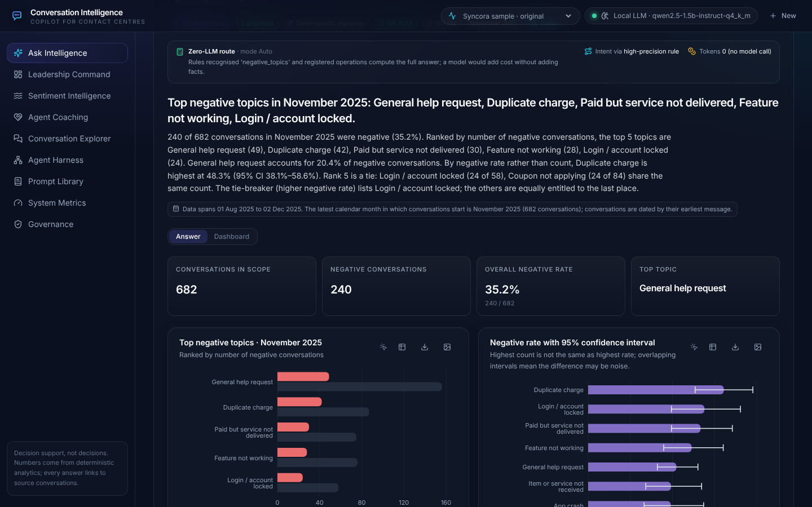

</details>

<details>
<summary><b>Q2 · Coaching: why the honest answer is "not per agent"</b></summary>

<br>

The data holds **2,987 agent IDs for 3,000 conversations**, with at most 2 conversations each. A per-agent ranking would rest on one or two transcripts, so the answer says so and offers what the data *can* support:

* **Workforce patterns.** Only **3,215 of 10,966 negative customer turns (29.3%)** got an acknowledgement or apology. **57.3%** of assessable closing actions did not fit the issue.
* **A review queue of conversations**, each with its evidence, for a team lead.
* **Human review required.** Questions asking for personnel decisions are refused.

</details>

<details>
<summary><b>Q3 · Sentiment over one conversation, with an X-Ray</b></summary>

<br>

Turn-by-turn customer sentiment is shown in **turn order**. The dataset's timestamps are not in turn order, and the answer says so. Each turning point is shown with the agent message just before it.

> *In C0000479 (Coupon not applying · Voucher), customer sentiment worsened: +1.0 at the first follow-up to −1.0 at the end. Five turning points; the problem resurfaced after the customer said it was fixed.*

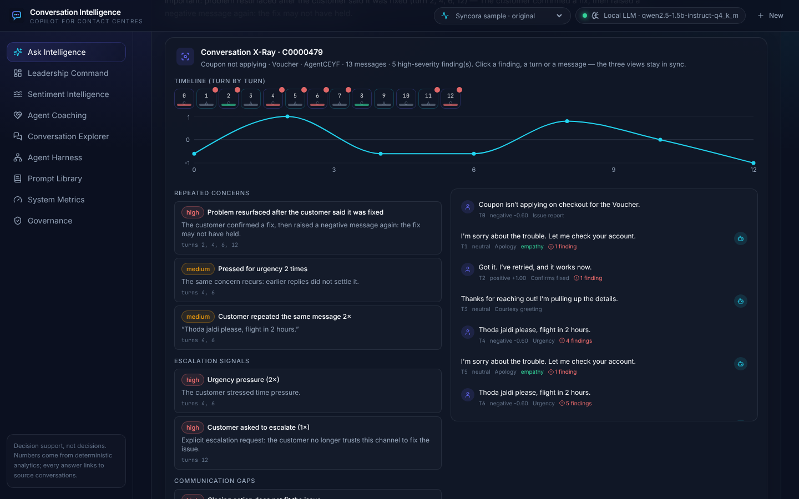

</details>

<details open>
<summary><b>Q4 · What leadership should review first</b></summary>

<br>

<picture>
  <source media="(prefers-color-scheme: dark)" srcset="docs/readme/q4-priorities-dark.png">
  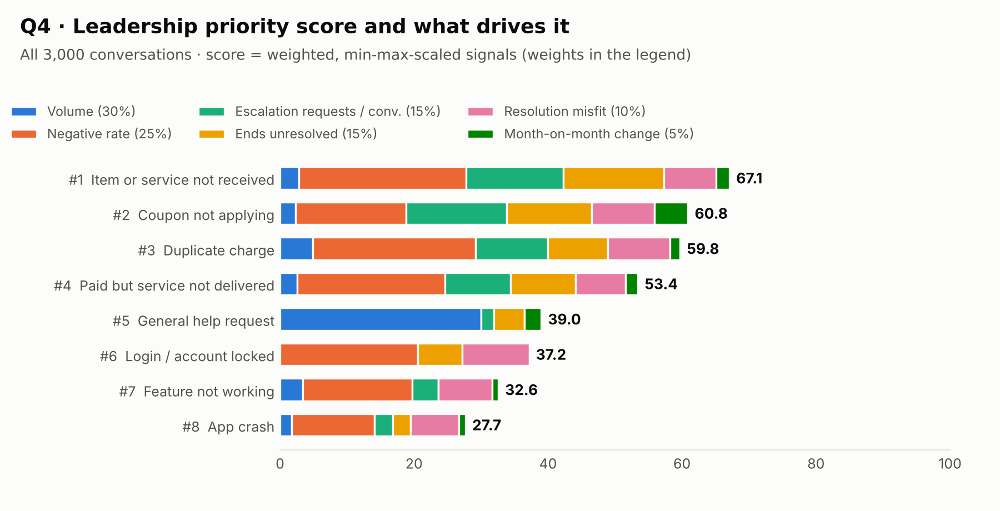
</picture>

| Priority | Concern | Score | Conversations | Negative rate | Main driver |
|:-:|---|--:|--:|--:|---|
| 1 | Item or service not received | 67.1 | 338 | 39.1% | negative rate |
| 2 | Coupon not applying | 60.8 | 331 | 34.1% | escalation requests |
| 3 | Duplicate charge | 59.8 | 362 | 38.7% | negative rate |
| 4 | Paid but service not delivered | 53.4 | 335 | 37.3% | negative rate |
| 5 | General help request | 39.0 | 662 | 24.6% | volume |

* **A transparent score:** weighted, min-max-scaled signals; the weights are shown in the chart.
* **Robust to the weights:** under 13 weight scenarios, the top concern stays first in 92% of them.
* **Actionable:** each recommendation names a finding, its driver, an action, a decision owner, evidence and its uncertainty.

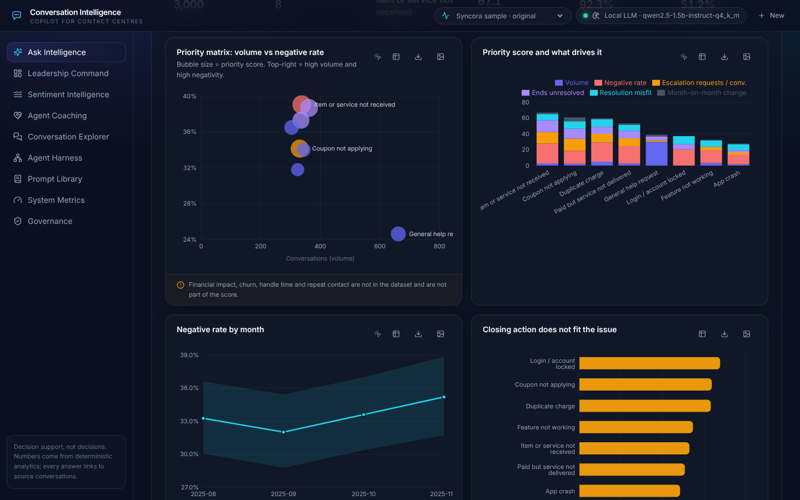

</details>

---

## ◆ How it works

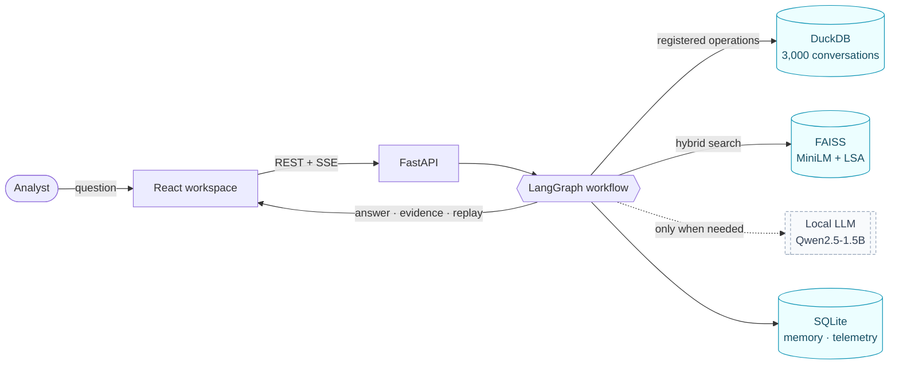

### The agent graph, in four stages

Every box is a real LangGraph node. The UI animates the nodes live as they run, and **AI Decision Replay** plays them back step by step.

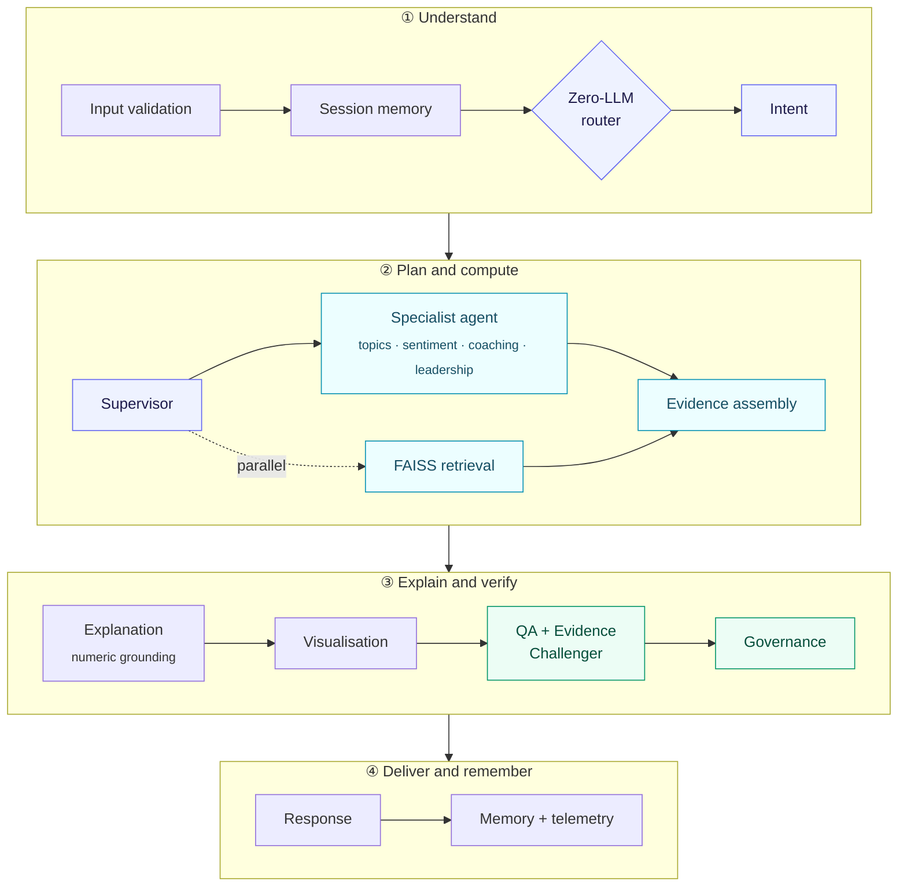

| Responsibility | Where | Never does |
|---|---|---|
| Decide whether a model is needed | `agents/router.py` | call a model |
| Turn a question into a typed intent | `agents/intent_router.py` | invent IDs, numbers or SQL |
| Plan registered operations and the date window | `agents/supervisor.py` | compute numbers |
| Compute every figure | `analytics/*` via `query_registry.py` | accept free-form SQL |
| Find source transcripts | `retrieval/index.py` | produce numbers |
| Verify the answer before display | `agents/qa_agent.py`, `agents/evidence_challenger.py` | change a number |

<details>
<summary><b>One request, end to end (sequence diagram)</b></summary>

<br>

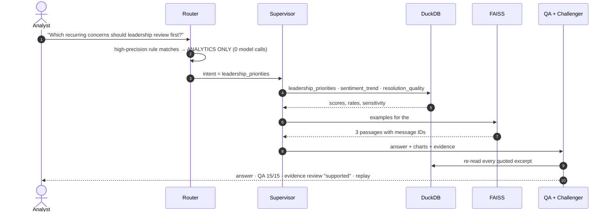

</details>

<details>
<summary><b>How a question is routed (confidence cascade)</b></summary>

<br>

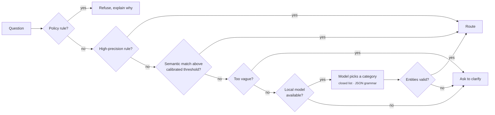

Each decision records which stage routed the question and why. The semantic stage is built and calibrated, but no threshold reached 95% precision on validation, so it stays off ([details](docs/evaluation/INTENT_ROUTING.md)).

</details>

Full design: **[ARCHITECTURE.md](ARCHITECTURE.md)**.

---

## ◆ Bonus extensions

<table>
<tr>
<td width="33%" valign="top">

#### 🔎 Knowledge retrieval
Hybrid **MiniLM + LSA** over 18,639 four-turn chunks, fused with weighted reciprocal rank fusion.

**86.1%** hit@5 · **62.8%** topic P@5 on 36 paraphrased queries.

</td>
<td width="33%" valign="top">

#### 🤖 Specialised LLM agent
A **local Qwen2.5-1.5B** intent classifier, constrained to a closed list by a JSON grammar. It is called only when rules are unsure.

**95.9%** with it vs **90.4%** without.

</td>
<td width="33%" valign="top">

#### 🧠 Memory
Follow-ups such as *"compare the top two"* resolve to **stored, re-validated references**, never to earlier model prose.

**11 / 11** follow-ups routed correctly.

</td>
</tr>
</table>

<details>
<summary><b>Retrieval: per-method results</b></summary>

<br>

<picture>
  <source media="(prefers-color-scheme: dark)" srcset="docs/readme/retrieval-methods-dark.png">
  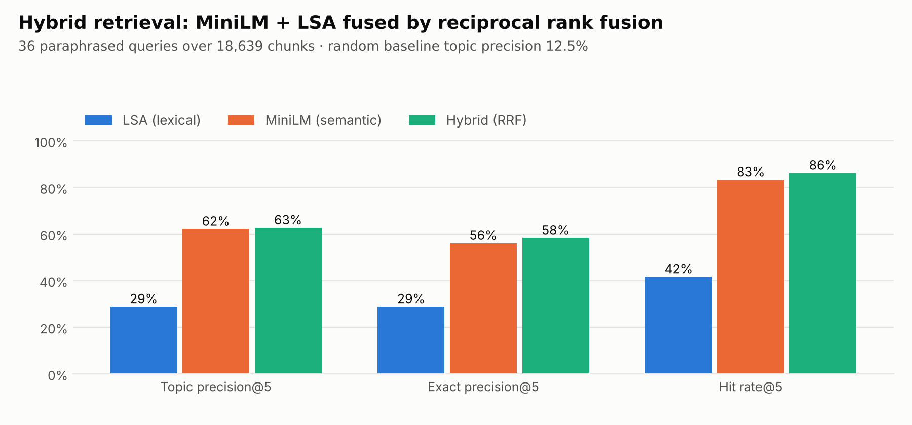
</picture>

| | LSA (lexical) | MiniLM (semantic) | **Hybrid (RRF)** |
|---|--:|--:|--:|
| Topic precision@5 | 28.9% | 62.2% | **62.8%** |
| Exact precision@5 | 28.9% | 56.1% | **58.3%** |
| Hit rate@5 | 41.7% | 83.3% | **86.1%** |

* **Indexed:** 4-turn windows (overlap 2), embedded twice, in exact-cosine FAISS indexes with metadata filters.
* **Triggered:** by similar-case questions, by coaching evidence (in parallel), and after an analysis to illustrate the top result.
* **Caveat:** the fusion weight was tuned on these same queries, and the gain over MiniLM alone is small. [EVALUATION.md](EVALUATION.md) says so.

</details>

<details>
<summary><b>Specialised agent: routing accuracy by method</b></summary>

<br>

<picture>
  <source media="(prefers-color-scheme: dark)" srcset="docs/readme/routing-accuracy-dark.png">
  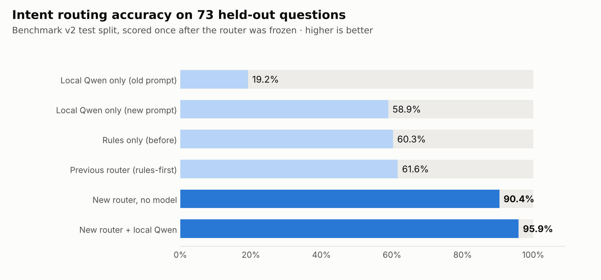
</picture>

* **Why a small model:** classifying a question is a safe job for one, because every entity and number still comes from deterministic code.
* **Honest evaluation:** the held-out split was written before the router changed, then frozen and scored once ([protocol](docs/evaluation/INTENT_ROUTING.md)).

</details>

<details>
<summary><b>Memory: what is stored and reused</b></summary>

<br>

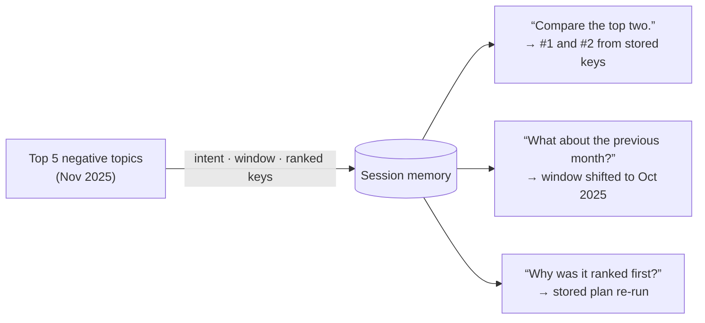

* **Re-validated:** references are checked against the database before reuse.
* **Private:** sessions are isolated, kept for 30 days (configurable) and deletable.

</details>

---

## ◆ Beyond the brief: six analytical enhancements

| | Enhancement | What it adds |
|:-:|---|---|
| 🧭 | **Zero-LLM Intelligence Router** | AUTO / ANALYTICS ONLY / HYBRID AI modes; fact questions cost no tokens; unknown token counts show as "not reported", never as a fake zero |
| 📊 | **Query-driven dashboards** | Each answer becomes a dashboard, with a "why this chart" line per chart and refinements that re-run the analysis |
| 🩻 | **Conversation X-Ray** | Escalations, repeated concerns and communication gaps, each linked to messages; timeline, chart and transcript stay in sync |
| 🔬 | **Root Cause Investigator** | Tested associations with intervals, symptoms separated from drivers, alternative explanations; it never claims cause |
| ⏪ | **AI Decision Replay** | Step-through playback of routing, nodes, DuckDB operations, FAISS searches and model calls, with secrets redacted |
| ⚖️ | **Evidence Challenger** | Re-reads every quote, discloses small samples, states counter-evidence, rewrites causal claims |

<table>
<tr>
<td width="50%">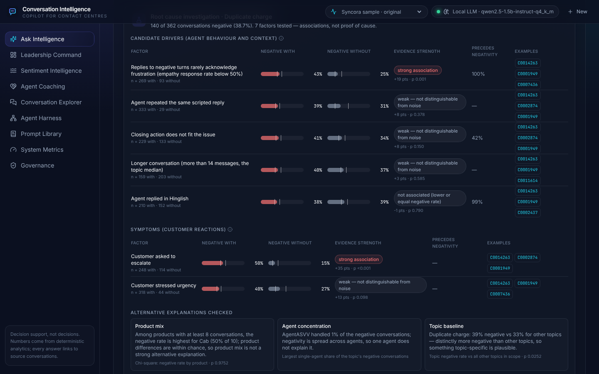<br><sub><b>Root Cause Investigator</b>: drivers vs symptoms, with intervals</sub></td>
<td width="50%">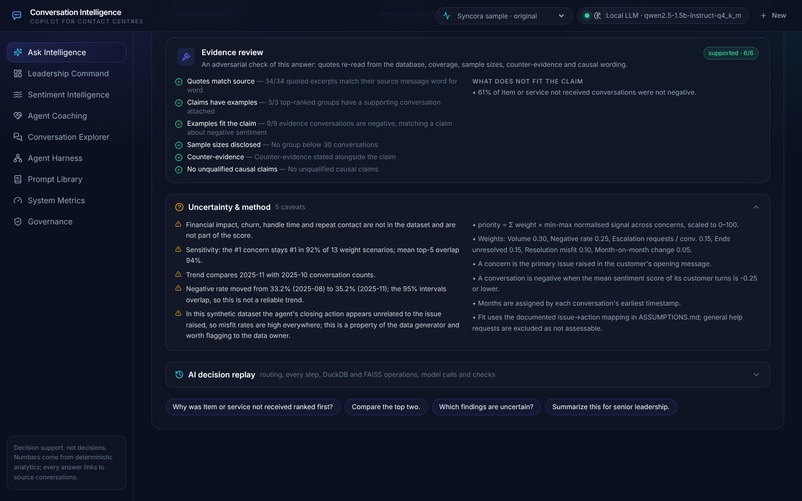<br><sub><b>Evidence Challenger</b>: what was checked, and what does not fit the claim</sub></td>
</tr>
<tr>
<td width="50%">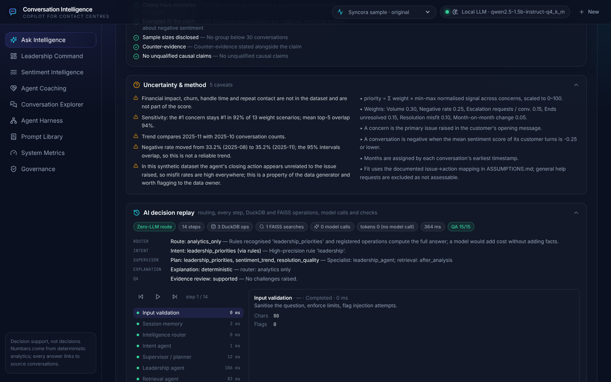<br><sub><b>AI Decision Replay</b>: every decision, step by step</sub></td>
<td width="50%">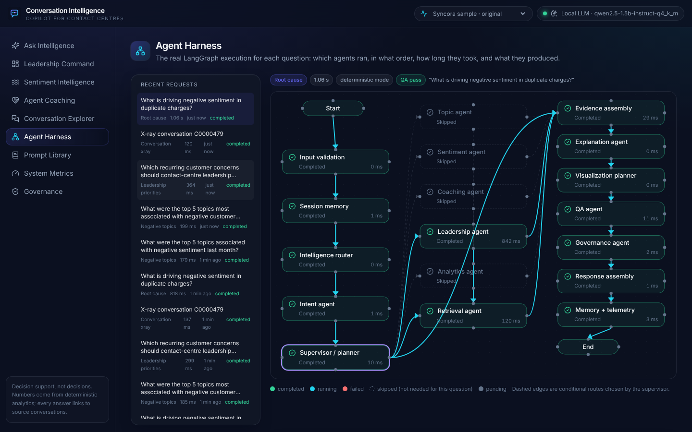<br><sub><b>Agent Harness</b>: the real execution graph and timings</sub></td>
</tr>
</table>

Details and limitations: **[docs/ENHANCEMENTS.md](docs/ENHANCEMENTS.md)** · full-page screenshots: [`docs/screenshots/`](docs/screenshots).

---

## ◆ Evaluation

| What was measured | Result |
|---|---|
| Q1 vs an independent oracle (raw CSV, separate code) | **exact match**: 682 conversations, 240 negative, all top-5 counts |
| Intent routing, 73 held-out questions, scored once | **95.9%** (macro F1 0.932); 90.4% without a model; previous router 61.6% |
| Unsupported or prohibited questions refused | **6 / 6** end to end; 9 / 9 in the routing test split |
| Follow-up routing | **11 / 11** |
| End-to-end QA pass rate (51 requests) | **88%**: every critical check passes; the rest are Evidence Challenger warnings |
| Retrieval (36 paraphrased queries) | hybrid hit@5 **86.1%**, topic P@5 **62.8%** (random: 12.5%) |
| Latency, deterministic path | p50 **125 ms** · p95 **540 ms** on a local CPU |
| Automated tests | backend **138** · Vitest **8** · Playwright **17**, all passing |

<picture>
  <source media="(prefers-color-scheme: dark)" srcset="docs/readme/sentiment-trend-dark.png">
  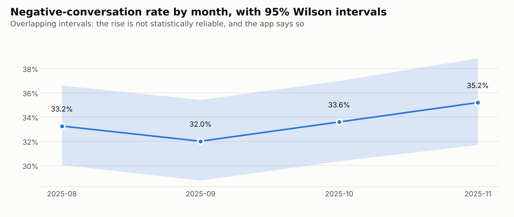
</picture>

<sub>The negative rate rises from 32.0% to 35.2%, but the 95% intervals overlap, so the app does not call it a trend.</sub>

Methods, failures and caveats: **[EVALUATION.md](EVALUATION.md)** · routing protocol: **[INTENT_ROUTING.md](docs/evaluation/INTENT_ROUTING.md)** · requirement-by-requirement audit: **[compliance audit](docs/VERINT_REQUIREMENT_COMPLIANCE_AUDIT.md)**.

---

## ◆ Quick start

**Prerequisites:** Python 3.12+ with [uv](https://docs.astral.sh/uv/), Node 22+, and `make`.

```bash
git clone https://github.com/florina787/Data-sets.git
cd Data-sets/conversation-intelligence-copilot
cp .env.example .env          # nothing needs to be filled in
make install                  # Python deps (with MiniLM embeddings) + npm ci
make prepare                  # raw zip → DuckDB (≈30 s)
make index                    # FAISS index, MiniLM + LSA (≈2–3 min on CPU)
make dev                      # API on :8000, UI on :5173
```

Open **http://localhost:5173**. Interactive API docs are at **http://localhost:8000/docs**.

> [!TIP]
> **Optional local model** for questions that need interpretation (CPU, no key, ≈1.1 GB):
> ```bash
> make install-local-llm && make llm-download
> ```
> `llama-cpp-python` is built from source if no wheel exists for your platform (needs a C/C++ toolchain and CMake). The first call takes ≈ 9 s, then ≈ 1 s per routing call.

**Docker:** `docker compose up --build`, then open http://localhost:8080. *The images could not be built in the development sandbox (registry rate limits), so they are not verified end to end.*

<details>
<summary><b>All commands</b></summary>

| Command | What it does |
|---|---|
| `make install-local-llm`, `make llm-download` | Optional: llama.cpp bindings, then the local model |
| `make prepare` | Ingest, validate, label, build DuckDB + manifests |
| `make index` | Build the retrieval index |
| `make synthetic` | Optional: 120 tagged synthetic demo conversations (load with `ENABLE_SYNTHETIC_DEMO=true make prepare index`) |
| `make test` | Backend pytest (138) + frontend typecheck and Vitest (8) |
| `make e2e` | Playwright end-to-end (17) |
| `make evaluate` | Evaluation on the real data → `docs/evaluation/EVALUATION_RESULTS.md` |
| `make screenshots` | Re-capture `docs/screenshots` from a running app |
| `make report` | Generate the submission DOCX and the engineering PDF |
| `make package` | Build the submission ZIP (`dist/`) from the committed tree |

</details>

### ◇ Run it in your IDE

<details open>
<summary><b>VS Code / Cursor / Windsurf: one click</b></summary>

<br>

The repo ships a [`.vscode/`](.vscode) folder with debug configurations, tasks and settings.

1. Open the **`conversation-intelligence-copilot`** folder (not the repository root) and accept the recommended extensions.
2. Run the tasks **`install`**, then **`prepare + index`** (*Terminal → Run Task…*). This is needed once.
3. In *Run and Debug* (`Ctrl/⌘ + Shift + D`), choose **Full stack (API + UI)** and press **F5**. Breakpoints work in the FastAPI code, including inside LangGraph nodes.
4. Other launch configurations: **Backend: pytest** (debug tests) and **Data: prepare dataset**. The *Testing* panel discovers the pytest suite automatically.

</details>

<details>
<summary><b>PyCharm / IntelliJ</b></summary>

<br>

1. Open `conversation-intelligence-copilot`. Run `make install` once, then set the interpreter to `backend/.venv/bin/python` (*Settings → Python Interpreter → Add → Existing*).
2. Mark `backend` as **Sources Root**.
3. Create a run configuration: *Python → Module name* `uvicorn`, parameters `app.main:app --reload --port 8000`, working directory `backend`, with the EnvFile pointed at `.env`.
4. Create an *npm* run configuration: package.json `frontend/package.json`, command `run`, script `dev`. Alternatively, run `npx vite` in the terminal.
5. For tests: *pytest* configuration with working directory `backend`.

</details>

<details>
<summary><b>Any editor: two terminals</b></summary>

<br>

```bash
# terminal 1
cd backend && uv run uvicorn app.main:app --reload --port 8000
# terminal 2
cd frontend && npx vite
```

</details>

---

## ◆ Reference

<details>
<summary><b>Configuration (environment variables)</b></summary>

<br>

All settings are environment variables (see [`.env.example`](.env.example)). Nothing secret is hardcoded.

| Variable | Default | Purpose |
|---|---|---|
| `LLM_PROVIDER` | `auto` | `auto` (local model if downloaded, otherwise none), `local`, or `none` (deterministic only) |
| `LOCAL_MODEL_REPO`, `LOCAL_MODEL_FILE`, `LOCAL_MODEL_DIR` | `Qwen/Qwen2.5-1.5B-Instruct-GGUF`, `qwen2.5-1.5b-instruct-q4_k_m.gguf`, `data/models` | Local model source and location |
| `LOCAL_N_CTX`, `LOCAL_THREADS`, `LOCAL_MAX_OUTPUT_TOKENS` | 8192, 4, 600 | llama.cpp context, CPU threads, output cap |
| `LLM_ENABLED` | true | Kill switch for all model calls |
| `EMBEDDING_BACKEND`, `EMBEDDING_MODEL` | auto, all-MiniLM-L6-v2 | auto falls back to local LSA if the model can't load |
| `RETRIEVAL_MODE` | hybrid | `hybrid` (MiniLM + LSA, RRF), `dense`, or `lsa` |
| `RRF_K`, `HYBRID_LSA_WEIGHT` | 60, 0.15 | Fusion constant and LSA's vote relative to MiniLM |
| `DATASET_MODE`, `ENABLE_SYNTHETIC_DEMO` | original, false | The demo set is loaded only when enabled |
| `MIN_AGENT_CONVERSATIONS` | 3 | Coaching sample-size gate |
| `SESSION_RETENTION_DAYS` | 30 | Memory retention |
| `ENABLE_LANGSMITH` | false | LangSmith tracing (needs `LANGSMITH_API_KEY`) |
| `DATABASE_PATH`, `MEMORY_DATABASE_PATH`, `FAISS_INDEX_PATH`, … | `data/…` | Storage locations |

</details>

<details>
<summary><b>Models, dependencies and cost</b></summary>

<br>

| Component | Choice | Notes |
|---|---|---|
| LLM (optional) | Qwen2.5-1.5B-Instruct (Q4_K_M GGUF) via `llama-cpp-python`, CPU | Category-only intent classification when rules are unsure; grounded explanations. **No key; not needed to run.** |
| Orchestration | LangGraph (+ SQLite checkpointer) | Conditional and parallel routing, per-request checkpoints |
| Analytics | DuckDB, pandas, SciPy | Exact and deterministic; Wilson intervals, χ² and z-tests |
| Retrieval | FAISS; Sentence-Transformers MiniLM + LSA (scikit-learn) | Local and free |
| Memory / telemetry | SQLite | Sessions, checkpoints, model calls, audit |
| API | FastAPI, Pydantic v2 | REST + Server-Sent Events |
| UI | React 18, TypeScript, Vite, Tailwind, Radix, Recharts, React Flow, Framer Motion | Nine pages, light/dark, mobile |
| Reports | python-docx, ReportLab, matplotlib | Submission DOCX + engineering PDF |

* **External services:** a one-time download from Hugging Face (MiniLM weights and, optionally, the local model). After that, no data leaves the machine.
* **Cost:** $0. When the local model is used, it makes at most two calls per question; intent classification measured ≈ 660 prompt tokens.

</details>

<details>
<summary><b>Context only: how the API would have been designed with a Gemini key</b></summary>

<br>

> [!NOTE]
> This project does **not** use Gemini or any hosted model, and nothing below is implemented. It shows how the API would have been designed had a Gemini API key been used. The guarantees would stay the same: numbers from DuckDB, every answer checked by QA and the Evidence Challenger, no model-written SQL.

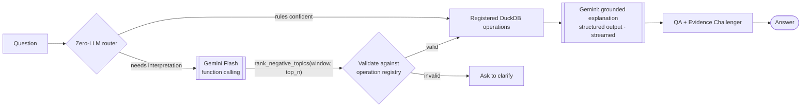

**Endpoints that would change**

| Endpoint | Today (local) | With Gemini |
|---|---|---|
| `POST /api/chat`, `/api/chat/stream` | Local model picks one intent from a closed list | Each registered operation is a Gemini **function declaration**; the server validates the chosen call before running it. The explanation streams as SSE `explanation.delta` events, shaped by a `response_schema`. The response gains a `usage` block (prompt, cached and output tokens, cost). |
| `GET /api/model/status` | Local model loaded or not | Model version, rate-limit headroom, context-cache state, last error |
| `POST /api/model/retry` | Reloads the local model | Clears provider back-off after quota or outage errors |
| `GET /api/telemetry/tokens` | Local token counts | Split by provider and model, cached vs uncached, cost per request, session and day |
| `POST /api/retrieval/search` | hybrid / dense / lsa | Optional `gemini-embedding` method, fused only if it beats MiniLM on the same benchmark |

**New endpoints:**
* `POST /api/labels/jobs`: batch labelling through the Gemini Batch API;
* `GET /api/labels/jobs/{id}`: progress, tokens and cost of a run;
* `POST /api/labels/jobs/{id}/apply`: rebuild with the new labels after an agreement check;
* `GET /api/model/budget`: the remaining session and daily token budgets.

**Cross-cutting changes:**
* **Context caching:** the system prompt, taxonomy and operation catalogue are cached once.
* **Budgets and fallback:** over budget returns `429` + `Retry-After`; AUTO mode falls back to the deterministic answer, and a circuit breaker falls back to the local model.
* **Data minimisation:** only the question, verified figures and up to four masked excerpts are sent.
* **Key handling:** the key lives in a secret manager, never reaches the browser, and is redacted from telemetry.
* **Evaluation gate:** Gemini routing would be scored on the same frozen test split before switching.

</details>

<details>
<summary><b>The dataset</b></summary>

<br>

The **Syncora.ai Customer Support Conversation** sample (Kaggle), as supplied with the assignment (`data/raw/cs_conversations.csv.zip`):
* 3,000 synthetic conversations;
* 41,965 messages;
* August to December 2025.

No conversations were appended. Data dictionary: [docs/dataset/DATASET.md](docs/dataset/DATASET.md) · interpretations: [ASSUMPTIONS.md](ASSUMPTIONS.md).

| Property | How it is handled |
|---|---|
| Every message ends in random filler tokens | removed into `clean_text`; raw text kept |
| Timestamps are not in turn order | turn index is authoritative; conversations dated by their earliest message |
| ≈ 1 agent per conversation (max 2) | no per-agent ranking; conversations are prioritised for review instead |
| 426 unique message templates | labels are a documented template mapping |
| Most topic differences are not significant | every ranking states its χ² p-value and intervals |

</details>

<details>
<summary><b>Sample requests and outputs</b></summary>

<br>

[`examples/requests/`](examples/requests) and [`examples/outputs/`](examples/outputs) are generated from real runs (JSON + Markdown). They cover each of the four questions with follow-ups, retrieval, and an unsupported question.

```bash
curl -s localhost:8000/api/chat -H 'Content-Type: application/json' \
  -d '{"question":"Which recurring customer concerns should contact-centre leadership review first?"}' \
  | jq '.headline, .routing.route'
```

```json
"Leadership should review Item or service not received first (priority score 67.1), then Coupon not applying, Duplicate charge."
"analytics_only"
```

</details>

<details>
<summary><b>Limitations</b></summary>

<br>

* **A small local model.** It is enough for picking a category, but its explanations are slower and plainer than a hosted model's would be.
* **Labels are a judgement.** Sentiment and empathy mappings are developer judgements over templated text; human agreement needs labels from the in-app review panel.
* **A small, same-author routing benchmark.** 73 test questions (3–9 per intent): the 95.9% is indicative, not precise. Known misroutes are listed in [INTENT_ROUTING.md](docs/evaluation/INTENT_ROUTING.md).
* **A small hybrid retrieval gain,** with the weight tuned on the evaluation queries.
* **Not production-hardened:** no authentication or RBAC ([SECURITY.md](SECURITY.md)), single-node storage, unverified Docker images.

</details>

<details>
<summary><b>Repository guide</b></summary>

<br>

```
backend/    FastAPI app (app/), scripts/ (prepare, index, evaluate, reports, figures), tests/
frontend/   React app (src/), Playwright tests and capture scripts (e2e/)
data/       raw/ (supplied zip), manifests/; processed/, indexes/, models/ are generated
docs/       dataset, evaluation, reports, screenshots, interview notes, audit, README media
examples/   sample requests and outputs
```

| Document | What it covers |
|---|---|
| [ARCHITECTURE.md](ARCHITECTURE.md) | Components, agent graph, failure handling, retrieval, memory, security |
| [EVALUATION.md](EVALUATION.md) | Every metric, how it was measured, and what cannot be claimed |
| [ASSUMPTIONS.md](ASSUMPTIONS.md) | Dataset interpretation, labels, windows, scoring |
| [docs/ENHANCEMENTS.md](docs/ENHANCEMENTS.md) | The six enhancements, with limitations |
| [Compliance audit](docs/VERINT_REQUIREMENT_COMPLIANCE_AUDIT.md) | Sentence-by-sentence audit against the assignment |
| [docs/reports/](docs/reports) | Submission report (DOCX) and engineering report (PDF) |
| [SECURITY.md](SECURITY.md) | Threat model and controls |

**Production roadmap (not implemented here):**
* managed warehouse and vector store;
* a job queue for labelling;
* SSO / RBAC;
* a secret manager;
* OpenTelemetry;
* CI/CD with evaluation gates;
* A/B tests on human-labelled sets.

</details>

---

<div align="center">
<sub>MIT licensed (see <a href="LICENSE">LICENSE</a>). The dataset remains subject to its original Kaggle / Syncora terms.<br>
README charts are generated by <code>backend/scripts/readme_figures.py</code>; screenshots and the demo by <code>frontend/e2e/capture-readme-media.mjs</code>.</sub>
</div>
