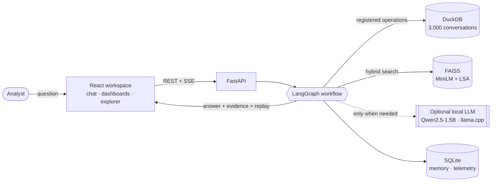
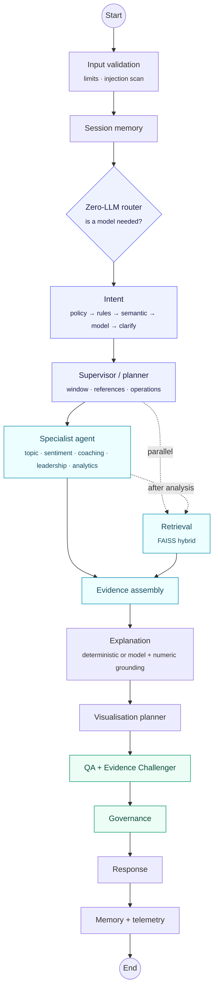
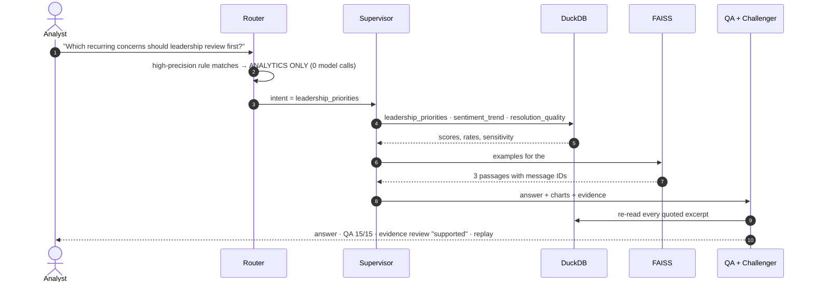
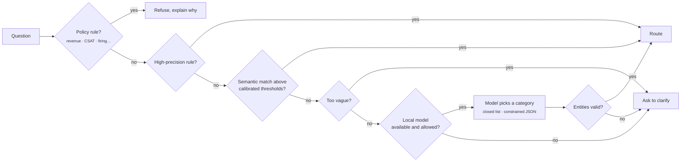
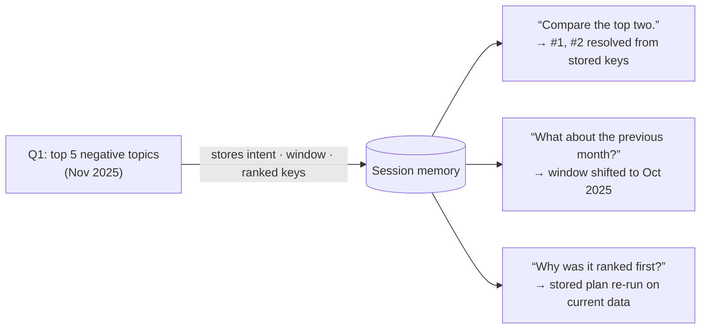
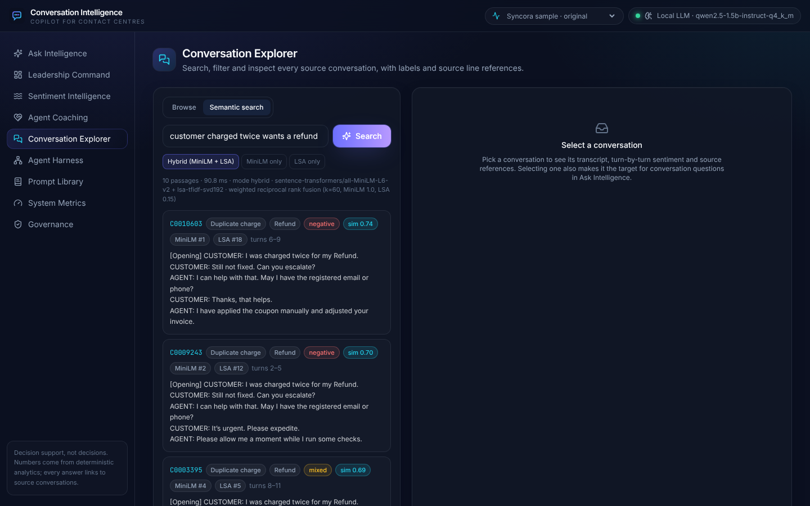
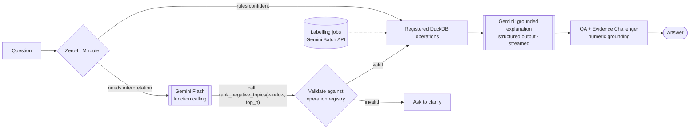

<div align="center">


<br>

<a href="#quick-start"></a>


<br>


**[Quick start](#quick-start)** · **[The four questions](#the-four-assignment-questions)** · **[Architecture](#how-it-works)** · **[Evaluation](#evaluation)** · **[Gemini design](#if-a-gemini-api-key-were-available)** · **[Reports](docs/reports)**

</div>

---

A **conversation analysis bot for contact-centre analysts**. An analyst asks a question in plain language. A LangGraph workflow decides what analysis is needed, runs registered DuckDB operations over 3,000 customer-support conversations, retrieves source transcripts, explains the result, and checks it before anything is shown. Each answer carries:

* counts and rankings;
* charts;
* cited conversations;
* uncertainty notes;
* a replay of how it was produced.

Everything runs on your machine. The only language model is a small **local** one (Qwen2.5-1.5B), and it is optional.

> [!IMPORTANT]
> **Numbers are computed, never generated.** Every count, rate and rank comes from a registered, parameterised DuckDB operation. The local model is used only to interpret questions the rules cannot route and to phrase explanations. Any explanation containing a number that is not in the verified results is rejected.

<table>
<tr>
<td width="25%" align="center"><b>4 / 4</b><br><sub>assignment questions answered and independently re-computed</sub></td>
<td width="25%" align="center"><b>3 / 3</b><br><sub>bonus extensions: retrieval, specialised agent, memory</sub></td>
<td width="25%" align="center"><b>95.9%</b><br><sub>intent routing on 73 held-out questions (was 61.6%)</sub></td>
<td width="25%" align="center"><b>0 tokens</b><br><sub>for all four assignment questions: the router answers them without a model</sub></td>
</tr>
</table>

<div align="center">

<sub><i>The analyst workspace: ask anything, or start from one of the four assignment questions.</i></sub>
</div>

## Contents

- [The four assignment questions](#the-four-assignment-questions)
- [How it works](#how-it-works)
- [Bonus extensions](#bonus-extensions)
- [Six analytical enhancements](#six-analytical-enhancements)
- [Evaluation](#evaluation)
- [Quick start](#quick-start)
- [Configuration](#configuration) · [Models, dependencies and cost](#models-dependencies-and-cost)
- [If a Gemini API key were available](#if-a-gemini-api-key-were-available)
- [The dataset](#the-dataset) · [Sample requests and outputs](#sample-requests-and-outputs)
- [Limitations](#limitations) · [Repository guide](#repository-guide)

---

## The four assignment questions

All four are answered end to end through the chat UI and the API. Each was re-computed independently from the raw CSV for the [requirements audit](docs/VERINT_REQUIREMENT_COMPLIANCE_AUDIT.md).

### 1 · Top 5 topics associated with negative sentiment in the last month in the data

<picture>
  <source media="(prefers-color-scheme: dark)" srcset="docs/readme/q1-negative-topics-dark.png">
  
</picture>

**"Last month" is the latest month in the data** (November 2025), not today's date. In that month **240 of 682** conversations were negative (35.2%).

| Rank | Topic | Negative | Of | Rate |
|:-:|---|--:|--:|--:|
| 1 | General help request | 49 | 156 | 31.4% |
| 2 | Duplicate charge | 42 | 87 | 48.3% |
| 3 | Paid but service not delivered | 30 | 75 | 40.0% |
| 4 | Feature not working | 28 | 76 | 36.8% |
| 5 | Login / account locked | 24 | 58 | 41.4% |

The answer also points out:
* **Rank 5 is a tie.** Coupon not applying also has 24 negative conversations.
* **By rate, Duplicate charge leads.**
* **The differences are not statistically significant** (χ² p = 0.07).

### 2 · Agents who may benefit from empathy or communication coaching

The data holds **2,987 agent IDs for 3,000 conversations, with at most 2 conversations each**. Ranking individual agents would rest on one or two transcripts, so the answer says this plainly. Instead it:

* reports workforce patterns: only **3,215 of 10,966 negative customer turns (29.3%)** got an acknowledgement or apology, and **57.3%** of assessable closing actions did not fit the issue;
* ranks **conversations** for a team-lead review, each with its evidence;
* flags the output for human review. Questions asking for personnel decisions are refused.

### 3 · How customer sentiment changed over a selected conversation

Turn-by-turn customer sentiment is shown in **turn order**. Timestamps in this dataset are not in turn order, and the answer says so. Turning points are shown with the agent message that preceded each one. An **X-Ray** links every finding to the exact messages.

> *In C0000479 (Coupon not applying · Voucher), customer sentiment worsened: +1.0 at the first follow-up to −1.0 at the end. Five turning points; the problem resurfaced after the customer said it was fixed.*

### 4 · Recurring concerns leadership should review first

<picture>
  <source media="(prefers-color-scheme: dark)" srcset="docs/readme/q4-priorities-dark.png">
  
</picture>

| Priority | Concern | Score | Conversations | Negative rate | Main driver |
|:-:|---|--:|--:|--:|---|
| 1 | Item or service not received | 67.1 | 338 | 39.1% | negative rate |
| 2 | Coupon not applying | 60.8 | 331 | 34.1% | escalation requests |
| 3 | Duplicate charge | 59.8 | 362 | 38.7% | negative rate |
| 4 | Paid but service not delivered | 53.4 | 335 | 37.3% | negative rate |
| 5 | General help request | 39.0 | 662 | 24.6% | volume |

The score is transparent: weighted, min-max-scaled signals, with the weights shown in the chart legend. A **sensitivity analysis** re-ranks the concerns under 13 weight scenarios: the top concern stays first in 92% of them. Each recommendation names:
* a finding;
* the signal driving it;
* an action;
* a decision owner;
* evidence;
* its uncertainty.

<table>
<tr>
<td width="50%"><br><sub>Q1 in the app: answer, KPIs, charts, evidence</sub></td>
<td width="50%"><br><sub>Q4 in the app: priority matrix and recommendations</sub></td>
</tr>
</table>

---

## How it works

### System overview



### The agent graph

Every node is a real LangGraph node that emits start and finish events. The UI animates them live, and Decision Replay plays them back.



| Responsibility | Where | Never does |
|---|---|---|
| Decide whether a model is needed | `agents/router.py` | call a model |
| Turn a question into a typed intent | `agents/intent_router.py` | invent IDs, numbers or SQL |
| Plan registered operations and the date window | `agents/supervisor.py` | compute numbers |
| Compute every figure | `analytics/*` via `query_registry.py` | accept free-form SQL |
| Find source transcripts | `retrieval/index.py` | produce numbers |
| Verify the answer before display | `agents/qa_agent.py`, `agents/evidence_challenger.py` | change a number |

Agents exchange a typed state (`agents/state.py`). Every result uses one versioned schema (`AnalysisResult`, `ChatResponse`). Full design: **[ARCHITECTURE.md](ARCHITECTURE.md)**.

### One request, end to end



### How intent is routed



Each decision records which stage routed the question and why. The record is visible in the answer and in **AI Decision Replay**. The semantic stage is built and calibrated, but no threshold reached 95% precision on validation, so it stays switched off ([details](docs/evaluation/INTENT_ROUTING.md)).

---

## Bonus extensions

<details open>
<summary><b>1 · Knowledge retrieval: hybrid MiniLM + LSA over 18,639 conversation chunks</b></summary>

<br>

<picture>
  <source media="(prefers-color-scheme: dark)" srcset="docs/readme/retrieval-methods-dark.png">
  
</picture>

| | LSA (lexical) | MiniLM (semantic) | **Hybrid (RRF)** |
|---|--:|--:|--:|
| Topic precision@5 | 28.9% | 62.2% | **62.8%** |
| Exact precision@5 | 28.9% | 56.1% | **58.3%** |
| Hit rate@5 | 41.7% | 83.3% | **86.1%** |

* **Indexed:** 4-turn windows (overlap 2), embedded twice, in exact-cosine FAISS indexes with metadata filters.
* **Triggered:** by similar-case questions, by coaching evidence (in parallel), and after the analysis to illustrate the top-ranked result.
* **Returns:** one passage per conversation, with message IDs, CSV line references and each method's rank.
* **Improves answers:** real, on-topic transcripts sit beside the computed result. Retrieval never produces a number.
* **Caveat:** the fusion weight was tuned on these same queries, and the hybrid gain over MiniLM alone is small. [EVALUATION.md](EVALUATION.md) states this.

</details>

<details open>
<summary><b>2 · Specialised LLM agent: a local, constrained intent classifier</b></summary>

<br>

<picture>
  <source media="(prefers-color-scheme: dark)" srcset="docs/readme/routing-accuracy-dark.png">
  
</picture>

* **What it is:** Qwen2.5-1.5B-Instruct running locally (llama.cpp, CPU, no key). It answers with one category from a closed list, enforced by a JSON-schema grammar.
* **Why this approach:** classifying a question is a safe job for a small model, because every entity and number still comes from deterministic code.
* **How it fits:** it is called only when rules cannot route a question with high precision (6.9% of test questions).
* **Usefulness:** 95.9% with it vs 90.4% without, on a held-out split written before the router changed, frozen, and scored once ([protocol](docs/evaluation/INTENT_ROUTING.md)).

</details>

<details open>
<summary><b>3 · Memory: follow-ups that resolve to stored references, not model prose</b></summary>

<br>



* **Stored per turn:** question, intent, scope, plan, and deterministic references (ranked keys, conversation IDs).
* **Re-validated:** references are checked against the database before reuse; model prose is never reused as fact.
* **Measured:** follow-up routing is 11 / 11 on the evaluation sessions.
* **Privacy:** sessions are isolated, retained for 30 days (configurable) and deletable per session.

</details>

---

## Six analytical enhancements

These go beyond the brief. They are documented in **[docs/ENHANCEMENTS.md](docs/ENHANCEMENTS.md)** and audited separately from the assignment requirements.

| | Enhancement | What it adds |
|:-:|---|---|
| 🧭 | **Zero-LLM Intelligence Router** | AUTO / ANALYTICS ONLY / HYBRID AI modes. Fact questions cost no tokens. Tokens show as "not reported" when unknown, never as a fake zero. |
| 📊 | **Query-driven dashboards** | Each answer becomes a dashboard: sections with "why this chart", filter chips, and refinements that re-run the analysis. |
| 🩻 | **Conversation X-Ray** | Escalation signals, repeated concerns and communication gaps, each linked to messages. Timeline, sentiment line and transcript stay in sync. |
| 🔬 | **Root Cause Investigator** | Tested associations with confidence intervals, symptoms separated from drivers, alternative explanations. Never claims cause. |
| ⏪ | **AI Decision Replay** | Step-through playback of routing, nodes, DuckDB operations, FAISS searches and model calls, with secrets redacted. |
| ⚖️ | **Evidence Challenger** | Re-reads every quote from the database, discloses small samples, states counter-evidence, and rewrites causal wording as association. |

<table>
<tr>
<td width="50%"><br><sub>Conversation X-Ray: click a finding and the linked turns light up</sub></td>
<td width="50%"><br><sub>Root cause: drivers vs symptoms, with intervals</sub></td>
</tr>
<tr>
<td width="50%"><br><sub>A dashboard generated for one question</sub></td>
<td width="50%"><br><sub>Decision replay and evidence review</sub></td>
</tr>
<tr>
<td width="50%"><br><sub>Agent Harness: the real execution graph</sub></td>
<td width="50%"><br><sub>Hybrid search: each result shows its MiniLM and LSA rank</sub></td>
</tr>
</table>

More screenshots: [`docs/screenshots/`](docs/screenshots) (coaching, memory follow-ups, explorer, dashboards, prompt library, metrics, governance, drill-down, mobile).

---

## Evaluation

| What was measured | Result |
|---|---|
| Q1 against an independent oracle (raw CSV, separate code) | **exact match**: 682 conversations, 240 negative, all top-5 counts |
| Intent routing, 73 held-out questions (scored once) | **95.9%** accuracy, macro F1 0.932; 90.4% with no model; previous router 61.6% |
| Unsupported or prohibited questions refused | **6 / 6** end to end; 9 / 9 in the routing test split |
| Follow-up routing | **11 / 11** |
| End-to-end QA pass rate (51 requests) | **88%**. Every critical check passes; the rest are Evidence Challenger warnings (small samples, missing example) |
| Retrieval (36 paraphrased queries) | hybrid topic P@5 **62.8%**, hit@5 **86.1%**; random 12.5% |
| Latency, deterministic path | p50 **125 ms** · p95 **540 ms** (local CPU) |
| Automated tests | backend **138** · Vitest **8** · Playwright **17**, all passing |

<picture>
  <source media="(prefers-color-scheme: dark)" srcset="docs/readme/sentiment-trend-dark.png">
  
</picture>

Methods, failures and caveats: **[EVALUATION.md](EVALUATION.md)** · intent routing protocol: **[docs/evaluation/INTENT_ROUTING.md](docs/evaluation/INTENT_ROUTING.md)** · requirement-by-requirement audit with reproducible evidence: **[docs/VERINT_REQUIREMENT_COMPLIANCE_AUDIT.md](docs/VERINT_REQUIREMENT_COMPLIANCE_AUDIT.md)**.

---

## Quick start

**Prerequisites:** Python 3.12+ with [uv](https://docs.astral.sh/uv/), Node 22+.

```bash
cd conversation-intelligence-copilot
cp .env.example .env          # nothing needs to be filled in
make install                  # uv sync --extra transformers (MiniLM embeddings) + npm ci
make prepare                  # raw zip → data/processed/analytics.duckdb (≈30 s)
make index                    # FAISS index: MiniLM + LSA (≈2–3 min on CPU; downloads MiniLM from Hugging Face once)
make dev                      # API :8000 + UI :5173
```

Open **http://localhost:5173**. API docs: **http://localhost:8000/docs**.

This runs fully without a model: every number comes from DuckDB, and the explanation is deterministic.

> [!TIP]
> **Optional: add the local model** for questions that need interpretation:
> ```bash
> make install-local-llm        # llama-cpp-python (built from source if no wheel exists; needs a C/C++ toolchain and CMake)
> make llm-download             # Qwen2.5-1.5B-Instruct Q4_K_M (≈1.1 GB) into data/models/
> ```
> It runs on CPU: the first call takes ≈ 9 s, then ≈ 1 s per routing call. A model-written explanation takes tens of seconds. With `LLM_PROVIDER=auto` (the default) it is used as soon as it is downloaded.

**Docker:** `docker compose up --build` → UI on http://localhost:8080. The backend prepares data and the index on first start. *The images could not be built in the development sandbox (Docker Hub / ECR anonymous-pull rate limits), so they are not verified end to end.*

<details>
<summary><b>All commands</b></summary>

| Command | What it does |
|---|---|
| `make install-local-llm`, `make llm-download` | Optional: install llama.cpp bindings, then download the local model (≈1.1 GB) |
| `make prepare` | Ingest, validate, label, build DuckDB + manifests |
| `make index` | Build the retrieval index |
| `make synthetic` | Optional: generate 120 tagged synthetic demo conversations (then `ENABLE_SYNTHETIC_DEMO=true make prepare index`; a default build contains only the supplied 3,000) |
| `make test` | Backend pytest (138) + frontend typecheck and Vitest (8) |
| `make e2e` | Playwright end-to-end (17); starts the servers if needed |
| `make evaluate` | Evaluation on the real data → `docs/evaluation/EVALUATION_RESULTS.md` |
| `make screenshots` | Re-capture `docs/screenshots` from a running app |
| `make report` | Generate the submission DOCX and the engineering PDF |
| `make package` | Build the submission ZIP (`dist/`) from the committed tree |

</details>

---

## Configuration

All settings are environment variables (see [`.env.example`](.env.example)). Nothing secret is hardcoded.

<details>
<summary><b>Environment variables</b></summary>

| Variable | Default | Purpose |
|---|---|---|
| `LLM_PROVIDER` | `auto` | `auto` (local model if downloaded, otherwise none), `local`, or `none` (deterministic only) |
| `LOCAL_MODEL_REPO`, `LOCAL_MODEL_FILE`, `LOCAL_MODEL_DIR` | `Qwen/Qwen2.5-1.5B-Instruct-GGUF`, `qwen2.5-1.5b-instruct-q4_k_m.gguf`, `data/models` | Local model source and location (`make llm-download`) |
| `LOCAL_N_CTX`, `LOCAL_THREADS`, `LOCAL_MAX_OUTPUT_TOKENS` | 8192, 4, 600 | llama.cpp context, CPU threads, output cap |
| `LLM_ENABLED` | true | Kill switch for all model calls |
| `EMBEDDING_BACKEND`, `EMBEDDING_MODEL` | auto, all-MiniLM-L6-v2 | auto falls back to local LSA if the model can't load |
| `RETRIEVAL_MODE` | hybrid | `hybrid` (MiniLM + LSA, reciprocal rank fusion), `dense`, or `lsa` |
| `RRF_K`, `HYBRID_LSA_WEIGHT` | 60, 0.15 | Fusion constant and LSA's vote relative to MiniLM (see EVALUATION.md for how it was chosen) |
| `DATASET_MODE`, `ENABLE_SYNTHETIC_DEMO` | original, false | Dataset modes; the demo set is only loaded when enabled |
| `MIN_AGENT_CONVERSATIONS` | 3 | Coaching sample-size gate |
| `SESSION_RETENTION_DAYS` | 30 | Memory retention |
| `ENABLE_LANGSMITH` | false | Turns on LangSmith tracing (needs `LANGSMITH_API_KEY`) |
| `DATABASE_PATH`, `MEMORY_DATABASE_PATH`, `FAISS_INDEX_PATH`, … | `data/…` | Storage locations |

</details>

## Models, dependencies and cost

| Component | Choice | Notes |
|---|---|---|
| LLM (optional) | Qwen2.5-1.5B-Instruct (Q4_K_M GGUF) via `llama-cpp-python`, on CPU | Category-only intent classification when rules are unsure, and grounded explanation for interpretive questions. **No key; no model is needed to run the app.** |
| Orchestration | LangGraph (+ SQLite checkpointer) | Conditional and parallel routing, per-request checkpoints |
| Analytics | DuckDB, pandas, SciPy | Exact, deterministic; Wilson intervals, χ² and z-tests |
| Retrieval | FAISS; Sentence-Transformers MiniLM + LSA (scikit-learn), fused | Local, free; MiniLM weights downloaded from Hugging Face on first `make index` |
| Memory / telemetry | SQLite | Sessions, checkpoints, LLM calls, audit |
| API | FastAPI, Pydantic v2 | REST + Server-Sent Events |
| UI | React 18, TypeScript, Vite, Tailwind, Radix, Recharts, React Flow, Framer Motion | Nine pages, light/dark, mobile |
| Reports | python-docx, ReportLab, matplotlib | Submission DOCX + engineering PDF |

**External services.** The only network access is a one-time download from Hugging Face: the MiniLM weights (on the first index build) and, if you choose, the local model. After that, no data leaves the machine.

**Cost.** **$0.** Everything, including the model, runs locally. Questions that need no model (all four assignment questions in AUTO mode) also use no CPU time for inference. When the model is used, it makes at most two calls per question. Intent classification was measured at ≈ 660 prompt tokens. Token counts are recorded per call (System Metrics → Token accounting).

---

## If a Gemini API key were available

> [!NOTE]
> **Context only.** This project does not use Gemini or any other hosted model, and none of the changes below are implemented. The section shows how the API would have been designed had a Gemini API key been used.

If a Gemini key had been used, the API would have been built as follows. The guarantees above would stay the same: numbers come from DuckDB, every answer goes through QA and the Evidence Challenger, and no model writes SQL.



**Endpoints that would change**

| Endpoint | Today (local) | With Gemini |
|---|---|---|
| `POST /api/chat`, `POST /api/chat/stream` | The local model picks one intent from a closed list; the explanation arrives in one piece | Each registered operation (from `GET /api/analytics/operations`) is exposed to Gemini as a **function declaration**. Gemini picks the operation and parameters; the server validates them against the registry before running anything. The explanation is **streamed** as SSE `explanation.delta` events. Its shape is fixed by a `response_schema` mirroring `ChatResponse`. The response gains a `usage` block (prompt, cached and output tokens, estimated cost) from Gemini's `usage_metadata`. |
| `GET /api/model/status` | Local model loaded or not | Adds model version, remaining requests and tokens per minute, context-cache state, and the last error (for example quota or auth). |
| `POST /api/model/retry` | Reloads the local model | Clears the provider back-off after a quota or outage error. |
| `GET /api/telemetry/tokens` | Local token counts | Split by provider and model, with cached vs uncached input tokens and cost per request, per session and per day. |
| `POST /api/retrieval/search` | `mode`: hybrid / dense / lsa | Optional `gemini-embedding` as a third method, included in the fusion **only if** it beats MiniLM on the same 36-query benchmark. |

**New endpoints**

| Endpoint | Purpose |
|---|---|
| `POST /api/labels/jobs` | Start a sentiment, empathy and resolution labelling run over the unique message texts through the **Gemini Batch API**: asynchronous, resumable, and cheaper than live calls. It replaces running a labelling script by hand. |
| `GET /api/labels/jobs/{job_id}` | Progress, failures, tokens and cost of a labelling run. |
| `POST /api/labels/jobs/{job_id}/apply` | Rebuild DuckDB with the model labels, after the agreement check against the rule labels and the human review sample (`/api/review/*`) passes. |
| `GET /api/model/budget` | The per-session and per-day token budgets and what is left of them. |

**Cross-cutting changes**

* **Context caching.** The system prompt, topic taxonomy and operation catalogue are identical on every call, so they would be cached once (Gemini `cachedContents`) to cut input tokens and latency.
* **Budgets and back-off.** A request over its session or daily token budget returns `429` with `Retry-After`, and AUTO mode falls back to the deterministic answer instead of failing. Provider errors open a circuit breaker; the local model becomes the fallback.
* **Data minimisation.** Only the question, the verified figures and up to four masked excerpts are sent; raw transcripts and customer identifiers never are. This would be stated on `GET /api/governance/status`.
* **The key stays server-side.** It would be read from a secret manager, never sent to the browser, and redacted from telemetry and Decision Replay.
* **Evaluation gate.** Gemini routing would be scored on the same frozen 73-question test split before it replaced the local model.

---

## The dataset

The **Syncora.ai Customer Support Conversation** sample (Kaggle), as attached to the assignment and committed at `data/raw/cs_conversations.csv.zip`:

* 3,000 synthetic conversations;
* 41,965 messages;
* August to December 2025.

No conversations were appended. Preparation steps, derived fields and the data dictionary are in **[docs/dataset/DATASET.md](docs/dataset/DATASET.md)**; every interpretation is in **[ASSUMPTIONS.md](ASSUMPTIONS.md)**.

Properties the app surfaces rather than hides:

| Property | How it is handled |
|---|---|
| Every message ends in random filler tokens | removed into `clean_text`; raw text kept |
| Timestamps are not in turn order (all 3,000 conversations) | turn index is authoritative; conversations dated by their earliest message |
| ≈ 1 agent per conversation (max 2) | no per-agent ranking; conversations are prioritised for review instead |
| 426 unique message templates | labels are a documented template mapping; agreement checks in EVALUATION.md |
| Most topic differences in negative rate are not significant | every ranking states its χ² p-value and intervals |

## Sample requests and outputs

[`examples/requests/`](examples/requests) and [`examples/outputs/`](examples/outputs) are generated from real runs (`uv run python -m scripts.generate_examples`), as JSON and readable Markdown. They cover:
* Q1 with follow-ups;
* Q2;
* Q3;
* Q4 with "why" and "uncertain" follow-ups;
* retrieval;
* an unsupported question.

```bash
curl -s localhost:8000/api/chat -H 'Content-Type: application/json' \
  -d '{"question":"Which recurring customer concerns should contact-centre leadership review first?"}' \
  | jq '.headline, .routing.route, .recommendations[0]'
```

```json
"Leadership should review Item or service not received first (priority score 67.1), then Coupon not applying, Duplicate charge."
"analytics_only"
```

---

## Limitations

> [!NOTE]
> These are stated in the reports and the evaluation as well. They are not hidden.

* **Only a small local model was used.** It is enough for picking a category, but its explanations are slower and plainer than a hosted model's would be. The hosted design is described [above](#if-a-gemini-api-key-were-available).
* **Labels are a judgement.** Sentiment and empathy mappings are developer judgements over templated text. Human-agreement metrics need labels from the in-app review panel.
* **The routing benchmark is small and same-author.** The 95.9% comes from 73 questions (3–9 per intent) written by the same author as the rules: indicative, not precise. Three known misroutes are listed, unfixed, in [INTENT_ROUTING.md](docs/evaluation/INTENT_ROUTING.md).
* **The hybrid retrieval gain is small** and its weight was tuned on the evaluation queries.
* **No authentication or RBAC** (see [SECURITY.md](SECURITY.md)). Storage is single-node. Docker images are unverified.
* **The local model is slow on CPU:** ≈ 1 s per warm routing call; a model-written explanation takes tens of seconds.

---

## Repository guide

```
backend/    FastAPI app (app/), scripts/ (prepare, index, evaluate, reports, figures), tests/ (unit, integration, evaluation datasets)
frontend/   React app (src/), Playwright end-to-end tests (e2e/)
data/       raw/ (supplied zip), manifests/ (profile, quality, evaluation, intent routing); processed/, indexes/, models/ are generated
docs/       dataset, evaluation, reports, screenshots, interview notes, audit, README figures
examples/   sample requests and outputs
```

| Document | What it covers |
|---|---|
| [ARCHITECTURE.md](ARCHITECTURE.md) | Components, agent graph, failure handling, retrieval, memory, security boundaries |
| [EVALUATION.md](EVALUATION.md) | Every metric, how it was measured, and what cannot be claimed |
| [ASSUMPTIONS.md](ASSUMPTIONS.md) | Dataset interpretation, labels, windows, scoring |
| [docs/ENHANCEMENTS.md](docs/ENHANCEMENTS.md) | The six enhancements, with limitations |
| [docs/VERINT_REQUIREMENT_COMPLIANCE_AUDIT.md](docs/VERINT_REQUIREMENT_COMPLIANCE_AUDIT.md) | Sentence-by-sentence audit against the assignment |
| [docs/reports/](docs/reports) | Submission report (DOCX) and engineering report (PDF) |
| [docs/interview/](docs/interview) | Demo script and interview preparation |
| [SECURITY.md](SECURITY.md) | Threat model and controls |

**Production roadmap (not implemented here):**
* managed warehouse and vector store;
* a job queue for labelling;
* SSO / RBAC and tenant isolation;
* a secret manager;
* OpenTelemetry tracing;
* CI/CD with evaluation gates;
* prompt / model A/B tests on human-labelled sets;
* horizontal API scaling.

## License

MIT, see [LICENSE](LICENSE). The dataset remains subject to its original Kaggle / Syncora terms.
