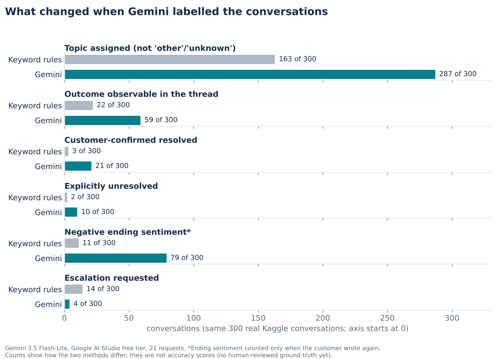
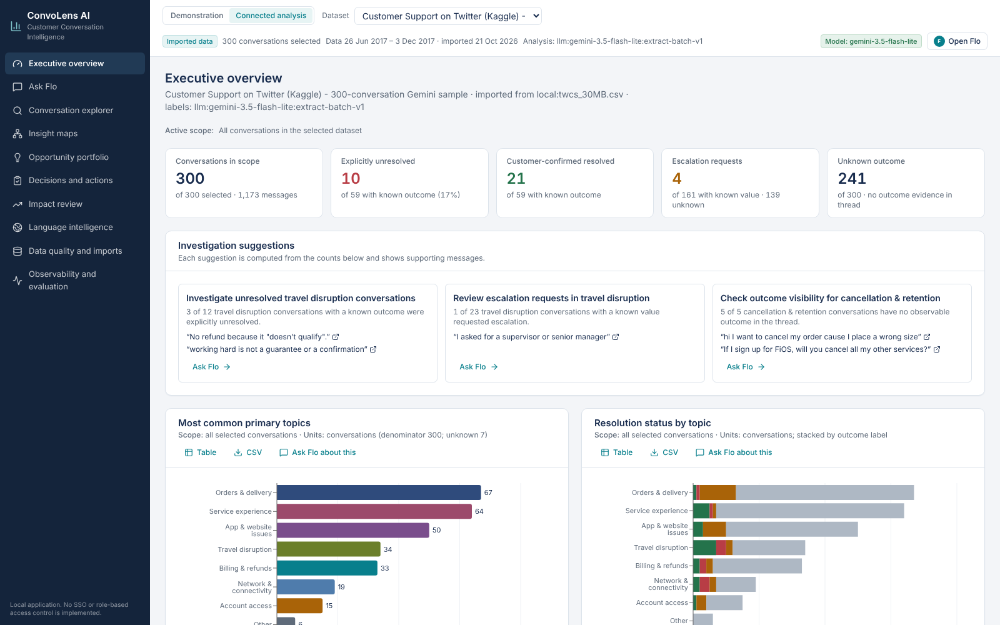
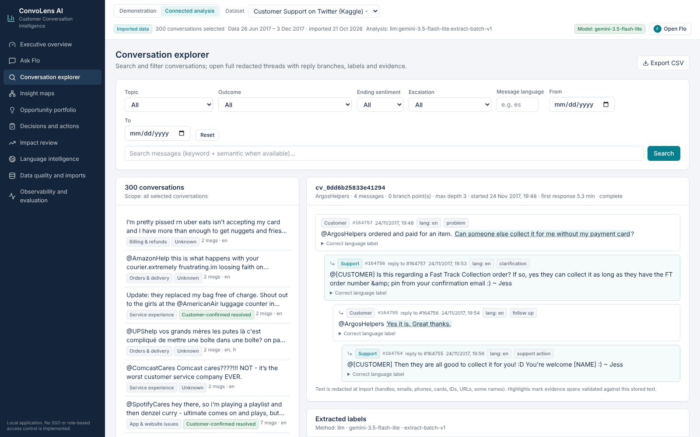
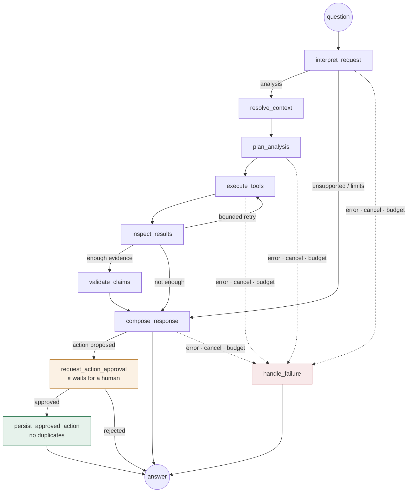

<div align="center">

# ConvoLens AI

### Customer conversation intelligence, with an AI analyst you can audit

**Find what drives customer contacts. See which conversations stay unresolved. Turn findings into owned actions.**<br>
Every number traces to an exact SQL count, and every claim to a real customer message.

       


<sub><b>Meet Flo, the built-in chatbot.</b> ① Type a question in the message box and press Enter, ② or click Send, ③ or pick a suggested question.</sub>

</div>

---

## The project in one paragraph

ConvoLens is an **agentic AI system for analysing customer-support conversations**. It runs on **3,000 real conversations** from the open-source Kaggle dataset [*Customer Support on Twitter*](https://www.kaggle.com/datasets/thoughtvector/customer-support-on-twitter). It rebuilds every conversation from its reply links and labels each one: what the customer wanted, whether the problem was solved, how they felt, and whether they asked to escalate. Every label is backed by a quote from the conversation. **Flo**, a LangGraph agent, answers questions in plain English. It plans which tools to call, counts with SQL, quotes real messages, checks its own claims before replying, and asks a person before saving any action.

---

## 🆕 We connected a real LLM: Google Gemini, free tier

To show the AI labelling on real data without paid credentials, we connected **Google Gemini through a free Google AI Studio key**.

| | |
|---|---|
| **Model** | `gemini-3.5-flash-lite`, through Gemini's OpenAI-compatible API |
| **Cost** | **Free tier**, no billing |
| **Usage** | **21 requests in total**: 15 conversations per request, one retry after a Google gateway error |
| **Sample** | 300 conversations drawn with the same seed from the real Kaggle data |
| **Key handling** | The key is never in the code or the repository. The environment's network layer adds it to requests to `generativelanguage.googleapis.com`. |

### How the results changed



| Same 300 real conversations | Keyword rules (before) | **Gemini (after)** |
|---|---|---|
| Conversations with a real topic | 163 (54%) | **287 (96%)** |
| Conversations left as "other" or "unknown" | 137 | **13** |
| Outcome visible in the thread | 22 | **59** |
| Customer-confirmed resolved | 3 | **21** |
| Explicitly unresolved | 2 | **10** |
| Negative ending sentiment (when the customer wrote again) | 11 | **79** |
| Escalation requested | 14 | **4** |
| Evidence quotes checked against the stored text | — | **374 matched exactly**; 7 didn't match and were dropped |
| Conversations with at least one verified quote | — | **294 of 300** |

**What this means:**
- **Topics:** the keyword rules missed nearly half the conversations. Gemini understands real customer language ("why is your rice always undercooked", "I still want the lyrics feature back") and assigned a real topic to 96% of them.
- **Outcomes:** Gemini found **nearly three times as many conversations with a visible outcome**. Most public threads still end without one (241 of 300), because the conversation moves to private messages. ConvoLens reports that honestly instead of guessing.
- **Escalation:** Gemini is **stricter**. The keyword rules flagged any mention of words like "complaint"; Gemini flags only explicit requests such as *"I asked for a supervisor or senior manager"*.
- **Accuracy:** these numbers show how the two methods differ. They are **not accuracy scores**, because no human-checked labels exist yet. The app supports reviewer corrections so those can be collected.

### Guardrails we added for the free model

| Problem we found while testing | What we built |
|---|---|
| Free tier allows only **20 requests per day** for Gemini Flash | Switched to Flash-Lite and **batched 15 conversations per request**. A hard request cap, no automatic retries, and labels cached so no conversation is sent twice. |
| The model **skipped evidence** when it was optional | Evidence is now **mandatory** in the schema, and any label without a verified quote is **downgraded to "unknown"** (recorded, not hidden) |
| A label once looked like a guess ("@O2 ? [URL]" marked *resolved*) | The same evidence rule now catches it |
| The model gave an "ending sentiment" for one-message conversations | Ending sentiment now counts **only when the customer wrote again** (162 set to unknown) |
| A support reply exposed a customer's first name ("Hi Debbie") | Redaction v2 removes names in greetings **before** any text reaches the model (536 names redacted) |
| Gemini rejected nested JSON schemas | Schemas are flattened for Gemini; Pydantic still validates the full structure afterwards |

<table>
<tr>
<td width="50%"><br><sub><b>Real data, Gemini labels.</b> The top bar shows the model and labelling method in use. Every number shows its denominator, e.g. "10 of 59 with known outcome".</sub></td>
<td width="50%"><br><sub><b>Evidence you can check.</b> Gemini labelled this real conversation <i>customer-confirmed resolved</i>. The highlighted quotes, <i>"Can someone else collect it…"</i> and <i>"Yes it is. Great thanks."</i>, are exact matches with the stored message.</sub></td>
</tr>
</table>

---

## Why CX teams should care

| What a CX team needs | What ConvoLens does |
|---|---|
| **Know what drives contacts** | Rebuilds real reply threads and labels topic, outcome, sentiment and escalation, then counts them in SQL, with "unknown" always shown |
| **See unresolved conversations** | Four outcomes: *customer-confirmed resolved*, *explicitly unresolved*, *solution offered but unconfirmed*, *unknown*. Silence is never counted as success. |
| **Answers grounded in evidence** | Numbers are checked against SQL results before they are shown, and quotes against the stored messages. One click opens the exact message. |
| **Prioritise improvements** | An opportunity portfolio with a visible scoring formula and **reviewer-entered** effort |
| **Keep humans in charge** | Flo can only **propose** actions. The workflow pauses until a person approves, edits or rejects, and a resumed run can't save a duplicate. |
| **Stay safe with untrusted text** | Customer text is treated as data, never instructions. A prompt-injection message in the test data is blocked, and a test proves it. |
| **Serve global customers** | Language is detected per message, including mixed and Romanized text such as Hinglish, and quality is reported per language |

> **No invented business impact.** ConvoLens reports no deflection savings, ROI, churn or CSAT unless the data contains them. Ask Flo for CSAT and it explains that the data has no ratings.

---

## Talk to Flo


<sub>① Your question, with the page and filters Flo used. ② Every answer: finding, scope and denominator, evidence, limitations, next step. ③ Each number (<code>M3</code>) is an exact SQL count. ④ Each quote (<code>E1</code>) opens the exact customer message. (Shown on demonstration data.)</sub>

| You type… | Flo does… |
|---|---|
| *Brief me on this dataset.* | Size, time range, top issues, outcomes and escalation requests |
| *Why are refund conversations unresolved?* | Measures outcomes in the refund scope and quotes what customers said, with reported patterns kept separate from causes |
| *Compare resolved and unresolved conversations.* | Side-by-side cohorts with numerators and denominators |
| *Prepare a decision brief.* | Finding, hypothesis, alternatives, proposed owner, success measure |
| *Propose an action to reduce unresolved refunds.* | Drafts an action and **waits for your approval** |
| *What is our CSAT score?* | Explains there is no CSAT data, with no invented number |

<table>
<tr>
<td width="33%" valign="top"><br><sub><b>Human approval.</b> Flo drafts; a person enters an owner and approves.</sub></td>
<td width="33%" valign="top"><br><sub><b>Honest limits.</b> A clear "not available" instead of a guess.</sub></td>
<td width="33%" valign="top"><br><sub><b>Transparent agent.</b> The real LangGraph path each answer took.</sub></td>
</tr>
</table>

---

## Real data at a glance

| Step | Result |
|---|---|
| Tweets read (30 MB extract of `twcs.csv`) | **159,240**, from 2012 to 2017 |
| Conversations rebuilt from reply links | **41,661** threads (420 with branching replies among those selected) |
| Eligible threads | **40,914** |
| **Selected for analysis (fixed seed)** | **3,000** conversations, 11,359 messages |
| Labelled by Gemini | 300 of them (same seed), using 21 free-tier requests |
| PII removed before storage or AI use | 8,282 customer handles · 2,489 URLs · 2,169 agent sign-offs · 536 names · 133 IDs · 55 phone numbers |
| Scale test (synthetic, full 2.8M-row size) | 3,000 selected from 754,223 eligible threads in **139 s** |

<table>
<tr>
<td width="50%"><br><sub><b>Issue map:</b> topics linked by observed co-occurrence, never shown as proven causes.</sub></td>
<td width="50%"><br><sub><b>Decisions and actions:</b> proposed → approved → in progress → completed, with owner, due date and approval history.</sub></td>
</tr>
</table>

---

## How it works



| Layer | Built with |
|---|---|
| Agent | LangGraph `StateGraph`: one state model, conditional routing, bounded loops, a human-approval pause, SQLite checkpoints |
| Tools | 11 typed, read-only LangChain tools with validated inputs and parameterised SQL. Model-written SQL or code is never run. |
| Models | **Gemini** (OpenAI-compatible API), Claude through Anthropic or Amazon Bedrock. Structured output; prompts are versioned. |
| Search | Keyword (BM25) plus sentence-transformer embeddings with FAISS, merged by rank and limited by metadata filters |
| Data pipeline | Schema checks, reply-graph rebuilding (branches, missing parents, loops, duplicates), stable IDs, reproducible sampling, an import manifest, background jobs |
| Trust | PII redaction, evidence validation, refusal rules, prompt-injection protection, tool, token and time budgets, session isolation |
| Observability | LangSmith tracing (redacted), run summaries, feedback, a live agent execution map |
| Evaluation | Topic, outcome, search, numbers, citations, refusals, tool choice, prompt injection, language. Reported per language. |
| Frontend | React 19 + TypeScript, Tailwind, Radix, Recharts, React Flow |
| Delivery | Docker Compose, lockfiles, **75 automated tests** |

---

## Run it

```bash
# 1. Backend (no keys needed for Demonstration mode)
cd convolens/backend && uv sync
uv run uvicorn app.main:app --host 127.0.0.1 --port 8000

# 2. Frontend (second terminal)
cd convolens/frontend && npm ci && npm run dev        # → http://127.0.0.1:5173

# 3. Import the Kaggle data
cd convolens/backend
uv run python -m app.ingestion.cli file ~/Downloads/twcs/twcs.csv

# 4. Label with Gemini (free key from aistudio.google.com/apikey)
export MODEL_PROVIDER=gemini GOOGLE_API_KEY=... GEMINI_MODEL=gemini-3.5-flash-lite MODEL_REQUESTS_PER_MINUTE=8
uv run python -m app.ingestion.cli analyze <dataset_id> --batch-size 15
```

You can also use Claude: set `MODEL_PROVIDER=anthropic` and `ANTHROPIC_API_KEY`, or `bedrock`. Docker: `cd convolens && docker compose up --build` → http://127.0.0.1:8080

---

## Honest status

| | |
|---|---|
| ✅ Built and tested | Full app; demo mode; real-data import of 3,000 conversations; **Gemini labelling of 300 real conversations**; charts, maps, approvals; Docker; 75 tests |
| ⏳ Not yet run | **Flo's live chat with Gemini** (skipped to save the free daily quota; the code path is tested with scripted models) · Gemini on all 3,000 conversations (about 200 requests, several days of free quota) · LangSmith traces · semantic search with downloaded embeddings |
| ⚠️ Known gaps | No human-checked labels yet, so Gemini's accuracy isn't measured · some agent sign-offs such as "~ Jess" are not redacted · see [Known limitations](docs/KNOWN_LIMITATIONS.md) |

**Documentation:** [Architecture](docs/ARCHITECTURE.md) · [Data dictionary](docs/DATA_DICTIONARY.md) · [Evaluation](docs/EVALUATION.md) · [Security](docs/SECURITY.md) · [Test results](docs/TEST_RESULTS.md) · [5-minute demo](docs/DEMO_SCRIPT.md)

<sub>Data: “Customer Support on Twitter” by Thought Vector on Kaggle, CC BY-NC-SA 4.0 (not included in this repository). Screenshots show redacted text. Chatbot screenshots use synthetic demonstration data; the Gemini screenshots use real, redacted Kaggle conversations.</sub>
