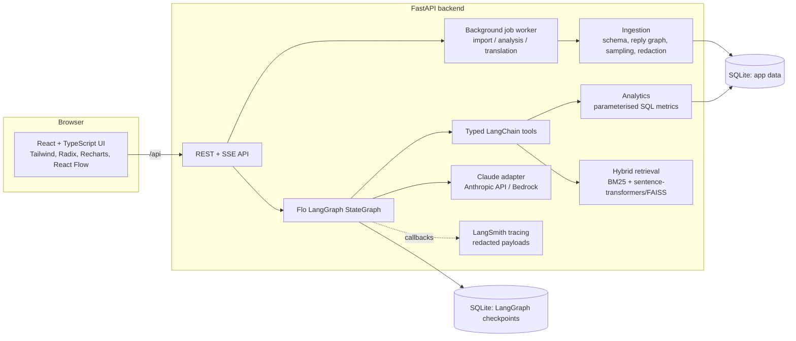
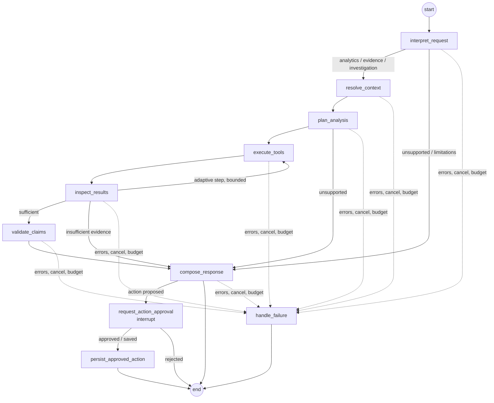

# Architecture

ConvoLens AI is one FastAPI backend and one React single-page app. The backend has a single LangGraph
`StateGraph` and a single SQLite database. There are no other services: retrieval, jobs and the agent
all run inside the backend process.

## Data flow

The product connects each step to the next:

Conversation data → calculated metrics → evidence-backed investigation → proposed decision → human review → assigned action → impact measurement.

| Step | Where |
|---|---|
| Conversation data | `app/ingestion/twcs.py` (parse, validate, reply graph), `app/ingestion/importer.py` (sample, redact, persist) |
| Calculated metrics | `app/analytics/metrics.py`: exact SQL counts with denominators and unknowns |
| Evidence-backed investigation | `app/graph/*` (Flo), `app/tools/catalog.py`, `app/retrieval/index.py` |
| Proposed decision | `prepare_decision_brief` tool → leadership brief; `propose_action` drafts an action |
| Human review | LangGraph `interrupt()` in `request_action_approval`; reviewer approves, saves as proposed, or rejects |
| Assigned action | `persist_approved_action` (idempotency key), then the Decisions page (owner, due date, status transitions, history) |
| Impact measurement | `app/analytics/impact.py`: baseline vs follow-up with comparability checks and a non-causal warning |

## Unit of analysis

A **conversation** is one reply tree: a connected component of `in_response_to_tweet_id` links, rooted at
a message whose parent is absent. Each message has at most one parent, so every message belongs to exactly
one conversation, and counts never include a message twice. Branches (one message with several replies) stay
inside one conversation. Conversations are never merged because they share an author.

## Ingestion pipeline (`app/ingestion`)

1. **Schema inspection.** The importer reads the header and rejects files that lack any of `tweet_id, author_id, inbound, created_at, text, response_tweet_id, in_response_to_tweet_id`.
2. **Pass 1 (no text in memory).** For each row it:
   - parses IDs as strings (it also accepts the `123.0` float artefact),
   - parses booleans explicitly (anything ambiguous is rejected),
   - parses timestamps (Twitter format, then ISO),
   - detects duplicates: identical rows are dropped; conflicting rows with the same ID taint their thread.
3. **Reply graph.** Children are built from `in_response_to_tweet_id` and cross-checked against `response_tweet_id`. The pass also detects missing parents, cycles (by colouring parent-pointer walks), branch points and dangling reply references.
4. **Eligibility.** A thread is eligible only if all of these hold:
   - the root is customer-initiated,
   - the root's parent is present,
   - there is at least one support reply,
   - it has at most 50 messages,
   - it has no cycle and no conflicting duplicate.

   Every other thread is stored as an exclusion with its reason.
5. **Sampling.** Eligible threads are sorted by stable key `cv_` + sha256(source kind, root ID). The importer draws `random.Random(seed).sample(eligible, min(3000, n))`. The method, seed and coverage go into the manifest.
6. **Pass 2.** Text is loaded only for selected messages.
7. **Per message:**
   - PII redaction (raw text is never stored),
   - a pseudonymous customer reference,
   - language detection,
   - an inferred journey stage.
8. **Per conversation:** rules analysis with evidence spans validated against the stored text. Effective labels are written for SQL.
9. **Manifest.** Records source, file hash, parser, redactor and detector versions, seed, counts, exclusions, completeness, branching statistics and import timestamps.

Imports run as background jobs (`app/ingestion/jobs.py`):

- **Progress** is reported by bytes read.
- **Cancellation** is checked every 20k rows and between batches; a cancelled import deletes its partial dataset.
- **Recovery:** jobs left running when the server restarts are marked `interrupted` and can be resumed.

Imports are idempotent: the dataset ID derives from the file hash and the import parameters.

## Flo agent (`app/graph`)

There is one state model, `FloState` (`app/graph/state.py`). It has these fields:

- **Identity:** `request_id`, `session_id`, `dataset_id`, `mode`
- **Context:** `messages`, `page`, `active_filters`, `resolved_filters`
- **Plan and results:** `question_type`, `analysis_plan`, `tool_results`, `evidence_ids`, `validated_evidence`, `validated_metrics`, `limitations`
- **Approval:** `proposed_action`, `approval_state`, `approval`, `action_record_id`
- **Outcome:** `errors`, `response`
- **Budgets:** `iterations`, `tool_calls`, `tokens_in`, `tokens_out`, `started_at`
- **Run metadata:** `prompt_versions`, `visited`

### Node behaviour

- **`interpret_request`** resets per-turn state. A deterministic guard catches unsupported metrics in both modes: CSAT, NPS, revenue, churn, location and agent performance. The model cannot talk its way around this guard.
- **`resolve_context`** applies the explicit UI filters as the scope. Topics named in the question narrow the scope only when no topic is selected. Otherwise Flo keeps the explicit scope and says so.
- **`plan_analysis`**:
  - Demonstration mode uses transparent rule templates per question type.
  - Connected mode asks Claude for a structured `LLMPlan` whose tool names are restricted to the allowlist. Every step's arguments are validated against that tool's Pydantic schema, and the active filters are forced onto every step so the model cannot widen the scope.
  - `propose_action` is dropped unless the user explicitly asked for an action.
- **`execute_tools`** runs the plan within a tool-call limit (`FLO_MAX_TOOL_CALLS`).
- **`inspect_results`** can add one bounded adaptive step: a broader example search, capped by `FLO_MAX_ITERATIONS` and the tool limit. It flags a scope as insufficient when its denominator is below `FLO_MIN_DENOMINATOR`.
- **`validate_claims`** turns tool outputs into numbered metrics (`M#`) with numerators, denominators and unknowns. It resolves evidence IDs against stored text (`E#`); invalid references are excluded and reported.
- **`compose_response`**:
  - Demonstration mode composes from templates.
  - Connected mode streams Claude tokens. The model sees only validated metrics and quoted evidence wrapped as untrusted data.
  - Every number in the answer must trace to a validated metric, quote, limitation or the question, and every `[E#]`/`[M#]` must resolve. On failure Flo retries once; then it shows only the validated tool results with an explicit notice.
- **`request_action_approval`** calls `interrupt()`, so the run is checkpointed and paused. **`persist_approved_action`** writes the action with a unique idempotency key: sha256 of session, request and proposal. A resumed or replayed run returns the existing record instead of creating a new one.
- **`handle_failure`** reports errors, cancellation and budget overruns. It never falls back to demonstration rules after a model error.

### Runtime

- **Limits:** tool calls, iterations, model tokens per request, wall-clock timeout and model retries (provider `max_retries`).
- **Checkpoints:** `langgraph-checkpoint-sqlite` (`SqliteSaver`, `var/checkpoints.db`), with thread ID `session_id/request_id`.
- **Sessions:** Flo sessions have an unguessable ID and a bearer token (hashed at rest). Runs, investigations, resume and cancel are all checked against the session.
- **Streaming:** Server-Sent Events carry real execution events — `run_started`, `node`, `tool`, `token`, `validation`, `approval_required`, `action_saved`, `answer` and `error`.

## Tools (`app/tools/catalog.py`)

There are 11 typed `StructuredTool`s:

`get_dataset_summary`, `get_topic_counts`, `get_resolution_breakdown`, `get_sentiment_breakdown`, `get_escalation_counts`, `compare_segments`, `search_conversations`, `get_conversation`, `get_evidence`, `prepare_decision_brief`, `propose_action`.

- Arguments are validated Pydantic models: `Filters` forbids extra fields and allowlists every value.
- Queries are SQLAlchemy expressions with bound parameters. No tool accepts SQL or code.
- Results carry dataset identity, applied filters, numerator/denominator, unknown counts, evidence IDs and `tool_meta` (duration, status, request ID, read-only flag).
- `propose_action` only drafts. It never writes.

## Retrieval (`app/retrieval/index.py`)

- **Keyword:** in-process BM25 over redacted messages.
- **Semantic:** `sentence-transformers` (default `paraphrase-multilingual-MiniLM-L12-v2`, an optional extra) with a FAISS `IndexFlatIP` over normalised embeddings.
- **Fusion:** reciprocal rank fusion (k=60), with at most two hits per conversation.
- **Filters:** metadata filters are resolved in SQL first, and only in-scope messages can be returned.
- **Unavailable semantics:** if the model or library is unavailable, the response says so (`semantic_unavailable_reason`). It is never silently replaced.

## Models (`app/llm/provider.py`)

`MODEL_PROVIDER=anthropic` uses `langchain_anthropic.ChatAnthropic`; `bedrock` uses `langchain_aws.ChatBedrockConverse`. Keys live only in the backend environment. There is no fallback.

Uses of the model:

- planning (structured output),
- answer synthesis (streamed),
- conversation extraction (`ConversationAnalysis` structured output, `extract-v1`),
- translation (`translate-v1`).

Prompt versions are recorded on every run and analysis.

## Observability (`app/observability/tracing.py`)

When `LANGSMITH_TRACING=true` and `LANGSMITH_API_KEY` are set, the graph runs with a `LangChainTracer`. Its client passes `hide_inputs` and `hide_outputs` through the redactor.

Each trace carries:

- a root run ID stored with the run,
- request ID, session, dataset and mode metadata,
- prompt versions, model calls, tool calls, graph steps and evidence IDs,
- latency and token usage,
- errors and user feedback (`create_feedback`).

The Observability page shows local summaries and fetches authorised deep links (`read_run` and `get_run_url`). Without credentials the page shows "LangSmith not configured" and everything else works.

## Storage

- `var/convolens.db`: application data. See [DATA_DICTIONARY.md](DATA_DICTIONARY.md).
- `var/checkpoints.db`: LangGraph checkpoints.
- Original unredacted text is never written anywhere.
