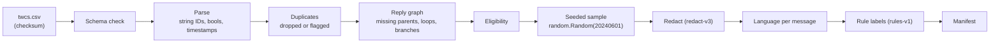

# Reproducing the 3,000-conversation dataset

The Kaggle data is **not** in this repository: it is licensed separately and contains customer text. These steps
rebuild the exact dataset used in the reports from the same input file.

## Source and licence

- **Dataset:** [Customer Support on Twitter](https://www.kaggle.com/datasets/thoughtvector/customer-support-on-twitter)
  by Thought Vector, file `twcs.csv`.
- **Licence:** CC BY-NC-SA 4.0, as listed on Kaggle (check the page before reuse). Attribution is required, use must
  be non-commercial, and derivatives must be shared under the same licence.
- **Format:** CSV with 7 required columns: `tweet_id, author_id, inbound, created_at, text, response_tweet_id,
  in_response_to_tweet_id`. The importer rejects files without them.

## The exact input used

The reports use a 30 MB extract of `twcs.csv` (its first rows, cut at a complete line):

| Field | Value |
|---|---|
| File | `twcs_30MB.csv` |
| Size | 29,999,948 bytes |
| SHA-256 | `f8a8c092c71c579e8cd0032254ba1d07d14e8fd39944ab80c0351ac731efb4f7` |

Check yours with `shasum -a 256 twcs_30MB.csv` (macOS) or `sha256sum twcs_30MB.csv` (Linux). A different file, including the
full `twcs.csv`, is imported the same way but gives a different (equally valid) 3,000-thread sample.

## Pipeline



**Eligibility:** the thread starts with a customer message whose parent is in the file, has at least one support reply,
has at most 50 messages, and contains no loop or conflicting duplicate ID.

## Commands

```bash
cd convolens/backend && uv sync --frozen
cp ~/Downloads/twcs_30MB.csv ../data/imports/
uv run python -m app.ingestion.cli file ../data/imports/twcs_30MB.csv --seed 20240601 --sample-size 3000
uv run python -m app.ingestion.cli list
```

## Expected counts (twcs_30MB.csv, seed 20240601)

| Count | Value |
|---|---|
| Rows read / unique messages | 159,240 / 159,240 |
| Reply threads | 41,661 |
| Eligible | 40,914 |
| Excluded: not customer-started / root parent missing / over 50 messages | 577 / 154 / 16 |
| **Selected conversations** | **3,000** |
| Selected messages | 11,359 (6,341 customer, 5,018 support) |

The import writes a manifest (file hash, parser and redactor versions, seed, counts, exclusions) shown on the
Data quality page.

## Model labels and embeddings (optional, need a key)

```bash
export MODEL_PROVIDER=gemini GOOGLE_API_KEY=... GEMINI_MODEL=gemini-3.5-flash-lite MODEL_MAX_RETRIES=0
uv run python -m app.ingestion.cli analyze <dataset_id> --batch-size 15 --max-requests 12   # resumable, cached
uv run python -m app.ingestion.cli embed <dataset_id> --max-texts 700                       # resumable, cached
```

Labels are cached by conversation content hash, model and prompt version, so re-runs skip finished work. Progress
can be moved between machines with `export-labels` and `import-labels`.
