<div align="center">


<br>


**[The story](#-the-story) · [What Muse does](#-what-muse-does) · [See it move](#-see-it-move) · [How Muse thinks](#-how-muse-thinks) · [Honest status](#-honest-status) · [Run it](#-run-it)**

</div>

<br>

<p align="center">
  
</p>

---

## ✦ The story

> *"I'm fine."* It's what so many women say in their forties and fifties. They say it while they're up at 3am again, holding back tears in a meeting for no reason they can name, running a company or a family, caring for parents and children, and quietly wondering whether this is just how life feels now.

Menopause is not an illness. It is a natural transition that most women reach between the ages of 45 and 55 ([WHO](https://www.who.int/news-room/fact-sheets/detail/menopause)). Yet for many it arrives with little warning and less support. The symptoms are real and wide-ranging: sleep, mood, memory, joints, skin, hair and appetite. They can start years before periods stop. Care is scattered. And the one thing that helps most, someone to talk to who understands, is often missing.

**FEMORA Muse was built to change that.**

Imagine **Bea**: 37, running a fast-growing company in the United States, never enough hours in the day. She doesn't think menopause is her story yet. But she wants to understand what's ahead, keep on top of her screenings, eat well across the cuisines she loves, and have somewhere to put the worries she doesn't say out loud.

Now imagine **Nancy** in Nashville, who wants to stay strong and sharp for the decades ahead, find a yoga class or a walking group nearby, and never miss a check-up.

They aren't the same woman, and Muse doesn't treat them as if they were. Muse doesn't assume Bea is menopausal because she opened the app, or that Nancy is religious because she asked about meditation. **Muse knows only what each woman chooses to share.**

> Bea and Nancy are example configurations used to describe the product. They are not real accounts, and the app holds no health records for them.

### Our purpose

<table>
<tr>
<td width="33%" valign="top">

#### 🕊️ To be heard
A companion who listens first, encourages often, can make you laugh, and knows when to say *"please talk to a clinician."*

</td>
<td width="33%" valign="top">

#### 🌍 To be understood
Food from every kitchen, every culture, every belief or none, every stage of life.

</td>
<td width="33%" valign="top">

#### 🛡️ To be safe
Private by default. Nothing invented. Nothing sent without your tap. Safety rules that never depend on an AI's mood.

</td>
</tr>
</table>

---

## ✦ What Muse does

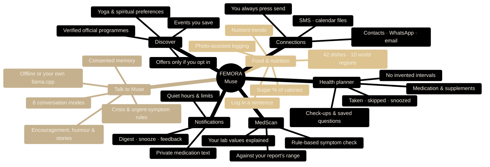

---

## ✦ See it move

<table>
<tr>
<td width="50%" valign="top">

### 💬 Talk to Muse
Long, warm conversations about anything: loneliness, sleep, work, family, confidence. Muse validates first, encourages sincerely, and always asks a caring question back. It tells original stories, makes you laugh, and answers precisely when you ask. Ask about your food and it quotes **exact numbers from your own log**, never guesses.

</td>
<td width="50%">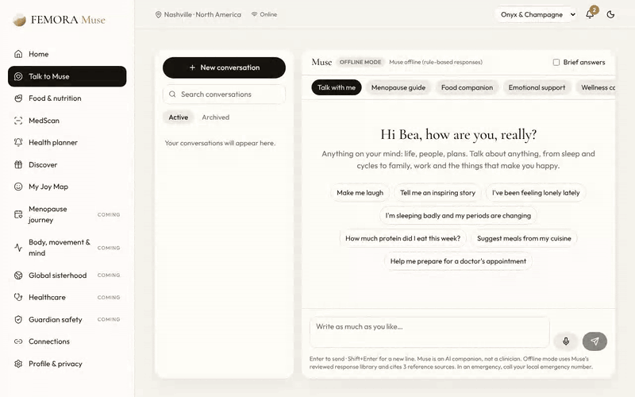</td>
</tr>
<tr>
<td width="50%">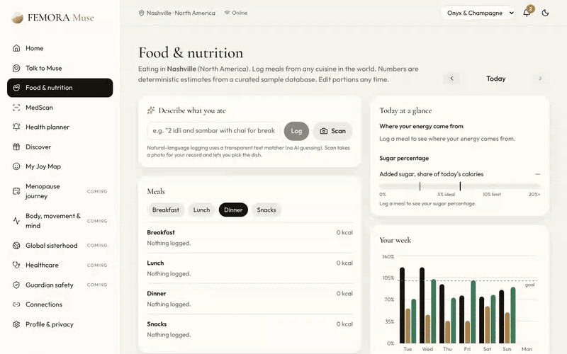</td>
<td width="50%" valign="top">

### 🍲 Food from every kitchen
Type *"2 idli and sambar with chai for breakfast"* and it's logged. Idli, jollof, laksa, tacos, shakshuka, congee: **42 dishes from 10 regions**, with editable portions and 14 nutrients. Muse shows where your energy comes from, your **sugar percentage** against WHO guidance, and how your week is trending.

</td>
</tr>
<tr>
<td width="50%" valign="top">

### ⏰ Health planner & notifications
Medication and supplement reminders that follow **exactly** the schedule you enter: taken, skipped or snoozed, with refill dates and adherence. Check-ups carry the questions you want to ask your clinician. Muse then greets you with *"Bea, you have a cervical screening on Thursday. Would you like to review the questions you saved?"* only because that appointment really exists.

</td>
<td width="50%">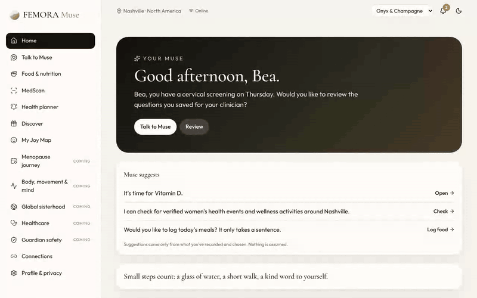</td>
</tr>
<tr>
<td width="50%"></td>
<td width="50%" valign="top">

### ✨ Three luxury themes
**Onyx & Champagne**, **Emerald & Ivory** and **Midnight & Pearl**, each in light and dark. Editorial typography, generous whitespace and quiet motion that respects *reduced motion*. Every colour lives in one file, [`tokens.css`](web/src/theme/tokens.css), so a full redesign never touches a feature.

</td>
</tr>
</table>

### A closer look

<table>
<tr>
<td width="50%">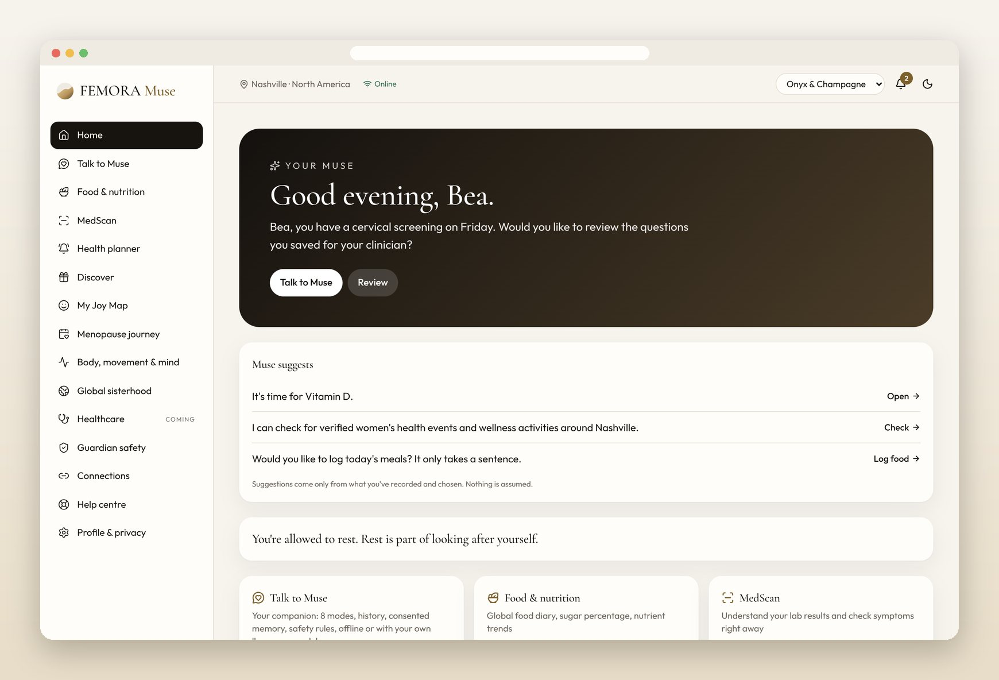<br><sub><b>Home:</b> proactive suggestions built only from what she's recorded</sub></td>
<td width="50%"><br><sub><b>Talk to Muse:</b> original stories, encouragement, conversation history</sub></td>
</tr>
<tr>
<td width="50%"><br><sub><b>Food:</b> energy split, sugar percentage, seven-day goal progress</sub></td>
<td width="50%">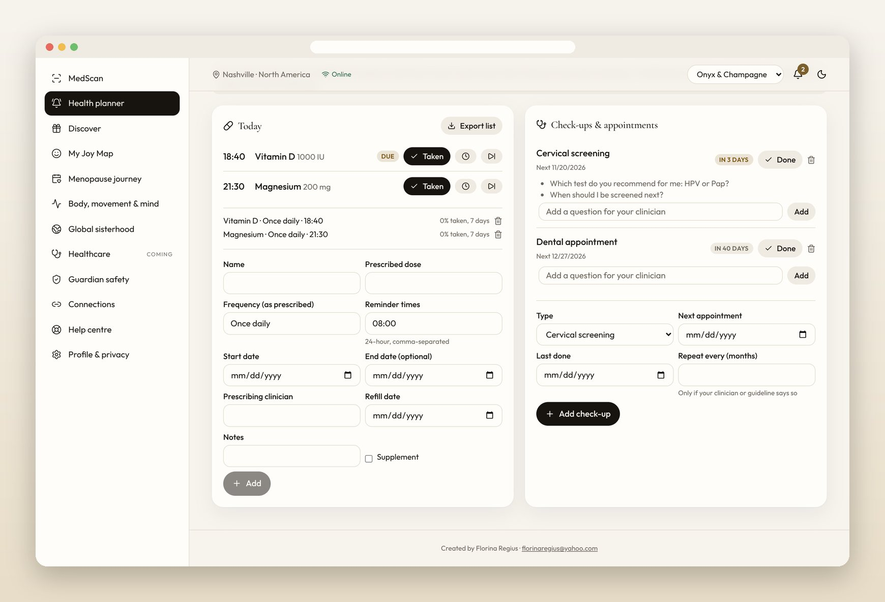<br><sub><b>Planner:</b> doses, refills, check-ups and questions for the clinician</sub></td>
</tr>
<tr>
<td width="50%">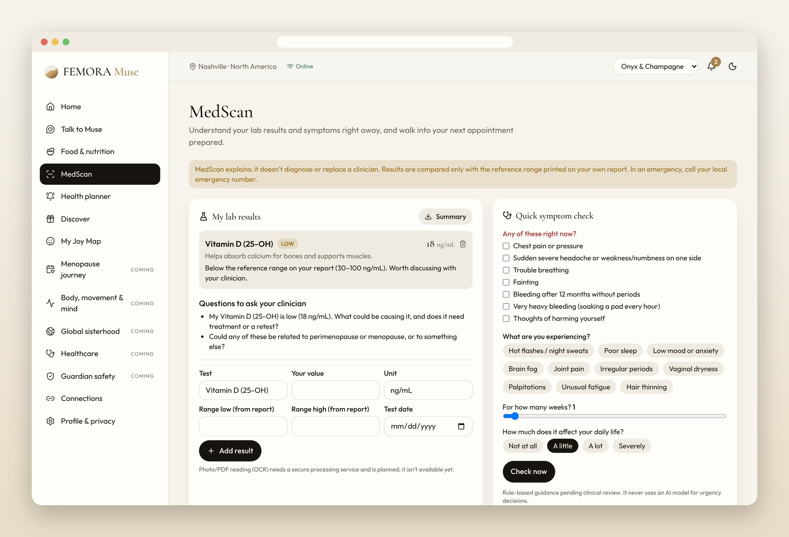<br><sub><b>MedScan:</b> lab values explained against <i>your</i> report's range</sub></td>
<td width="50%"><br><sub><b>Discover:</b> verified sources with check dates; nothing invented</sub></td>
</tr>
<tr>
<td width="50%">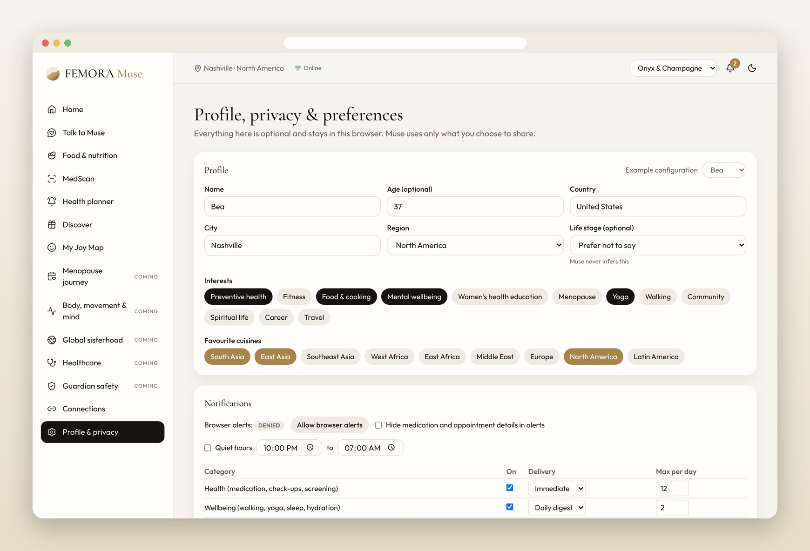<br><sub><b>Privacy & preferences:</b> notifications, model, memory, export and delete</sub></td>
<td width="50%"><br><sub><b>Emerald & Ivory, dark:</b> one token file, every page restyled</sub></td>
</tr>
</table>

<p align="center">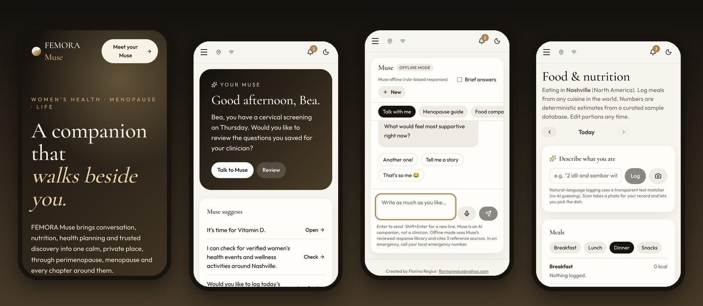<br><sub>Mobile-first: every page works at phone size.</sub></p>

> The tour above uses a handful of example entries typed in for the recording (meals, one reminder, one appointment). A fresh install starts completely empty.

---

## ✦ Graphs that mean something

Muse avoids dashboards for their own sake. Each chart answers a question a woman actually asks. These two are computed from Muse's own food table:

<p align="center"></p>

<p align="center"></p>

---

## ✦ How Muse thinks

Muse combines a warm conversation layer with **deterministic tools** for everything that must be right. No language model decides a dose, a reminder time, a screening interval or whether something is an emergency.

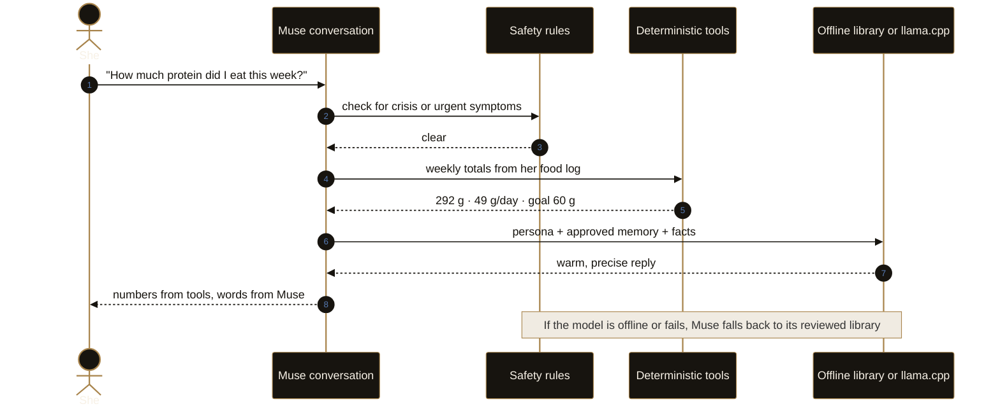

### Every notification earns its place

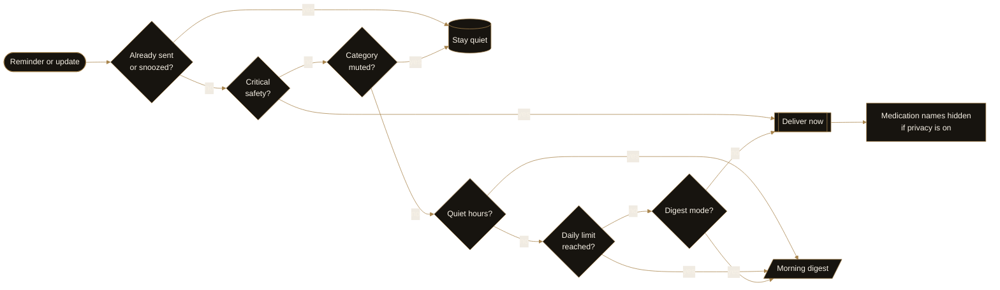

### Architecture

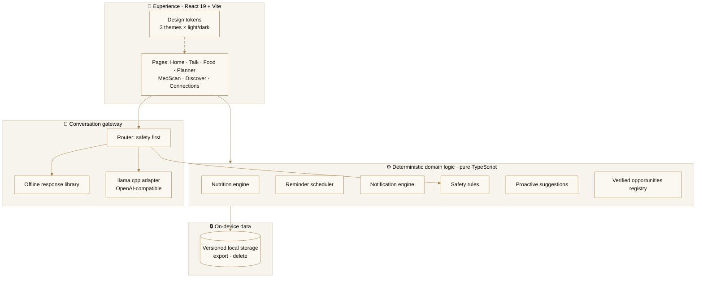

The domain logic is plain TypeScript with no UI dependencies, so the future **React Native app** reuses it as is.

### Tested, not just built

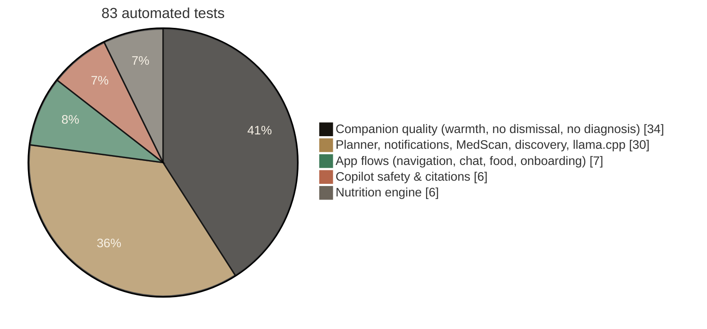

---

## ✦ Our promises

| | Promise | How it's enforced |
|---|---|---|
| 🚫 | **Nothing invented.** No fake events, discounts, appointments or lab values. | Discover only lists HTTP-verified official sources (with check dates), a verified feed, or events *you* save. Tests reject unverified items. |
| 🔒 | **Your data stays yours.** | Stored on your device. Export or delete everything in one tap. No account, no upload. |
| 🤝 | **Consent before memory.** | Memory is off until you approve a specific fact. Review and delete any time. |
| 📵 | **Nothing sent without your tap.** | WhatsApp, email, text and calendar open *your* apps with a draft. Muse never sends on its own. |
| 🩺 | **Supports clinicians, never replaces them.** | No diagnoses, no dose changes, no invented screening intervals. Crisis and urgent symptoms always route to real help first. |
| 🧘 | **Respects belief and solitude.** | Spiritual suggestions only if you choose them, including "none". Social nudges are gentle and optional. |

---

## ✦ Honest status

| Area | Status |
|---|---|
| Talk to Muse (offline library, safety rules, memory consent, llama.cpp adapter) | ✅ Available |
| Food & nutrition (global diary, sugar %, charts, photo-assisted logging) | ✅ Available |
| Health planner, notification engine, MedScan, Discover, Connections | ✅ Available |
| Luxury themes, responsive layout, route code-splitting | ✅ Available |
| Menopause journey (cycle calendar, symptoms, stage education, doctor summary) | ✅ Available |
| Forecasting trained on **10,375 real women** (CDC NHANES) with open-source lifelines, scikit-learn, statsmodels; personal next-period forecast | ✅ Available, see [ml/README.md](ml/README.md) |
| Agent evaluation with promptfoo (12/12 passing, in CI) | ✅ Available, see [evals/README.md](evals/README.md) |
| Body dashboard · Guardian · sisterhood map · onboarding tour | 🔜 In development |
| Accounts, encrypted sync, Gmail/Outlook, push notifications, mobile app, wearables | 🗺️ Roadmap (needs a server or the mobile app) |
| Clinical validation | ⏳ Not yet; Muse is not a medical device |

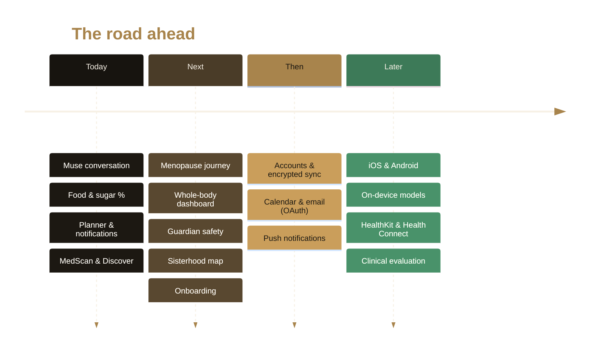

---

## ✦ Run it

```bash
cd femora/web
npm install
npm run dev        # http://127.0.0.1:5174
```

```bash
npm test           # 110 tests
npm run build      # production build
```

**Optional: your own private AI.** Run a [llama.cpp](https://github.com/ggml-org/llama.cpp) server on your computer, then open *Profile & privacy → Muse model*, press **Test connection** and enable it. Your conversation goes only to your machine.

```bash
llama-server -m your-model.gguf --port 8080
```

<details>
<summary><b>Project structure</b></summary>

```
femora/
├── web/                     React 19 + Vite + TypeScript app
│   ├── src/theme/           design tokens (all colours, type, radii)
│   ├── src/components/      theme-agnostic UI primitives, app shell
│   ├── src/modules/
│   │   ├── conversation/    router, safety rules, persona, offline library, llama.cpp adapter
│   │   ├── nutrition/       food table, deterministic engine, charts, scanner
│   │   ├── reminders/       medication & check-up scheduling
│   │   ├── notifications/   delivery rules engine
│   │   ├── medscan/         lab explainer & symptom triage
│   │   ├── opportunities/   verified registry & discovery
│   │   ├── connections/     contacts, WhatsApp, email, calendar links
│   │   └── muse/            proactive suggestions
│   └── src/__tests__/       83 tests
├── training/                companion dialogues (evaluation & future tuning)
└── docs/                    MUSE_PLAN.md, media
```

</details>

<details>
<summary><b>Tech stack</b></summary>

React 19 · TypeScript · Vite · Tailwind CSS 4 (token-driven) · React Router · Recharts · Lucide · Vitest + Testing Library · Playwright (visual checks) · llama.cpp (optional) · GitHub Actions (CI and a manual Pages deploy)

</details>

<details>
<summary><b>Deploying to GitHub Pages</b></summary>

Deployment is manual and needs the owner's approval: enable *Settings → Pages → Source: GitHub Actions*, then run **FEMORA deploy to GitHub Pages** from the Actions tab.

</details>

📖 Full plan: [docs/MUSE_PLAN.md](docs/MUSE_PLAN.md)

---

<div align="center">

### *Your health, your pace, your Muse.*

<sub>FEMORA Muse supports, and never replaces, professional medical care. In an emergency, call your local emergency number.</sub>

<br><br>

**Created by Florina Regius** · [florinaregius@yahoo.com](mailto:florinaregius@yahoo.com)

</div>
