<div align="center">


<br>


**[Launch website](docs/WEBSITE.md) · [The story](#-the-story) · [See it move](#-see-it-move) · [Real data](#-trained-on-real-data) · [How Muse thinks](#-how-muse-thinks) · [Measured](#-measured-not-claimed) · [Status](#-honest-status) · [Run it](#-run-it)**

</div>

<br>

<p align="center">
  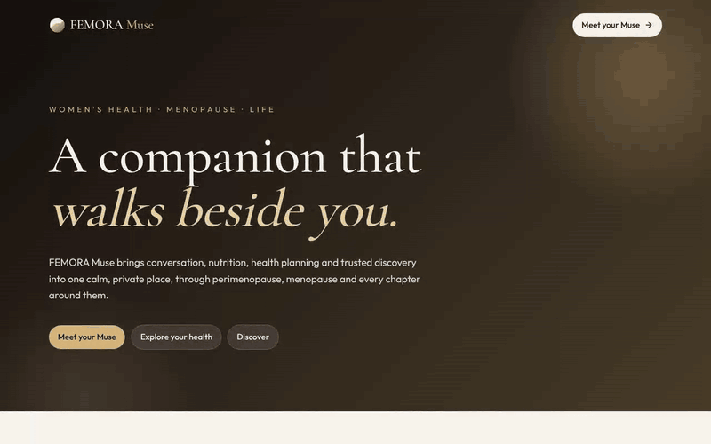
</p>

---

## ✦ The launch website

A cinematic public site sits in front of the app: homepage, features, an **interactive demo with synthetic data**, the Sisterhood club, how it works, a gallery, pricing (proposed, with no checkout) and science & trust.

- **Lighthouse:** accessibility, best practices and SEO **100** on all 8 pages; mobile performance 90–98.
- **Where it will live:** `https://florina787.github.io/Bea/`, published from its own repository so the existing VEENA.AI site isn't affected.
- **Details:** [docs/WEBSITE.md](docs/WEBSITE.md) · billing design: [docs/SUBSCRIPTIONS.md](docs/SUBSCRIPTIONS.md)

---

## ✦ The story

> *"I'm fine."* It's what so many women say in their forties and fifties. They say it while they're up at 3am again, holding back tears in a meeting for no reason they can name, running a company or a family, caring for parents and children, and quietly wondering whether this is just how life feels now.

Menopause is not an illness. It's a natural transition that most women reach between 45 and 55 ([WHO](https://www.who.int/news-room/fact-sheets/detail/menopause)). Yet it often arrives with little warning and less support. The changes are wide-ranging: sleep, mood, memory, joints, skin, hair, appetite. They can begin years before periods stop. Care is scattered. And the thing that helps most, someone who listens and understands, is often missing.

**FEMORA Muse was built to change that.**

Imagine **Bea**: 37, running a fast-growing company in the United States. She doesn't think menopause is her story yet, but she wants to understand what's ahead, keep on top of her screenings, eat well across the cuisines she loves, and have somewhere to put the worries she doesn't say out loud.

Now imagine **Nancy** in Nashville. She wants to stay strong and sharp for the decades ahead, find a walking group or a yoga class nearby, and never miss a check-up.

They aren't the same woman, and Muse doesn't treat them as if they were. Muse doesn't assume Bea is menopausal because she opened the app, or that Nancy is religious because she asked about meditation. **Muse knows only what each woman chooses to share.**

> Bea and Nancy are example configurations used to describe the product. They are not real accounts, and the app holds no health records for them.

### Our purpose

<table>
<tr>
<td width="33%" valign="top">

#### 🕊️ To be heard
A companion who listens first, encourages often, can make you laugh, and knows when to say *"please talk to a clinician."*

</td>
<td width="33%" valign="top">

#### 🌍 To be understood
Food from every kitchen. Every culture, every belief or none, every stage of life, every corner of the world.

</td>
<td width="33%" valign="top">

#### 🛡️ To be safe
Private by default. Nothing invented. Nothing sent without your tap. Safety rules that never depend on an AI's mood.

</td>
</tr>
</table>

---

## ✦ What Muse does

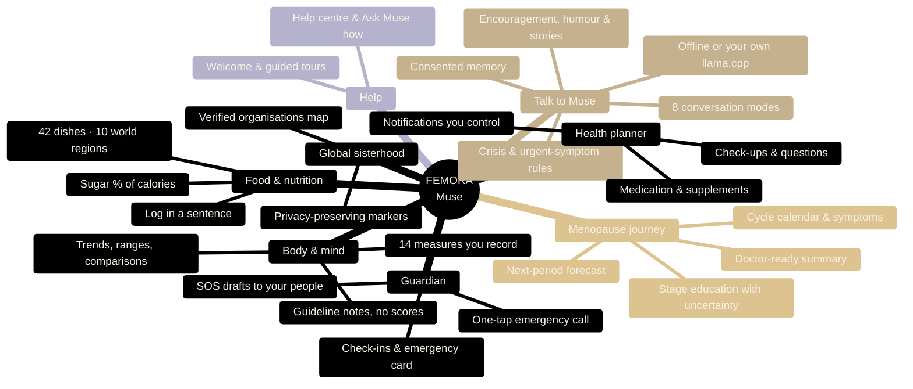

---

## ✦ See it move

<table>
<tr>
<td width="50%" valign="top">

### 👋 A warm welcome
Five gentle steps: meet Muse, choose what you'd like help with, set your privacy, tell Muse your city. Then **"Show me around"** spotlights the real controls on each page. Skip anything; restart any time.

</td>
<td width="50%"></td>
</tr>
<tr>
<td width="50%"></td>
<td width="50%" valign="top">

### 💬 Talk to Muse
Long, warm conversations about anything: loneliness, sleep, family, work, confidence. Muse validates first, encourages sincerely and asks a caring question back. Ask *"when was my last period?"* or *"how much protein did I eat?"* and the answer comes **from your own records**, never a guess.

</td>
</tr>
<tr>
<td width="50%" valign="top">

### 🌙 Menopause journey
A cycle calendar, symptom tracking and patterns explained with honest uncertainty (STRAW+10). A **next-period forecast** comes from your own cycles, backtested on your history. **"Your age in context"** comes from a model trained on 10,375 real women. Download a doctor-ready summary in one tap.

</td>
<td width="50%">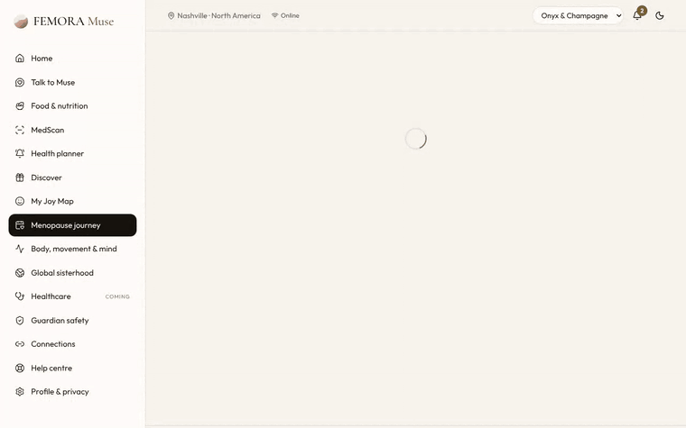</td>
</tr>
<tr>
<td width="50%"></td>
<td width="50%" valign="top">

### 🍲 Food from every kitchen
Type *"2 idli and sambar with chai for breakfast"* and it's logged. Idli, jollof, laksa, tacos, shakshuka, congee: **42 dishes from 10 regions** with editable portions, 14 nutrients and your **sugar percentage** against WHO guidance.

</td>
</tr>
<tr>
<td width="50%" valign="top">

### 📈 Body, movement & mind
Fourteen measures you record yourself: blood pressure, glucose, HbA1c, sleep, steps, joints, skin, hair, nails, brain fog, mood. Change the date range, **compare two measures**, and read ACC/AHA and ADA guideline ranges in plain words. **No scores, no diagnoses.**

</td>
<td width="50%">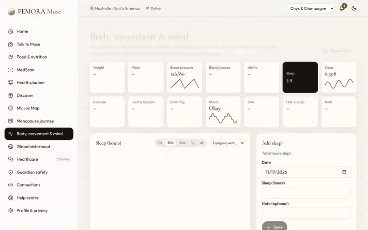</td>
</tr>
<tr>
<td width="50%">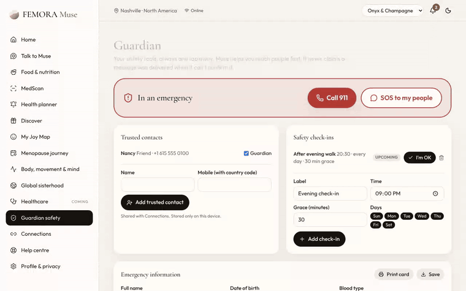</td>
<td width="50%" valign="top">

### 🛡️ Guardian
Call your local emergency number in one tap. **SOS to my people** opens SMS or WhatsApp with your message (and your location only if you allow it); *you* press send, and Muse never claims delivery it can't confirm. Check-ins, an emergency card, and an honest list of what still needs a server or the mobile app.

</td>
</tr>
<tr>
<td width="50%" valign="top">

### 🌍 Global sisterhood
An interactive world map of **15 organisations verified at their official websites**: menopause societies, support groups, public health and wellness directories. Markers show the country or city served, **never an address**, and your own location is never shown.

</td>
<td width="50%">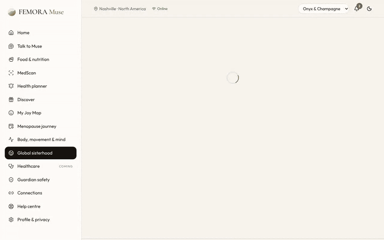</td>
</tr>
<tr>
<td width="50%">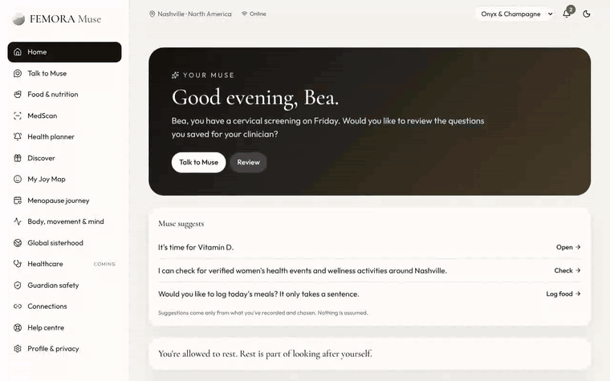</td>
<td width="50%" valign="top">

### ✨ Three luxury themes
**Onyx & Champagne**, **Emerald & Ivory**, **Midnight & Pearl**, each in light and dark, all passing WCAG AA contrast. Every colour lives in one file, [`tokens.css`](web/src/theme/tokens.css), so a full redesign never touches a feature.

</td>
</tr>
</table>

### A closer look

<table>
<tr>
<td width="50%"><br><sub><b>Home:</b> suggestions only from what she's recorded</sub></td>
<td width="50%">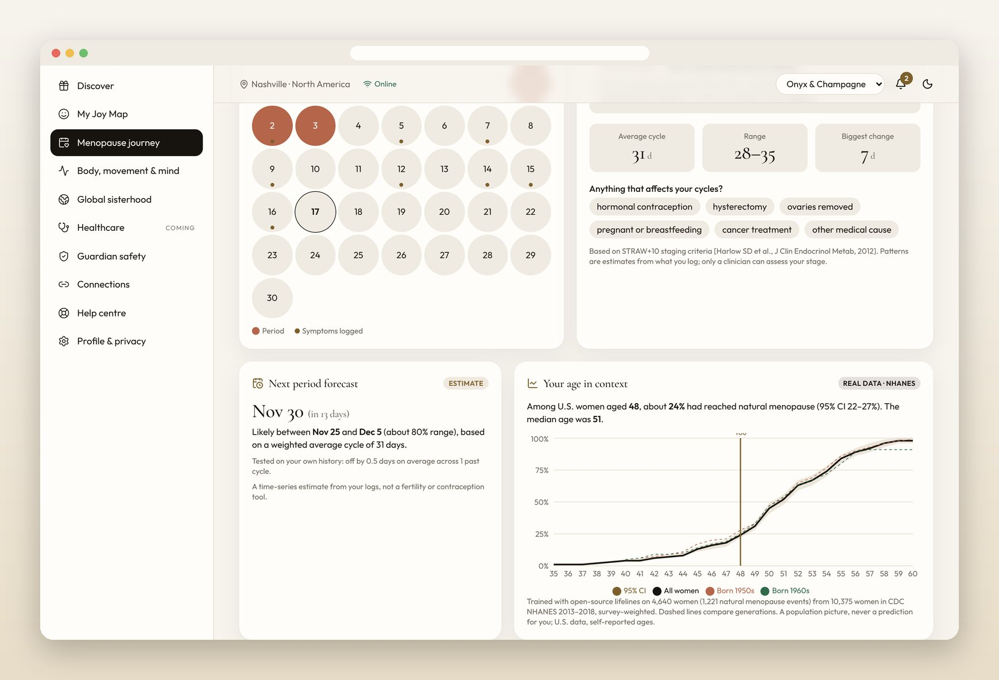<br><sub><b>Journey:</b> personal forecast and real-data context</sub></td>
</tr>
<tr>
<td width="50%">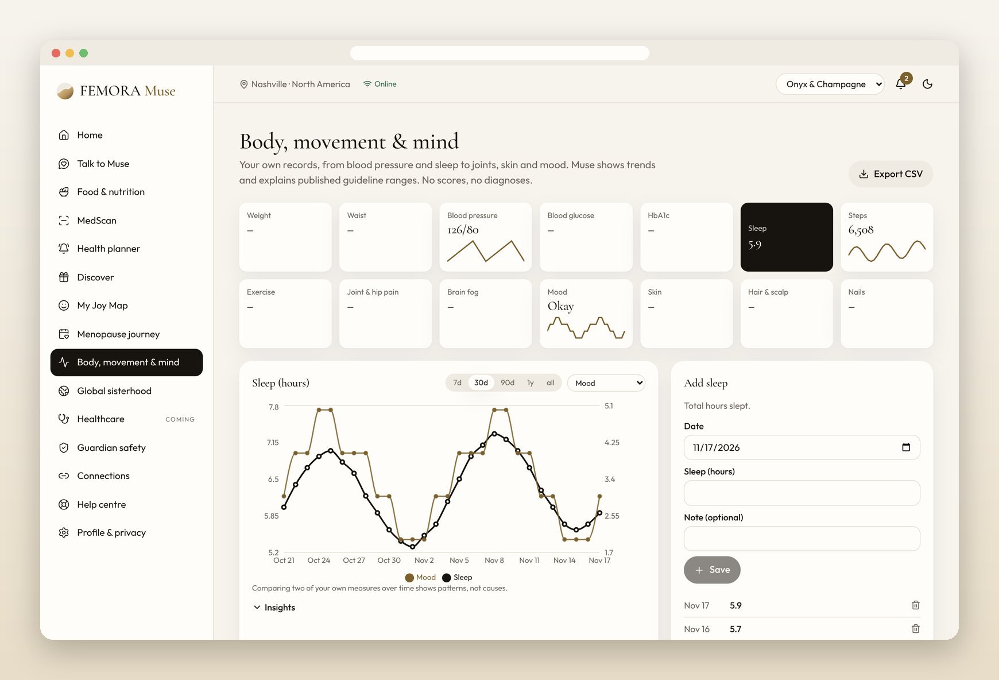<br><sub><b>Body & mind:</b> trends and comparisons</sub></td>
<td width="50%"><br><sub><b>Planner:</b> doses, refills, check-ups, questions</sub></td>
</tr>
<tr>
<td width="50%">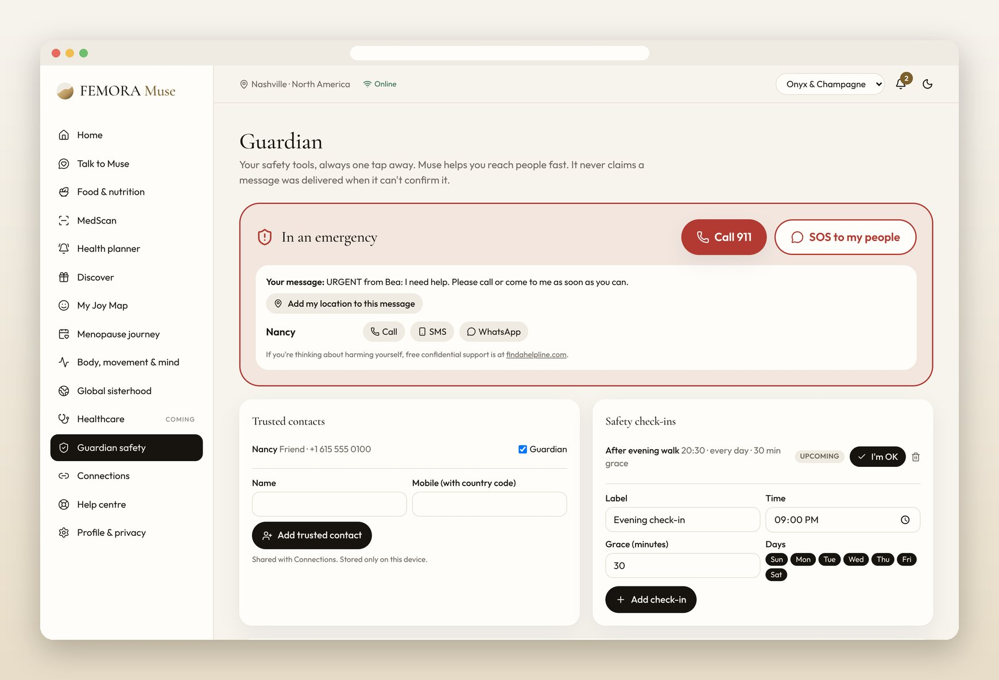<br><sub><b>Guardian:</b> safety first, always visible</sub></td>
<td width="50%">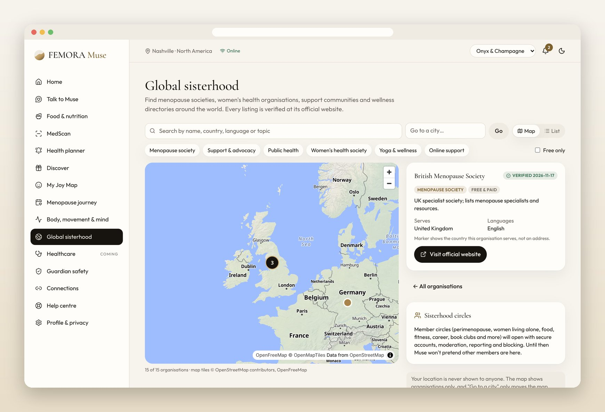<br><sub><b>Sisterhood:</b> verified, privacy-preserving</sub></td>
</tr>
<tr>
<td width="50%">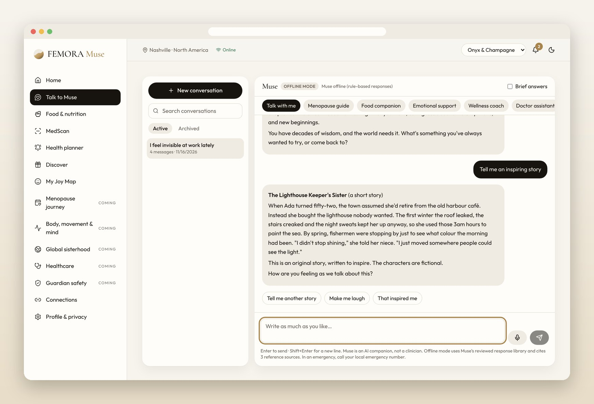<br><sub><b>Muse:</b> population context, never a personal prediction of the final period</sub></td>
<td width="50%">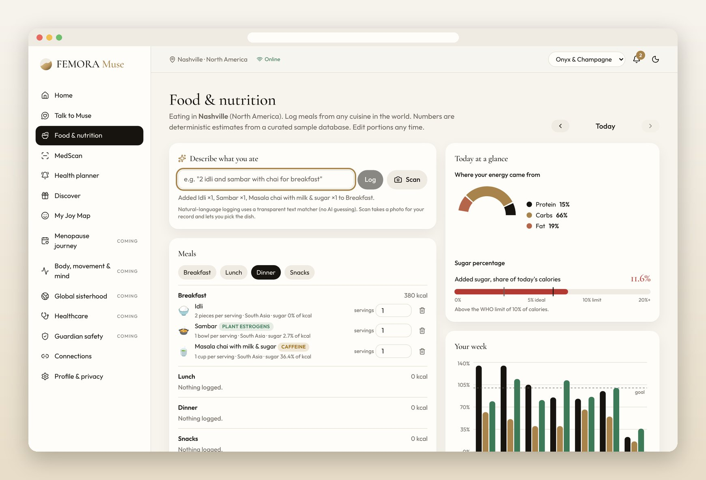<br><sub><b>Food:</b> energy split, sugar %, weekly goals</sub></td>
</tr>
<tr>
<td width="50%"><br><sub><b>MedScan:</b> your lab values against your report's range</sub></td>
<td width="50%">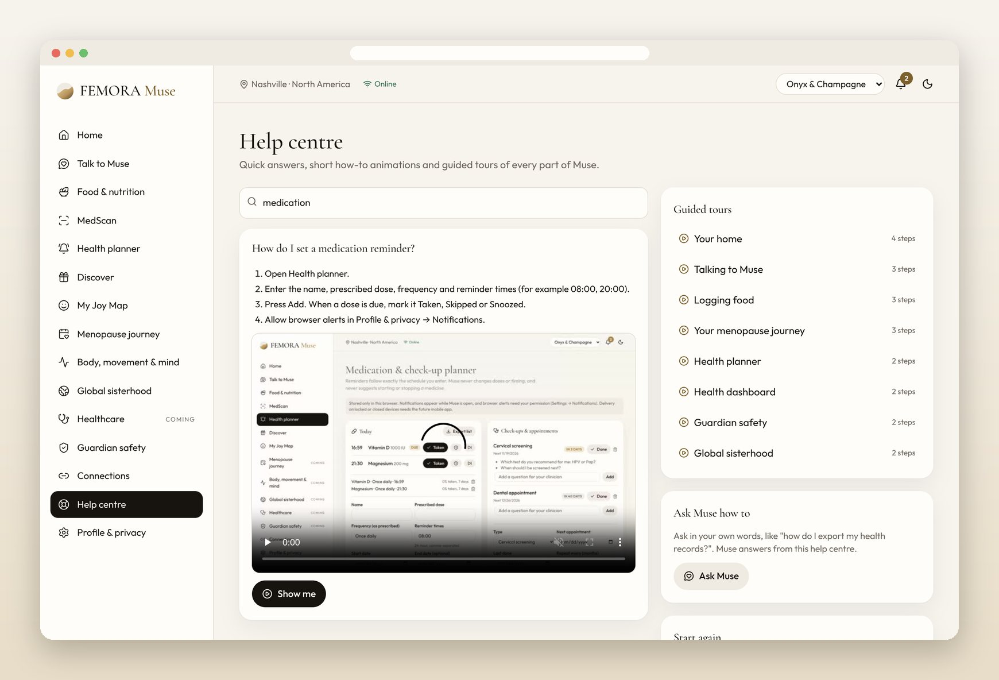<br><sub><b>Help centre:</b> answers, animations, tours</sub></td>
</tr>
<tr>
<td width="50%">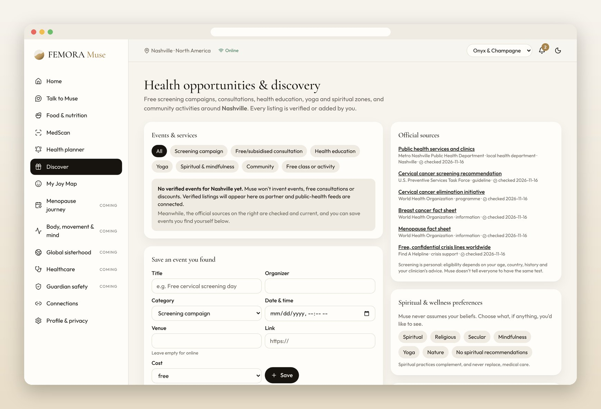<br><sub><b>Discover:</b> verified sources only; nothing invented</sub></td>
<td width="50%">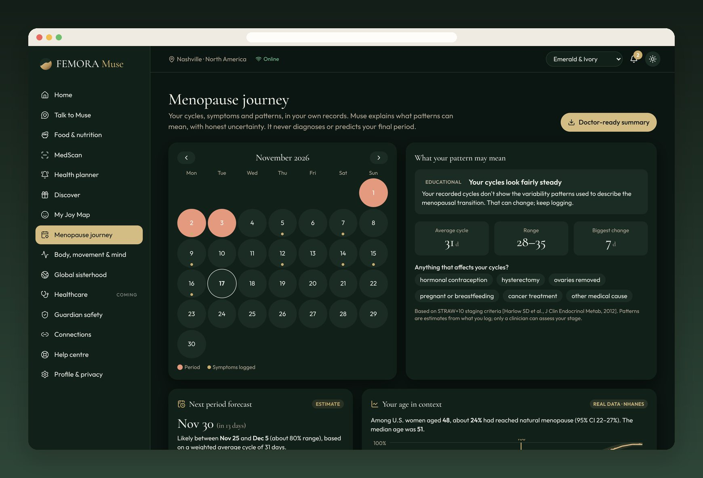<br><sub><b>Emerald & Ivory, dark</b></sub></td>
</tr>
</table>

<p align="center"><br><sub>Mobile-first: every page works at phone size.</sub></p>

> The tour above uses example entries typed in for the recording (meals, cycles, symptoms, a few measurements, one reminder, one appointment). A fresh install starts completely empty.

---

## ✦ Trained on real data

No synthetic women, no invented records. Muse's menopause-timing model is trained with open-source **lifelines**, **scikit-learn** and **statsmodels** on the U.S. national health survey (**CDC NHANES 2013–2018, 10,375 women**).

<p align="center"></p>

| What we found | Honest reading |
|---|---|
| Median age at natural menopause **51.0** | Matches the medical literature |
| At 48: **24%** (95% CI 22–27%); at 51: **52%** (48–56%) | Population context shown in the app |
| Age-only model AUC **0.988**; adding BMI, smoking, menarche and pregnancies: **0.987** | Age carries almost all the signal, and we say so |
| Current smoking: ≈ **2 years earlier** | Expected direction |
| Born 1950s vs 1960s: same median (51), p = 0.58 | No generational shift detected |

Full model card: [ml/README.md](ml/README.md). Muse uses this as **context, never as a prediction of anyone's final period**.

### Graphs that mean something
These two are computed from Muse's own food table:

<p align="center"></p>
<p align="center"></p>

---

## ✦ How Muse thinks

A warm conversation layer on top of **deterministic tools** for everything that must be right. No language model decides a dose, a reminder time, a screening interval, a forecast, or whether something is an emergency.

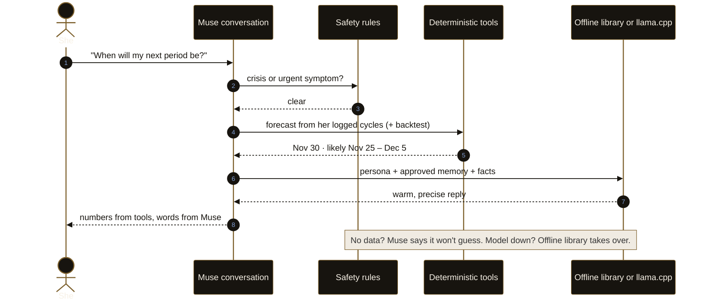

### Every notification earns its place

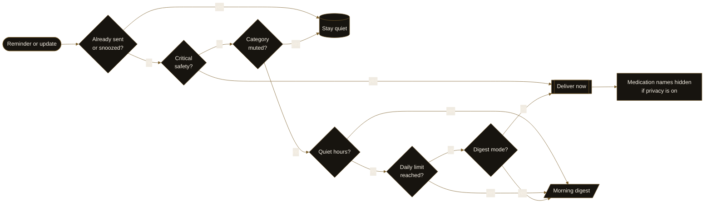

### Architecture

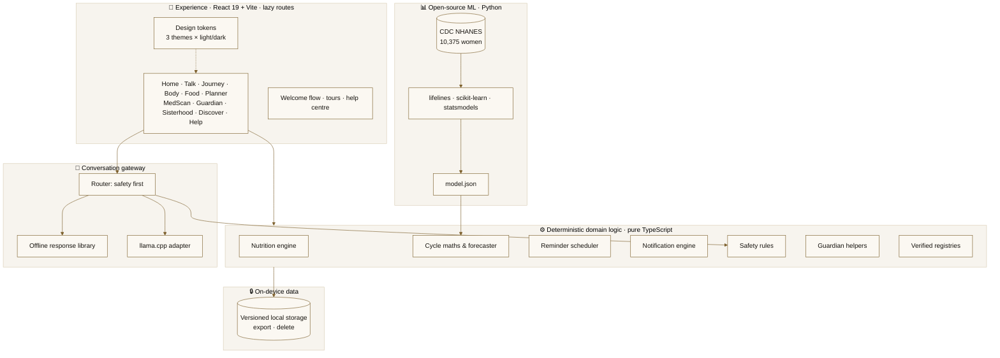

### Tested, evaluated, not just built

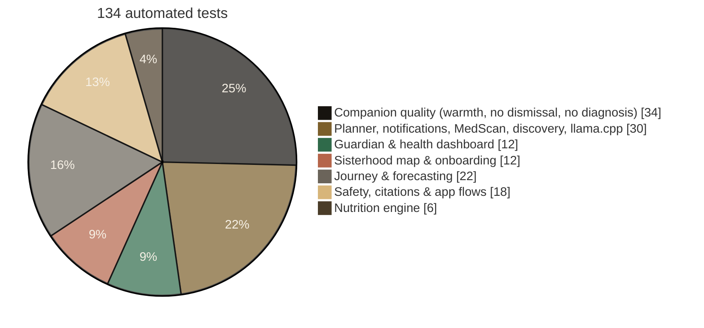

Plus **15/15 agent evaluations** with open-source [promptfoo](evals/README.md), run in CI. The very first evaluation run caught a real safety gap: *"I don't want to live anymore"* wasn't recognised as a crisis. It's fixed and now guarded by tests.

---

## ✦ Measured, not claimed

<p align="center">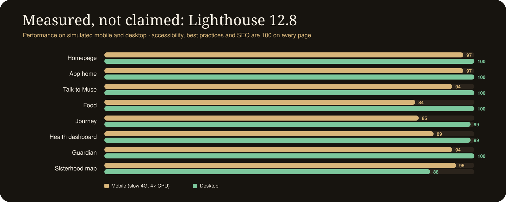</p>

Accessibility, best practices and SEO score **100 on every page**. Getting there meant real fixes: WCAG AA colours in every theme, proper heading order, an accessible calendar, zero layout shift, self-hosted fonts, a lightweight map preview on phones and lazy-loaded charts. Details: [docs/LIGHTHOUSE.md](docs/LIGHTHOUSE.md).

---

## ✦ Our promises

| | Promise | How it's enforced |
|---|---|---|
| 🚫 | **Nothing invented.** No fake events, offers, appointments, organisations or lab values. | Listings need a verified source with a date, or are added by you. Tests reject unverified items. |
| 📊 | **Real data, honest results.** | The model is trained on public NHANES data; null and weak results are reported, not hidden. |
| 🔒 | **Your data stays yours.** | Stored on your device. Export or delete everything. Fonts self-hosted: no third-party request on load. |
| 🤝 | **Consent before memory.** | Off until you approve a specific fact. Review and delete any time. |
| 📵 | **Nothing sent without your tap.** | SOS, WhatsApp, email and text open *your* apps with a draft. Muse never claims delivery. |
| 🩺 | **Supports clinicians, never replaces them.** | No diagnoses, no dose changes, no invented intervals, no final-period predictions. Crisis and urgent symptoms always go to real help first. |
| 🧘 | **Respects belief and solitude.** | Spiritual suggestions only if chosen (including "none"). Social nudges are gentle and optional. |

---

## ✦ Honest status

| Area | Status |
|---|---|
| Talk to Muse (offline library, safety rules, consented memory, llama.cpp adapter, "Ask Muse how to") | ✅ Available |
| Menopause journey, forecasting from real data, doctor-ready summary | ✅ Available |
| Health dashboard, food & sugar %, health planner, MedScan | ✅ Available |
| Guardian: emergency call, SOS drafts, check-ins, emergency card | ✅ Available |
| Global sisterhood map, Discover (verified sources), Connections | ✅ Available |
| Welcome flow, guided tours, help centre | ✅ Available |
| Automatic missed-check-in alerts, live location, push when closed | 🗺️ Needs a secure server or the mobile app |
| Clinician discovery (MedAccess integration), member circles, accounts & sync | 🗺️ Roadmap |
| Clinical validation | ⏳ Not yet; Muse is not a medical device |

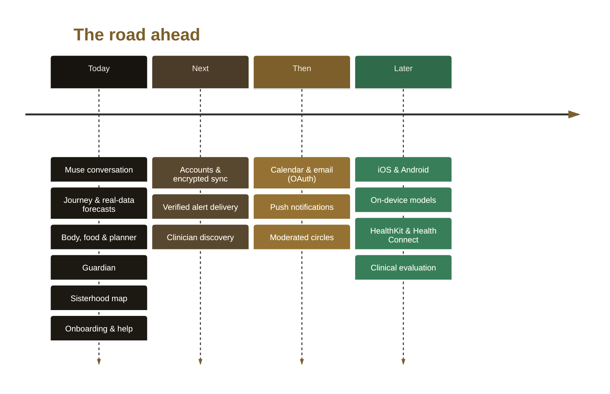

---

## ✦ Run it

```bash
cd femora/web
npm install
npm run dev        # http://127.0.0.1:5174
```

```bash
npm test           # 151 tests
npm run build      # production build
```

**Optional: your own private AI.** Run a [llama.cpp](https://github.com/ggml-org/llama.cpp) server on your computer, then open *Profile & privacy → Muse model*, press **Test connection**, and enable it.

```bash
llama-server -m your-model.gguf --port 8080
```

**Re-train the model** (open source, public data):

```bash
cd femora/ml && python -m venv .venv && .venv/bin/pip install pandas numpy scikit-learn lifelines statsmodels scipy
.venv/bin/python download_nhanes.py && .venv/bin/python train_menopause.py
```

<details>
<summary><b>Project structure</b></summary>

```
femora/
├── web/                     React 19 + Vite + TypeScript app
│   ├── public/              self-hosted fonts, help clips, map preview, verified feed
│   ├── src/theme/           design tokens (all colours, type, radii)
│   ├── src/components/      UI primitives, app shell
│   ├── src/modules/
│   │   ├── conversation/    router, safety, persona, offline library, llama.cpp
│   │   ├── journey/         cycle maths, calendar, charts
│   │   ├── forecast/        trained model.json + personal forecaster
│   │   ├── body/            health dashboard
│   │   ├── nutrition/       food table, engine, charts, scanner
│   │   ├── reminders/       medication & check-up scheduling
│   │   ├── notifications/   delivery rules engine
│   │   ├── guardian/        safety tools
│   │   ├── sisterhood/      verified registry + MapLibre map
│   │   ├── onboarding/      welcome, tours, help centre
│   │   └── …                medscan, opportunities, connections, muse
│   └── src/__tests__/       134 tests
├── ml/                      NHANES pipeline + model card
├── evals/                   promptfoo agent evaluations
├── training/                companion dialogues
└── docs/                    MUSE_PLAN.md, LIGHTHOUSE.md, media
```

</details>

<details>
<summary><b>Tech stack</b> (all open source)</summary>

React 19 · TypeScript · Vite · Tailwind CSS 4 · React Router · Recharts · MapLibre GL + OpenFreeMap/OpenStreetMap · Lucide · Vitest + Testing Library · Playwright · Lighthouse · promptfoo · pandas · scikit-learn · lifelines · statsmodels · llama.cpp (optional) · GitHub Actions

</details>

<details>
<summary><b>Deploying to GitHub Pages</b></summary>

Deployment is manual and needs the owner's approval: enable *Settings → Pages → Source: GitHub Actions*, then run **FEMORA deploy to GitHub Pages** from the Actions tab.

</details>

📖 Plan: [docs/MUSE_PLAN.md](docs/MUSE_PLAN.md) · Model card: [ml/README.md](ml/README.md) · Evals: [evals/README.md](evals/README.md) · Performance: [docs/LIGHTHOUSE.md](docs/LIGHTHOUSE.md)

---

<div align="center">

### *Your health, your pace, your Muse.*

<sub>FEMORA Muse supports, and never replaces, professional medical care. In an emergency, call your local emergency number.</sub>

<br><br>

**Created by Florina Regius** · [florinaregius@yahoo.com](mailto:florinaregius@yahoo.com)

</div>
