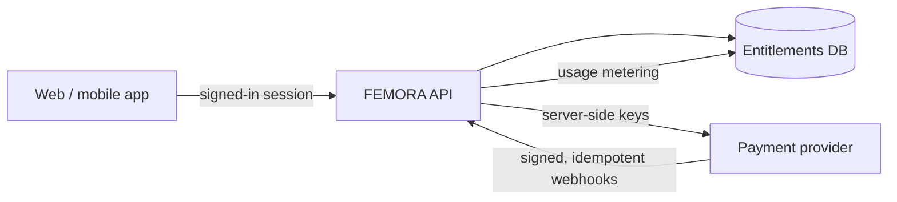

# Subscriptions & entitlements: architecture (not active)

**Status: no payments, no subscriptions, no trials are active.** The website shows proposed plans (FEMORA Free, Plus, Circle) and a proposed 30-day trial. Nothing collects payment details, and the shipped billing provider (`noBilling`) cannot start a trial or charge anything.

## Principles
- The browser is **never** the source of truth for what someone has paid for. `localStorage` can be edited by anyone.
- GitHub Pages hosts only static files: **no secret keys** for a payment provider may ever be shipped in this website.
- No automatic billing without explicit consent. A trial ends by returning to Free unless the member actively chooses a paid plan.
- Prices, AI allowances and terms are published **before** any checkout exists.

## Code today (`web/src/modules/billing/entitlements.ts`)
| Piece | Purpose |
|---|---|
| `PLANS` | Plan names, taglines, feature lists, AI-allowance wording; prices `To be announced` |
| `FEATURE_LABEL`, `hasFeature()` | Entitlement map used by the pricing table |
| `trialWindow()` | Pure trial maths: start, expiry (30 days), reminder (3 days before) |
| `BillingProvider` interface | What any real provider must implement: `getEntitlement()`, `startTrial()` |
| `noBilling` | The only provider shipped: `available: false`; refuses trials with a plain reason |

## Required production design

1. **Authenticated accounts** (passkeys or email + MFA). One trial per account, plus abuse controls (device and payment fingerprinting, rate limits).
2. **Entitlements table**: `account_id, plan, status (none|trialing|active|past_due|cancelled|expired), trial_started_at, trial_ends_at, current_period_end, source`.
3. **Trial start**: server sets both timestamps, records consent text and version, and schedules a reminder 3 days before expiry. No card is required for the trial.
4. **Webhooks**: verify signatures, store event IDs for idempotency, process in order, and handle retries.
5. **Usage accounting**: hosted-AI messages counted server-side per period. Limits are enforced by the API (HTTP 402/429 with a clear message), and the app shows a live counter.
6. **Cancellation**: one step and effective at period end. On-device data is never deleted because of plan changes; synced copies follow the published retention policy, and can be exported or deleted at any time.
7. **Security & compliance review** before launch: PCI scope (use hosted checkout), consumer-protection rules for trials and auto-renewal in each market, privacy review.

## What has to happen before turning anything on
- [ ] Owner approves prices, allowances, trial terms and policies
- [ ] Backend (API + database) deployed with authentication
- [ ] Payment provider account, server-side keys, webhooks tested in sandbox
- [ ] Legal review of terms, cancellation and data-retention text
- [ ] Replace `noBilling` with a server-backed provider; keep the browser display-only
