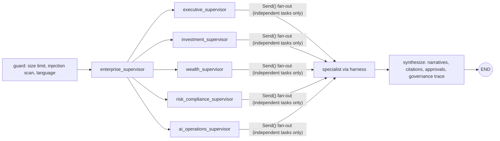

# Agents, orchestration, harness, retrieval and LLM observability

## J. Journey orchestration (LangGraph)

The graph is a DAG — there are no agent-to-agent loops; `recursion_limit=25` bounds execution. Routing is deterministic
(rules + chart context + role defaults). Parallel execution is used only for independent specialists (e.g. AUM,
financial performance and revenue agents for the CEO question).

| # | Agent | Supervisor | Tools (allowlist) | Roles |
|---|---|---|---|---|
| 1 | aum_agent | executive | finance.kpis, finance.aum_waterfall, finance.net_flows | executive, finance, cio, analyst |
| 2 | financial_performance_agent | executive | finance.kpis, finance.revenue_expenses, finance.margin_trend | executive, finance |
| 3 | revenue_agent | executive | finance.revenue_attribution | executive, finance |
| 4 | portfolio_agent | investment | investment.portfolio_detail, investment.enterprise_concentration | cio, analyst, advisor, executive |
| 5 | benchmark_agent | investment | investment.fund_list, market.intelligence | cio, analyst, executive |
| 6 | investment_research_agent | investment | docs.search (model-planned) | cio, analyst, executive, advisor |
| 7 | market_intelligence_agent | investment | market.intelligence | investment, executive, advisors |
| 8 | risk_agent | risk & compliance | risk.heatmap, investment.enterprise_concentration, investment.correlation | cio, analyst, executive |
| 9 | scenario_agent | investment | scenario.run, scenario.compare | cio, analyst, executive |
| 10 | client_intelligence_agent | wealth | client.profile, client.interactions | advisor, compliance |
| 11 | wealth_advisor_agent | wealth | client.portfolios, client.suitability | advisor, compliance |
| 12 | retirement_planning_agent | wealth | client.retirement, client.goals | advisor |
| 13 | product_research_agent | wealth | investment.fund_list, docs.search | all incl. external advisors (public data) |
| 14 | client_meeting_agent | wealth | client.*, comms.draft (send is approval-gated) | advisor |
| 15 | compliance_research_agent | risk & compliance | docs.search (model-planned), compliance.events | compliance, executive, advisor, cio |
| 16 | board_reporting_agent | executive | finance.kpis, finance.actual_vs_budget, strategy.initiatives, risk.heatmap | executive |
| 17 | decision_memory_agent | executive | strategy.decisions, strategy.decision_list | executive, cio, compliance |
| 18 | operational_intelligence_agent | AI ops | aiops.traces, aiops.breakers, docs.search | ai_admin |
| 19 | data_quality_agent | AI ops | data_quality.run | ai_admin, executive |
| 20 | evaluation_agent | AI ops | aiops.traces | ai_admin |

All agents have Pydantic input schemas and a common structured output (`narrative`, `facts`, `citations`, `warnings`,
`approval`, `charts`). Full contracts (owner, version, roles, tools, schemas, budgets, classification, approval and
evaluation requirements) are served by `GET /api/agents` and asserted by tests.

## O. Agent harness (`harness/runtime.py`)

Request admission (role check, schema validation, input size, global concurrency semaphore with load shedding) →
identity propagation → idempotency cache (key = tenant, user, roles, agent version, language, input, dataset version)
→ budgeted execution (iterations, tokens, cost, deadline) → cancellation (`POST /api/ask/{id}/cancel`) → retries with
exponential backoff + jitter for retryable errors → circuit breakers per upstream (`harness/resilience.py`) → output
schema validation + numeric grounding → error classification → telemetry trace + audit events. Checkpointing/resume:
LangGraph checkpointers (in-memory for Ask; SQLite for durable approval workflows).

The **tool gateway** (`harness/tools.py`) rejects unknown tools, prohibited actions, non-allowlisted tools, invalid
arguments (strict Pydantic, extra fields forbidden), policy denials for the human principal, approval-gated actions
and rate-limit violations — even when an agent or a compromised model plan attempts them.

Model adapters (`harness/models.py`): deterministic in-process mock (default); AWS Bedrock adapter (Converse API,
credentials required, CA region enforced by policy, ungrounded numbers rejected with deterministic fallback); scripted
adversarial model for tests.

## K. Permission-aware hybrid RAG (`retrieval/`)

Ingestion → file validation (extension allowlist, size, magic bytes, EICAR, executables, PDF active content, macro
Office files, zip bombs) → parsing (PDF, DOCX, XLSX, CSV, Markdown, structured records) → classification (public docs
with PII auto-upgraded) → metadata (id, source, owner, version, classification, tenant, access groups, effective/expiry
dates, jurisdiction, language) → chunking → injection screening (high severity ⇒ quarantined) → embedding (deterministic
hashing embedder; pgvector column + HNSW index on PostgreSQL) → BM25 keyword index → **authorization pre-filter before
scoring** → hybrid RRF fusion → policy post-check per candidate → rerank → evidence validation → citations.
Retrieved text is rendered as neutralized evidence and never executed as instructions.

## L. LLM observability

Every agent run records workflow id, agent id/version, model, tool calls, latency, tokens, estimated cost, retries,
failure class, evaluation score, approval status and policy outcome (`agent_traces`, redacted). LangSmith export is
enabled automatically with `LANGSMITH_API_KEY` and sends only redacted payloads; otherwise FLO reports
`local-fallback` mode. Prometheus metrics (`/metrics`) feed the provided Grafana dashboard; the internal AI Operations
page shows cost per (successful) workflow, tokens, latency, cache hit rates, tool failure rate, queue depth, active
workflows, concurrency, model utilization, circuit breakers, traces and per-workflow agent diagrams.
