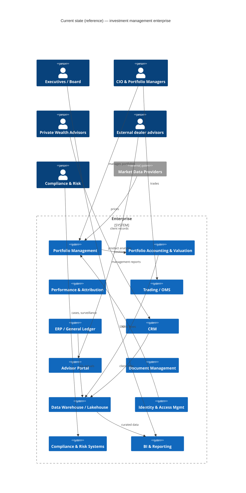
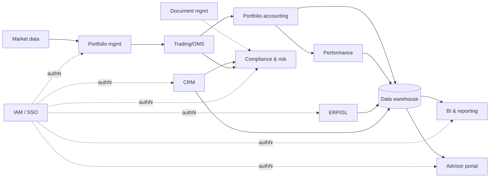
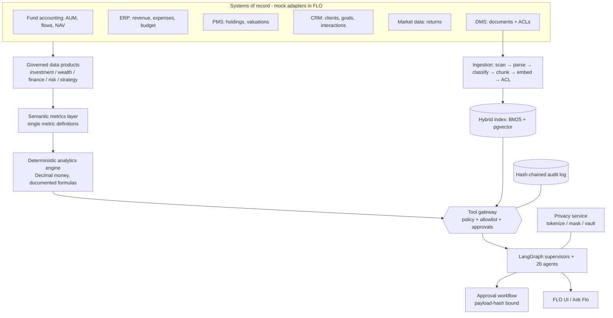

# FLO Architecture — current-state assessment, target architecture, deployment and integrations

> FLO is an **independent, AGF-inspired architecture demonstration**. It is not affiliated with AGF, uses no AGF
> branding and has no access to any proprietary system. Everything below describes **reference system categories**,
> not confirmed products, owners or contracts. All data is synthetic.

## A. Current-state architecture assessment (reference model)

A traditional investment-management enterprise typically runs the 13 system categories below. FLO models each as an
interface (`integrations/base.py`) with a mock, synthetic-data adapter (`integrations/mock/adapters.py`).

### Integration discovery matrix

Values are **assumptions to validate** (see the last section), chosen to be typical for a Canadian asset/wealth manager.

| # | System category | Assumed owner | Business purpose | Data classification | API availability | Batch interfaces | Event interfaces | Authentication | Authorization | Data freshness | Availability SLA (assumed) | Rate limits (assumed) | Data residency | Vendor licensing | Integration risk |
|---|---|---|---|---|---|---|---|---|---|---|---|---|---|---|---|
| 1 | Portfolio management (PMS) | Investment Ops | Positions, mandates, models, rebalancing | Confidential | REST/SOAP (vendor) | EOD position files (SFTP) | Trade/position events (MQ) | Service account, mTLS | Vendor roles by desk | Intraday / EOD | 99.5% business hours | 10-50 rps | CA (assumed) | Per-seat + data fees | High (core book of record) |
| 2 | Portfolio accounting & valuation | Fund Accounting | NAV, AUM, fund flows, valuations | Confidential | Limited REST | Daily NAV/flow extracts | Rare | Service account | By fund family | T+1 | 99.5% | Batch-oriented | CA | Outsourced/vendor | High (NAV accuracy) |
| 3 | Investment performance | Performance team | TWR/MWR, attribution, GIPS composites | Confidential | Report APIs | Monthly composites | No | Service account | By composite | Month-end + 5d | 99% | Low | CA | Vendor | Medium |
| 4 | Trading / OMS | Trading desk | Orders, executions, compliance pre-trade | Restricted | FIX / REST | EOD blotter | FIX execution reports | mTLS + certs | Trader entitlements | Real-time | 99.9% market hours | Strict | CA/US | Vendor | **Critical** — FLO never writes (trading prohibited) |
| 5 | Market data providers | Market Data | Prices, indices, reference data | Licensed | REST / streaming | EOD files | Streaming quotes | API keys (vault) | Licence entitlements | Real-time / EOD | Contractual | Contractual quotas | Varies | **Redistribution limits** | Medium (licensing) |
| 6 | Financial ERP / GL | Finance | Revenue, expenses, budgets, close | Confidential | REST (ERP) | Month-end close files | Journal events | OAuth2 client credentials | Cost-centre roles | Monthly close | 99.5% | Moderate | CA | Enterprise licence | Medium |
| 7 | CRM / advisor relationship | Distribution / PW | Clients, households, interactions | **Restricted (PI)** | REST | Nightly extracts | Change events (webhooks) | OAuth2 | Record-level sharing | Near-real-time | 99.9% | 100+ rps | CA (privacy) | Per-seat | **High (personal information)** |
| 8 | Advisor portals & analytics | Distribution | Dealer/advisor product analytics | Internal / public | REST | — | — | OIDC | Advisor/dealer codes | Daily | 99.5% | Moderate | CA | — | Medium (external advisors ≠ PW clients) |
| 9 | Document management | All | Policies, research, legal, KYC docs | Mixed per document | REST/CMIS | Bulk export | Doc events | OAuth2 | Folder/doc ACLs | On change | 99.5% | Moderate | CA | Enterprise | Medium (ACL fidelity) |
| 10 | Data warehouse / lakehouse | Data Office | Integrated analytics, history | Mixed | SQL / REST | ELT pipelines | CDC streams | Workload identity | Row/column security | T+1 | 99.5% | Query quotas | CA | Consumption | Medium |
| 11 | Identity & access management | Security | SSO, groups, MFA, lifecycle | Restricted | OIDC / SCIM | — | Joiner/mover/leaver events | OIDC | Group → role mapping | Real-time | 99.95% | — | CA/global | Enterprise | High (authZ source of truth) |
| 12 | Compliance & risk systems | Compliance / CRO | Surveillance, KYC, AML, cases | Restricted | REST | Daily | Alerts | Service account | Case-level | Daily / real-time | 99.5% | Low | CA | Vendor | High (regulatory records) |
| 13 | BI & management reporting | Finance / Data | Board & management reporting | Confidential | BI APIs | Scheduled refresh | — | SSO | Workspace roles | Daily / monthly | 99% | — | CA | Per-seat | Low |

### Current-state C4 context diagram

### Application dependency diagram (current state)

### Data-flow diagram (current state → FLO)

### Assumptions requiring validation with technology leadership

1. Actual systems in each category, their owners, APIs, authentication methods and contractual SLAs/rate limits.
2. Whether a lakehouse already exposes curated, reconciled AUM/flow/revenue data (FLO would consume it rather than source systems).
3. The authoritative definitions for AUM, fee-earning assets, net flows and operating margin (FLO's semantic layer is a proposal).
4. Data residency requirements per entity and whether any cloud region outside Canada is acceptable for any data class.
5. The enterprise IdP, group model and whether ABAC attributes (advisor assignment, business unit, clearance) are mastered in IAM or CRM.
6. Which regulatory frameworks apply to which legal entity (registrant categories, CIRO membership, OSFI applicability).
7. Market-data licence terms for derived analytics and AI-generated narratives.
8. Approved model providers, enterprise agreements and model-risk validation process.
9. Whether external dealer advisors are in scope at all, and the precise segregation from private-wealth client records.
10. Records-retention schedules for AI interactions, approvals and traces.

## Target architecture (implemented in this repository)

| Plane | Implementation | Files |
|---|---|---|
| Experience | React + TypeScript + Vite + Tailwind (shadcn-style primitives), ECharts, Recharts, MapLibre, TanStack Query/Table | `frontend/` |
| API | FastAPI, Pydantic v2, role-aware routes, load shedding, security headers | `backend/main.py`, `backend/api/` |
| Orchestration | LangGraph: enterprise supervisor → 5 domain supervisors → 20 specialists (parallel `Send`), durable `interrupt()` approvals | `agents/graph.py`, `agents/specialists.py` |
| Agent harness | admission, budgets, timeouts, retries, circuit breakers, idempotency cache, cancellation, output/grounding validation, telemetry | `harness/` |
| Tool gateway | allowlists, schema validation, policy per call, approval obligations, prohibited actions, rate limits, audit | `harness/tools.py`, `agents/tools.py` |
| Governance | deny-by-default RBAC + ABAC policy-as-code (YAML), OPA/Rego mirror with parity tests, hash-chained audit | `policies/`, `governance/` |
| Privacy | detection, masking, tokenization, encrypted vault, authorized rehydration, retention, secure deletion | `privacy/` |
| Analytics | Decimal financial engine, semantic layer, scenario engine, decision memory, data-quality checks | `analytics/`, `scenarios/` |
| Knowledge | ingestion pipeline, hybrid retrieval, pgvector, ACL pre-filter, injection quarantine | `retrieval/`, `data/documents/` |
| Integrations | provider-neutral interfaces + mock synthetic adapters | `integrations/` |
| Data | SQLAlchemy models, Alembic migrations (SQLite & PostgreSQL), deterministic generator | `backend/db/`, `data/synthetic/` |
| Observability | local trace store, Prometheus metrics, optional LangSmith (redacted), Grafana dashboard | `observability/`, `infrastructure/observability/` |

## C. Cloud & deployment strategy

* **Container-based and cloud-portable**: two images (API/worker, UI). No cloud SDK is required at runtime; Bedrock is an
  optional adapter that policy restricts to approved Canadian regions.
* **Local / demo**: `docker compose --profile observability up -d --build` — PostgreSQL 16 + pgvector, Redis, OPA sidecar,
  migration job, API (2 workers), worker, UI (nginx), Prometheus, Grafana. Verified in this environment.
* **Kubernetes**: plain manifests (`infrastructure/k8s/flo.yaml`) and a Helm chart (`infrastructure/helm/flo`) with OPA
  sidecars, HPA, PDB, default-deny NetworkPolicies, restricted pod security, read-only root filesystems.
* **Terraform**: provider-neutral module contracts (`infrastructure/terraform/modules`, `terraform validate` passes) and
  one illustrative AWS `ca-central-1` example. Equivalent Azure Canada / GCP Montréal implementations follow the same contracts.
* **Choices left to the enterprise**: cloud provider, managed Postgres flavour, secret manager, IdP, model provider,
  tracing backend. Each sits behind an interface or an environment variable.

## T. Trusted tooling & integrations

* Every system category is an interface; FLO ships **only mock adapters** (`mode = "mock-synthetic"`,
  `connected_to_production = False`) and the UI states this on the Data Products page and the sidebar.
* Adapters are constructed per request bound to one tenant and filter by tenant (defence in depth under the policy engine).
* Production adapters must use scoped service identities, short-lived credentials (workload identity), secret managers,
  network restrictions (see NetworkPolicy), request validation, rate limiting and audit — the tool gateway already
  enforces validation, rate limiting and audit on every call.
* Agents have **no** shell, raw database, unrestricted network or trading access: such actions are listed as
  `prohibited` in `policies/rbac.yaml` and the trading tool exists only to prove the gateway blocks it.
