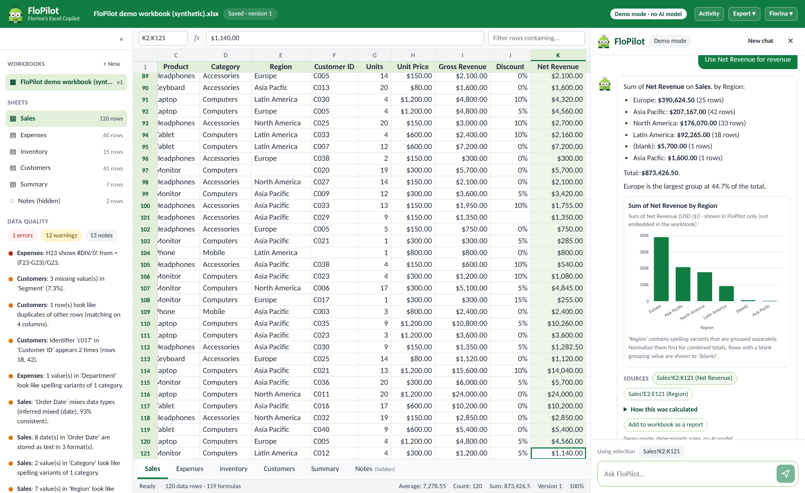

# FloPilot — Florina’s Excel Copilot


FloPilot is a standalone web app that helps business users **understand, clean, analyse, transform and visualise Excel workbooks in plain English**. Upload an `.xlsx` or `.csv`, ask questions, and get answers whose every number comes from deterministic calculations, with sheet/range references. Any change to the workbook is shown as a concrete preview, applied only after you approve that exact change, validated, and saved as a new version you can roll back.

Its mascot, **FloMin**, greets you with *“Hi, I’m FloMin. How can I help with your workbook?”*

> FloPilot is Florina’s independently built product. It is **not** a Microsoft product and is not affiliated with Microsoft. It does not connect to your live Excel session: it works on uploaded copies.



## What works today

| Journey | What you do | What FloPilot does |
|---|---|---|
| **Analyze** | Upload → ask “Summarize net revenue by region” | Computes the answer deterministically and shows the method, filters, missing-data treatment, assumptions and clickable source ranges, plus a chart. Asks when a term is ambiguous (“revenue” = Gross or Net?). |
| **Clean** | “Clean the Sales sheet” | Detects issues and prepares separate proposals (spelling variants, text dates, numbers stored as text…). Shows before/after in the grid. Nothing changes until you approve. |
| **Formulas** | “Add a profit-margin column using net revenue” | Proposes target cells, formula, plain-English meaning, inputs, assumptions, behaviour and compatibility; previews values; verifies them with LibreOffice when it is installed. |
| **Report** | “Compare actual spending with budget” → “Add to workbook” | Builds the summary and, on approval, a new report sheet with a native Excel chart. |
| **Recover** | Activity → Versions → “Restore this version…” | Creates a new version identical to the chosen one. History is never deleted. |

It runs **without any AI model key** using a clearly labelled deterministic demo mode. With an Anthropic API key configured on the server, requests the deterministic planner cannot classify are handled by Claude through the same tools, permissions and budgets.

## Quick start

### Docker (recommended)

```bash
cd flopilot
cp .env.example .env            # optional; defaults run the demo without any key
docker compose up --build -d
open http://localhost:8080      # choose “Florina (demo analyst)”, then “Open the synthetic demo workbook”
```

The backend container has **no internet access** by default. To use an LLM, set `FLOPILOT_LLM_PROVIDER=anthropic` and `ANTHROPIC_API_KEY` in `.env` and run with `-f docker-compose.yml -f docker-compose.llm.yml`. For real formula verification, build with `FLOPILOT_INSTALL_LIBREOFFICE=true`. Behind a TLS-inspecting proxy, set `FLOPILOT_EXTRA_CA_FILE=/path/to/ca.crt` while building. Details: [docs/DEPLOYMENT.md](docs/DEPLOYMENT.md).

### Local development

Requires Python 3.12+ and Node 20.19+/22.

```bash
cd flopilot
make install                    # pip install -r backend/requirements-dev.txt && npm ci
make dev-api                    # http://localhost:8000  (API docs at /docs)
make dev-web                    # http://localhost:5173
```

### Tests

```bash
make test-api                   # pytest: 121 tests (calculations, formulas, fidelity, harness, security, journeys)
make test-web                   # vitest: 16 tests + TypeScript typecheck
make e2e                        # Playwright browser journey (10 steps) against a running app with a fresh data dir
make lint scan                  # ruff; pip-audit, npm audit, trivy (if installed)
```

Actual results from the last run are in [docs/VALIDATION.md](docs/VALIDATION.md).

## Demo walkthrough (5 minutes)

See [docs/DEMO.md](docs/DEMO.md). Short version, on the synthetic demo workbook:

1. **Summarize revenue by region** → FloPilot asks Gross or Net → choose *Net Revenue* → table, chart, sources, “How this was calculated”.
2. Click the **Sales!K2:K121** source chip → the grid selects it; the status bar Sum matches the answer.
3. **Clean the Sales sheet** → four proposals. Use **Preview in grid**, toggle Before/After, then **Approve & apply** one. Approving a second shows it is out of date (the workbook moved to v2) → **Prepare again**.
4. **Add a profit-margin column using net revenue** → formula details, preview values, LibreOffice verification (if installed) → approve.
5. **Fix the formula error in Expenses!H23** → diagnosis (#DIV/0! because Budget is 0) and a flagged formula replacement.
6. **Remove the duplicates on Sales** → refused safely (Summary formulas reference those rows) with a non-destructive alternative.
7. **Activity → Versions → Restore version 1**, approve, and the workbook is back to the original.

## Documentation

| Document | Contents |
|---|---|
| [docs/ARCHITECTURE.md](docs/ARCHITECTURE.md) | Components, request lifecycle, harness, roles, tools, contracts, data model, library trade-offs |
| [docs/FEATURES.md](docs/FEATURES.md) | Feature checklist: implemented / partial / demo only / not implemented |
| [docs/LIMITATIONS.md](docs/LIMITATIONS.md) | Supported formats, size limits, workbook-fidelity rules, known limitations |
| [docs/SECURITY.md](docs/SECURITY.md) | Data flow, threat model, prompt/formula injection, isolation, logging and retention |
| [docs/DEPLOYMENT.md](docs/DEPLOYMENT.md) | Docker, configuration, LLM opt-in, LibreOffice, PostgreSQL/object-storage path, scaling |
| [docs/DECISIONS.md](docs/DECISIONS.md) | Defaults chosen for missing inputs, assumptions, architectural decisions |
| [docs/DEMO.md](docs/DEMO.md) | Demo walkthrough and seeded data issues |
| [docs/VALIDATION.md](docs/VALIDATION.md) | Actual test, build, scan and deployment results |

## Folder structure

```
flopilot/
├── backend/                 FastAPI service (Python)
│   ├── app/
│   │   ├── api/             HTTP routes
│   │   ├── agent/           supervisor, deterministic planner, LLM loop, grounding, narration, context
│   │   ├── harness/         run state machine, typed tool registry, tools, chart specs
│   │   ├── llm/             provider adapters (demo / Anthropic)
│   │   ├── services/        workbooks & versions, operations & approvals
│   │   ├── workbook/        ingest, model, profile, quality, query, formulas, evaluator, recalc,
│   │   │                    changes, cleaning, validate, fidelity, cache_values, grid, security
│   │   ├── auth.py db.py storage.py audit.py config.py schemas.py extensions.py main.py
│   ├── scripts/generate_demo_workbook.py
│   ├── sample_data/flopilot_demo_workbook.xlsx   (synthetic)
│   └── tests/               pytest suite
├── frontend/                React + TypeScript (Vite), nginx config for Docker
│   ├── public/              FloMin mascot, icon, favicon, wordmark (SVG)
│   └── src/                 App, components (Grid, CopilotPanel, ProposalCard, Chart, …), lib, tests
├── e2e/ui_journey.mjs       Playwright browser journey
├── docs/                    documentation and screenshots
├── docker-compose.yml       local deployment (+ docker-compose.llm.yml opt-in egress)
├── .env.example             configuration template (no secrets)
└── Makefile
```

## Brand assets

`frontend/public/flomin.svg` (full mascot, transparent), `flomin-icon.svg` (compact icon), `favicon.svg`, `flopilot-wordmark.svg`. FloMin is an original character: a rounded green helper with silver goggles, a warm smile and dark-green overalls carrying a small bar-chart emblem.
