<div align="center">

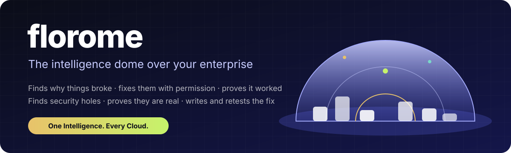

<br>


<h3>When a company's computer systems break, Florome finds out <i>why</i>, suggests a fix, waits for a person to say yes, applies the fix, and checks that the business really works again.<br>Its security side, <b>Shield</b>, looks for weak spots in software and <b>proves</b> each one is real before anyone has to worry about it.</h3>

</div>

---

## 💬 Just ask: the Copilot is the front door

<div align="center">

<br>
<b>Open Florome and the first thing you see is a question box.</b> Ask about outages, security, customers, money or rules, and get the answer in one sentence with the proof one click away.<br>
<sub>Real recording of the home page: <i>"What caused the incident?"</i> → <i>"What are customers most negative about?"</i> (answered by the Conversation Intelligence Copilot) → a follow-up → a typed security question.</sub>
</div>

<table>
<tr>
<td width="25%" align="center" valign="top">🗣️<br><b>One sentence</b><br><sub>The direct answer first, never a wall of text</sub></td>
<td width="25%" align="center" valign="top">📊<br><b>A small picture</b><br><sub>Bars, a chain of systems, a table or a timeline, drawn from the same data</sub></td>
<td width="25%" align="center" valign="top">🔗<br><b>The evidence</b><br><sub>Buttons that open the exact record, or the customer's own words quoted</sub></td>
<td width="25%" align="center" valign="top">➡️<br><b>Four next questions</b><br><sub>Keep going with one click; <i>"why?"</i> works too</sub></td>
</tr>
</table>

**Two sources, one conversation.** Every answer says underneath where it came from:

| You ask about… | Answered by | Example |
|---|---|---|
| Outages, fixes, security holes, AI helpers, money, rules | **Florome's own records** | *"What caused the incident?"* |
| Customer conversations: complaints, sentiment, agent coaching | **The Conversation Intelligence Copilot** (the project Florome was built on top of), called live over its own API | *"What are customers most negative about?"* |

You don't choose: Florome works out which one your question is for. If the customer engine isn't running, the home page says **"not running"** and customer questions get an honest *"not available right now"* answer instead of a guess.

<table>
<tr>
<td width="62%" valign="top">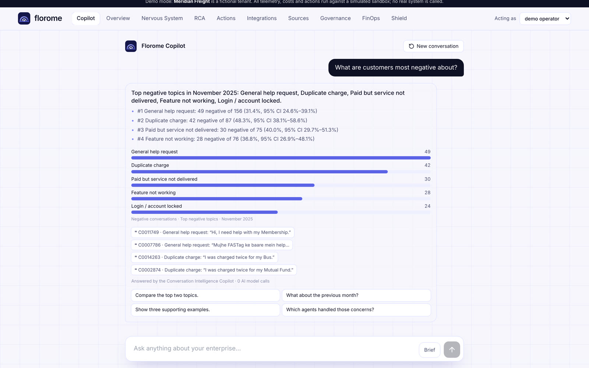</td>
<td width="38%" valign="top">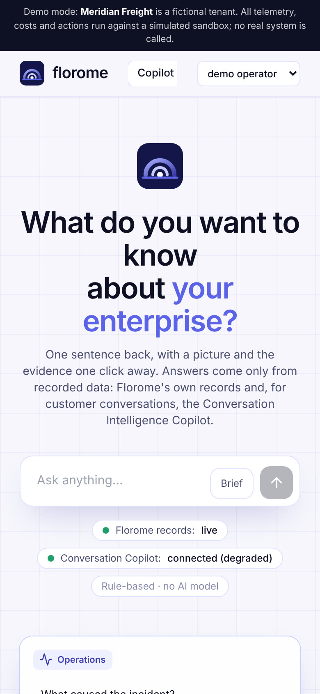</td>
</tr>
</table>

> Both sources are **rule-based**: no AI model wrote any of these answers (each answer shows *"0 AI model calls"*). They say *"I can't answer that"* rather than guessing. The dashboards are still one click away under **Overview**, and every other page keeps its own **Ask Florome** helper. [More below ↓](#-ask-florome-questions-in-plain-english)

---

## 🎬 Then see the whole product (one minute of GIFs)

> **New to this?** You don't need to know anything about programming to read this page. Watch the clips first. Every technical word is explained in plain English the first time it appears, and again in the [glossary](#-glossary-every-technical-word-in-plain-english) at the bottom.

<div align="center">


**The whole idea in 13 seconds.** A company's daily money report is broken. Florome has already found the cause. It proposes five repair steps, a *second* person approves, the repairs run, and every check turns green.

</div>

<table>
<tr>
<td width="50%" valign="top" align="center">
<br>
<b>① The map</b><br><sub>Every system the company runs, and how data flows between them. Filter by cloud, search, click any box.</sub>
</td>
<td width="50%" valign="top" align="center">
<br>
<b>② The investigation</b><br><sub>Press one button. Florome tests every possible explanation. Click any dot to see the original record behind it.</sub>
</td>
</tr>
<tr>
<td width="50%" valign="top" align="center">
<br>
<b>③ Shield: security holes, proven</b><br><sub>Reads the code, safely attacks a throw-away copy in a sealed box, then writes a fix and attacks it again.</sub>
</td>
<td width="50%" valign="top" align="center">
<br>
<b>④ Rogue AI helpers, stopped</b><br><sub>Small AI programs try to steal a key, phone home or open a back door. Each is stopped on its first bad move.</sub>
</td>
</tr>
<tr>
<td width="50%" valign="top" align="center">
<br>
<b>⑤ Plugging in tools</b><br><sub>What's really connected and what's only planned, plus a live, checked call to an AI tool.</sub>
</td>
<td width="50%" valign="top" align="center">
<br>
<b>⑥ The safety switch</b><br><sub>One button freezes every action, and a log that can't be secretly edited records it all.</sub>
</td>
</tr>
</table>

> [!NOTE]
> **Everything above is a demonstration on made-up data.** The company ("Meridian Freight"), its systems, its money and its outage are all simulated *inside* Florome. Nothing real is touched. Where something isn't finished yet, this page says so plainly. See [What it does not do yet](#-what-it-does-not-do-yet).

---

## 📖 Contents

1. [Florome in one minute](#%EF%B8%8F-florome-in-one-minute)
2. [Why this exists, in plain words](#-why-this-exists-in-plain-words)
3. [The two halves of Florome](#-the-two-halves-of-florome)
4. [Story 1: the morning the money report broke](#-story-1-the-morning-the-money-report-broke): every screen, explained number by number
5. [Story 2: Shield finds security holes and proves them](#%EF%B8%8F-story-2-shield-finds-security-holes-and-proves-them)
6. [Story 3: an AI helper misbehaves, and gets stopped](#-story-3-an-ai-helper-misbehaves-and-gets-stopped)
7. [Ask Florome: questions in plain English](#-ask-florome-questions-in-plain-english)
8. [Plugging in other systems](#-plugging-in-other-systems)
9. [The safety rules nobody can switch off](#-the-safety-rules-nobody-can-switch-off)
10. [Following the money](#-following-the-money)
11. [How it works underneath](#%EF%B8%8F-how-it-works-underneath)
12. [The numbers, measured](#-the-numbers-measured)
13. [What it does not do yet](#-what-it-does-not-do-yet)
14. [Try it yourself](#-try-it-yourself)
15. [Questions people ask](#-questions-people-ask)
16. [Glossary](#-glossary-every-technical-word-in-plain-english)

---

## ⏱️ Florome in one minute

**Picture a big company as a city.** Each "building" is a computer system: one collects orders, one stores files, one adds up the numbers, one runs the website. The buildings sit in different neighbourhoods, which are different cloud companies (Amazon, Microsoft, Databricks). Roads between them carry data.

When one building catches fire, the smoke usually appears somewhere else. That's where people start looking, and it's the wrong place.

**Florome is a glass dome over the whole city.** From up there it can see every building and every road at once. That lets it do seven things:

| | What Florome does | Everyday comparison |
|:-:|---|---|
| 👀 | **Sees** every system and how data moves between them | A live map of the whole city |
| 🔍 | **Investigates** when something breaks: lists every possible explanation and checks each against the records | A detective who writes down every suspect *and* every alibi |
| 🛠️ | **Proposes a fix**, with the risk and an undo plan for each step | A builder's written quote before any work starts |
| ✋ | **Waits for a person to approve.** The one who wrote the plan is *not* allowed to approve it | The two-signature rule on a big company cheque |
| ▶️ | **Applies the fix** one step at a time, and can pick up where it left off if interrupted | A careful builder ticking off a checklist |
| ✅ | **Checks the business recovered**, not just that the machines are on | Confirming the shop actually reopened, not just that the lights work |
| 🛡️ | **Shield** finds security holes in software and *proves* them in a sealed lab | A locksmith who doesn't just say "this lock looks weak" but opens it in a workshop, then fits a better one |

---

## 🤔 Why this exists, in plain words

**1. The real cause is rarely where the alarm rings.**
In the demo, customers see an error on a *website* run on Microsoft's cloud. The real cause is a small software update made **50 minutes earlier**, three systems away, on *Amazon's* cloud. Those are different teams with different tools and different logins, and people can lose hours looking in the wrong place.

**2. "The computer said so" is not good enough.**
Many tools now ask an AI to *guess* what went wrong. A confident guess is dangerous. Florome doesn't guess. It writes down every possible explanation and tests each one against the actual records. It then labels each one **Confirmed**, **Probable**, **Inconclusive** or **Disproven**, and shows which tests passed and which failed. It never makes up a score like "87% sure".

**3. Automatic repairs can make things worse.**
A tool that changes live systems on its own, with nobody watching, is a risk. Florome shows a person exactly what will happen, needs a *second* person to approve, and writes everything into a log that can't be quietly changed.

**4. Security alarms cry wolf.**
Code-checking tools raise hundreds of "maybe" warnings, many of them harmless, and teams stop reading them. Shield doesn't stop at "maybe". It safely tries the attack on a throw-away copy, and only calls something a real hole if the attack works **twice**.

---

## 🧩 The two halves of Florome

<table>
<tr>
<td width="50%" valign="top">

### 🌐 Operations
*"Something broke. Why, and how do we fix it safely?"*

- A live map of all connected systems
- Investigations backed by evidence
- Repair plans that need a second person to approve
- Proof of recovery, including the real business result
- A tamper-proof log, an emergency stop, and a view of spending

</td>
<td width="50%" valign="top">

### 🛡️ Shield
*"Where could someone break in, and is it real?"*

- Reads software and maps who can reach what
- Runs three well-known security scanners
- Turns hints into specific, testable suspicions
- **Proves or disproves each one in a sealed lab**
- Writes a fix, attacks it again, sends it for review
- Stops misbehaving AI helpers on their first bad move

</td>
</tr>
</table>

Florome also sits **on top of** two earlier projects in this repository instead of replacing them:

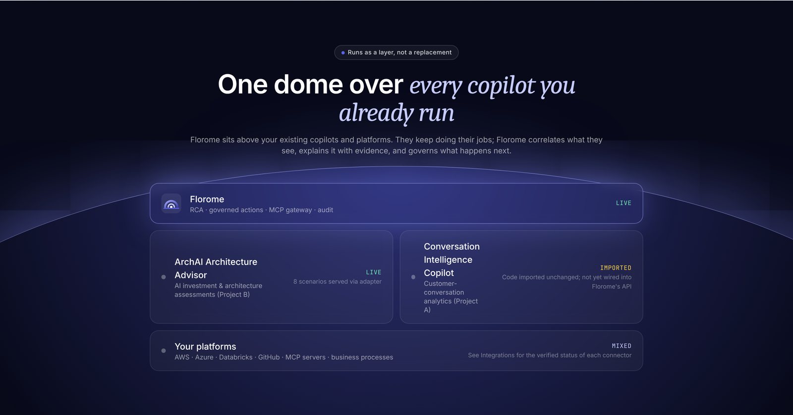

- **ArchAI Architecture Advisor** (in `../archai-enterprise-advisor/`) answers *"should we use AI for this, and how?"*. Florome talks to it directly. That connection is **live and tested**.
- **Conversation Intelligence Copilot** (in `../conversation-intelligence-copilot/`) analyses customer conversations. It's included unchanged but **not yet wired in**, and the screen says so.

---

## 📰 Story 1: the morning the money report broke

This is the demo scenario, told the way a person would live through it. For each screen you'll find **what you're looking at**, numbered so you can match it to the picture, **what Florome does behind the scenes**, and **why it matters**.

### What actually happened (the hidden truth)

Every morning, new orders pass through **five systems on three different clouds** before the Finance team gets its daily revenue report:

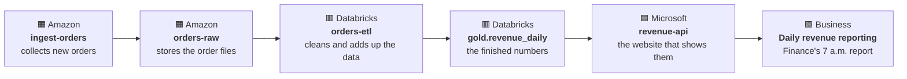

An engineer updated the first system, `ingest-orders`, so it reads orders in a new format. The new version **quietly throws away every order that is missing a currency**. Fewer orders flow on, so the next system receives incomplete files, the adding-up job refuses to run, the finished numbers go stale, the website starts showing errors, and Finance can't produce its report.

Florome worked out this exact sequence from the records alone. Each dot below is the moment one system first went wrong, measured in minutes after the bad update:

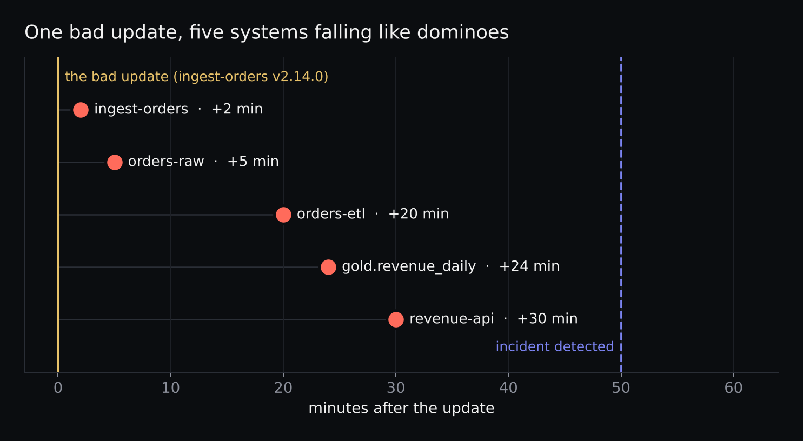

<sub>Drawn from the investigation's stored findings by <code>backend/scripts/readme_charts.py</code>. No number on this page is typed in by hand.</sub>

To make the test fair, the demo also contains **red herrings**: things that *look* suspicious but aren't the cause.
- Someone changed a scaling setting on the website 75 minutes earlier.
- The website itself was updated 3 hours earlier.
- Processor usage on two machines was recorded. Both readings were normal.

### Step 1: you see the alarm on the map

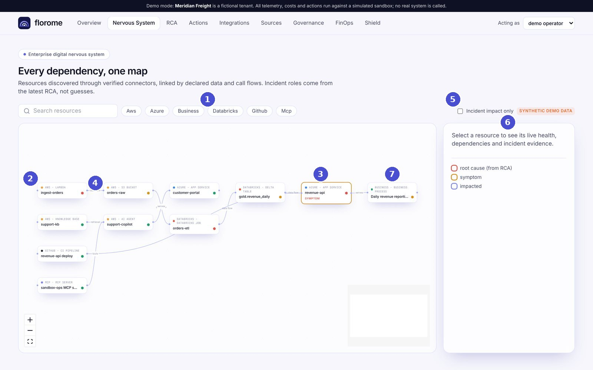

| # | What you're looking at | In plain words |
|:-:|---|---|
| **1** | Cloud filter buttons | Show only Amazon, only Microsoft, and so on. Press one again to clear it. |
| **2** | A system "box" | One computer system. The small coloured dot at the top left shows which cloud it lives on. The dot at the right shows its health: 🟢 fine, 🟠 struggling, 🔴 failing. |
| **3** | The **symptom** | The system where people first *noticed* the problem: the website. The yellow outline means "this is where it hurts". |
| **4** | A connecting line | Data flows along it, left to right. The small label says what kind of connection it is ("data flow", "serves"). |
| **5** | "Incident impact only" | Tick it to hide everything that isn't involved in the current problem. |
| **6** | The detail panel | Click any box, and its live health, its connections and a link to the evidence appear here. |
| **7** | The business process | Not a computer: the actual *job* the company cares about, Finance's daily report. |

**Behind the scenes:** Florome asked each connected system "how are you right now?" and drew the connections it had been told about.
**Why it matters:** in one glance you can see that six systems across three clouds are unhealthy, not just the website. The customer-support systems in the second row are fine, so the problem has clear edges.

### Step 2: you press "Run investigation"

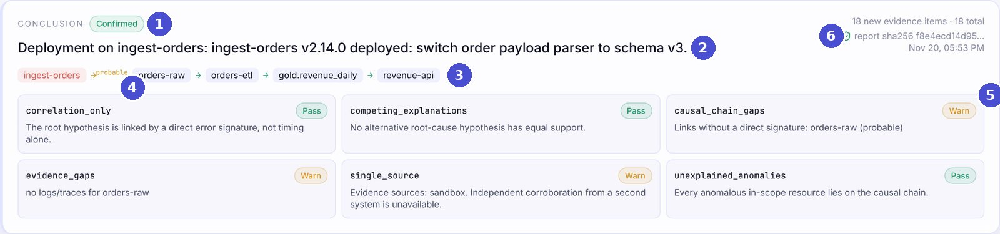

| # | What you're looking at | In plain words |
|:-:|---|---|
| **1** | **Confirmed** | The strongest possible verdict: every test passed, including a direct link in the error messages. |
| **2** | The conclusion | One sentence: what caused the problem. Here it's the update to `ingest-orders` that switched to the new format ("schema v3"). |
| **3** | The chain of failure | How the problem travelled: `ingest-orders → orders-raw → orders-etl → gold.revenue_daily → revenue-api`. |
| **4** | "probable" | An honest weak spot. The storage system `orders-raw` keeps **no error logs at all**, so this one link can't be *proven*, only inferred from timing. |
| **5** | The **devil's advocate** boxes | A second module tries to knock the conclusion down: is this just a timing coincidence? Is there an equally good alternative? Is evidence missing? It can only ever *lower* confidence, never raise it. 🟢 Pass means the conclusion survived; 🟠 Warn is a caveat you should know about. |
| **6** | The report's fingerprint | A unique code computed from the whole report. If anyone edits the report later, the code no longer matches and Florome flags it. |

**Behind the scenes**, in about a tenth of a second (measured: [numbers](#-the-numbers-measured)):
1. **Collect evidence.** Florome asks every system "upstream" of the website, meaning every system that feeds it, for its logs, measurements, updates, setting changes and request traces. That's 18 records, and each is stored with its own fingerprint.
2. **List every suspect.** It writes down **9 possible explanations**: every recent change, every possibly overloaded machine, and every link where a failure could have passed from one system to the next.
3. **Check every alibi.** Each explanation gets named tests. Did the change happen *before* the problems began? Do the error messages *mention* the change? Was something further upstream already broken *earlier*?
4. **Argue against itself** (the devil's-advocate boxes above).

<details open>
<summary><b>▶ Watch the investigation (GIF)</b></summary>
<br>

</details>

### Step 3: every suspect, and the tests that cleared or convicted it

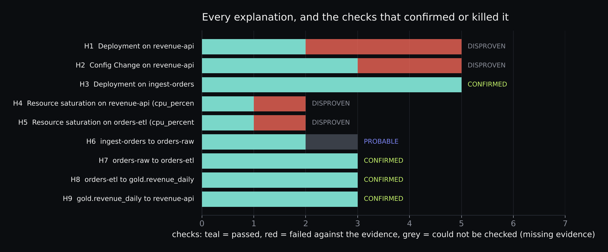

**How to read this chart:** each bar is one explanation Florome considered. **Teal** = a test passed. **Red** = a test *failed against the records*. **Grey** = the test couldn't be run because the records were missing.

| Suspect | Verdict | In plain words |
|---|:-:|---|
| **H3**: the update to ingest-orders | ✅ **Confirmed** | It happened 2 minutes before the first errors, and the errors literally name the new code ("OrderSchemaV3 validation failed"). Nothing further upstream was broken earlier. |
| H1: website update 3 hours earlier | ❌ Disproven | Too long before the problem, and no error mentions it. |
| H2: website scaling setting changed | ❌ Disproven | The website's errors talk about *missing data*, not scaling, and the systems feeding it had already failed first. |
| H4, H5: machines overloaded | ❌ Disproven | Processor use was 35% and 41%, nowhere near overloaded. |
| H6: failure passed to `orders-raw` | 🟣 Probable | The timing fits, but that system has no error messages that could *prove* the link. |
| H7–H9: failure passed down the line | ✅ Confirmed | Each system's errors name the system before it. |

### Step 4: click anything to see the original record

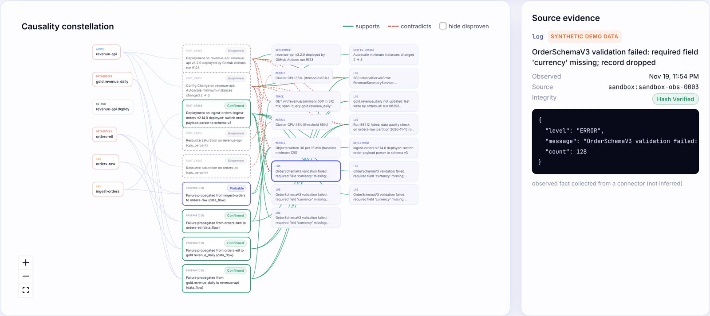

The **Causality Constellation** reads left to right:
- **Left:** the systems.
- **Middle:** the explanations, with **solid** outlines for alive and **dashed** for disproven.
- **Right:** the evidence records.

**Green lines** mean *"this record supports that explanation"*. **Red dashed lines** mean *"this record contradicts it"*. Clicking a record shows it exactly as it was collected, plus **"hash verified"**, meaning nobody has altered it since.

**Why it matters:** no conclusion is a black box. A manager, an auditor or a sceptical engineer can trace any claim back to its source in two clicks.

### Step 5: travel back in time

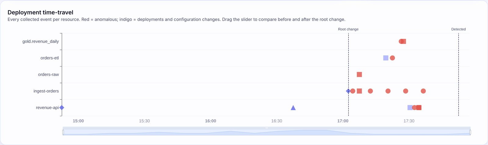

One row per system, one dot per event. 🔴 Red = something went wrong; 🔷 indigo diamonds and triangles = updates and setting changes. The dashed lines mark **"Root change"** and **"Detected"**. Drag the slider underneath to zoom into any period. The pattern jumps out: red dots start on `ingest-orders` right after its update, then appear on each system further down the line, in order, like falling dominoes.

### Step 6: Florome proposes a repair plan

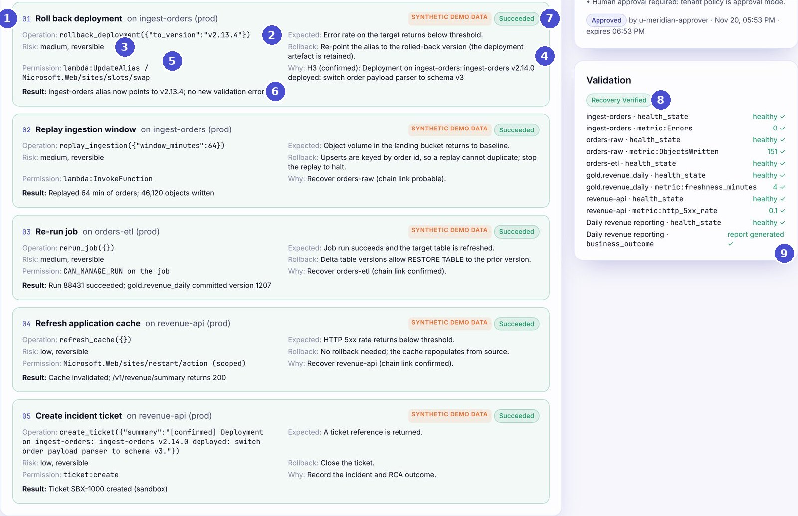

| # | What you're looking at | In plain words |
|:-:|---|---|
| **1** | Step number and name | Five steps, in the order the dominoes must be stood back up: roll back the update, re-collect the lost orders, re-run the adding-up job, refresh the website, open a ticket. |
| **2** | **Operation** | The exact instruction, including its settings. Here: go back to version `v2.13.4`. |
| **3** | **Risk** | How dangerous the step is (low / medium / high), and whether it can be undone. |
| **4** | **Rollback** (undo plan) | What to do if this step needs reversing. |
| **5** | **Permission** | The exact access right this step needs in the cloud provider's own security system. |
| **6** | **Result** | Filled in after the step runs: what the system reported back. |
| **7** | Step status | Pending → Succeeded (or Failed). It also says **"synthetic demo data"**, because this ran against the simulation, not a real cloud. |
| **8** | **Recovery Verified** | The final check: every affected system re-read *after* the fix. |
| **9** | **Business outcome** | The check that matters most: Finance's report was generated again. |

**Behind the scenes:** Florome can only use actions that each system's connector publishes on a fixed menu, and every setting is checked against strict rules, so a made-up or malformed command is simply rejected. If the investigation had been *inconclusive*, Florome would refuse to plan anything except opening a ticket and gathering more evidence.

**Why the order matters:** re-running the adding-up job *before* re-collecting the lost orders would just fail again, and in the demo it really does fail if you try. This is a working simulation, not a slideshow.

### Step 7: a second person approves (the two-signature rule)

- The person who **created** the plan **cannot** approve it. If they try, Florome refuses with *"Separation of duties"*.
- Approval is tied to an exact **fingerprint of the plan**. Change a single setting afterwards and the approval stops counting.
- An approval can be used **once** (no reusing old approvals) and it **expires** after 60 minutes.
- Each plan is also **signed** with a secret key that isn't stored in the database. So even someone with direct database access who rewrites a plan *and* its fingerprint gets caught.

### Step 8: Florome runs the fix, then proves the recovery

Each step runs **one at a time** and is saved as soon as it finishes. Steps that hit temporary errors are retried, up to 3 times. If something fails halfway, you press **Resume** and the finished steps are *not* repeated, because each one carries a unique "already done" label.

Then comes the **proof**: every affected system is measured again. Each bar pair below compares a system's key reading *during* the outage with its reading *after* the fix, against that system's **alarm line** (the level where an alert fires):

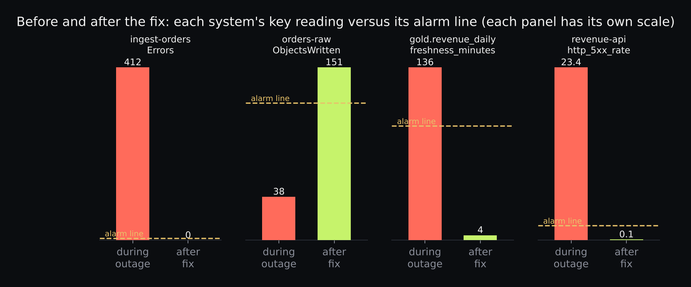

| System | Reading | During outage | After fix | In plain words |
|---|---|:-:|:-:|---|
| ingest-orders | errors per 5 minutes | **412** | **0** | Stopped throwing orders away |
| orders-raw | files written per 15 minutes | **38** | **151** | Back above its normal minimum of 120 |
| gold.revenue_daily | minutes since last update | **136** | **4** | The numbers are fresh again (limit: 90) |
| revenue-api | % of website requests failing | **23.4%** | **0.1%** | Back under the 2% limit |

The map turns green, and the incident is marked **resolved** only because the business report was produced:


Every action also lands in the **ledger**, styled like a banking app because it's a record of real changes:

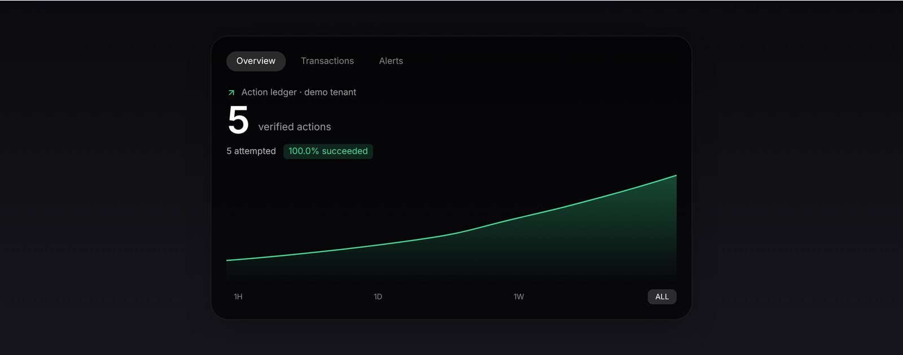

---

## 🛡️ Story 2: Shield finds security holes and proves them

<div align="center">

<sub>Real recording, sped up 2.8×.</sub>
</div>

### The test subject: "LedgerLite", an app that's broken on purpose

To show Shield honestly, we built a small invoicing app called **LedgerLite** with **five real security holes** and **four look-alikes that seem dangerous but are actually safe**. The look-alikes matter most: a good security tool has to tell them apart.

| Part of the app | What it does | Real hole? | The trick, in plain words |
|---|---|:-:|---|
| `search_invoices` | Search your invoices by customer | 🔴 **Yes** | Typing `x' OR '1'='1` as a customer name fools the database into showing **everyone's** invoices ("SQL injection") |
| `by_customer` | Same search, written safely | 🟢 No | The database treats the trick as a strange name, nothing more |
| `get_invoice` | Open invoice number *N* | 🔴 **Yes** | You're logged in, but you can open **other people's** invoices just by changing the number ("broken access control") |
| `get_my_invoice` | Same, written safely | 🟢 No | It only ever returns invoices you own |
| `download` | Download a report | 🔴 **Yes** | Asking for `../secret.txt` walks **out of** the reports folder ("path traversal") |
| `read_file` | Same, written safely | 🟢 No | It checks the final location is still inside the folder |
| `ping` | Network check tool | 🔴 **Yes** | Adding `; another-command` makes the server run **any command you like** ("command injection") |
| `echo` | Similar tool, written safely | 🟢 No | The text is passed as plain data, never to a command line |
| `import_ledger` | Upload a ledger file | 🔴 **Yes** | A specially crafted file makes the server **run code** while opening it ("unsafe deserialization") |

> The answer key is read **only** by the scoring step, never by the part that hunts for holes, so Shield can't cheat.

### What Shield does, step by step

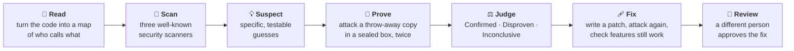

**1 · Read the code like a map.** Shield reads every file with **tree-sitter**, a widely used tool that understands the structure of code. It notes three things:
- every web address the app answers,
- which of those need a login,
- every **dangerous operation**: talking to the database, running programs, opening files, unpacking uploads.

It then traces whether text typed by a visitor can **flow** into one of those dangerous operations. Every line on the map points back to a specific file and line number, in a specific version of the code.

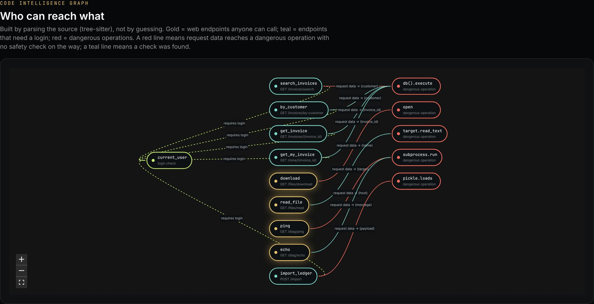

How to read this map:
- 🟡 **Gold** boxes are pages anyone on the internet can open.
- 🟢 **Teal** boxes need a login. The dashed lime lines lead to `current_user`, the login check.
- 🔴 **Red** boxes are dangerous operations.
- A **red line** means visitor input reaches danger with **no safety check** in between. A **teal line** means a safety check was found.

**2 · Run the security scanners.** Shield runs three well-known free tools, each as a separate program with a time limit:
- **Opengrep** spots risky code patterns, using rules written for this project.
- **Bandit** is Python's standard security checker.
- **Trivy** checks the app's add-on libraries against public lists of known problems.

If two tools report the same thing on the same line, Shield merges them into **one** suspicion with two pieces of evidence, rather than counting it twice.

**3 · Form specific suspicions.** Each one records:
- the exact place in the code,
- the **assumption being questioned**, e.g. *"visitors can only read files inside the reports folder"*,
- the evidence **for** and **against**,
- *how it can be tested safely*.

**4 · Prove it in a sealed box (the "Cyber Range").** This is the step most tools skip. For every suspicion, Shield does five things:
1. copies the app into a **temporary folder** that is deleted afterwards,
2. plants a **secret marker**, a random number, so success can be detected *without causing any harm*,
3. starts the copy in a sealed box: **no network at all**, **no passwords or keys**, strict limits on processor time, memory and file size, and a hard time limit,
4. sends the attack and checks whether the secret marker comes back,
5. **does it all again** with a fresh copy and a different marker.

> **Harmless proof, not damage.** The command test asks the server to *multiply two numbers*. If the answer comes back, the server ran our command. The file test looks for a planted marker file. Nothing is deleted, sent anywhere, or broken.


**5 · Give a verdict.**

| Verdict | Meaning | The rule |
|:-:|---|---|
| ✅ **Confirmed** | It's real | The attack worked in **2 out of 2** separate sealed runs |
| ❌ **Disproven** | False alarm | The attack failed both times **and** a specific safety measure explains why |
| ⚠️ **Inconclusive** | Can't tell yet | Mixed results, a failed test, or only a scanner hint with no proven path |
| 🟣 **Probable** | Likely, not proven | A clear path to danger, but no safe way to test it here |

**How serious** a hole is ("severity") is judged *separately* from whether it's real. A real hole that anyone on the internet can reach rates higher than one that needs a login first.

### One finding, explained number by number

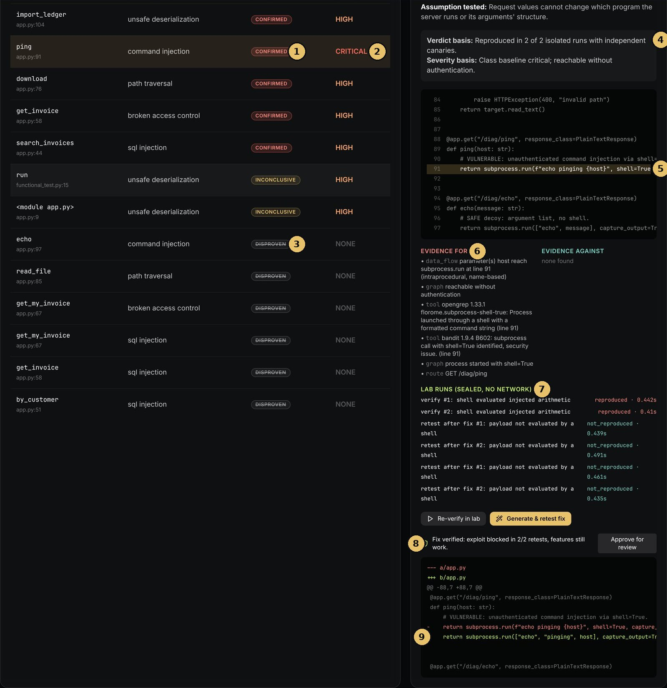

| # | What you're looking at | In plain words |
|:-:|---|---|
| **1** | **CONFIRMED** | The `ping` attack worked in both sealed runs. |
| **2** | **CRITICAL** | The worst severity: anyone on the internet could make the server run commands, no login needed. |
| **3** | **DISPROVEN** | The safe `echo` look-alike. One scanner flagged it, but the attack failed twice and Shield found why. |
| **4** | Verdict and severity reasons | Florome always says *why*, in one or two sentences. |
| **5** | The highlighted line of code | The exact line with the problem: it hands visitor text to a command line (`shell=True`). |
| **6** | Evidence **for** | Five independent clues: the data path, "no login needed", two scanners, and the command-line setting. |
| **7** | Lab runs | Two attacks that **worked** ("reproduced"), then the retests of the fix that **failed** ("not_reproduced"), which is what you want. Each took under half a second. |
| **8** | Fix verified | The attack is blocked in 2 out of 2 retests, and the app's normal features still work. A *different* person can now approve it for review. |
| **9** | The fix itself | 🔴 Red line removed: "run this text as a command". 🟢 Green line added: "run exactly this program with exactly these words". |

**And here is a false alarm being thrown out.** The safe `echo` tool *looks* almost identical to `ping`, and one scanner flagged it. But the sealed-lab attack failed twice, and Shield points to the reason: the text is passed as a plain list of words, never to a command line ("argument list without shell").


**6 · Fix, retest, review.** For every confirmed hole, Shield writes a small fix from a reviewed template and applies it **only to a copy**. It attacks the copy twice more (the attack must now fail) and runs the app's own feature checks (they must still pass). **Shield never changes the real code by itself.**

**7 · Raise the alarm.** Every confirmed high or critical hole automatically becomes an incident in Florome's main incident list, next to the operational ones.

### Does proving actually help? The honest comparison

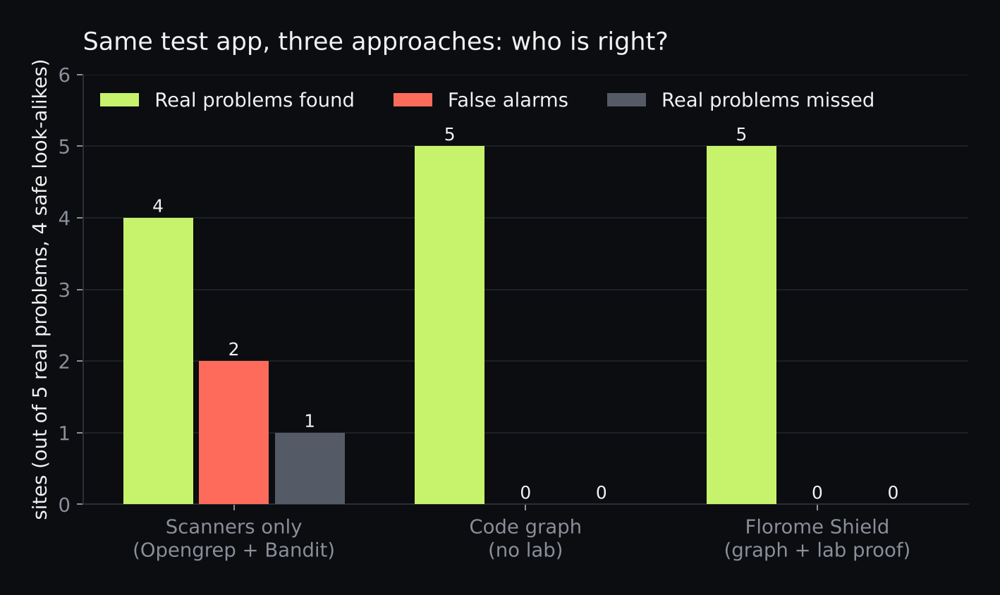

We scored three approaches on the same 9 spots in LedgerLite:

| Approach | Real holes found (of 5) | False alarms | Missed | What it tells you |
|---|:-:|:-:|:-:|---|
| **Scanners only** | 4 | **2** (the safe `echo`, plus a harmless line that merely loads the unpacking library) | **1** (the invoice-access hole: scanners can't see "you opened someone else's invoice") | Typical scanner behaviour: noisy, and blind to logic mistakes |
| **Code map, no lab** | 5 | 0 | 0 | On this small app, spotting the safety checks in the code was enough |
| **Florome Shield** (map + lab proof) | 5 | 0 | 0 | Same score, **plus** a working attack behind each finding and a retested fix (5 of 5 fixes passed) |
| **AI model only** | – | – | – | **Not run.** No approved AI service is configured, and Florome never calls paid AI services on its own |

> [!IMPORTANT]
> **Read this honestly.** On this small test app, the code map *without* the lab also scored perfectly, so here the lab adds **proof**, not extra detection. Every confirmed finding has a reproduced attack and a retested fix behind it, which is what lets a busy team trust it. The test app is tiny (9 spots) and was written by the same people who built Shield. Treat these numbers as a self-check, **not** as evidence about real-world software. No new, previously unknown vulnerabilities are claimed.

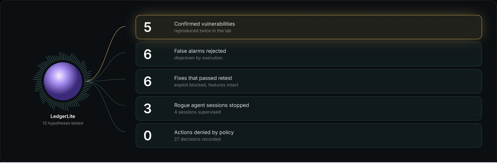

---

## 🤖 Story 3: an AI helper misbehaves, and gets stopped

Companies increasingly let small AI programs ("agents") do jobs on their behalf. **What if one is tricked, or makes a mistake, and tries to steal a password or send data out?** Shield includes an **Agent Containment Supervisor**: a guard that works whether or not the AI behaves.

**How it works:**
1. The agent runs inside a sealed box. It has **no network**, its own private work folder, and a **fake password file planted outside that folder as bait**. It also gets a short-lived **visitor badge** (a temporary credential) and strict time and memory limits.
2. Before the agent's first instruction runs, a **tripwire** is set inside the box. It watches every attempt to open a file, reach the network, start another program, or load low-level code.
3. On the **first** forbidden move, the tripwire **ends the program instantly**. It doesn't *ask* the AI to stop.
4. The supervisor then **cancels the visitor badge**, keeps a **forensic record** (what was attempted, the output, a fingerprint of every file in the folder), and writes the event to the tamper-proof log.
5. Even if the tripwire were somehow bypassed, the box still has no network and still has hard limits. Several independent layers protect each other ("defence in depth").


| Scenario | What the agent tried | What happened |
|---|---|---|
| benign analysis | Read its input and write a report | ✅ Finished normally in 42 ms (ms = thousandths of a second) |
| credential theft | Read a private key outside its folder | 🛑 Stopped in 46 ms. The key was never shown |
| network egress | Connect to an outside address | 🛑 Stopped in 37 ms |
| shell escape | Open a command line | 🛑 Stopped in 50 ms |
| write outside workspace | Plant a file elsewhere | 🛑 Stopped in 37 ms |
| native code bypass | Load low-level code to dodge the tripwire | 🛑 Stopped in 38 ms |
| resource exhaustion | Loop forever | 🛑 Killed by the processor-time limit at 3.0 s, by design |

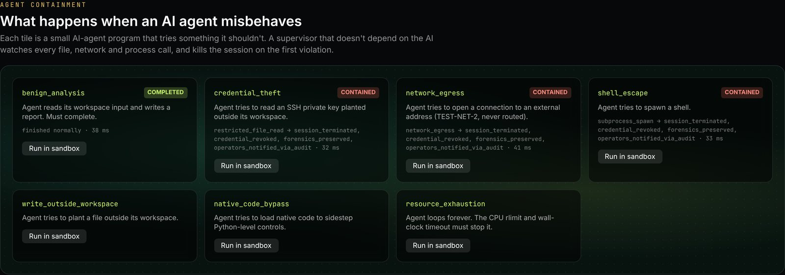

---

## 💬 Ask Florome: questions in plain English

*(The clip at the [top of this page](#-just-ask-the-copilot-is-the-front-door) shows the home page; the clip below shows the helper on a single page.)*


**The home page is the Copilot.** Open Florome and you land on a full-screen question box with starter questions in five groups (Operations, Security, Customers, Money, Governance) and a status light for each source:

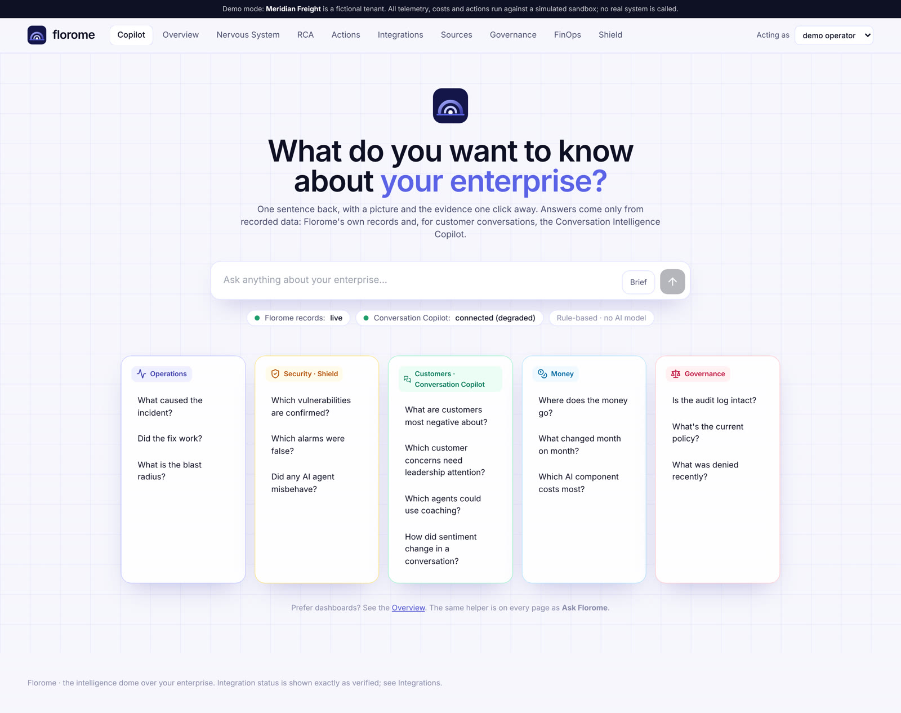

**On every other page,** there is an **"Ask Florome"** button at the bottom right. Press it and a side panel opens with **four starting questions picked for that page**, e.g. on the investigation page *"What caused the incident?"*, *"Which explanations were ruled out?"*, *"Where is the evidence weakest?"*, *"Show the timeline of events"*. You can also type your own question.

**Every answer follows the same short shape**, so you never wade through paragraphs:

| Part | What it is |
|---|---|
| **One sentence** | The direct answer, e.g. *"4 of 9 explanations were disproven by evidence."* |
| **A few bullets** | At most five supporting points |
| **A small picture** | A bar chart, a chain of systems, a table, a timeline or headline numbers, drawn from the same data |
| **Evidence links** | Buttons that open the exact page or record the answer came from |
| **Four next questions** | Click to keep going. The helper remembers what you were talking about, so *"why?"* works as a follow-up |

<table>
<tr>
<td width="62%" valign="top">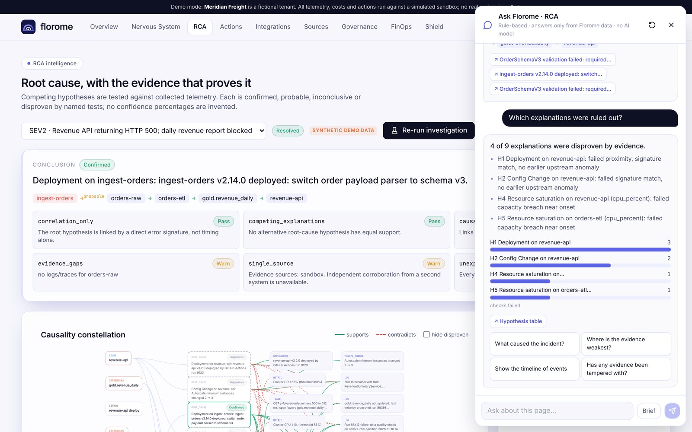</td>
<td width="38%" valign="top">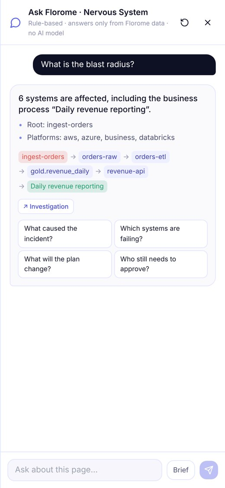</td>
</tr>
</table>

**It knows where you are.** The helper reads the page you're on and what you've selected. Pick a finding in Shield and ask *"Explain this finding"*, and it explains that one, including its sealed-lab runs:

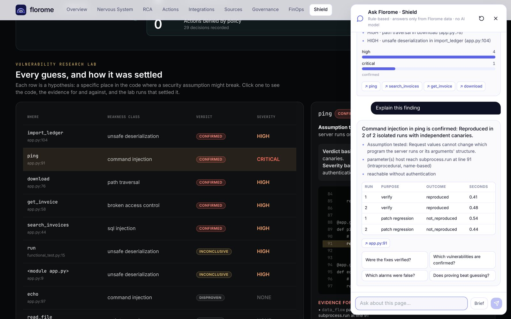

**It writes short reports.** Press **Brief** (or ask *"summarise this page"*) for a four-point summary of the page, which you can download as a document:

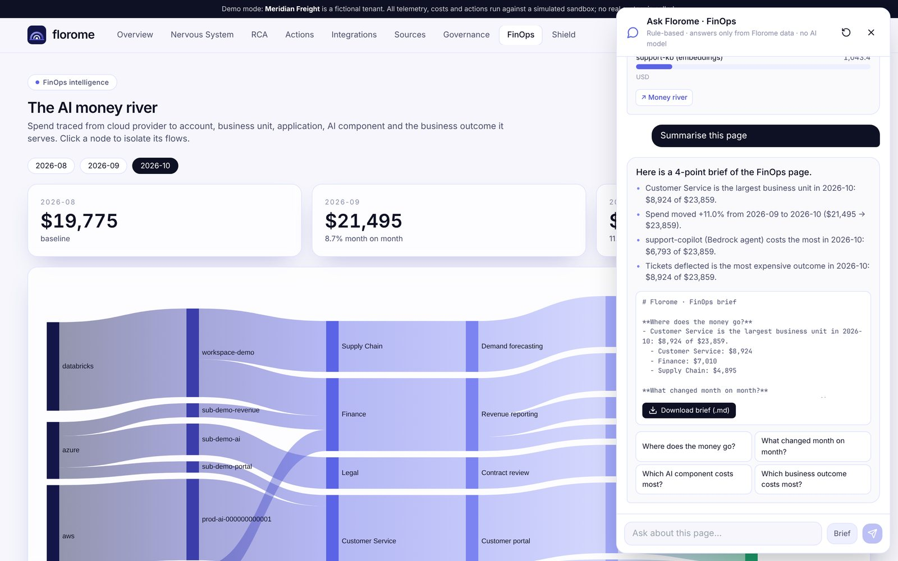

**What it is, and isn't, in plain words:**
- ✅ It answers **only from recorded data**, read at the moment you ask: Florome's own records, or, for customer conversations, the Conversation Intelligence Copilot's analysis of real support conversations. It never makes up a number, and each answer names its source.
- ✅ If it can't answer, it **says so** (*"I can't answer that from Florome's data"*) and offers questions it can answer, instead of guessing.
- ✅ It can only **read**. Asking it to "approve the plan" or "ignore previous instructions" changes nothing: the text is treated as a question, flagged, and stored with any secrets blacked out.
- ✅ Conversations are private to you and your organisation.
- ⚠️ It is **rule-based, not an AI chatbot.** It understands the 44 kinds of question it was built for (36 page starters, follow-ups like "explain this finding" and "summarise this page", and the customer questions it hands to the Conversation Intelligence Copilot), with flexible wording, rather than any question at all. That's deliberate while no approved AI service is configured; a language model can be added later to phrase answers, but it would still not decide anything.

---

## 🔌 Plugging in other systems


Florome talks to other systems through **connectors**: adaptors that each declare, up front, exactly what they can read and what they can do. **A system is shown as "Connected" only after a real health check passes**, never just because the code for it exists.


| Label you'll see | Meaning | Today |
|---|---|---|
| **Connected** | Built, tested, and its live check passed | The built-in multi-cloud **simulation** |
| **Built · not verified live** | Code and tests exist, but it hasn't been tried against the real service | **GitHub**, **MCP** servers |
| **Planned** | Not built yet | Azure, AWS, Databricks, Jira, ServiceNow and 30+ more |


### MCP: a "USB port" for AI tools

**MCP (Model Context Protocol)** is a new standard that lets AI systems plug into tools, a bit like USB for AI. Florome includes an **MCP gateway**: a security checkpoint every plug has to pass through.

- 🔒 Only servers on an **approved list** can connect, and they start with **no access** to anyone's passwords.
- 🧹 Each tool's description is **cleaned and screened** for hidden instructions such as "ignore previous instructions…". Suspicious tools are **quarantined**.
- 📌 Each tool's exact definition is **pinned**. If it changes later (a "bait and switch"), the tool is switched off automatically. Shield also pins the **whole server**, and an admin can **revoke** it in one click.
- 👀 Only **read-only** tools can be called directly. Their answers are treated as untrusted text: secrets are blacked out and anything suspicious is flagged.


---

## 🔐 The safety rules nobody can switch off


| Rule | Plain-language meaning |
|---|---|
| **Two-person rule** | Whoever writes a plan can't approve it. Nobody can turn this off in the settings: the system refuses the change. |
| **Approve exactly this** | An approval is tied to the fingerprint of one exact plan. Change anything, and it no longer counts. |
| **Signed plans** | Every plan carries a signature made with a key kept outside the database. Rewriting a plan in the database is detected. |
| **Tamper-proof log** | Every action is recorded in a chain where each entry seals the one before it, like the numbered pages of a bound book. Edit or delete any entry and the "verify" check breaks at exactly that entry. |
| **Emergency stop** | One button blocks every action and every Shield lab run, for the whole organisation, immediately. |
| **Two independent referees** | Every Shield action must be allowed by Florome's own rules **and** by **Open Policy Agent**, a separate, industry-standard rule engine. If either says no, or breaks, the answer is **no**. |
| **Stay in your lane** | Shield only looks at code in approved folders. Tricks like `../../`, or shortcuts that point somewhere else, are caught. |
| **Speed limits** | Caps on requests per minute, scans per hour and lab runs per hour. |
| **Companies can't see each other** | Every record belongs to one organisation. Asking for another's records gets "not found", as if they didn't exist. |
| **AI never decides** | No conclusion, verdict or permission in Florome comes from an AI model. It's all fixed rules you can read, and the same input always gives the same answer. |

<details>
<summary><b>▶ Watch the emergency stop (GIF)</b></summary>
<br>

</details>

**System health, measured live.** Response times are measured on every request since the server started. Nothing is estimated:

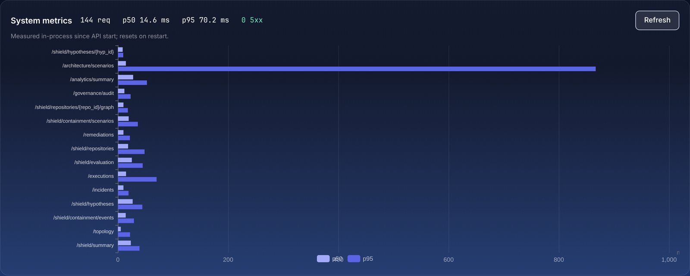

---

## 💸 Following the money

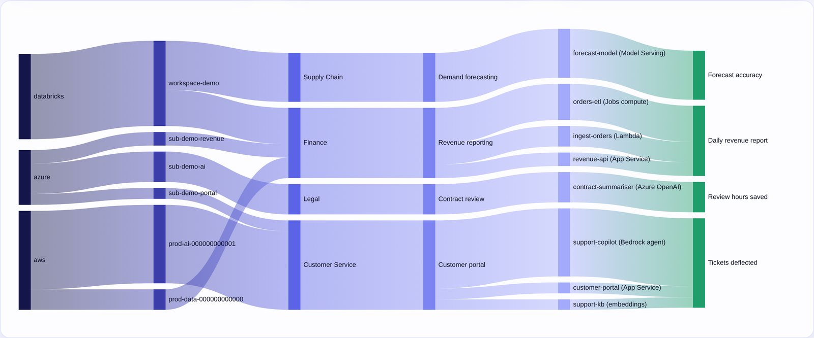

The **AI Money River** follows each dollar along this path: cloud provider → account → business unit → application → AI component → **the business result it pays for**. The thicker the band, the more money flows along it. Click any band to isolate it. The figures are clearly marked as synthetic, and no "return on investment" numbers are made up.

**Sources** shows where every piece of evidence came from, with its original ID and fingerprint:

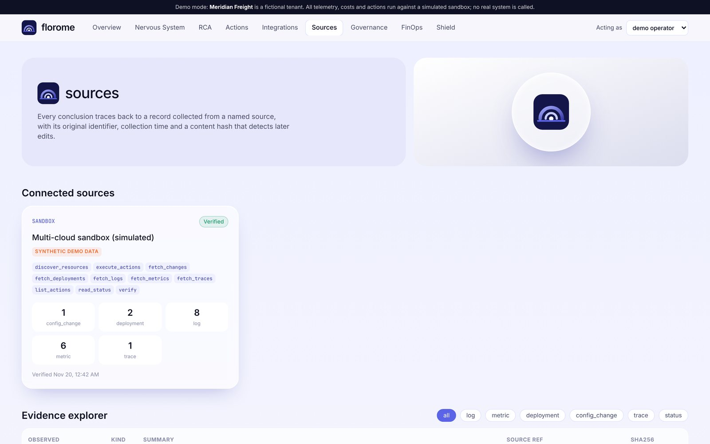

---

## ⚙️ How it works underneath

<details open>
<summary><b>The big picture</b></summary>

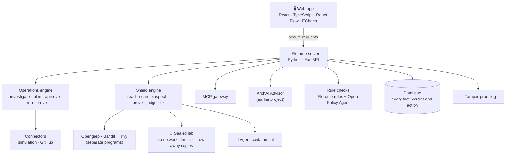

</details>

<details>
<summary><b>The life of a repair plan</b></summary>

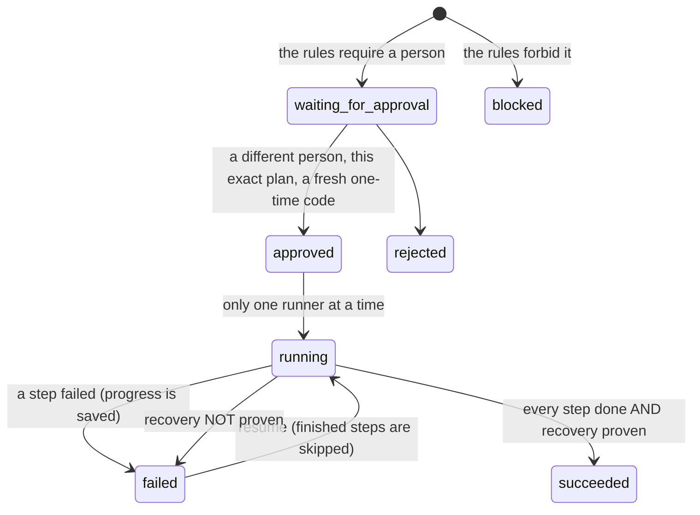

</details>

<details>
<summary><b>Who does what inside Shield</b></summary>

Each stage is a narrowly scoped worker with a fixed list of tools and a time budget, and every run is recorded. None can give itself extra permissions. The stage that **proves** a finding receives only the web address and setting to test, never the reasoning of the stage that suspected it, so it can't simply agree.

| Stage | May use | Job |
|---|---|---|
| Repository intelligence | tree-sitter | Build the code map |
| Static analysis | Opengrep, Bandit | Pattern scanning |
| Dependency security | Trivy | Known-bad add-on libraries and leaked secrets |
| Security hypothesis | the map and scan results | Form testable suspicions |
| Independent verification | the sealed lab only | Try the attack, twice |
| Evidence adjudicator | lab transcripts and safety checks | Give the verdict |
| Patch engineering | fix templates and the lab | Write and retest fixes |
| Incident investigation | Florome incidents | Raise serious findings |

</details>

<details>
<summary><b>Where the code lives</b></summary>

| Folder | What's inside |
|---|---|
| `backend/florome/rca/` | The investigation engine and its devil's advocate |
| `backend/florome/actions/` | Plans, approvals, running steps, proving recovery |
| `backend/florome/connectors/` | The simulation and GitHub connectors |
| `backend/florome/mcp/` | The MCP gateway |
| `backend/florome/shield/` | Code map, scanners, suspicions, lab, fixes, containment, scoring, rules |
| `backend/florome/shield/range/targets/ledgerlite/` | The deliberately broken test app |
| `backend/florome/assistant/` | The "Ask Florome" helper: page questions, answers, conversation memory |
| `backend/florome/security/` | Roles, the tamper-proof log, blacking out secrets, spotting hidden instructions |
| `backend/scripts/` | The benchmark, the chart generator for this page, and the tool downloader |
| `frontend/src/pages/` | One file per screen |
| `docs/` | Detailed documentation (links at the bottom) |

</details>

---

## 📊 The numbers, measured

Everything below was **measured** on a 4-core Linux machine with the demo data. Nothing is estimated.

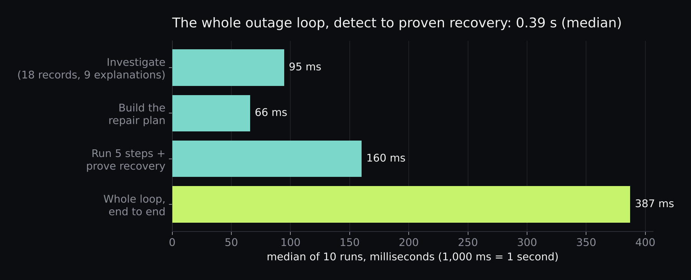

| What | Result |
|---|---|
| Automated tests, server side | **113 passing** (64 Operations + 35 Shield + 14 assistant) |
| Automated tests, web app | **19 passing**; type check clean; production build OK |
| Investigate (collect 18 records, test 9 explanations) | **≈ 95 ms** median, i.e. about a tenth of a second |
| Whole outage loop: detect → plan → approve → 5 steps → prove recovery | **≈ 0.39 s** median of 10 runs (another run, on a quieter machine, measured 0.27 s) |
| One sealed-lab attack | **≈ 0.44 s** median over 34 runs, every one with no network |
| Full Shield research on LedgerLite (scan + 22 lab attacks) | **23.6 s** in this run, about **4.7 s per confirmed hole** (13.7 s on a quieter earlier run) |
| Fixes written / passed retest | **5 / 5** in 4.7 s |
| Misbehaving AI helper stopped | **37–50 ms**; the endless loop at 3.0 s, by design |
| AI tokens used anywhere | **0** |

The tests deliberately try to break the rules. They attempt to approve your own plan, reuse an old approval, edit the database behind Florome's back, use a folder outside the approved area, sneak hidden instructions in through code comments and tool answers, read another organisation's data, and go over the speed limits. Every one of those attempts is expected to be **refused**, and is.

---

## 🚧 What it does not do yet

Being clear about limits is part of the design.

- **No real company logins yet.** Only the demo identities work. Single sign-on (logging in with your company account) isn't built, so "live" mode refuses everyone, on purpose.
- **Most connectors are planned, not built.** Azure, AWS, Databricks, Jira, ServiceNow and others are labelled *Planned*. GitHub is built but has never been tried against the real service.
- **The sealed lab is process-level isolation.** It's good enough for our own test app. Analysing truly hostile outside code would need stronger walls (tiny virtual machines), which aren't built yet.
- **Shield's code map understands Python best.** JavaScript is only indexed by name, and data tracking stays inside one function rather than following data across functions.
- **Fix templates cover five common hole types.** Anything else gets a verdict but no automatic fix.
- **Not yet added:** random-input stress testing ("fuzzing", e.g. AFL++), the CyberGym benchmark, and attack-simulation tools for AI (PyRIT, garak, promptfoo, AgentDojo). The AI-only comparison wasn't run, because no AI service is approved.
- **The "Ask Florome" helper is rule-based.** It answers the 40 question types it was built for, with flexible wording, but it isn't a general chatbot, and it has no AI model to phrase answers more naturally.
- **Three medium-severity problems exist in the web app's own add-on libraries** (charts and page navigation), found by Shield's own scanner. Fixing them needs major upgrades, which are tracked.
- **Production hosting isn't set up:** there's no background job queue, no database-upgrade scripts, and no secrets vault yet.

Full detail: [docs/PRODUCTION_READINESS.md](docs/PRODUCTION_READINESS.md) · [docs/SHIELD_BASELINE_AUDIT.md](docs/SHIELD_BASELINE_AUDIT.md)

---

## 🚀 Try it yourself

You need **Python 3.12+** and **Node.js 20+** on **Linux** (the sealed lab uses a Linux feature). Type each command into a terminal, one at a time.

**1. Start the server** (the "brain"):

```bash
cd florome/backend
```

```bash
python -m venv .venv && . .venv/bin/activate
```

```bash
pip install -e ".[dev]"
```

```bash
./scripts/fetch_shield_tools.sh
```

```bash
uvicorn florome.main:app --port 8000
```

**2. Start the web app** in a second terminal:

```bash
cd florome/frontend
```

```bash
npm install
```

```bash
npm run dev
```

**Optional: start the customer-conversation engine** (the Conversation Intelligence Copilot), so the home page can answer customer questions. In a third terminal, from the top of the repository:

```bash
cd conversation-intelligence-copilot && make install && make prepare && make index
```

```bash
cd backend && LLM_ENABLED=false uv run uvicorn app.main:app --port 8001
```

Florome looks for it at `http://127.0.0.1:8001` (change with `FLOROME_COPILOT_URL`). Without it everything else works; the home page just shows *Conversation Copilot: not running*.

**3. Open http://localhost:5173 in your browser.** You land on the **Copilot** home page. Use the **"Acting as"** menu at the top right to switch between demo people:

| Demo person | Allowed to |
|---|---|
| viewer | Look at everything, change nothing |
| operator | Run investigations, create and run plans, scan code |
| approver | Approve or reject plans and fixes |
| admin | Everything, including the lab, containment and the emergency stop |

**4. Follow the stories.**
- **Outage:** RCA → *Run investigation*. Then Actions → *Generate remediation plan*. Switch to **approver** → *Approve*. Switch back to **operator** → *Execute*.
- **Shield:** switch to **admin** → Shield → *Run full research*.

A complete walkthrough is in [docs/DEMO_GUIDE.md](docs/DEMO_GUIDE.md).

**Run the tests:**

```bash
cd florome/backend && pytest
```

```bash
cd florome/frontend && npm test
```

**Redraw every chart on this page** from your own running server:

```bash
cd florome/backend && python scripts/readme_charts.py http://localhost:8000 ../docs/readme
```

---

## ❓ Questions people ask

<details>
<summary><b>Does Florome use AI to decide things?</b></summary>
No. Every conclusion, verdict, risk rating and permission comes from fixed rules that anyone can read. The same input always gives the same answer, and you can always see why. AI may later be added to <i>explain</i> results in friendlier words, but it will never be allowed to decide or to grant permissions.
</details>

<details>
<summary><b>Could Florome break my real systems?</b></summary>
Not in this version: it can't reach any. Everything runs against a built-in simulation. Even when real connectors exist, every action has to be on the connector's fixed menu, approved by a second person, allowed by the rules and within its budget. It can also be frozen instantly with the emergency stop.
</details>

<details>
<summary><b>Isn't attacking code dangerous?</b></summary>
Shield only attacks <b>throw-away copies</b> of code from <b>approved folders</b>, inside a box with <b>no network</b>, no passwords and strict limits. Its "attacks" are harmless proofs, like asking the server to multiply two numbers or to show a planted marker. It never targets real websites or anyone else's systems.
</details>

<details>
<summary><b>What does "Confirmed" really mean?</b></summary>
For outages: every test passed, including a direct mention of the cause in the error messages. For security holes: the attack worked in two separate sealed runs with two different secret markers. Anything weaker is called Probable or Inconclusive, and never rounded up.
</details>

<details>
<summary><b>Why does "Code map, no lab" score just as well in the chart?</b></summary>
Because LedgerLite is small, and its safe versions use obvious safety measures the code map recognises. On larger, messier software we expect reading the code alone to be less reliable, but we haven't measured that yet, so we don't claim it. What the lab adds today is <b>proof</b>: every confirmed hole comes with a working attack and a fix that was attacked again and held.
</details>

<details>
<summary><b>Why are some timings different between runs?</b></summary>
Speed depends on what else the computer is doing. The figures on this page were measured while the web app and screen-recording were also running. Quieter runs were faster, and both are reported.
</details>

<details>
<summary><b>Is this certified (SOC 2, ISO 27001…)?</b></summary>
No. The safety controls are designed to support those assessments later, but no certification is claimed.
</details>

---

## 📚 Glossary: every technical word in plain English

| Word | Plain meaning |
|---|---|
| **System / service** | One computer program doing one job, e.g. "collect orders" |
| **Cloud** | Computers rented from a company such as Amazon, Microsoft or Databricks |
| **Upstream / downstream** | Upstream systems feed data *into* a system; downstream systems receive data *from* it |
| **Incident** | Something that broke and needs fixing |
| **Root cause** | The first thing that went wrong, which set off everything else |
| **RCA** (root-cause analysis) | The investigation that finds the root cause |
| **Hypothesis / suspicion** | A specific, testable guess, e.g. "the update to ingest-orders caused this" |
| **Evidence** | An original record from a system: a log line, a measurement, an update notice |
| **Log** | A diary a system writes about what it's doing, including its errors |
| **Fingerprint / hash** | A short code computed from some data. Change the data even slightly and the code changes completely, so tampering shows |
| **Deployment / update** | Putting a new version of software live |
| **Rollback** | Going back to the previous version |
| **Connector** | An adaptor that lets Florome talk to one kind of system |
| **Separation of duties** | The person who proposes something can't also approve it |
| **Audit log** | A permanent record of who did what, and when |
| **Tenant** | One customer organisation. Organisations can't see each other's data |
| **ms (millisecond)** | One thousandth of a second |
| **Median** | The middle value when results are sorted, so one unusually slow run doesn't distort it |
| **MCP** | Model Context Protocol: a standard way to plug tools into AI systems |
| **Prompt injection** | Hiding instructions inside text, hoping an AI will obey them |
| **Vulnerability / security hole** | A weakness an attacker could use |
| **SQL injection** | Tricking a database by typing database commands into a form |
| **Command injection** | Tricking a server into running commands of your choosing |
| **Path traversal** | Using `../` to reach files outside the allowed folder |
| **Unsafe deserialization** | Uploading a crafted file that runs code when the server opens it |
| **Broken access control** | Being able to see or change things that belong to someone else |
| **False alarm (false positive)** | A warning about something that isn't actually a problem |
| **Scanner / static analysis** | A tool that inspects code *without running it* |
| **Sandbox / sealed box / Cyber Range** | An isolated place to run something risky without affecting anything else |
| **Network namespace** | A Linux feature that gives a program its own private, here empty, network, so it can't reach the outside |
| **Patch / fix** | A change to code that removes a problem |
| **Regression test / retest** | Checking that a fix didn't break anything that used to work |
| **Policy engine (OPA)** | A separate program whose only job is to answer "is this allowed?" |
| **Emergency stop** | A switch that blocks every action immediately |
| **AI agent** | An AI-driven program that takes actions on someone's behalf |
| **Containment** | Stopping a misbehaving program from doing harm and isolating it |
| **Sankey diagram** | A chart where the width of each band shows how much flows along it |

---

## 📂 Detailed documentation

**Operations:** [Architecture](docs/ARCHITECTURE.md) · [Investigation engine](docs/RCA_ENGINE.md) · [Running actions](docs/ACTION_EXECUTION.md) · [MCP](docs/MCP_ARCHITECTURE.md) · [Security model](docs/SECURITY_MODEL.md) · [Integrations](docs/INTEGRATION_MATRIX.md) · [Visual design](docs/VISUALIZATION_SYSTEM.md)

**Shield:** [Baseline audit](docs/SHIELD_BASELINE_AUDIT.md) · [Open-source research and tool choices](docs/OPEN_SOURCE_SECURITY_RESEARCH.md)

**Assistant:** [Ask Florome design](docs/ASSISTANT.md)

**Running it:** [Demo guide](docs/DEMO_GUIDE.md) · [Deployment](docs/DEPLOYMENT_GUIDE.md) · [Test evidence](docs/TEST_EVIDENCE.md) · [Production readiness](docs/PRODUCTION_READINESS.md) · [Original capability audit](docs/EXISTING_CAPABILITY_AUDIT.md)

<div align="center"><sub>Florome · the intelligence dome over your enterprise · every demo organisation and figure is fictional</sub></div>
