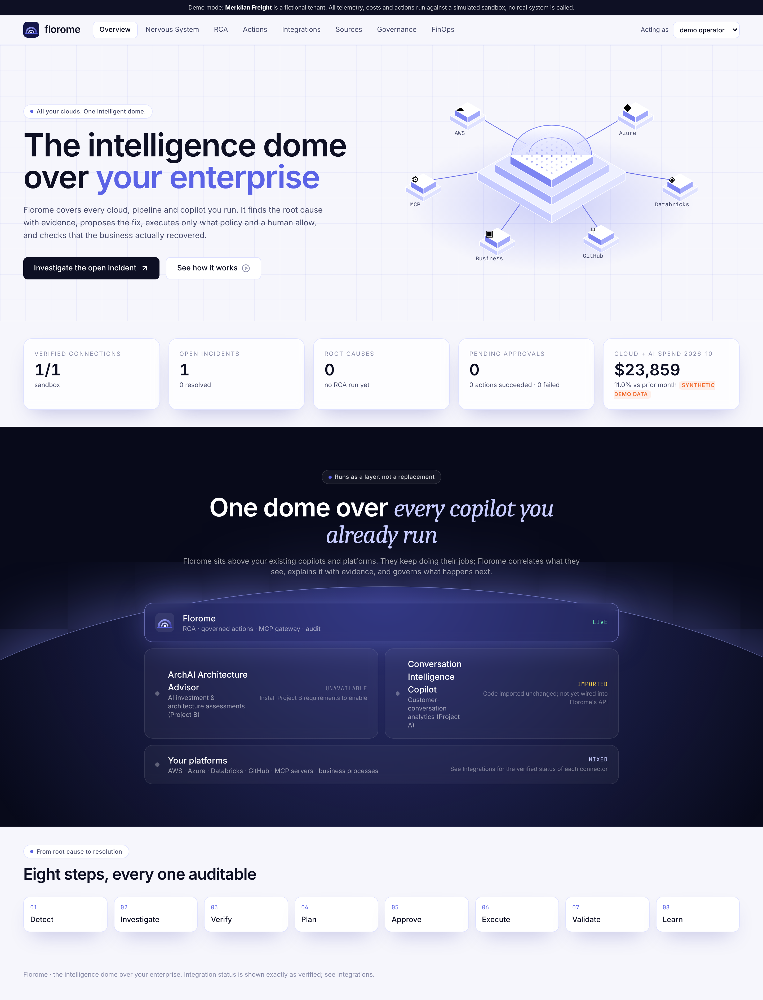

# Florome

**The intelligence dome over your enterprise.** *One Intelligence. Every Cloud. From Root Cause to Resolution.*

Florome is the integration layer built on top of the two existing projects in this repository:

| Project | Folder | Role in Florome |
|---|---|---|
| A. Conversation Intelligence Copilot | `../conversation-intelligence-copilot/` | Imported unchanged. Its Evidence Challenger and redaction/injection patterns were generalised into Florome. Not yet wired into Florome's API. |
| B. ArchAI Enterprise Architecture Advisor | `../archai-enterprise-advisor/` | Imported unchanged. Its decision engine is served through `/api/v1/architecture/*` via an adapter (verified by tests). |

It closes the loop **DETECT → INVESTIGATE → VERIFY → PLAN → APPROVE → EXECUTE → VALIDATE → LEARN**, with every step persisted and audited.



## What works today (verified by tests)

* **RCA engine.** Deterministic hypothesis generation (changes, saturation, propagation). Named tests cite evidence ids, and each conclusion is labelled confirmed, probable, inconclusive or disproven. An evidence challenger can only downgrade. No confidence percentages.
* **Governed remediation.** Plans are built from connector action catalogs. Policy-as-code supports observe, approval and autonomous modes. Approvals are bound to the plan hash, with separation of duties, nonce replay protection and expiry. Execution is durable and resumable, with idempotency keys, bounded retries, timeouts and an emergency stop. Post-action validation includes the business outcome.
* **MCP gateway** (MCP SDK 2.x, stdio). Servers must be allow-listed and start with a minimal environment. Discovery quarantines suspected injection, tools are default-deny, schemas are pinned with drift detection, invocation is read-only, and output is redacted. Verified against the bundled `sandbox-ops` server and a hostile test server.
* **Connectors.** A stateful sandbox serves as the safe execution target. A GitHub REST connector exists, but it is contract-tested against a mocked transport only and has **not** been verified live.
* **Security.** Hash-chained audit log, evidence content hashes, tenant isolation, RBAC, credential redaction.
* **UI.** Eight React pages wired to the API: Overview, Nervous System, RCA, Actions (with ledger), Integrations (with MCP console), Sources, Governance (with measured system metrics) and FinOps (Sankey).

Everything in demo mode is synthetic and labelled as such. See [docs/PRODUCTION_READINESS.md](docs/PRODUCTION_READINESS.md) for what is **not** done.

## Run locally

Backend (Python 3.12+):

```bash
cd florome/backend
python -m venv .venv && . .venv/bin/activate
pip install -e ".[dev]"
uvicorn florome.main:app --port 8000
```

Frontend (Node 20+), in a second terminal:

```bash
cd florome/frontend
npm install
npm run dev
```

Open http://localhost:5173. Use the **Acting as** selector to switch between the demo identities (operator, approver, admin, viewer).

To enable the AI investment (Project B) endpoints, also run:

```bash
pip install -r ../../archai-enterprise-advisor/requirements.txt
```

Tests:

```bash
cd florome/backend && pytest
```

```bash
cd florome/frontend && npm test && npm run typecheck && npm run build
```

## Documentation

[Architecture](docs/ARCHITECTURE.md) · [Capability audit](docs/EXISTING_CAPABILITY_AUDIT.md) · [Integration matrix](docs/INTEGRATION_MATRIX.md) · [MCP](docs/MCP_ARCHITECTURE.md) · [RCA engine](docs/RCA_ENGINE.md) · [Action execution](docs/ACTION_EXECUTION.md) · [Security model](docs/SECURITY_MODEL.md) · [Visualization system](docs/VISUALIZATION_SYSTEM.md) · [Demo guide](docs/DEMO_GUIDE.md) · [Deployment](docs/DEPLOYMENT_GUIDE.md) · [Test evidence](docs/TEST_EVIDENCE.md) · [Production readiness](docs/PRODUCTION_READINESS.md)
