<div align="center">


<br>


### Florome watches over every system a company runs. When something breaks, it works out *why*, proposes a fix, waits for a human to approve it, applies it, and checks that the business actually recovered. Its security half, **Shield**, hunts for weaknesses in code and **proves** each one is real before anyone has to care.

<br>


<sub>Real recording, sped up 1.7×. A revenue report is broken. Florome finds the cause, proposes five repair steps, gets approval from a second person, runs the repairs, and checks everything is healthy again.</sub>

</div>

---

> [!NOTE]
> **Everything you see in this README is a demonstration on made-up data.** The company ("Meridian Freight"), its cloud systems, its money and its outage are all simulated inside Florome, so nothing real is ever touched. Where something is *not* finished, this page says so plainly; see [What it does not do yet](#-what-it-does-not-do-yet).

## 📖 Contents

1. [Florome in one minute](#%EF%B8%8F-florome-in-one-minute)
2. [Why this exists: the problem in plain words](#-why-this-exists-the-problem-in-plain-words)
3. [The two halves of Florome](#-the-two-halves-of-florome)
4. [Story 1: the morning the revenue report broke](#-story-1-the-morning-the-revenue-report-broke) (step by step, with pictures)
5. [Story 2: Shield finds security holes and proves them](#%EF%B8%8F-story-2-shield-finds-security-holes-and-proves-them)
6. [Story 3: an AI helper goes rogue, and gets stopped](#-story-3-an-ai-helper-goes-rogue-and-gets-stopped)
7. [Connecting to your systems](#-connecting-to-your-systems)
8. [The safety rules nobody can switch off](#-the-safety-rules-nobody-can-switch-off)
9. [Following the money](#-following-the-money)
10. [How it works under the hood](#%EF%B8%8F-how-it-works-under-the-hood)
11. [The numbers](#-the-numbers)
12. [What it does not do yet](#-what-it-does-not-do-yet)
13. [Try it yourself](#-try-it-yourself)
14. [Questions people ask](#-questions-people-ask)
15. [Glossary: every technical word, explained](#-glossary-every-technical-word-explained)

---

## ⏱️ Florome in one minute

Imagine a large company as a city. Its "buildings" are computer systems spread across several cloud providers (Amazon, Microsoft, Databricks), connected by roads that carry data. When one building catches fire, the smoke shows up somewhere else entirely. Usually that's where people start looking, and it's the wrong place.

**Florome is a glass dome over that city.** From up there it can see every building and every road, so it can:

| | What Florome does | Everyday comparison |
|---|---|---|
| 👀 | **Sees** every system and how data flows between them | A live map of the whole city |
| 🔍 | **Investigates** when something breaks, testing every possible explanation against evidence | A detective who writes down every suspect and every alibi |
| 🛠️ | **Proposes a fix**, with the risks and an undo plan for each step | A repair estimate before any work starts |
| ✋ | **Waits for a human to approve.** The person who wrote the plan is *not allowed* to approve it | The two-signature rule for a large cheque |
| ▶️ | **Applies the fix** step by step, and can resume if interrupted | A careful builder who ticks off each task |
| ✅ | **Checks the business recovered**, not just the servers | Confirming the shop actually reopened, not just that the lights are on |
| 🛡️ | **Shield** hunts for security holes in software and *proves* each one in a sealed lab | A locksmith who doesn't just say "this lock looks weak" but opens it in a workshop, then fits a better one |

---

## 🤔 Why this exists: the problem in plain words

**Problem 1. The real cause is rarely where the alarm rings.** In our demo, customers see an error on a *revenue website* on Microsoft's cloud. The actual cause is a small software update made **50 minutes earlier**, three systems upstream, on *Amazon's* cloud. Different teams, different tools, different logins. People lose hours looking in the wrong place.

**Problem 2. "AI said so" is not good enough.** Many tools now ask an AI model to guess what went wrong. A guess presented confidently is dangerous. Florome doesn't guess. It lists every possible explanation, checks each against the actual records, and labels it **Confirmed**, **Probable**, **Inconclusive** or **Disproven**, showing exactly which checks passed and failed. It never invents a percentage like "87% confident".

**Problem 3. Automatic fixes can make things worse.** A tool that fixes production systems by itself, unsupervised, is a risk. Florome lets a human see exactly what will happen, requires a *second* person to approve, and records everything in a log that can't be quietly edited.

**Problem 4. Security scanners cry wolf.** Code-scanning tools flag hundreds of "possible" problems, and many are harmless. Teams stop reading the alerts. Shield doesn't stop at "possible": it safely tries the attack on a disposable copy and only calls something a vulnerability if the attack actually works, **twice**.

---

## 🧩 The two halves of Florome

<table>
<tr>
<td width="50%" valign="top">

### 🌐 Florome Operations
*"Something broke. Why, and how do we fix it safely?"*

- Live map of all connected systems
- Root-cause investigation with evidence
- Repair plans, two-person approval, execution
- Proof of recovery, including the business outcome
- Audit trail, emergency stop, spending view

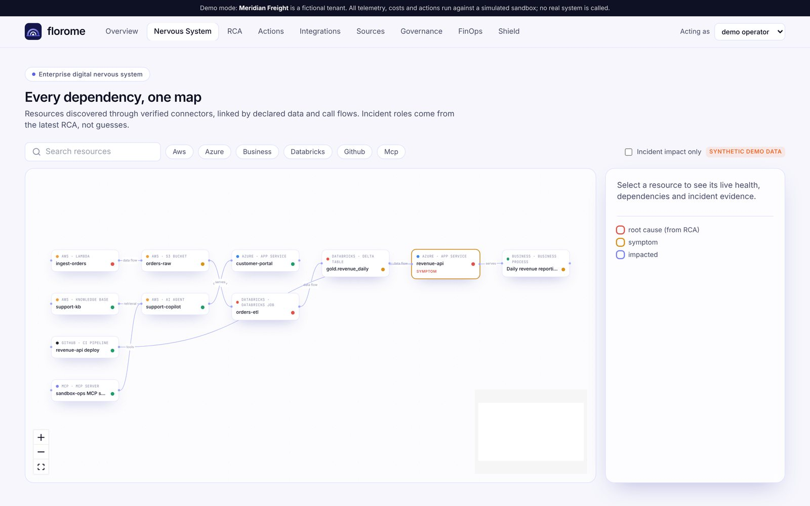

</td>
<td width="50%" valign="top">

### 🛡️ Florome Shield
*"Where could we be attacked, and is it real?"*

- Reads source code and maps who can reach what
- Runs three industry scanners
- Turns suspicions into testable guesses
- **Proves or disproves each guess in a sealed lab**
- Writes a fix, re-attacks it, sends it for review
- Stops misbehaving AI helpers on their first bad move

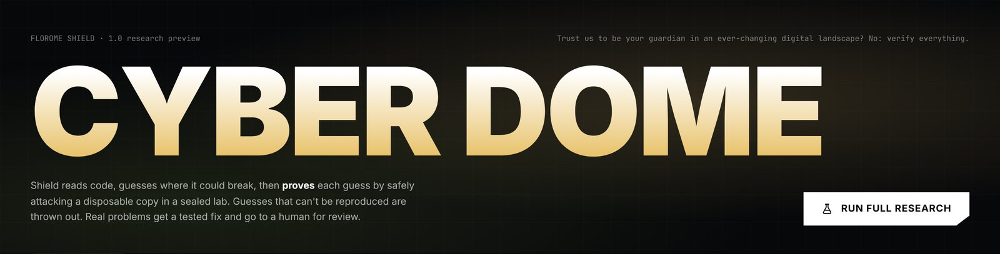

</td>
</tr>
</table>

Florome also sits **on top of** two earlier projects in this repository rather than replacing them:


- **ArchAI Architecture Advisor** (`../archai-enterprise-advisor/`) answers "should we use AI for this, and how?". Florome calls it directly; this connection is live and tested.
- **Conversation Intelligence Copilot** (`../conversation-intelligence-copilot/`) analyses customer conversations. It's included unchanged but **not yet wired in**, and the screen says so.

---

## 📰 Story 1: the morning the revenue report broke

This is the demo scenario, told the way a person would live through it. Each step shows **what you see**, **what Florome is doing behind the scenes**, and **why it matters**.

### The setup: how data flows in this (made-up) company

Every morning, orders flow through five systems on three different clouds before Finance gets its daily revenue report:

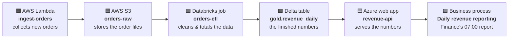

**What actually went wrong (the hidden truth):** 50 minutes before anyone noticed, an engineer updated `ingest-orders` so it reads orders in a new format ("schema v3"). The new version quietly **drops any order that's missing a currency field**. Fewer orders flow downstream, the data job refuses the incomplete batch, the revenue table goes stale, the website returns errors, and Finance's report can't be produced.

To make it realistic, the demo also contains **red herrings**, things that *look* suspicious but aren't the cause:
- someone changed a scaling setting on the website 75 minutes earlier,
- the website itself was updated 3 hours earlier,
- the computers' processor usage was recorded (it was normal).

### Step 1: You see the alarm on the map


- **What you see:** a live map. Each box is a system; its colour stripe shows which cloud it lives on; the dot shows whether it's healthy (green) or failing (red). The website `revenue-api` is marked as the **symptom**.
- **Behind the scenes:** Florome asked each connected system "how are you?" (`read_status`) and drew the connections it was told about.
- **Why it matters:** you immediately see that six systems across three clouds are unhealthy, not just the website. The customer-support systems on the right are fine, so the problem has boundaries.

### Step 2: You press "Run investigation"

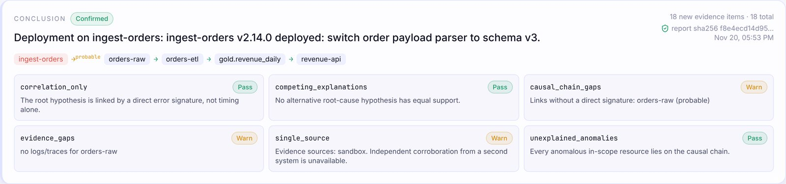

- **What you see:** a **conclusion** at the top, *"Deployment on ingest-orders … switch order payload parser to schema v3"*, marked **Confirmed**, and below it the chain of failure: `ingest-orders → orders-raw → orders-etl → gold.revenue_daily → revenue-api`.
- **Behind the scenes**, in about 76 milliseconds:
  1. **Collect evidence.** Florome asks every system upstream of the symptom for its logs, measurements, deployments, setting changes and traces: 18 records in total. Each record is stored with a **fingerprint** (a hash). If anyone edits it later, Florome notices.
  2. **List every suspect.** It writes down 9 possible explanations ("hypotheses"): every recent change, every overloaded machine, and every link where a failure could have passed from one system to the next.
  3. **Check every alibi.** Each explanation gets named checks, for example: *Did the change happen before the problems began? Do the error messages mention the change? Was something upstream already broken earlier?*
  4. **Play devil's advocate.** A second module, the **Evidence Challenger**, tries to knock the conclusion down: is this just a coincidence of timing? Is there an equally good alternative? Is any evidence missing? It can only ever *lower* confidence, never raise it.
- **Why it matters:** the boxes under the conclusion show the challenger's findings. Note the honest **"Warn"**: there are *no logs at all* for the storage step `orders-raw`, so that one link can only be called "probable". Florome tells you where its knowledge is thin.

### Step 3: You see *why*: every suspect and every alibi


<sub>Chart drawn from the stored investigation by <code>backend/scripts/readme_charts.py</code>. Nothing is typed in by hand.</sub>

How to read it: each bar is one explanation Florome considered. **Teal** = a check passed, **red** = a check *failed against the evidence*, **grey** = couldn't be checked because the evidence was missing.

| Suspect | Verdict | In plain words |
|---|---|---|
| **H3** ingest-orders update | ✅ **Confirmed** | It happened 2 minutes before the first errors, and the errors literally name the new code ("OrderSchemaV3 validation failed"). Nothing upstream was broken earlier. |
| H1 website update 3 hours earlier | ❌ Disproven | Too long before, and no error mentions it. |
| H2 website scaling setting change | ❌ Disproven | The website's errors talk about *missing data*, not scaling, and the systems feeding it were already broken first. |
| H4, H5 machines overloaded | ❌ Disproven | Processor usage was 35% and 41%, nowhere near overloaded. |
| H6 failure passed to `orders-raw` | 🟣 Probable | The timing fits, but that storage has no error messages that could prove the link. |
| H7–H9 failure passed down the chain | ✅ Confirmed | Each system's errors name the system before it. |

### Step 4: You click any piece of evidence to see the original record


- **What you see:** the **Causality Constellation**. Systems on the left, explanations in the middle, evidence on the right. **Green lines** mean "this evidence supports that explanation", **red dashed lines** mean "this evidence contradicts it". Clicking a record shows the raw data exactly as collected, plus **"hash verified"**, meaning nobody has altered it since collection.
- **Why it matters:** no conclusion is a black box. An auditor, a manager or a sceptical engineer can trace any claim back to its source in two clicks.

### Step 5: You travel back in time


- **What you see:** one row per system and one dot per event. **Red** = something went wrong; **indigo** diamonds and triangles = updates and setting changes. The dashed line marks **"Root change"**. You can drag the slider to zoom into any period.
- **Why it matters:** the pattern jumps out. The red dots start on `ingest-orders` right after the update, then appear on each downstream system in order, like dominoes.

### Step 6: Florome proposes a repair plan

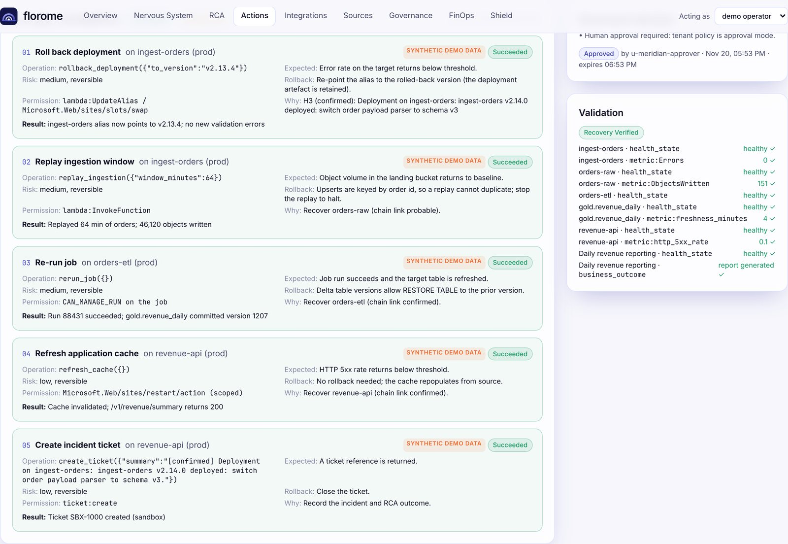

- **What you see:** five numbered steps, in the order the dominoes must be stood back up:
  1. **Roll back** `ingest-orders` to the previous good version (v2.13.4)
  2. **Replay** the last 63 minutes of orders so the missing ones are collected
  3. **Re-run** the data-cleaning job
  4. **Refresh** the website's cache so it shows the new numbers
  5. **Open a ticket** recording what happened
- For **every** step you see: the exact operation, the expected result, the **risk level**, the **undo plan**, and which **permission** the action needs in the cloud provider.
- **Behind the scenes:** Florome can only use actions that each system's connector *publishes* in a fixed menu, and every setting is checked against strict rules, so a malformed or invented command is rejected. If the investigation had been *inconclusive*, Florome would refuse to plan anything except a ticket and more diagnostics.
- **Why it matters:** order matters. Re-running the data job *before* replaying the missing orders would just fail again, and the demo really does fail if you try. This is a working simulation, not a slideshow.

### Step 7: A second person approves (the two-signature rule)

- The person who created the plan **cannot** approve it. Try it, and Florome refuses with *"Separation of duties"*.
- Approval is tied to an exact **fingerprint of the plan**. If anyone changes a single setting afterwards, the approval stops being valid.
- Each approval can be used **once** (no replaying old approvals), and it **expires** after 60 minutes.
- Since this round, each plan is also **signed** with a secret key that isn't stored in the database. So even someone with direct database access who rewrites a plan *and* its fingerprint is caught.

### Step 8: Florome executes, then proves recovery

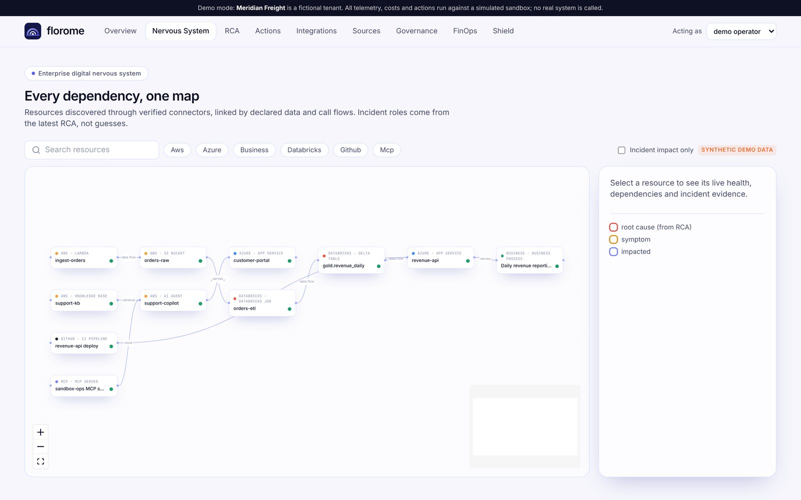

- Each step runs **one at a time**, is saved after it finishes, and is retried only for temporary errors (up to 3 times). If something fails halfway, you can **resume**. Finished steps are not repeated, because each step carries a unique "already done" key.
- Then the **validation** step re-reads every affected system *and the business process itself*. It's only marked resolved because the measurements are back to normal **and** Finance's report was generated.
- Every action lands in the **ledger** below, styled like a banking app because it's a record of value-changing transactions:


---

## 🛡️ Story 2: Shield finds security holes and proves them

<div align="center">

<sub>Real recording, sped up 2.8×. Shield reads the code, scans it, attacks every suspicion in a sealed lab, then writes and retests a fix.</sub>
</div>

### The test subject: "LedgerLite", a deliberately broken app

To show Shield honestly, we built a small invoicing app called **LedgerLite** with **five real security holes** and **four look-alikes that seem dangerous but are actually safe**. The look-alikes are the important part: a good security tool has to tell them apart.

| Where in the app | What it does | Real hole? | The trap, in plain words |
|---|---|---|---|
| `search_invoices` | Search your invoices by customer | 🔴 **Yes** (SQL injection) | Typing `x' OR '1'='1` as a customer name tricks the database into returning **everyone's** invoices |
| `by_customer` | Same search, written safely | 🟢 No | Uses the database's safe "fill in the blank" method, so the trick is just treated as a weird name |
| `get_invoice` | Open invoice number *N* | 🔴 **Yes** (broken access control) | You're logged in, but you can open **other people's** invoices just by changing the number |
| `get_my_invoice` | Same, written safely | 🟢 No | Only returns invoices you own |
| `download` | Download a report file | 🔴 **Yes** (path traversal) | Asking for `../secret.txt` walks **out of** the reports folder |
| `read_file` | Same, written safely | 🟢 No | Checks the final location is still inside the folder |
| `ping` | Network check tool | 🔴 **Yes** (command injection) | Adding `; another-command` makes the server run **any command you like** |
| `echo` | Similar tool, written safely | 🟢 No | Passes the text as plain data, never to a command line |
| `import_ledger` | Upload a ledger file | 🔴 **Yes** (unsafe deserialization) | A specially crafted file can make the server **run code** while opening it |

> The answer key (`ledgerlite_labels.json`) is read **only** by the scoring step, never by the detection engine, so Shield can't cheat.

### What Shield does, step by step

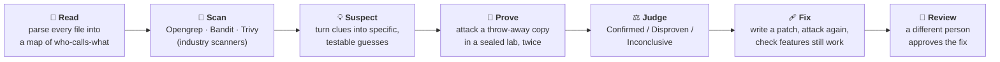

**1 · Read the code like a map.** Shield parses every source file using **tree-sitter** (a widely used code-reading library) and records every web address the app answers, which ones need a login, and every **dangerous operation** (database queries, running programs, opening files, decoding uploads). It then traces whether data typed by a visitor can **flow** into one of those dangerous operations. Every line on this map points back to a specific file and line number in a specific version of the code.


How to read it: **gold** boxes are pages anyone on the internet can call; **teal** boxes need a login (the dashed lime lines lead to `current_user`, the login check); **red** boxes are dangerous operations. A **red line** means visitor data reaches danger with **no safety check** on the way. A **teal line** means a safety check was found.

**2 · Run the industry scanners.** Shield runs three well-known open-source tools, each as a separate program with a time limit:
- **Opengrep**: finds risky code patterns using rules we wrote for this project
- **Bandit**: Python's standard security checker
- **Trivy**: checks the app's third-party libraries against known-vulnerability lists

If two tools report the same problem on the same line, Shield merges them into **one** suspicion with two pieces of evidence instead of double-counting.

**3 · Form specific guesses.** Each suspicion becomes a **hypothesis** with: the exact place in the code, the assumption being questioned (e.g. *"visitors can only read files inside the reports folder"*), the evidence **for** and **against**, and *how it could be safely tested*.

**4 · Prove it in a sealed lab (the Cyber Range).** This is the step most tools skip. For each guess, Shield:
- makes a **throw-away copy** of the app in a temporary folder,
- plants a **secret marker** (a random number) so success can be detected without causing any harm,
- starts the copy in a sealed box: **no network at all** (a Linux "network namespace"), **no passwords or keys** in its environment, strict limits on processor time, memory and file size, and a hard time limit,
- sends the attack, and checks whether the secret marker comes back,
- **does it all again** with a different copy and a different marker, then deletes everything.

> **Harmless proof, not damage.** The command-injection test asks the server to *multiply two numbers*. If the answer comes back, the server ran our command. The file test looks for a planted marker file. Nothing is deleted, sent anywhere or broken.

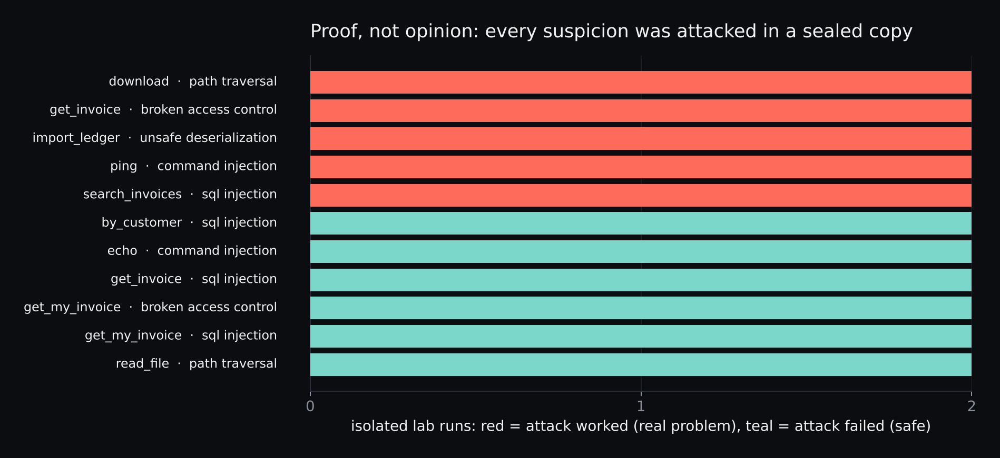

**5 · Give a verdict.**

| Verdict | Meaning | Rule |
|---|---|---|
| ✅ **Confirmed** | It's real | The attack worked in **2 out of 2** separate sealed runs |
| ❌ **Disproven** | False alarm | The attack failed both times **and** a specific safety measure explains why |
| ⚠️ **Inconclusive** | Can't tell yet | Results were mixed, the test errored, or there's only a scanner hint with no proven path |
| 🟣 **Probable** | Likely, not proven | Clear path to danger, but no safe way to test this target |

**Severity is judged separately** from the verdict. A confirmed hole that anyone on the internet can reach is rated higher than one that needs a login.

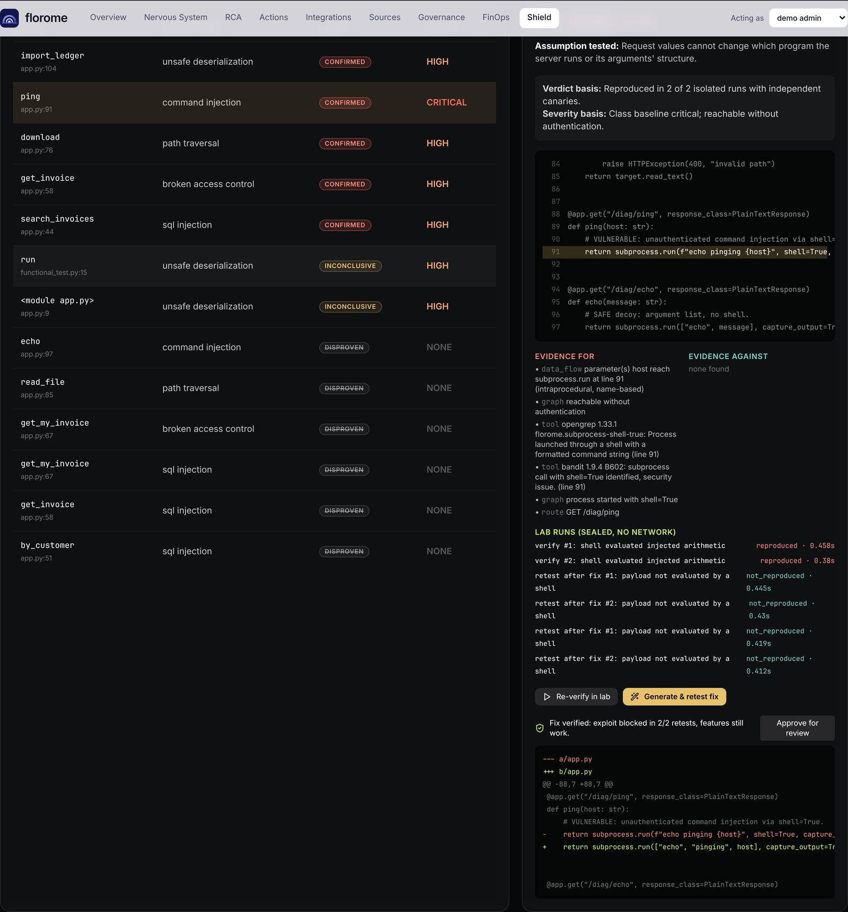

Above: the **command-injection** hole in `ping`. On the right you see the questioned assumption, the highlighted line of code, five pieces of supporting evidence, two lab runs that **reproduced** the attack, and then a **fix**. The fix replaces "run this text as a command" with "run this exact program with these exact arguments". Shield attacked the fixed copy twice more (**not reproduced**) and re-ran the app's normal feature checks (**still work**).

And here is a **false alarm being thrown out**. The safe `echo` tool *looks* similar, and one scanner flagged it, but the lab attack failed twice and Shield found the reason (*"argument list without shell"*):

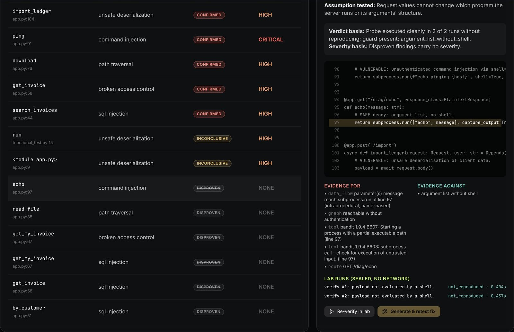

**6 · Fix, retest, review.** For each confirmed hole, Shield writes a small patch from a reviewed template, applies it **only to a copy**, attacks it twice more (the attack must now fail), and runs the app's own feature checks (they must still pass). A *different* person then approves it for code review. **Shield never changes the real code by itself.**

**7 · Raise an incident.** Every confirmed high or critical hole automatically becomes an incident in Florome's main incident list, next to the operational ones.

### Does proving actually help? The honest comparison


We scored three approaches on the same 9 spots in LedgerLite:

| Approach | Real holes found (of 5) | False alarms | Missed | What it means |
|---|---|---|---|---|
| **Scanners only** (Opengrep + Bandit) | 4 | **2** (the safe `echo`, and a harmless import line) | **1** (the invoice-access hole: scanners can't see "you opened someone else's invoice") | Typical of scanners: noisy, and blind to logic mistakes |
| **Code map, no lab** | 5 | 0 | 0 | The map's safety-check detection was enough on this small app |
| **Florome Shield** (map + lab proof) | 5 | 0 | 0 | Same score, **plus** a reproduced attack for each finding and a retested fix (5 of 5 fixes passed) |
| **AI model only** | n/a | n/a | n/a | **Not run.** No authorised AI service is configured, and Florome never calls paid AI services without being told to |

> [!IMPORTANT]
> **Read this honestly.** On this small test app, the code map *without* the lab also scored perfectly, so here the lab's value is **proof**, not extra detection. Every confirmed finding has a reproduced attack and a retested fix behind it, which is what lets a busy team trust it. The test app is tiny (9 spots) and was written by the same team that built Shield. Treat these numbers as a self-check that guards against regressions, **not** as evidence about real-world software. No new, previously unknown vulnerabilities are claimed.

Totals for one full Shield run on LedgerLite (measured): scan **4.4 s**, scan plus all lab proofs **13.7 s** (about **2.7 s per confirmed hole**), five fixes written and retested in **5.2 s**. AI tokens used: **0**.


---

## 🤖 Story 3: an AI helper goes rogue, and gets stopped

<div align="center">

</div>

Companies increasingly let AI "agents" run small programs on their behalf. **What if one is tricked, or simply makes a mistake, and tries to steal a password or phone home?** Shield includes an **Agent Containment Supervisor**: a guard that doesn't depend on the AI behaving itself.

**How it works, in plain words:**
1. The agent's program runs inside a sealed box: **no network**, a private workspace folder, a fake password file planted *outside* that folder as bait, a short-lived "visitor badge" (temporary credential), and strict time and memory limits.
2. Before the agent's first line runs, a **tripwire** is installed inside the box. It watches every attempt to open a file, connect to a network, start another program, or load low-level code.
3. On the **first** forbidden move, the tripwire ends the program **immediately**. It doesn't *ask* the AI to stop.
4. The supervisor then **revokes the visitor badge**, saves **forensic evidence** (what was attempted, the output, a fingerprint of every file in the workspace), and writes the event to the tamper-evident log.
5. Even if the tripwire were somehow bypassed, the box still has no network and still has hard limits. That's the **defence in depth** (layers of protection).

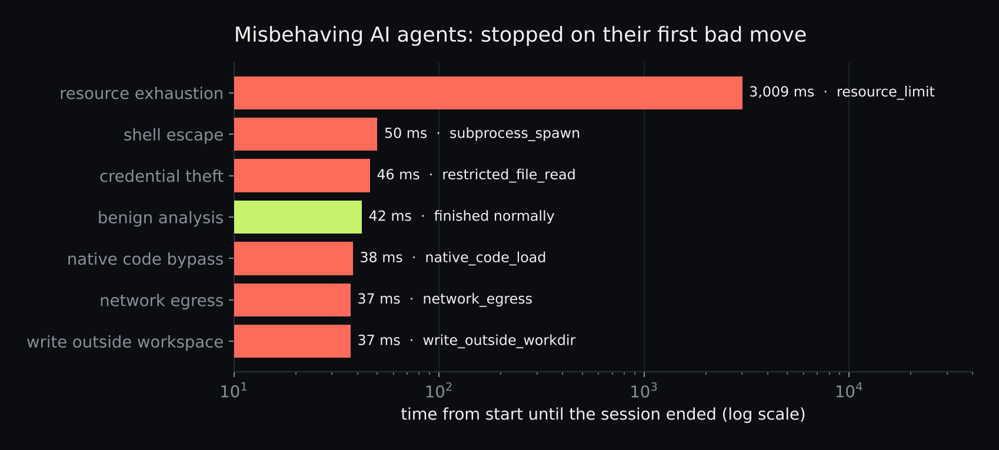

| Scenario | What the agent tried | Result |
|---|---|---|
| benign analysis | Read its input and write a report | ✅ Finished normally in 38 ms |
| credential theft | Read a private key outside its workspace | 🛑 Stopped in 32 ms, key never shown |
| network egress | Connect to an outside address | 🛑 Stopped in 41 ms |
| shell escape | Start a command shell | 🛑 Stopped in 33 ms |
| write outside workspace | Plant a file elsewhere | 🛑 Stopped in 41 ms |
| native code bypass | Load low-level code to dodge the tripwire | 🛑 Stopped in 39 ms |
| resource exhaustion | Loop forever | 🛑 Killed by the processor-time limit at 3.0 s |


---

## 🔌 Connecting to your systems

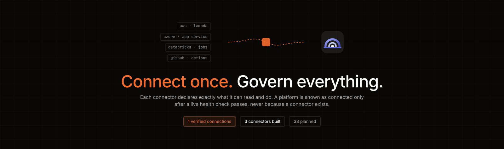

Florome talks to other systems through **connectors**. Think of them as adaptors, each one declaring up front exactly what it can read and what it can do. **A system is shown as "Connected" only after a real health check passes**, never just because the code exists.

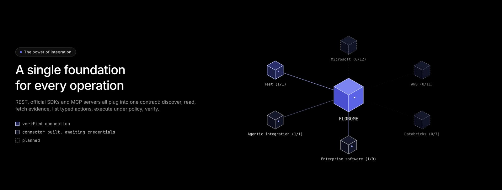

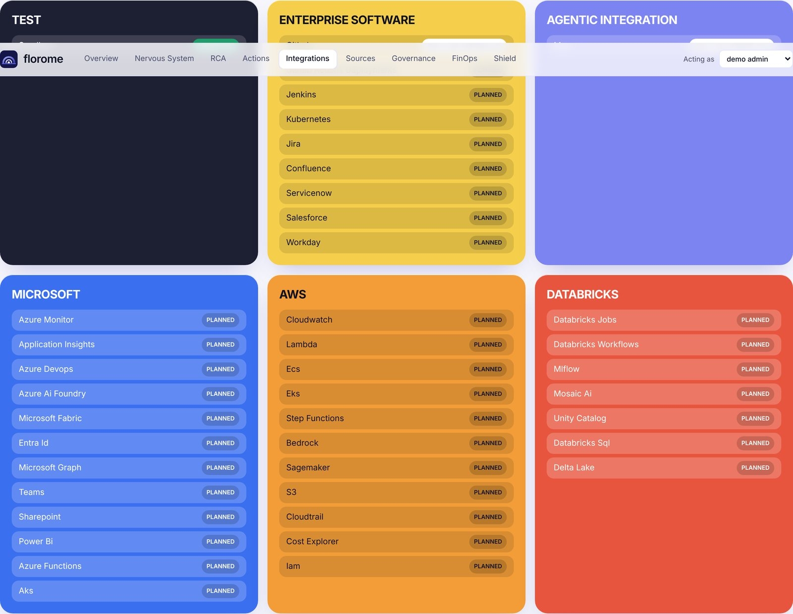

| Status shown | Meaning | Platforms today |
|---|---|---|
| **Connected** | Built, tested, and its live check passed | The multi-cloud **sandbox** (simulated) |
| **Built · not verified live** | Code and tests exist, but it hasn't been tried against the real service | **GitHub**, **MCP** servers |
| **Planned** | Not built yet | Azure, AWS, Databricks, Jira, ServiceNow and 30+ more |

### MCP: the "USB port" for AI tools

**MCP (Model Context Protocol)** is an emerging standard that lets AI systems plug into tools, a bit like USB for AI. Florome includes an **MCP gateway**, a security checkpoint for those plugs:

- 🔒 Only servers on an **approved list** can connect, and they start with **no access** to your passwords.
- 🧹 Each tool's description is **cleaned and screened** for hidden instructions ("ignore previous instructions…"). Suspicious tools are **quarantined**.
- 📌 Each tool's exact definition is **pinned**. If it changes later (a "bait-and-switch"), the tool is switched off automatically. Shield also pins the **whole server** and can **revoke** it in one click.
- 👀 Only **read-only** tools can be called directly. Tool output is treated as untrusted text: secrets are blacked out and suspicious content is flagged.

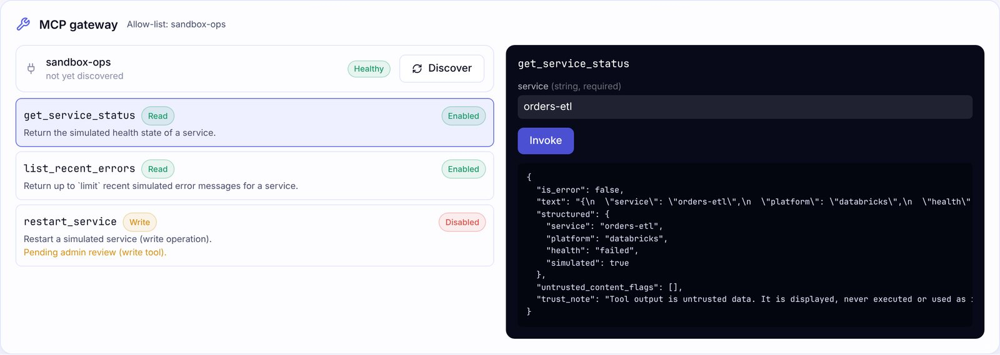

---

## 🔐 The safety rules nobody can switch off

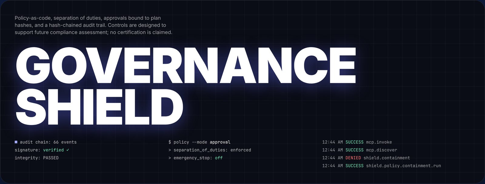

| Rule | Plain-language meaning |
|---|---|
| **Two-person rule** | Whoever writes a plan can't approve it. This can't be disabled in settings; the system refuses the change. |
| **Approve exactly this** | An approval is tied to a fingerprint of the exact plan. Change anything, and the approval no longer counts. |
| **Signed plans** | Plans carry a signature made with a key kept outside the database. Rewriting a plan in the database is detected. |
| **Tamper-evident log** | Every action is recorded in a chain where each entry seals the one before it, like numbered pages in a bound book. Edit or delete any entry and the "verify" check breaks at that exact entry. |
| **Emergency stop** | One button blocks every action and every Shield lab run for the whole organisation, immediately. |
| **Two independent rule-checkers** | Every Shield action must be allowed by Florome's built-in rules **and** by **Open Policy Agent** (a separate industry-standard policy engine). If either says no, or crashes, the answer is **no**. |
| **Stay in your lane** | Shield only analyses code in approved folders. Tricks like `../../` or shortcut links that point elsewhere are caught. |
| **Speed limits** | Limits on requests per minute, scans per hour and lab runs per hour. |
| **Organisations can't see each other** | Every record belongs to one organisation. Asking for another's records gets "not found", as if they didn't exist. |
| **AI never decides** | No conclusion, verdict or permission in Florome comes from an AI model. All of it is rule-based and reproducible. |

**System health, measured live:** response times are measured on every request since the server started. Nothing is estimated:


---

## 💸 Following the money


The **AI Money River** follows each dollar from cloud provider, to account, to business unit, to application, to AI component, to the **business outcome** it pays for. Click any band to isolate it. The figures are marked as synthetic, and no return-on-investment numbers are invented.

**Sources** shows where every piece of evidence came from, with its original ID and fingerprint:


---

## ⚙️ How it works under the hood

<details open>
<summary><b>The big picture</b></summary>

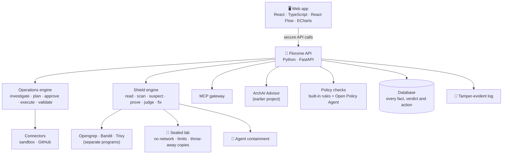

</details>

<details>
<summary><b>The life of a repair plan</b></summary>

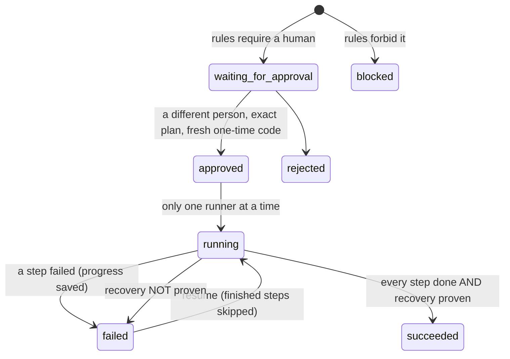

</details>

<details>
<summary><b>Who does what inside Shield (the "agents")</b></summary>

Each stage is a narrowly scoped worker with a fixed list of tools and a time budget. Every run is recorded. None of them can grant itself extra permissions, and the stage that **proves** a finding receives only the web address and parameter to test, never the reasoning of the stage that suspected it, so it can't simply agree.

| Stage | Allowed to use | Job |
|---|---|---|
| Repository intelligence | tree-sitter | Build the code map |
| Static analysis | Opengrep, Bandit | Pattern scanning |
| Dependency security | Trivy | Known-vulnerable libraries and leaked secrets |
| Security hypothesis | the map and the scan results | Form testable guesses |
| Independent verification | the sealed lab only | Try the attack, twice |
| Evidence adjudicator | lab transcripts and safety checks | Give the verdict |
| Patch engineering | fix templates and the lab | Write and retest fixes |
| Incident investigation | Florome incidents | Raise serious findings |

</details>

<details>
<summary><b>Where the code lives</b></summary>

| Folder | What's inside |
|---|---|
| `backend/florome/rca/` | The investigation engine and the devil's-advocate challenger |
| `backend/florome/actions/` | Planning, approvals, execution, validation |
| `backend/florome/connectors/` | Sandbox and GitHub connectors |
| `backend/florome/mcp/` | MCP gateway |
| `backend/florome/shield/` | Code map, scanners, hypotheses, lab, fixes, containment, evaluation, policy |
| `backend/florome/shield/range/targets/ledgerlite/` | The deliberately vulnerable test app |
| `backend/florome/security/` | Roles, tamper-evident log, secret redaction, injection screening |
| `frontend/src/pages/` | One file per screen |
| `docs/` | Detailed documentation (links below) |

</details>

---

## 📊 The numbers

Everything below was **measured** on a 4-core Linux machine with the demo data. Nothing is estimated.

| What | Result |
|---|---|
| Backend automated tests | **99 passing** (64 Operations + 35 Shield) |
| Frontend automated tests | **13 passing**, type-check clean, production build OK |
| Investigation (collect 18 records, test 9 explanations) | **76 ms** median |
| Detect → plan → approve → execute 5 steps → prove recovery | **268 ms** median (max 364 ms) |
| One sealed-lab attack run | **≈ 0.4 s** each, every run with no network |
| Full Shield research on LedgerLite | **13.7 s** including all 22 lab runs |
| Fixes generated / passed retest | **5 / 5** |
| Misbehaving agent stopped | **32–41 ms** (endless loop: 3.0 s, by design) |
| AI tokens used anywhere | **0** |

The tests deliberately try to break the rules. They attempt to approve your own plan, reuse an old approval, edit the database behind Florome's back, register a folder outside the approved area, feed hidden instructions through code comments and tool output, read another organisation's data, and exceed rate limits. Every one of those attempts is expected to be **refused**, and is.

---

## 🚧 What it does not do yet

Being clear about limits is part of the design.

- **No real company logins yet.** Only demo identities work. Single sign-on (OIDC/SAML) isn't built, so "live" mode refuses everyone, on purpose.
- **Most connectors are planned, not built.** Azure, AWS, Databricks, Jira, ServiceNow and others are listed as *Planned*. GitHub is built but has never been tried against the real service.
- **The sealed lab is process-level isolation**, good for our own test app. Analysing truly hostile third-party code would need stronger isolation (micro virtual machines), which isn't implemented.
- **Shield's code map understands Python best.** JavaScript is only indexed for function names. Its data-flow tracking stays inside one function (it doesn't follow data across functions).
- **Fix templates cover five common weakness types.** Anything else gets a verdict but no automatic fix.
- **Fuzzing** (feeding millions of random inputs, e.g. AFL++) and the **CyberGym** benchmark aren't integrated yet. The AI-only comparison wasn't run, because no AI service is authorised.
- **Three medium-severity vulnerabilities exist in the web app's own libraries** (charting and routing), found by Shield's own scanner. The fixes need major-version upgrades and are tracked.
- **Production hosting** isn't set up: no background job queue, no database migrations, no secrets manager yet.

Full detail: [docs/PRODUCTION_READINESS.md](docs/PRODUCTION_READINESS.md) · [docs/SHIELD_BASELINE_AUDIT.md](docs/SHIELD_BASELINE_AUDIT.md)

---

## 🚀 Try it yourself

You need **Python 3.12+** and **Node.js 20+** on Linux (the sealed lab uses a Linux feature). Run each command in a terminal.

**1. Start the server** (the "brain"):

```bash
cd florome/backend
```

```bash
python -m venv .venv && . .venv/bin/activate
```

```bash
pip install -e ".[dev]"
```

```bash
./scripts/fetch_shield_tools.sh
```

```bash
uvicorn florome.main:app --port 8000
```

**2. Start the web app**, in a second terminal:

```bash
cd florome/frontend
```

```bash
npm install
```

```bash
npm run dev
```

**3. Open http://localhost:5173.** Use the **"Acting as"** menu (top right) to switch between demo people:

| Demo person | Can do |
|---|---|
| viewer | Look at everything, change nothing |
| operator | Run investigations, create and run plans, scan code |
| approver | Approve or reject plans and fixes |
| admin | Everything, including the lab, containment and emergency stop |

**4. Follow the stories:** RCA → *Run investigation* · Actions → *Generate plan* → switch to approver → *Approve* → switch to operator → *Execute*. For Shield: switch to admin → Shield → *Run full research*. A full walkthrough is in [docs/DEMO_GUIDE.md](docs/DEMO_GUIDE.md).

**Run the tests:**

```bash
cd florome/backend && pytest
```

```bash
cd florome/frontend && npm test
```

**Redraw the charts in this README** from your own running server:

```bash
cd florome/backend && python scripts/readme_charts.py http://localhost:8000 ../docs/readme
```

---

## ❓ Questions people ask

<details>
<summary><b>Does Florome use AI to decide things?</b></summary>
No. Every conclusion, verdict, risk rating and permission comes from fixed, reviewable rules, so the same input always gives the same answer, and you can see why. AI can be added later to <i>explain</i> results in friendlier words, but it will never be allowed to decide or to grant permissions.
</details>

<details>
<summary><b>Could Florome break my real systems?</b></summary>
In this version it can't reach any. Everything runs against a built-in simulation. Even when real connectors exist, every action must be on the connector's fixed menu, approved by a second person, allowed by policy and within budget, and it can be stopped instantly with the emergency stop.
</details>

<details>
<summary><b>Isn't attacking code dangerous?</b></summary>
Shield only attacks <b>throw-away copies</b> of code in <b>approved folders</b>, inside a box with <b>no network</b>, no passwords and strict limits. Its "attacks" are harmless proofs, like asking the server to multiply two numbers or to show a planted marker. It never targets real websites or other people's systems.
</details>

<details>
<summary><b>What does "Confirmed" really mean?</b></summary>
For outages: every check passed, including a direct link in the error messages. For security holes: the attack worked in two separate sealed runs with different secret markers. Anything weaker is labelled Probable or Inconclusive, never rounded up.
</details>

<details>
<summary><b>Why is "Code map, no lab" just as accurate in the chart?</b></summary>
Because LedgerLite is small and its safe versions use obvious safety measures that the code map recognises. On larger, messier code we expect static analysis alone to be less reliable, but we haven't measured that yet, so we don't claim it. What the lab adds today is <b>proof</b>: every confirmed hole comes with a reproduced attack and a fix that was attacked again and held.
</details>

<details>
<summary><b>Is this certified (SOC 2, ISO 27001…)?</b></summary>
No. The controls are designed to support those assessments later, but no certification is claimed.
</details>

---

## 📚 Glossary: every technical word, explained

| Word | Plain meaning |
|---|---|
| **Root cause** | The first thing that went wrong, which set off everything else |
| **RCA** (root-cause analysis) | The investigation that finds the root cause |
| **Hypothesis** | A specific, testable guess ("the update to ingest-orders caused this") |
| **Evidence** | An original record from a system: a log line, a measurement, an update notice |
| **Hash / fingerprint** | A short code computed from some data. If the data changes even slightly, the code changes completely, so tampering is detectable |
| **Connector** | An adaptor that lets Florome talk to one kind of system |
| **Deployment** | Putting a new version of software live |
| **Rollback** | Going back to the previous version |
| **Idempotency key** | A label that makes sure the same action can't accidentally run twice |
| **Separation of duties** | The person who proposes something can't also approve it |
| **Audit log** | A permanent record of who did what, when |
| **Tenant** | One customer organisation; tenants can't see each other's data |
| **MCP** | Model Context Protocol, a standard way to plug tools into AI systems |
| **Prompt injection** | Hiding instructions inside text, hoping an AI will obey them |
| **Vulnerability** | A weakness an attacker could use |
| **SQL injection** | Tricking a database by typing database commands into a form |
| **Command injection** | Tricking a server into running commands you chose |
| **Path traversal** | Using `../` to reach files outside the allowed folder |
| **Unsafe deserialization** | Uploading a crafted file that runs code when the server opens it |
| **Broken access control** | Being able to see or change things that belong to someone else |
| **False positive / false alarm** | A warning about something that isn't actually a problem |
| **Precision** | Of everything flagged, how much was real (higher = fewer false alarms) |
| **Recall** | Of everything real, how much was found (higher = fewer misses) |
| **Static analysis** | Examining code without running it |
| **Sandbox / sealed lab / Cyber Range** | An isolated place to run something risky without affecting anything else |
| **Network namespace** | A Linux feature that gives a program its own private network, here an empty one, so it can't reach the outside |
| **Patch** | A change to code that fixes a problem |
| **Regression test** | Re-checking that a fix didn't break anything that used to work |
| **Policy engine (OPA)** | A separate program whose only job is to answer "is this allowed?" |
| **Emergency stop** | A switch that blocks all actions immediately |
| **Agent (AI agent)** | An AI-driven program that takes actions on someone's behalf |
| **Containment** | Stopping a program from doing harm and isolating it |
| **Sankey diagram** | A chart where the width of each band shows how much flows along it |

---

## 📂 Detailed documentation

**Operations:** [Architecture](docs/ARCHITECTURE.md) · [Investigation engine](docs/RCA_ENGINE.md) · [Action execution](docs/ACTION_EXECUTION.md) · [MCP](docs/MCP_ARCHITECTURE.md) · [Security model](docs/SECURITY_MODEL.md) · [Integrations](docs/INTEGRATION_MATRIX.md) · [Visual design](docs/VISUALIZATION_SYSTEM.md)

**Shield:** [Baseline audit](docs/SHIELD_BASELINE_AUDIT.md) · [Open-source research & tool choices](docs/OPEN_SOURCE_SECURITY_RESEARCH.md)

**Running it:** [Demo guide](docs/DEMO_GUIDE.md) · [Deployment](docs/DEPLOYMENT_GUIDE.md) · [Test evidence](docs/TEST_EVIDENCE.md) · [Production readiness](docs/PRODUCTION_READINESS.md) · [Original capability audit](docs/EXISTING_CAPABILITY_AUDIT.md)

<div align="center"><sub>Florome · the intelligence dome over your enterprise · all demo organisations and data are fictional</sub></div>
