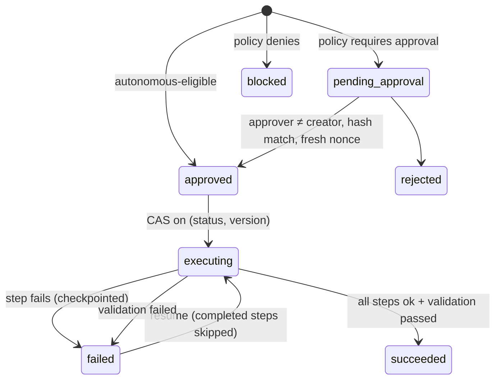

# Action execution

## Guarantees and tests

| Guarantee | Test |
|---|---|
| Only catalog actions, schema-validated parameters | `test_connectors::test_action_validation` |
| Approval bound to the plan hash, and a tampered plan refuses to run | `test_approvals::test_stale_plan_hash_is_rejected`, `test_tampered_stored_plan_refuses_to_execute` |
| Separation of duties | `test_separation_of_duties_creator_cannot_approve` |
| Replay protection | `test_nonce_replay_is_rejected` |
| Expiry re-checked at execution | `test_expired_approval_blocks_execution` |
| Bounded retry of transient errors only | `test_transient_failure_is_retried` |
| Durable resume without re-running completed steps | `test_permanent_failure_stops_and_resume_skips_completed_steps` |
| Timeout | `test_timeout_marks_step_timed_out` |
| No concurrent executors | `test_concurrent_execution_is_refused` |
| Validation reads real state | `test_validation_fails_when_system_not_recovered`, `test_out_of_order_recovery_fails_honestly` |
| Inconclusive RCA leads to no state-changing step | `test_inconclusive_rca_plans_no_state_changing_action` |
| Medium-risk steps are never autonomous | `test_autonomous_mode_runs_ticket_only_plan_without_approval` |

**Caveat:** a timed-out attempt is retried with the same idempotency key. The sandbox honours the key. GitHub `create_issue` only embeds it in the issue body, so a timed-out issue creation could duplicate.
