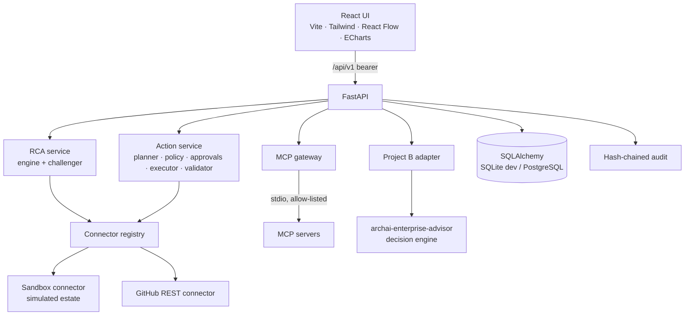

# Architecture

## Modules (`backend/florome/`)

| Path | Responsibility |
|---|---|
| `models.py` | Persistent domain model: tenants, users, connections, resources, dependencies, incidents, evidence (facts), hypotheses and RCA reports (inferences), plans, approvals, executions, validations, audit, MCP servers/tools, costs |
| `connectors/base.py` | Connector contract and capability declarations |
| `connectors/sandbox.py`, `connectors/github.py` | Implementations |
| `rca/engine.py`, `rca/challenger.py`, `rca/service.py` | Investigation |
| `actions/planner.py`, `actions/service.py` | Remediation lifecycle |
| `governance/policy.py` | Policy-as-code |
| `mcp/gateway.py`, `mcp_servers/` | MCP |
| `security/` | RBAC, audit chain, redaction, injection screening |
| `api/v1.py` | REST API (OpenAPI at `/docs`) |

Design rules:

* Observed facts and inferred conclusions live in separate tables.
* Every tenant-owned row carries `tenant_id`.
* Source identifiers are preserved (`source_system`, `source_ref`).
* No model output is executed.
