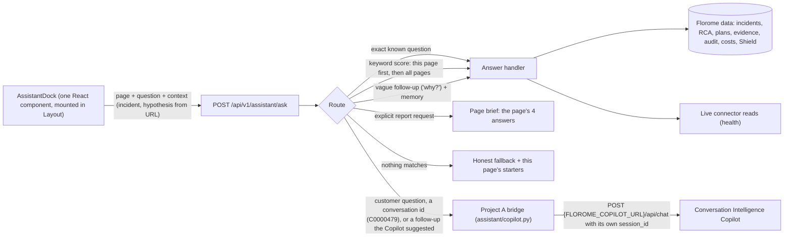

# Ask Florome: the Copilot home page and the page assistant

The assistant appears in two places, sharing one hook (`useAssistantChat` in `frontend/src/components/Assistant.tsx`):

* **The home page (`/`, `pages/Home.tsx`)**: a full-screen chat, page config `home`, with starter questions in five groups (Operations, Security · Shield, Customers · Conversation Copilot, Money, Governance) and a status pill per source from `GET /api/v1/assistant/sources`. The dashboard overview moved to `/overview`.
* **The dock on every other page**: the side panel with that page's four starters.

One reusable chat architecture, specialised per page by configuration (`backend/florome/assistant/service.py`, `PAGES`).

## Project A bridge

Customer-conversation questions are answered by the Conversation Intelligence Copilot (Project A, unchanged), called over HTTP. `assistant/copilot.py` translates its response into the answer contract: `headline` → statement, `key_points` → bullets, the first bar chart → `bars` visual (else metrics → `kpis`), `evidence` → quote chips (`Cxxxx · topic: "quote"`, `href: null`), `follow_up_questions` → follow-ups. Project A's `session_id` is stored in the conversation focus, so "What about the previous month?" continues its conversation. A non-`completed` status from Project A is shown, not hidden. Text from Project A is scanned for injection (`content_flags`).

Configuration: `FLOROME_COPILOT_URL` (default `http://127.0.0.1:8001`, empty disables it), `FLOROME_COPILOT_TIMEOUT_SECONDS` (60). When it is unreachable the answer says so; nothing is invented. Every answer carries `source {name, status, model_calls}`; the UI shows "From Florome records" or "Answered by the Conversation Intelligence Copilot · 0 AI model calls".

## Answer contract

`statement` (one sentence) · `bullets` (≤ 5) · `visual` (`kpis` | `bars` | `chain` | `table` | `timeline` | `report`, rendered from the same values) · `evidence` (in-app links) · `follow_ups` (exactly 4) · `intent` · `engine` · `input_flags` · `data_mode` · `source`. Evidence `href` is null for quoted customer conversations.

## Pages and starter questions

| Page | Starters |
|---|---|
| Home (Copilot) | What's broken right now? · Which vulnerabilities are confirmed? · What are customers most negative about? · Where does the money go? (plus grouped questions, including the four customer questions) |
| Overview | What's broken right now? · What needs my approval? · How healthy are our connections? · What did we spend last month? |
| Nervous System | Which systems are failing? · What's upstream of the failing service? · What is the blast radius? · Which cloud has the most failures? |
| RCA | What caused the incident? · Which explanations were ruled out? · Where is the evidence weakest? · Show the timeline of events |
| Actions | What will the plan change? · Who still needs to approve? · Did the fix work? · What failed or was denied? |
| Integrations | Which platforms are really connected? · What can the MCP tools do? · Which tools are quarantined? · What's planned next? |
| Sources | Where does the evidence come from? · Has any evidence been tampered with? · Which systems have no logs? · Show the latest errors |
| Governance | Is the audit log intact? · What was denied recently? · What's the current policy? · How fast is the API? |
| FinOps | Where does the money go? · What changed month on month? · Which AI component costs most? · Which business outcome costs most? |
| Shield | Which vulnerabilities are confirmed? · Which alarms were false? · Were the fixes verified? · Did any AI agent misbehave? |

Additional intents reachable through follow-ups or free text: *Explain the selected finding* (uses the selected Shield hypothesis), *Does proving beat guessing?*, *Which public endpoints reach dangerous code?*, plus page briefs ("summarise this page", "generate a report …").

## Design decisions

* **No language model in Florome.** Project A also runs with `LLM_ENABLED=false` in the demo, and its answers report their model-call count. No authorised model endpoint is configured and Florome does not call paid APIs implicitly. Routing and wording are deterministic, so answers are reproducible and testable. The UI states "Rule-based · answers only from Florome data · no AI model". A model could later rephrase handler output, but would not choose values or take actions.
* **Read-only.** Handlers only query; the assistant has no write path. Instruction-like input is flagged (`input_flags`) and treated as a question.
* **Memory.** `AssistantConversation.focus` carries `incident_id`, `hypothesis_id` and `last_intent` between turns. Conversations are scoped to tenant **and** user.
* **Privacy.** Stored user text and all answers pass through the redactor; answers only read the caller's tenant.
* **Page/assistant agreement.** Pages that have a selection put it in the URL (`?incident=`, `?hypothesis=`), which is where the dock reads context from.

## Tests

`backend/tests/test_assistant_copilot.py` (7): translation of a real recorded Project A response (`tests/fixtures/copilot_negative_topics.json`); non-completed status passed through; routing and session carry-over against a fake transport; Florome questions not sent to Project A; unreachable / not configured; home config and `/sources`; and a live test against Project A on :8001 (skipped when it isn't running). The other backend tests run with `copilot_url=""` so they never reach a live service. `frontend/src/tests/home.test.tsx` (3) covers the home groups and source status, the "not running" state, and a customer answer with its source line and quote chips.

`backend/tests/test_assistant.py` (14) walks every starter and every reachable follow-up (≥ 36 questions) and checks the contract; compares answers with stored data; routing (including the regression where the word "report" triggered a brief); memory; page context; user/tenant privacy; injection; secret redaction; validation and auth; Shield focus. `frontend/src/tests/assistant.test.tsx` (6) covers route mapping, starters, context in requests, visual rendering, follow-ups with conversation id, error + retry, Escape.

## Known limitations

* Understands the 44 question types (customer questions beyond them go to Project A, which has its own limits) it was built for (flexible wording), not arbitrary questions.
* Keyword routing can pick a neighbouring intent for unusual phrasing; the four follow-ups make correction one click away.
* Charts in answers are compact CSS visuals, not interactive drill-downs; drill-down happens through the evidence links into the full pages.
