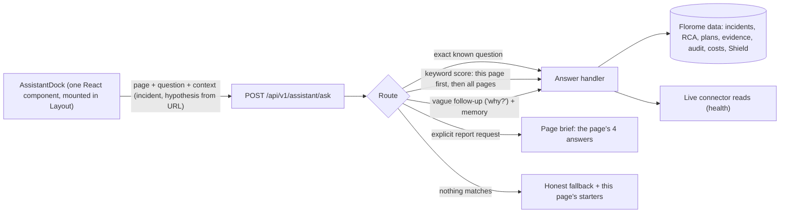

# Ask Florome: the page assistant

One reusable chat architecture, specialised per page by configuration (`backend/florome/assistant/service.py`, `PAGES`).

## Answer contract

`statement` (one sentence) · `bullets` (≤ 5) · `visual` (`kpis` | `bars` | `chain` | `table` | `timeline` | `report`, rendered from the same values) · `evidence` (in-app links) · `follow_ups` (exactly 4) · `intent` · `engine` · `input_flags` · `data_mode`.

## Pages and starter questions

| Page | Starters |
|---|---|
| Overview | What's broken right now? · What needs my approval? · How healthy are our connections? · What did we spend last month? |
| Nervous System | Which systems are failing? · What's upstream of the failing service? · What is the blast radius? · Which cloud has the most failures? |
| RCA | What caused the incident? · Which explanations were ruled out? · Where is the evidence weakest? · Show the timeline of events |
| Actions | What will the plan change? · Who still needs to approve? · Did the fix work? · What failed or was denied? |
| Integrations | Which platforms are really connected? · What can the MCP tools do? · Which tools are quarantined? · What's planned next? |
| Sources | Where does the evidence come from? · Has any evidence been tampered with? · Which systems have no logs? · Show the latest errors |
| Governance | Is the audit log intact? · What was denied recently? · What's the current policy? · How fast is the API? |
| FinOps | Where does the money go? · What changed month on month? · Which AI component costs most? · Which business outcome costs most? |
| Shield | Which vulnerabilities are confirmed? · Which alarms were false? · Were the fixes verified? · Did any AI agent misbehave? |

Additional intents reachable through follow-ups or free text: *Explain the selected finding* (uses the selected Shield hypothesis), *Does proving beat guessing?*, *Which public endpoints reach dangerous code?*, plus page briefs ("summarise this page", "generate a report …").

## Design decisions

* **No language model.** No authorised model endpoint is configured and Florome does not call paid APIs implicitly. Routing and wording are deterministic, so answers are reproducible and testable. The UI states "Rule-based · answers only from Florome data · no AI model". A model could later rephrase handler output, but would not choose values or take actions.
* **Read-only.** Handlers only query; the assistant has no write path. Instruction-like input is flagged (`input_flags`) and treated as a question.
* **Memory.** `AssistantConversation.focus` carries `incident_id`, `hypothesis_id` and `last_intent` between turns. Conversations are scoped to tenant **and** user.
* **Privacy.** Stored user text and all answers pass through the redactor; answers only read the caller's tenant.
* **Page/assistant agreement.** Pages that have a selection put it in the URL (`?incident=`, `?hypothesis=`), which is where the dock reads context from.

## Tests

`backend/tests/test_assistant.py` (14) walks every starter and every reachable follow-up (≥ 36 questions) and checks the contract; compares answers with stored data; routing (including the regression where the word "report" triggered a brief); memory; page context; user/tenant privacy; injection; secret redaction; validation and auth; Shield focus. `frontend/src/tests/assistant.test.tsx` (6) covers route mapping, starters, context in requests, visual rendering, follow-ups with conversation id, error + retry, Escape.

## Known limitations

* Understands the 40 question types it was built for (flexible wording), not arbitrary questions.
* Keyword routing can pick a neighbouring intent for unusual phrasing; the four follow-ups make correction one click away.
* Charts in answers are compact CSS visuals, not interactive drill-downs; drill-down happens through the evidence links into the full pages.
