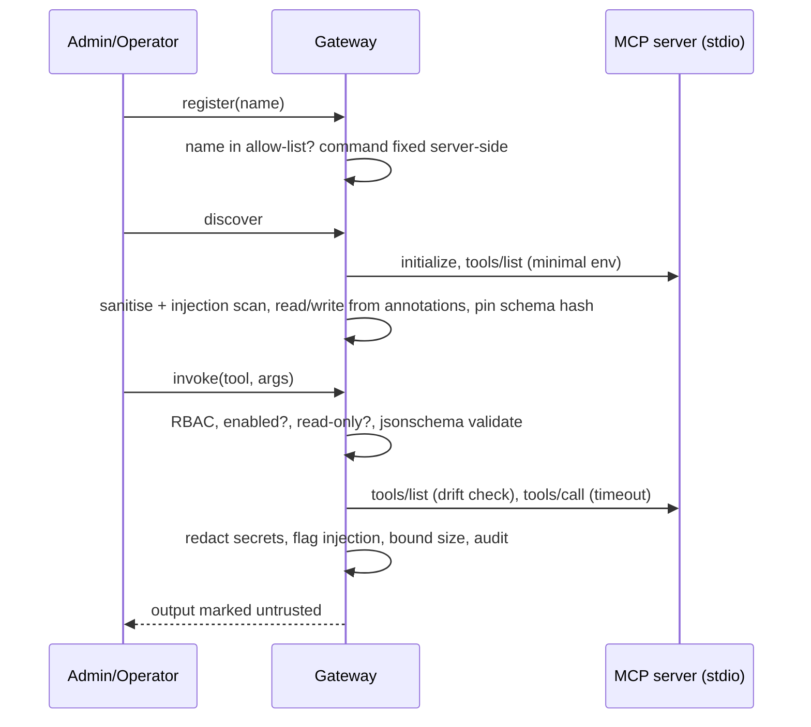

# MCP architecture

The gateway (`florome/mcp/gateway.py`) is the only path to MCP servers. It is built on MCP Python SDK **2.3** (`MCPServer`, `stdio_client`, `ClientSession`).

| Control | Behaviour |
|---|---|
| Allow-list | Bundled `sandbox-ops`, plus `FLOROME_MCP_ALLOWLIST_EXTRA=["name=python.module"]`. API input never supplies commands. |
| Environment | Only `PATH`, `PYTHONPATH` and `PYTHONIOENCODING` are passed. Credentials are not inherited (tested). |
| Enablement | Auto-enabled only if the server is bundled, the tool is read-only and nothing is flagged. Everything else needs admin review. Injection-flagged tools cannot be enabled. |
| Drift | The live schema hash is compared on every call; a mismatch disables the tool. |
| Writes | Refused. Routing MCP write tools through approved plans (an `MCPConnector` adapter) is the next step and is **not implemented**. |

**Known gap:** a timeout raised inside the stdio context can be wrapped by anyio's task group, so it surfaces as a 502 rather than a 504. It is still denied and audited.
