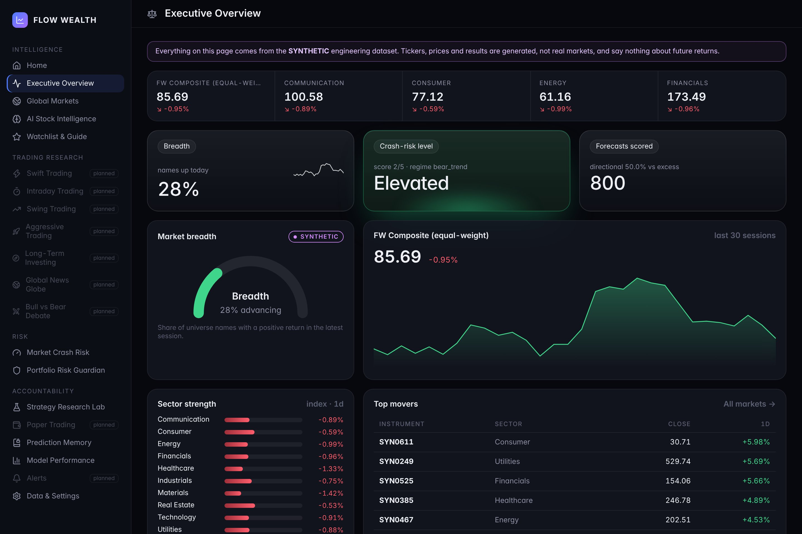
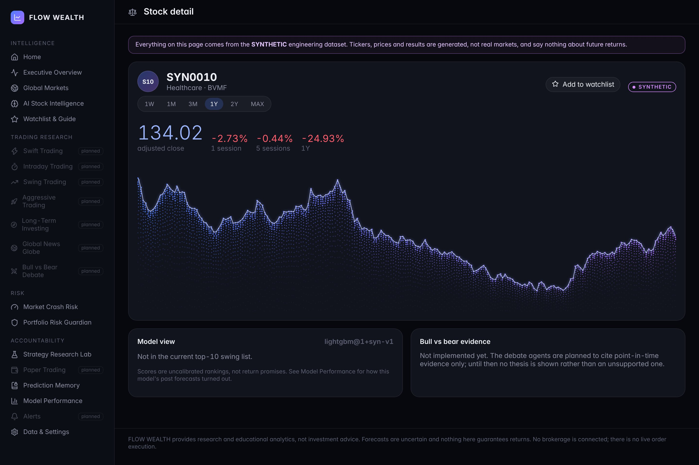
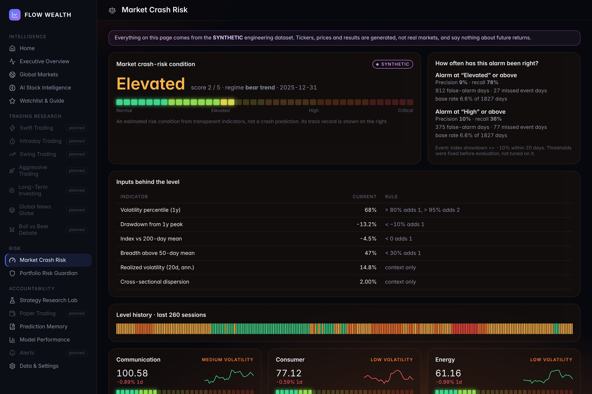
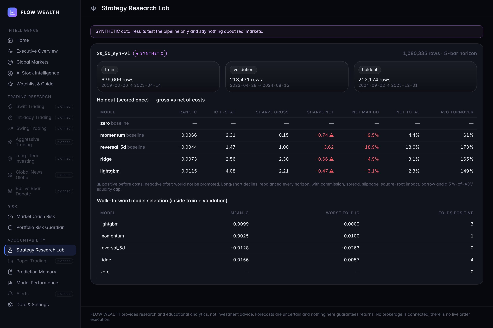
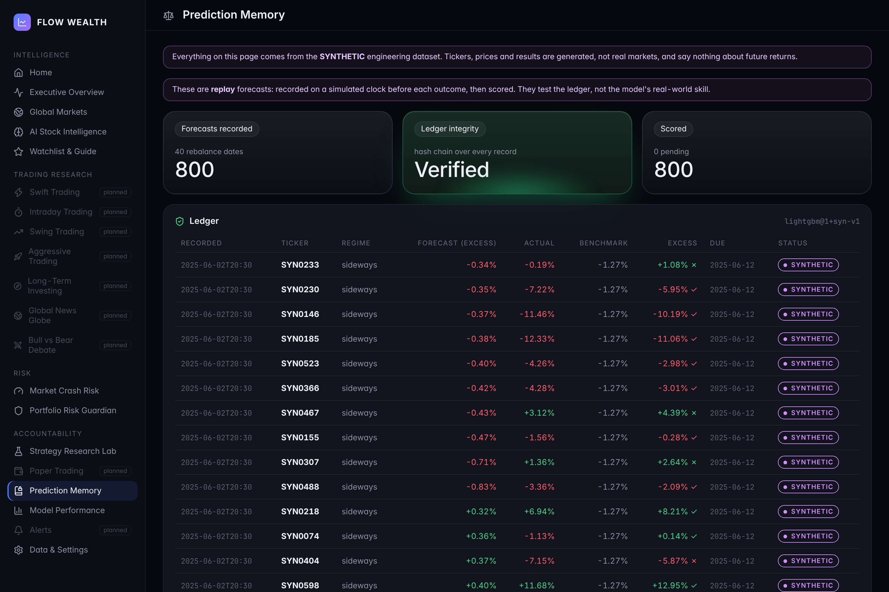

# FLOW WEALTH v4 — evidence-first financial research platform

Every forecast recorded. Every model earns its place.

> **Status: alpha foundation.** Data, point-in-time integrity, evaluation, prediction memory, the risk engine and the dashboard are built and
> tested. **No real market data is loaded** (the build environment could not reach any provider), so every number shown is from a clearly
> labelled SYNTHETIC dataset. News agents, bull/bear debate, options, portfolio optimisation and alerts are not built yet.
> Research and education only — not investment advice. No brokerage is connected.



| | |
|---|---|
|  |  |
|  |  |

## Quick start

Backend (Python ≥ 3.11, [uv](https://docs.astral.sh/uv/)), from `flowwealth/backend`:

```bash
uv sync
```
```bash
uv run pytest
```
```bash
uv run python -m flowwealth.data.pipeline --lake lake --version syn-v1
```
```bash
uv run python -m flowwealth.research.experiment --lake lake --version syn-v1 --out reports
```
```bash
uv run python -m flowwealth.research.replay --lake lake --version syn-v1 --out artifacts
```
```bash
uv run uvicorn flowwealth.api.app:app --port 8000
```

Frontend (Node 22), from `flowwealth/frontend`, with the API running:

```bash
npm ci
```
```bash
npm run dev
```

Open http://127.0.0.1:5173. Environment variables: `FLOWWEALTH_LAKE`, `FLOWWEALTH_DATASET`, `FLOWWEALTH_ARTIFACTS`, `FLOWWEALTH_REPORTS`,
`FLOWWEALTH_CORS`; provider keys `ALPHAVANTAGE_API_KEY`, `FRED_API_KEY` (optional).

## Layout

```
backend/flowwealth/
  contracts.py          DataStatus (LIVE/DELAYED/CACHED/HISTORICAL/SYNTHETIC/HYPOTHETICAL), Horizon, PredictionIn
  data/                 providers (cache, retry, rate limit, freshness, provenance), calendar, quality, lake, pipeline
  features/             leakage-safe features + horizon labels, lineage registry
  validation/           chronological 60/20/20 + walk-forward, purge + embargo
  models/               zero / momentum / reversal baselines, ridge, LightGBM
  research/             cost model, backtest (gross vs net), metrics, experiment, replay, paper trading
  memory/               append-only, hash-chained Prediction Memory
  evaluation/           outcome metrics, PSI drift, degradation rules, champion–challenger registry
  profiles/  risk/      trader profiles + hard limits; pre-trade risk engine; regime & crash-risk
  api/                  FastAPI research API (no execution endpoints)
frontend/               React + Vite dashboard (12 views)
docs/                   audit, architecture, plan, provider matrix, evaluation, risk register, security, cost
```

## Documents

[Current architecture (audit)](docs/ARCHITECTURE_CURRENT.md) · [Target architecture](docs/ARCHITECTURE_TARGET.md) ·
[Implementation plan & phase status](docs/IMPLEMENTATION_PLAN.md) · [Data provider matrix](docs/DATA_PROVIDER_MATRIX.md) ·
[Model evaluation plan](docs/MODEL_EVALUATION_PLAN.md) · [Evaluation report & test results](docs/EVALUATION_REPORT.md) ·
[Risk register](docs/RISK_REGISTER.md) · [Security & compliance](docs/SECURITY_AND_COMPLIANCE.md) · [Infrastructure & cost](docs/INFRASTRUCTURE_AND_COST.md)

## Acceptance criteria (brief §37) — honest scorecard

| # | Criterion | Status |
|---|---|---|
| 1 | Existing functionality preserved | ✅ nothing outside `flowwealth/` changed (no prior FLOW WEALTH code existed) |
| 2 | New modules tested | ✅ 41 backend + 9 frontend tests |
| 3 | 1M+ record pipeline | ✅ 1,119,431 rows in 6.4 s (synthetic) |
| 4 | Data provenance | ✅ provenance per fetch, dataset manifests with hash & lineage |
| 5 | Point-in-time forecasting | ✅ `available_at`, as-of queries, cohort ranks |
| 6 | No future-data leakage in training | ✅ truncation, cross-timezone, purge/embargo tests |
| 7 | News events have evidence | ⬜ no news pipeline yet |
| 8 | Structured, explainable multi-agent outputs | ⬜ agents not built |
| 9 | Forecasts have defined horizons | ✅ |
| 10 | Risk models independently evaluated | 🟡 crash alarm precision/recall reported; risk engine unit-tested; no real-data validation |
| 11 | Aggressive mode cannot bypass limits | ✅ hard caps, tested |
| 12 | Swift trading uses fresh data | ✅ gate (LIVE ≤ 2 s); swift engine itself not built |
| 13 | Transaction costs in backtests | ✅ gross and net |
| 14 | Immutable Prediction Memory | ✅ triggers + hash chain |
| 15 | Outcomes compared with predictions | ✅ (replay; no live forward run yet) |
| 16 | Drift monitored | 🟡 PSI + degradation rules; no scheduler |
| 17 | Challengers evaluated before promotion | ✅ criteria + approval + rollback |
| 18 | Rankings explain methodology | ✅ |
| 19 | UI distinguishes real/delayed/simulated/hypothetical | ✅ badge on every view |
| 20 | Paper trading independent of brokerage | 🟡 engine tested; no UI |
| 21 | Security & licensing documented | ✅ (auth not implemented — see security doc) |
| 22 | No unverified performance claims | ✅ |
| 23 | Tests and results reported | ✅ EVALUATION_REPORT §6 |
| 24 | Known limitations disclosed | ✅ |
| 25 | Reproducible deployment instructions | 🟡 local + CI reproducible; no hosted deployment |

**The platform is not complete.** See the implementation plan for the next increments, starting with licensed real data and scheduled forward predictions.
