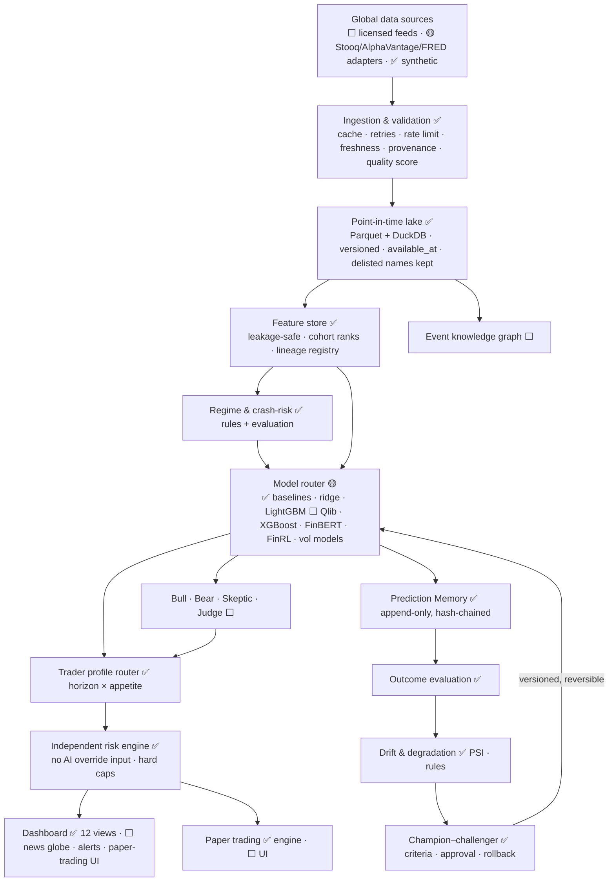

# Architecture — target (v4) and what exists today

Legend: ✅ implemented and tested · 🟡 partial · ⬜ planned

## Component boundaries

| Concern | Module | Storage | Runs as |
|---|---|---|---|
| Contracts (DataStatus, Horizon, PredictionIn) | `flowwealth/contracts.py` | — | library |
| Provider adapters | `data/providers/` | Parquet cache + JSON meta | job |
| Lake | `data/lake.py`, `data/pipeline.py` | `lake/bars/version=*/year=*/*.parquet`, manifests | job (CLI) |
| Quality | `data/quality.py` | manifest `quality` | job |
| Features / labels | `features/build.py` | in-memory → Parquet (planned feature store) | job |
| Splits | `validation/splits.py` | — | library |
| Models | `models/forecasters.py` | ⬜ model artefact store | job |
| Research / backtest / costs | `research/` | `reports/*.json` | job |
| Prediction Memory | `memory/store.py` | SQLite (→ PostgreSQL) | service + job |
| Evaluation / drift / registry | `evaluation/` | registry JSON (→ PostgreSQL) | job |
| Profiles / risk engine / regime | `profiles/`, `risk/` | — | library + API |
| API | `api/app.py` | reads lake, artefacts | FastAPI service |
| Dashboard | `flowwealth/frontend` | localStorage (watchlist only) | static SPA |

## Storage mapping to production

* Parquet + DuckDB stay for the analytical lake (cheap, local, columnar).
* Prediction Memory and the model registry move to PostgreSQL. The SQLite triggers become `REVOKE UPDATE, DELETE` for the app role plus
  `BEFORE UPDATE/DELETE` triggers; the hash chain stays as tamper evidence.
* pgvector only for news/filing retrieval when the news agents exist; not used today.
* Redis is not needed yet (no high-frequency fan-out).
