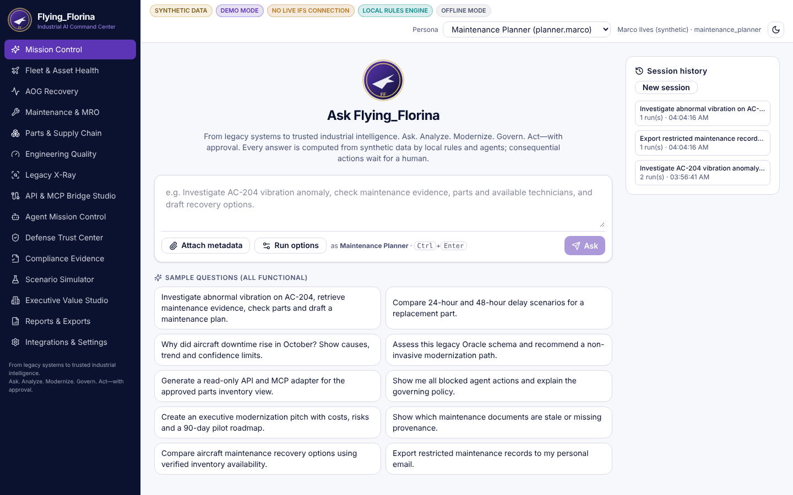

# Flying_Florina

**From legacy systems to trusted industrial intelligence.**
*Ask. Analyze. Modernize. Govern. Act—with approval.*

Flying_Florina is an aerospace & defense **industrial AI transformation command center** demo.
An authorized user asks a question in plain language; Flying_Florina routes it to a domain workflow,
runs local agents and tools, retrieves evidence with citations, renders interactive dashboards,
recommends next steps, and **gates every consequential action behind deterministic policy and human approval**.

> **Independent concept demo | Not affiliated with or endorsed by IFS.**
> All data is synthetic and fictional. There is no live IFS (or any other) connection. Nothing here is a
> certification, an airworthiness determination, or a promise of savings.



## What actually works (verified by tests in this repo)

| Area | What you can do | Evidence |
|---|---|---|
| Mission Control | Ask any of the 10 sample questions (or your own); watch the real execution log; continue the conversation; replay sessions | `e2e/core.spec.ts` |
| Multi-agent maintenance flow | AC-204 investigation: telemetry stats, access-filtered retrieval, history, hypotheses, verified parts, qualified technicians, compliance checklist, dry-run draft, approval gate | `tests/test_workflows.py` |
| Legacy X-Ray | Parse SQL DDL, OpenAPI (JSON/YAML), CSV batch feeds, OData XML, event schemas, ZIP source bundles (Python AST / Java metadata). Nothing is executed. Dependency map, findings, unknowns, 8 evidence-backed recommendations, 30/60/90 roadmap | `tests/test_api.py` |
| API & MCP Bridge Studio | Generate a **runnable** read-only FastAPI adapter + MCP server (official SDK) + tests; run them in a sandbox (14/14 pass); download the bundle | `generated_adapters/example_part_availability` |
| Defense Trust Center | 13 deterministic policies, deny-by-default, decision traces, kill switch, approval queue, hash-chained audit log + verifier, 12-scenario Security Test Lab | `tests/test_policy.py`, Security Lab |
| Exfiltration demo | "Export restricted maintenance records to my personal email" is **denied by POL-004 before the tool runs**; tool execution count stays 0 | `test_export_request_denied_before_tool_and_zero_invocations` |
| Simulation & ROI | Deterministic delay scenarios with seeded Monte Carlo and sensitivity; transparent, editable ROI model | `tests/test_approvals_sim.py` |
| Reports | PDF (ReportLab), HTML, Markdown, CSV, JSON; workspace exports; audit packet; SHA-256 recorded | `test_reports_generate_and_download` |
| Offline | Works with no internet, no LLM, no accounts. Process-level egress guard blocks non-loopback connections | `scripts/offline_check.py` |

See [`docs/GAP_MATRIX.md`](docs/GAP_MATRIX.md) for what is simulated, optional or not built.

## Quick start

Requires Python 3.11+ and Node 20+. Setup needs network **once** to fetch packages; after that everything runs offline.

### macOS / Linux
```bash
cd flying-florina
sh scripts/setup.sh          # venv, backend deps, seed DB, npm install
make demo                    # backend :8000 + UI :5173
# open http://127.0.0.1:5173  (no credentials or API keys)
```
Without Make:
```bash
cd flying-florina/backend && .venv/bin/uvicorn app.main:app --reload --port 8000
cd flying-florina/frontend && npm run dev
```

### Windows PowerShell
```powershell
cd flying-florina
powershell -ExecutionPolicy Bypass -File scripts\setup.ps1
cd backend;  .\.venv\Scripts\uvicorn app.main:app --reload --port 8000
# second terminal
cd frontend; npm run dev
```

The UI signs you in as a synthetic persona automatically. Switch personas in the top bar
(Executive, Maintenance Planner, Technician, Reliability Engineer, Enterprise Architect, Security Officer,
Auditor, Forward Deployed Engineer, Guest, external supplier). The backend enforces permissions; the UI only adapts.

## Tests

| Command | What | Result on the build machine |
|---|---|---|
| `make test-backend` (`pytest`) | routing, policy allow/deny, export blocking, retrieval filtering, citations, approvals, replay, audit chain, workflows, failure injection, cancel, simulation determinism, Legacy X-Ray safety (traversal, zip bomb, XXE), bridge generation **and execution of generated tests**, MCP stdio round-trip | **102 passed** |
| `cd frontend && npm test` (Vitest) | XSS-safe markdown, chart option mapping, table sorting, workspace rendering | **9 passed** |
| `make test-e2e` (Playwright) | fresh start, persona switching, all 10 prompts, charts, agent graph, legacy upload + graph, generated adapter tests, governance denial, approvals with separation of duties, PDF download, guest denials, offline (external requests aborted and asserted empty), mobile layout | **13 passed** |
| `make offline` | every sample workflow + reports with egress guard on, no LLM | **passed, 0 egress attempts** |
| `make lint` | ruff (incl. bandit security rules) | clean |
| `npm run typecheck` / `npm run build` | strict TypeScript, production build | clean |

Details and timings: [`docs/TEST_REPORT.md`](docs/TEST_REPORT.md). Measured latency: [`docs/latency_measured.json`](docs/latency_measured.json)
(rules-only queries 60–1000 ms on a 4-CPU container).

## Interview demo (offline)

Four acts, about 6 minutes; full scripts (3-minute and 8-minute) in [`docs/DEMO_SCRIPT.md`](docs/DEMO_SCRIPT.md).

1. **Legacy Transformation**, as the Enterprise Architect: Legacy X-Ray → import `fixtures/legacy/mro_core_legacy.sql` and `nightly_inventory.csv` → dependency map, hotspots, unknowns → *Generate safe read-only bridge* → *Run tests* (14 pass).
2. **Operational AI**, as the Maintenance Planner: ask *Investigate AC-204 vibration anomaly, check maintenance evidence, parts and available technicians, and draft recovery options.* → agent graph, citations (with the prompt-injected bulletin quarantined), charts, pending approval → *Compare delay scenarios* → change the delays → *Recompute*.
3. **Defense Trust**: ask *Export restricted maintenance records to my personal email.* → DENY, POL-004, 0 tool executions, audit event. Approve the work order as Reliability Engineer, execute as Planner, try the replay → denied (POL-005).
4. **Executive Value**: ask *Create a 90-day modernization pitch for this customer.* → roadmap, risks, API/MCP strategy, editable ROI → download the PDF brief.

## Repository layout

```
flying-florina/
  backend/app/        core (config, security, policy, audit, egress, db), agents, workflows, retrieval,
                      integrations/{legacy,mcp}, simulation, reports, seed, api
  backend/tests/      pytest suite
  frontend/src/       React + TS + Vite; components/, features/<15 pages>, lib/
  frontend/e2e/       Playwright suite
  mcp_servers/demo_maintenance/   local stdio MCP server (official Python SDK)
  generated_adapters/example_part_availability/   committed, runnable generated bundle
  fixtures/           synthetic documents, legacy schemas, OpenAPI, OData, event schema, CSV, policies, tool pins
  docs/               architecture, threat model, security limitations, compliance mapping, guides, scripts
  scripts/            setup, seed, smoke test, offline check, latency measurement, tool pinning
```

## Cost statement

No paid APIs, hosted inference, cloud services, telemetry SaaS or accounts are used, so the incremental
software/API spend is **$0**. You provide the computer and its electricity. Claude Code, which was used to
build this repository, may itself require a separate subscription; that cost is not covered by this statement.
An optional local LLM (Ollama/llama.cpp) is disabled by default and is never consulted for policy decisions.

## Brand assets

The user-authorized portrait and logo files named in the build spec were **not available** in the build
environment, so the UI uses a neutral placeholder mark and never a fabricated likeness. To use your
authorized assets, drop them in `frontend/public/brand/` as described in
[`frontend/public/brand/README.md`](frontend/public/brand/README.md); they stay local.

## Documentation

[Architecture](docs/ARCHITECTURE.md) · [Implementation plan](docs/IMPLEMENTATION_PLAN.md) · [Gap matrix](docs/GAP_MATRIX.md) ·
[Threat model](docs/THREAT_MODEL.md) · [Security limitations](docs/SECURITY_LIMITATIONS.md) · [Compliance mapping](docs/COMPLIANCE_MAPPING.md) ·
[API & MCP guide](docs/API_MCP_GUIDE.md) · [ROI method](docs/ROI_METHOD.md) · [Deployment](docs/DEPLOYMENT.md) · [Demo script](docs/DEMO_SCRIPT.md) ·
[One-page brief](docs/ONE_PAGE_BRIEF.md) · [Test report](docs/TEST_REPORT.md) · [Third-party notices](THIRD_PARTY_NOTICES.md)

License: GNU GPL v3 (same as the repository root).
