<div align="center">

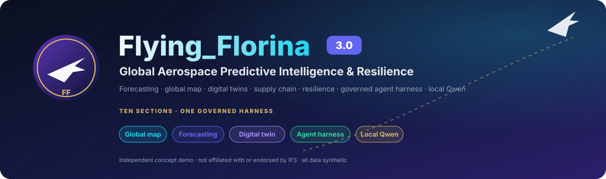

<br/>


### Forecast. Map. Simulate. Explain. Govern.

**Flying Florina 3.0** is a global aerospace predictive-intelligence and resilience platform: component forecasting, a global
interactive map with a +90-day timeline, maintenance digital twins, supply-chain and resilience simulation, a civilian airspace-safety
lab, software change-impact analysis and persistent conversational memory, all driven by a **governed agent harness**. Models and
simulations produce every number; **your local Qwen** explains; deterministic policy decides; humans approve.

<sub><b>Independent concept demo | Not affiliated with or endorsed by IFS.</b> All operational data is synthetic and fictional. No live IFS connection,
no certification, no airworthiness determinations, no promised savings.</sub>

<br/><br/>

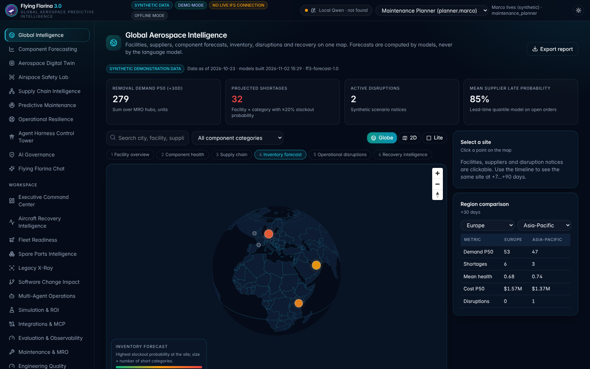

<sub>Global Intelligence: MapLibre globe with inventory-forecast layer, predictive timeline, KPIs, region comparison and freshness. No tile service, no network.</sub>

</div>

---

<div align="center">

**[3.0 overview](#-flying-florina-30)** ·
**[3.0 screens](#-the-30-screens)** ·
**[Harness](#-the-governed-agent-harness)** ·
**[Measured](#-30-measured-results)** ·
**[Deploy](#-deployment-modes)** ·
**[2.0: four questions](#-the-four-signature-questions)** ·
**[Local Qwen](#-local-qwen-setup)** ·
**[Quick start](#-quick-start)** ·
**[1.0 deep dive](#-platform-foundations-from-10)** ·
**[Docs](#-documentation)**

</div>

---

## 🌍 Flying Florina 3.0

| # | Section | What it does | Route |
|---|---|---|---|
| 1 | **Global Intelligence** | Globe / 2D / lite map, 6 layers (facilities, component health, supply chain, inventory forecast, disruptions, recovery), TODAY→+90 d timeline, search, filters, region comparison, report export | `/global` |
| 2 | **Component Forecasting** | Demand P10/P50/P90, inventory depletion curves, demand heatmap, health gauges, RUL distribution, failure-risk comparison, historical accuracy vs baselines | `/forecasting` |
| 3 | **Aerospace Digital Twin** | Unit history, telemetry, why it was flagged, uncertainty over time, work orders, replacements, documents to review (advisory only) | `/twin` |
| 4 | **Airspace Safety Lab** | Capability-honest analysis of prerecorded footage; labelled evaluation with FP/FN; civilian scope only | `/airspace` |
| 5 | **Supply Chain Intelligence** | Supplier trends, lead-time distributions, concentration, repair capacity, dependency graph, delay-impact simulator | `/supply` |
| 6 | **Predictive Maintenance** | 2.0 statistical risk view + Qwen explanation | `/predictive` |
| 7 | **Operational Resilience** | 8 scenarios: baseline vs disruption vs recovery, backlog uncertainty, recovery time, cost | `/resilience` |
| 8 | **Agent Harness Control Tower** | Graph, timeline, governance, model performance, evaluation, recovery — from recorded events only | `/control-tower` |
| 9 | **AI Governance** | Policies, approvals, audit chain, security lab (2.0) | `/trust` |
| 10 | **Flying Florina Chat** | 12 suggested 3.0 questions + the four 2.0 questions; memory that survives restarts | `/` |

Every 2.0 page (Command Center, AOG recovery, Legacy X-Ray, Bridge Studio, Observability, …) is still there under *Workspace*, plus
the new **Software Change Impact** page (`/change-impact`).

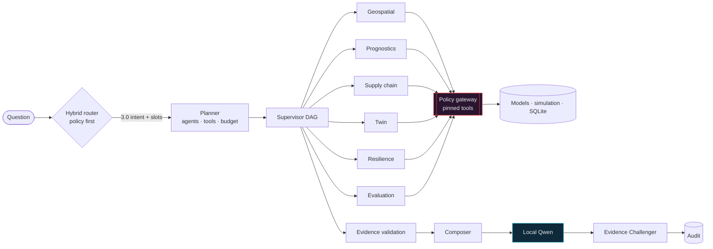

## 🖥 The 3.0 screens

<table>
<tr>
<td width="50%"><b>Component Forecasting</b><br/>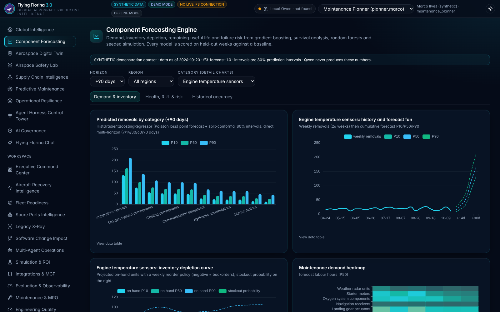</td>
<td width="50%"><b>Historical forecast accuracy</b><br/>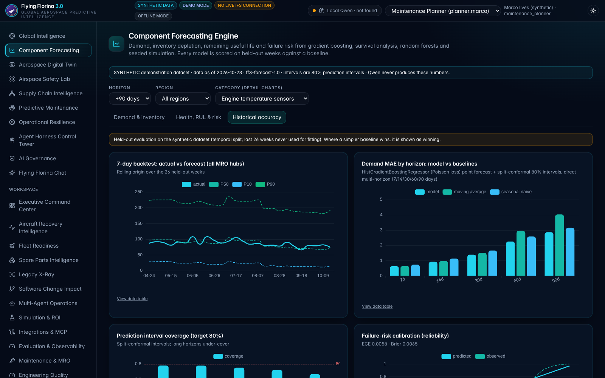</td>
</tr>
<tr>
<td><b>Aerospace Digital Twin</b><br/>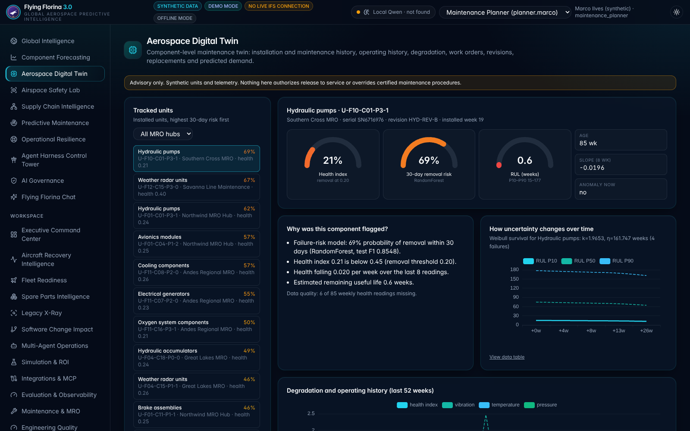</td>
<td><b>Supply Chain: 14-day supplier delay simulated</b><br/>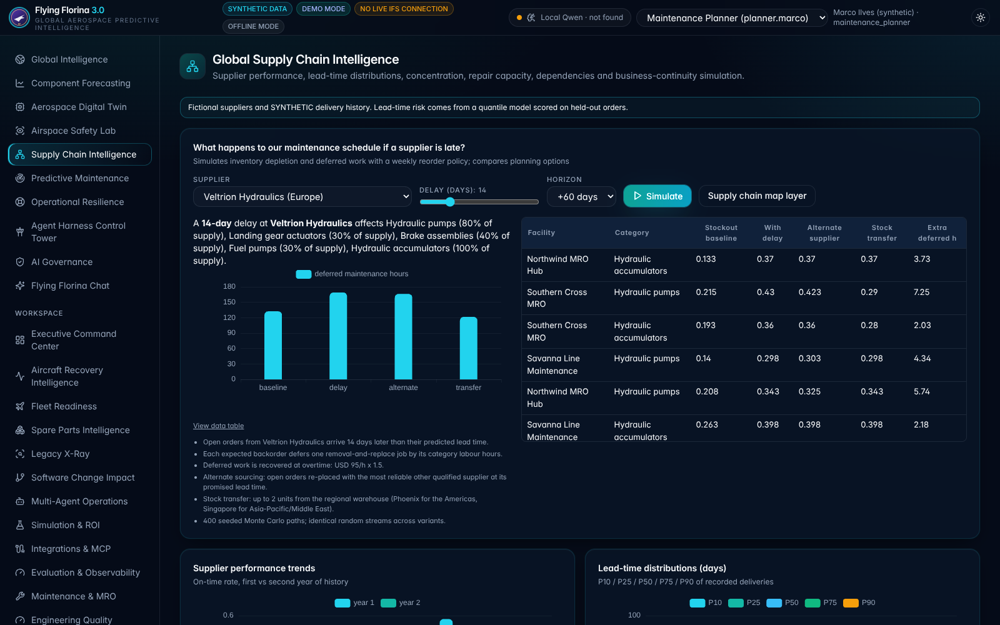</td>
</tr>
<tr>
<td><b>Operational Resilience</b><br/>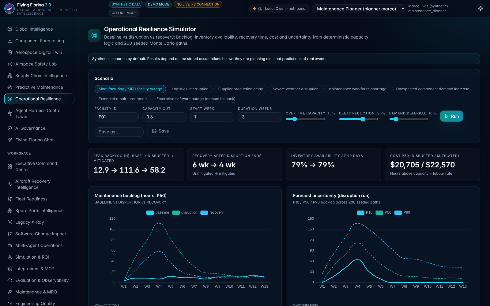</td>
<td><b>Agent Harness Control Tower (recorded run)</b><br/>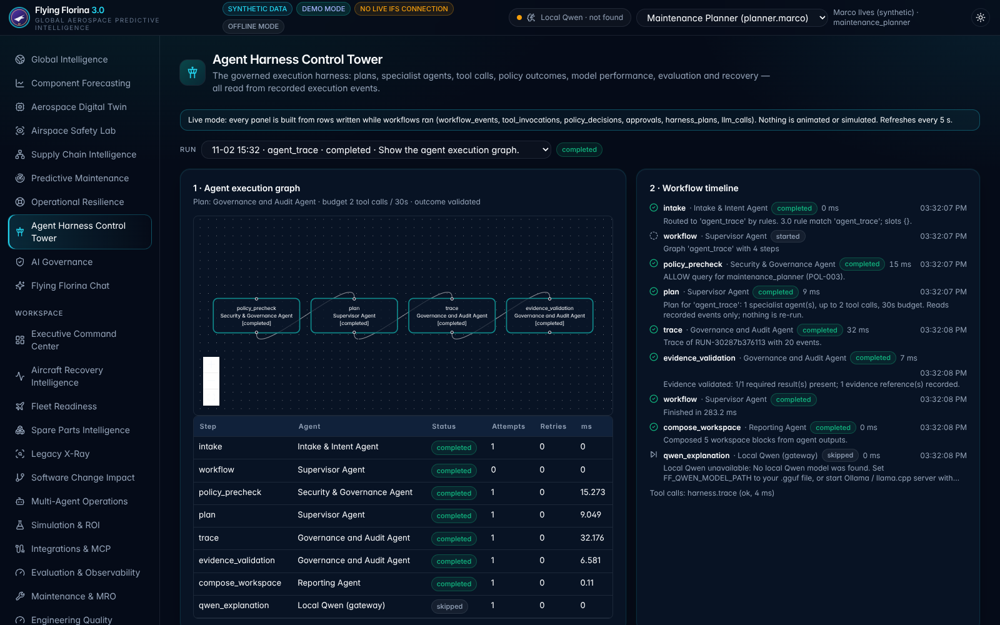</td>
</tr>
<tr>
<td><b>Airspace Safety Lab (capability-honest)</b><br/>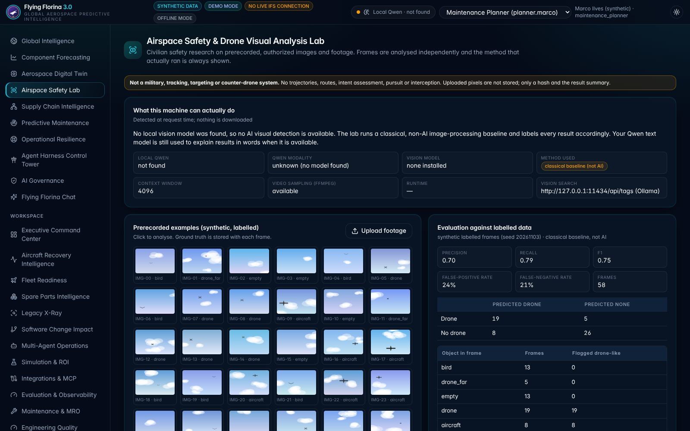</td>
<td><b>Software Change Impact</b><br/>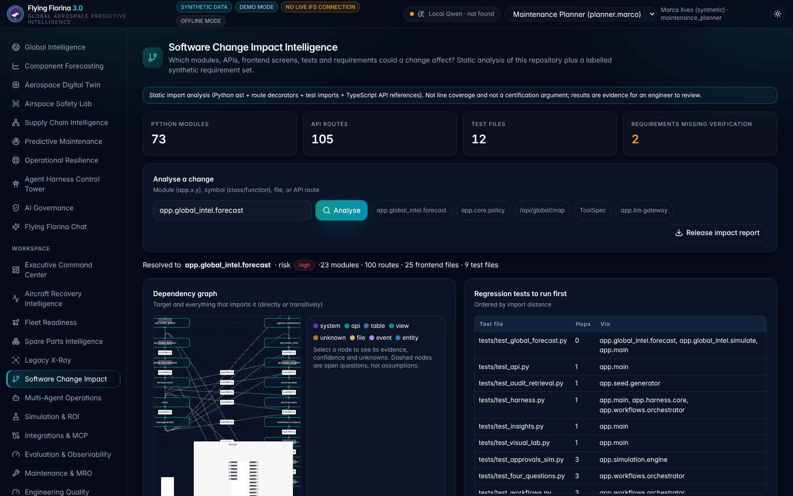</td>
</tr>
<tr>
<td><b>Chat: follow-up from memory ("What about the next 60 days?")</b><br/>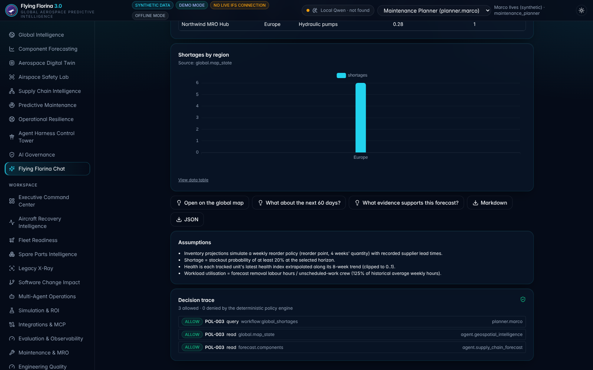</td>
<td><b>Global map: supply-chain layer at +60 days</b><br/>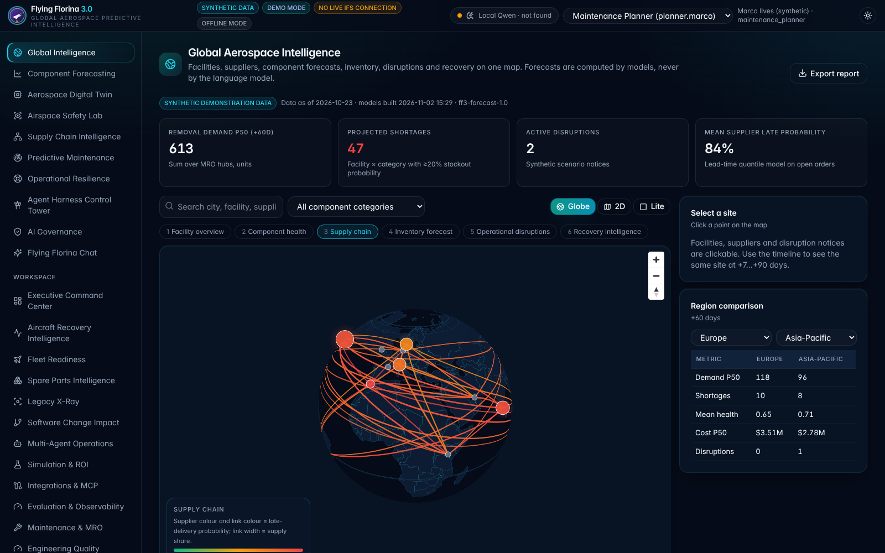</td>
</tr>
</table>

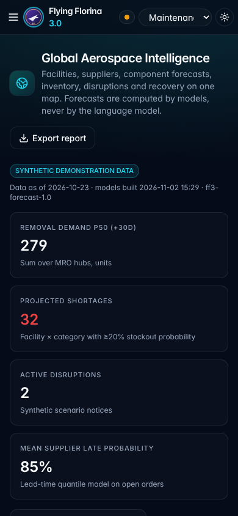
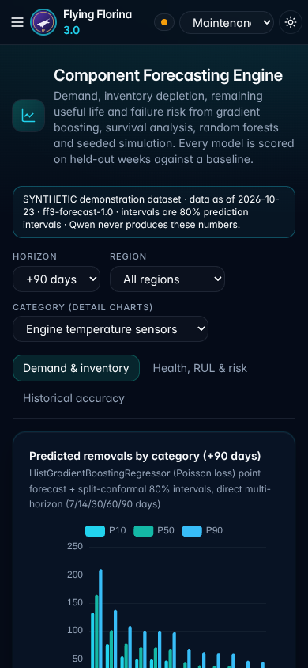
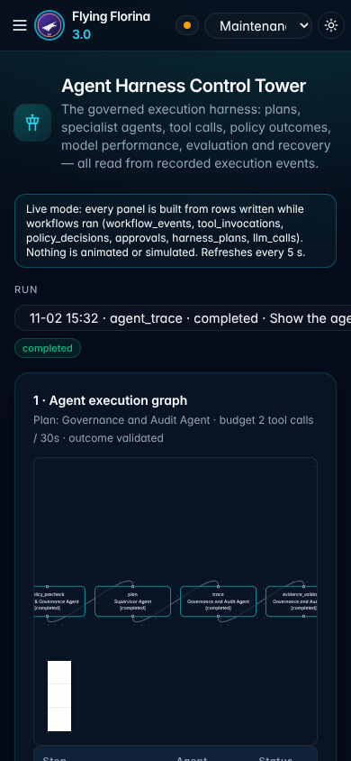

## 🧭 The governed agent harness

USER REQUEST → authentication → intent classification → **policy engine** → **task planner** → supervisor → 12 **specialist agents**
(each with its own tool allowlist) → **11 pinned, typed tools** through the deny-by-default gateway → **evidence validation** → human
approval when required → response generation (deterministic composer, then local Qwen + Evidence Challenger) → **hash-chained audit**.
Budgets are enforced atomically; simple questions use one specialist, complex ones several. Tests prove unauthorized tools are blocked,
budgets halt runs, failures are safe, missing evidence is reported, approvals cannot be bypassed, memory survives restarts and traces
match real executions. → [docs/AGENT_HARNESS.md](docs/AGENT_HARNESS.md)

## 📊 3.0 measured results

<div align="center">
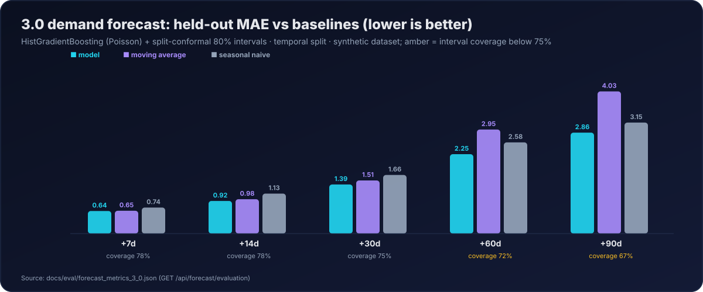
<br/><br/>
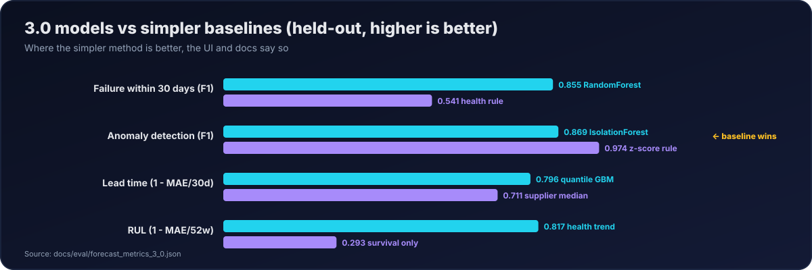
</div>

| What | Result (held-out, synthetic) | Honest note |
|---|---|---|
| Demand forecast, 7–90 days | beats moving average and seasonal naive at every horizon (90 d MAE 2.86 vs 4.03) | 80% intervals under-cover at long horizons (66.7% at 90 d) |
| Failure within 30 days | F1 0.855 vs 0.541 health rule; ECE 0.006 | — |
| Anomaly detection | IsolationForest F1 0.869 | **the simple z-score rule wins (0.974)** and the UI says so |
| Remaining useful life | health-trend MAE 9.5 weeks | survival-only 36.7 weeks; evaluation favours early failures |
| 3.0 intent routing (fresh held-out) | 90.3% (56/62), follow-ups 3/4 | below the 95% target; supplier names without "supplier" are missed |
| 2.0 routing after 3.0 | held-out v2 95.8% (unchanged) | — |
| Visual-lab baseline (not AI) | precision 0.70, recall 0.79 on 58 labelled frames | no vision model installed; aircraft are its false positives |
| Latency | 3.0 chat p50 251 ms; map API p50 16 ms; warm restart 1.1 s | 2.0 workflows ~1.2× slower than the 2.0 code measured the same day |

Details: [FORECASTING_ENGINE.md](docs/FORECASTING_ENGINE.md) · [PERFORMANCE_BENCHMARKS.md](docs/PERFORMANCE_BENCHMARKS.md) ·
[eval/README.md](docs/eval/README.md) · [CHANGELOG_3.0.md](docs/CHANGELOG_3.0.md)

## 🚢 Deployment modes

| Mode | Command | Status |
|---|---|---|
| A — Local | `make demo` | verified |
| B — Docker Compose | `docker compose up --build` (add `QWEN_MODEL_DIR`, `FF_QWEN_MODEL_FILE`, `INSTALL_LLAMA=true` for your Qwen) | config validated; images not built here (no Docker daemon) |
| C — Kubernetes reference | `kubectl apply -k deploy/k8s` | manifests parsed; not applied to a cluster; single-writer SQLite backend |

→ [docs/DEPLOYMENT.md](docs/DEPLOYMENT.md) (including the PostgreSQL migration path for horizontal scaling)

**3.0 docs:** [Architecture](docs/FLYING_FLORINA_3_ARCHITECTURE.md) · [Audit](docs/FLYING_FLORINA_3_ARCHITECTURE_AUDIT.md) ·
[Agent harness](docs/AGENT_HARNESS.md) · [Forecasting engine](docs/FORECASTING_ENGINE.md) · [Global map](docs/GLOBAL_MAP.md) ·
[Qwen integration](docs/QWEN_INTEGRATION.md) · [Security & governance](docs/SECURITY_GOVERNANCE.md) · [Deployment](docs/DEPLOYMENT.md) ·
[Demo walkthrough](docs/DEMO_WALKTHROUGH.md) · [Performance](docs/PERFORMANCE_BENCHMARKS.md)

---

## 🛩 Flying_Florina 2.0 (still included)

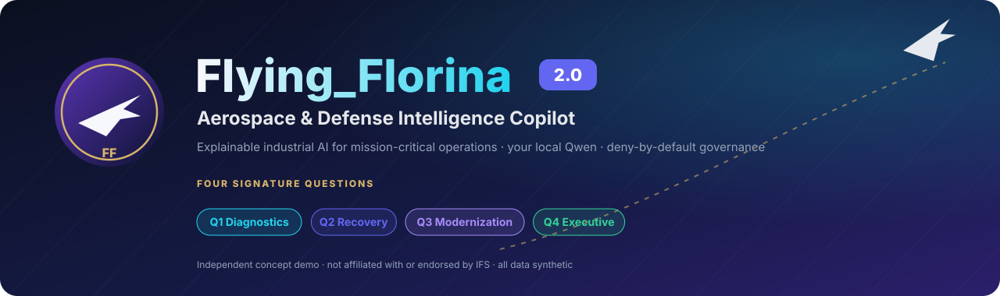

## 🛫 Why it matters for A&D leadership

| | |
|---|---|
| **The customer problem** | Decisions about a grounded or degrading aircraft depend on evidence scattered across ERP, MRO, legacy databases, nightly files and document libraries that disagree. Engineers spend hours assembling it, and AI assistants that can act create new governance risk. |
| **Why it matters in A&D** | Every hour of AOG has an operational and financial cost; safety-critical decisions need traceable evidence; export-control and security rules forbid casual data movement; legacy platforms can't simply be replaced. |
| **How Flying_Florina works** | A hybrid router sends each question to specialist agents that query verified data deterministically. **Your local Qwen model explains the evidence**, an **Evidence Challenger** rejects any number, ID or claim it can't support, and **governance validation** confirms nothing was approved or executed by the model. |
| **How it complements enterprise systems** | It sits next to systems such as IFS Cloud as an evidence-and-governance layer, reading through typed, read-only adapters and MCP tools. It replaces nothing. See [IFS integration readiness](docs/IFS_INTEGRATION_READINESS.md) (implemented vs proposed). |
| **How governance is enforced** | Deny-by-default policy before every tool call, agents limited to the human's rights, retrieved text can never trigger actions, human approval with separation of duties for every write, a kill switch, a hash-chained audit log, and loopback-only model calls. |
| **What the demo proves** | All four signature questions run end to end; held-out routing 95.8% (macro-F1 0.958); 100% citation accuracy; exfiltration and instruction-override attempts denied with 0 tool executions; generated read-only adapters pass their own tests. |
| **What production would need** | Enterprise IdP and MFA, container sandboxing, externally anchored audit, an internal package mirror and SBOM, authorized IFS APIs, model-provenance review, and a formal security and compliance assessment. See [deployment readiness](docs/DEPLOYMENT_READINESS.md). |

---

## ❓ The four signature questions

<table>
<tr>
<td width="50%" valign="top">

#### Q1 · Aircraft Diagnostics
*Why is aircraft AC-204 showing abnormal vibration, and what should engineering investigate?*

`telemetry ‖ retrieval ‖ history → hypotheses → Qwen → Challenger`

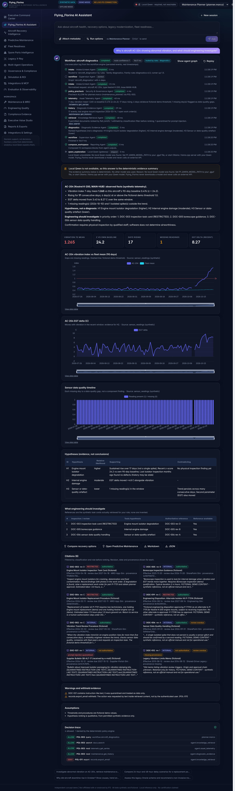

</td>
<td width="50%" valign="top">

#### Q2 · Aircraft Recovery
*Which recovery option could return AC-204 to service fastest, considering spare parts, maintenance scheduling, and engineering approval?*

`parts ‖ scheduling → compliance → simulation → draft → approval gate`


</td>
</tr>
<tr>
<td valign="top">

#### Q3 · Legacy Modernization
*How can we modernize our legacy aircraft maintenance system using APIs, MCP, and AI without replacing the existing platform?*

`Legacy X-Ray → integration options → adapter preview → contract tests → security review`

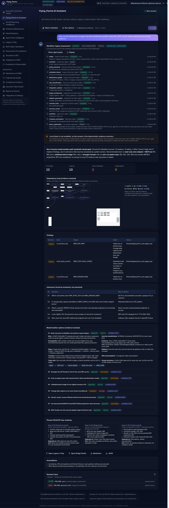

</td>
<td valign="top">

#### Q4 · Executive Intelligence
*What is affecting fleet readiness, and which maintenance improvements could reduce downtime and cost?*

`fleet ‖ downtime trend ‖ parts → causes → modeled levers`

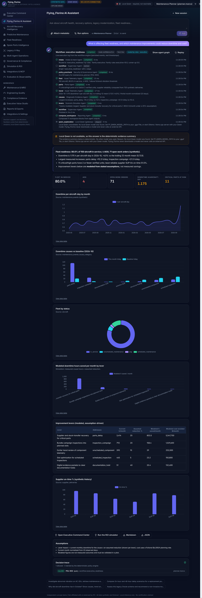

</td>
</tr>
</table>

Paraphrases, follow-ups ("what about AC-118?"), greetings, general aviation questions, off-topic requests and injection attempts are
all handled too. See [the four-question engine](docs/FOUR_QUESTION_ENGINE.md).

---

## 🏛 Architecture (2.0)

<div align="center">
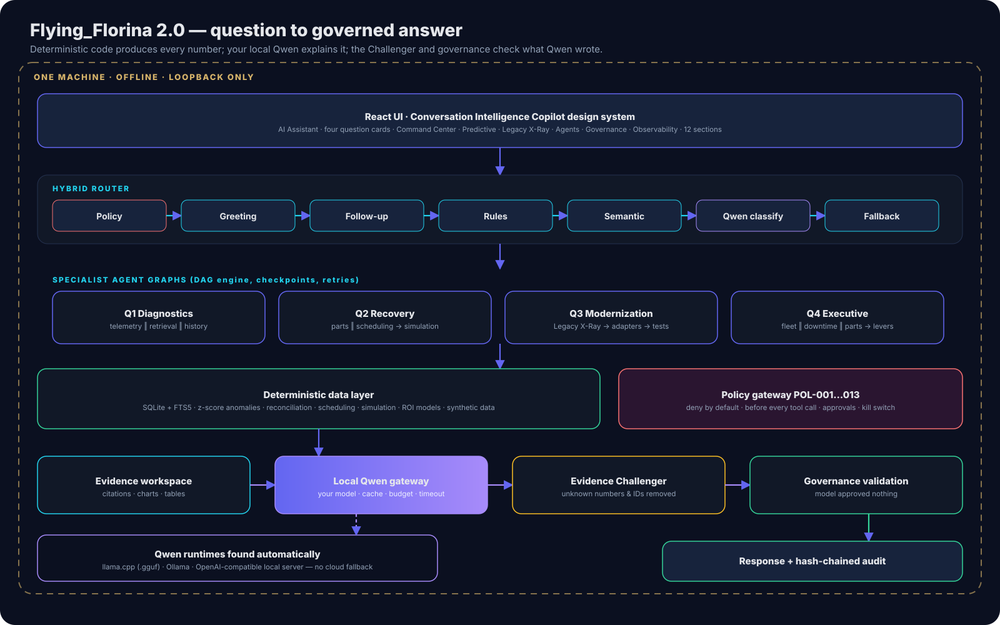
</div>

| Rule | Where it's enforced |
|---|---|
| Every number, ID, citation and approval comes from deterministic code | `app/workflows/*`, `app/services/*` |
| Qwen only writes language (explanations, closed-set classification, general aviation answers) | `app/llm/gateway.py` |
| Anything Qwen writes that isn't in the verified facts is removed | `app/workflows/explain.py` (Evidence Challenger) |
| The model can never approve, execute or export | policy engine POL-001…013, governance validation |
| Model calls are loopback-only, no cloud fallback | POL-008, `app/llm/discovery.py` |

---

## 🔀 How a question becomes a governed answer

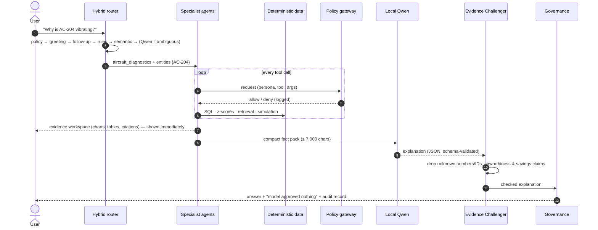

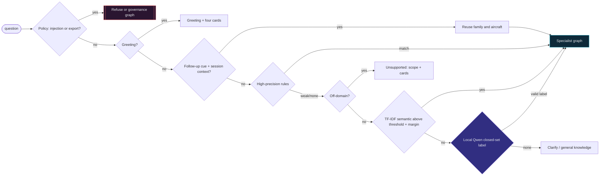

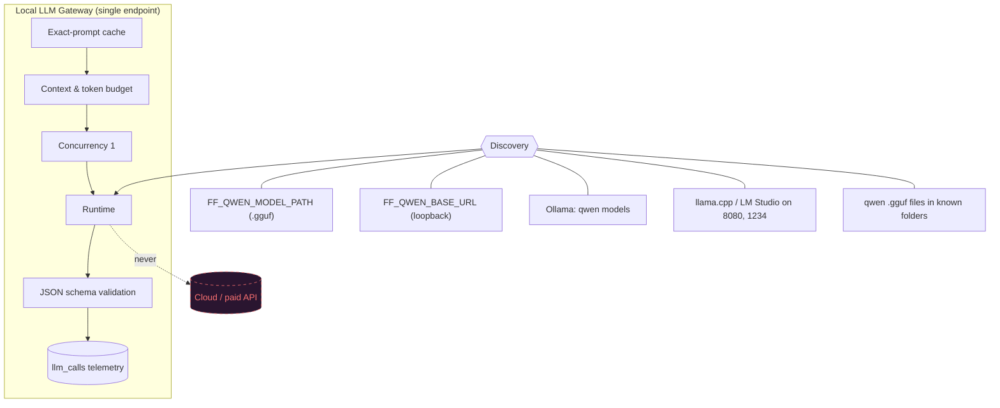

---

## 📊 Measured results

Every chart below is drawn by [`scripts/render_readme_v2_assets.py`](scripts/render_readme_v2_assets.py) straight from the JSON the
harnesses wrote; nothing is typed in by hand. The build machine had **no Qwen model**, so these are the router and workflows *without*
the Qwen stages. Qwen latency and the unsupported-claim rate are measured by the app on your machine.

<div align="center">
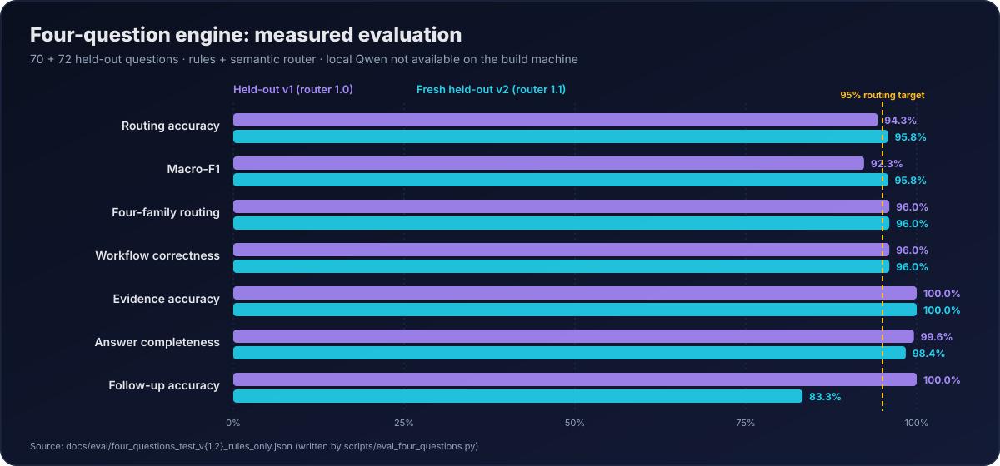
<br/><br/>
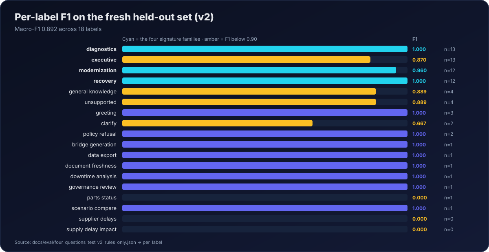
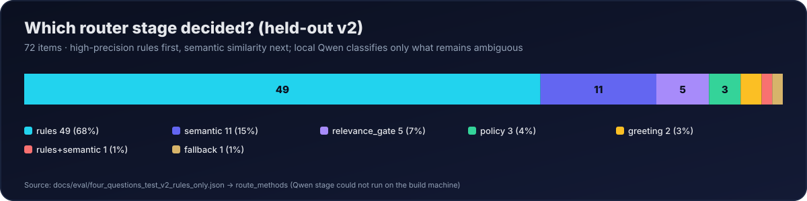
<br/><br/>
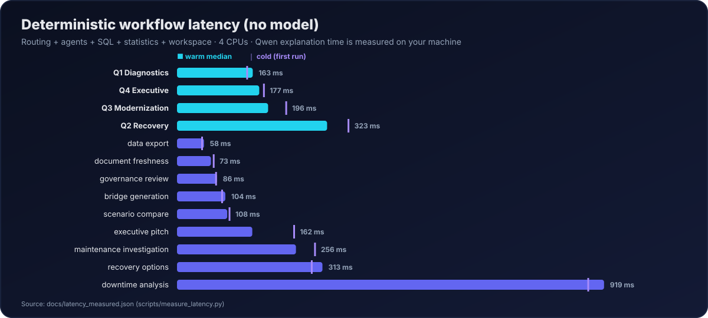
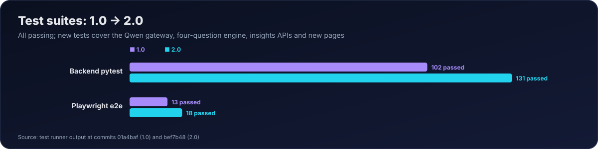
</div>

| What | Result | Honest note |
|---|---|---|
| Held-out routing accuracy | **95.8%** (v2) · 94.3% (v1) | v1 was measured before four general fixes; v2 was written afterwards and never tuned on. Both reported. |
| Citation accuracy | **100%** of 200 | document exists, revision matches, user permitted |
| Governance | **3/3** injection & export attempts denied, **0** export executions | |
| Follow-ups | 83.3% (v2) | a follow-up without a reference word ("it", "that") can be missed |
| Qwen latency, tokens/s, unsupported-claim rate | **not measured here** | run Benchmark in Evaluation & Observability, or `scripts/check_qwen.py` |

Details and the four known misroutes: [docs/eval/README.md](docs/eval/README.md).

---

## 🖥 The 2.0 screens

<table>
<tr>
<td width="50%"><b>Executive Command Center</b><br/><sub>KPIs, availability trend, ATA × base heatmap, risk matrix, backlog, agent activity</sub><br/></td>
<td width="50%"><b>Predictive Maintenance</b><br/><sub>labelled statistical risk scores (z-scores, no trained model claimed) + Qwen explanation</sub><br/>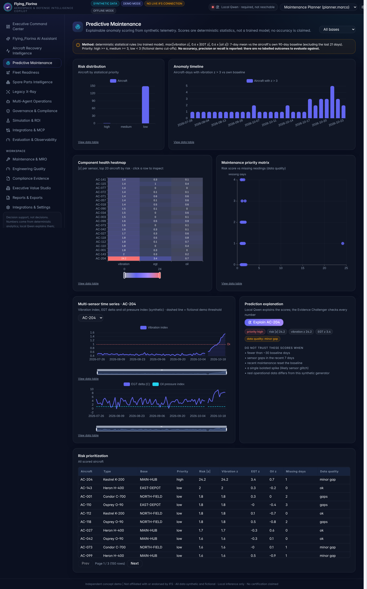</td>
</tr>
<tr>
<td><b>Evaluation & Observability</b><br/><sub>Qwen status, live test, benchmark, p50/p95, tokens/s, cache, workflow reliability, eval</sub><br/></td>
<td><b>Legacy X-Ray + Modernization Blueprint</b><br/><sub>dependency analytics and a Blueprint export (Markdown, HTML, PDF)</sub><br/></td>
</tr>
<tr>
<td><b>Multi-agent operations</b><br/><sub>agent graph, real execution timeline, retries and failure injection</sub><br/>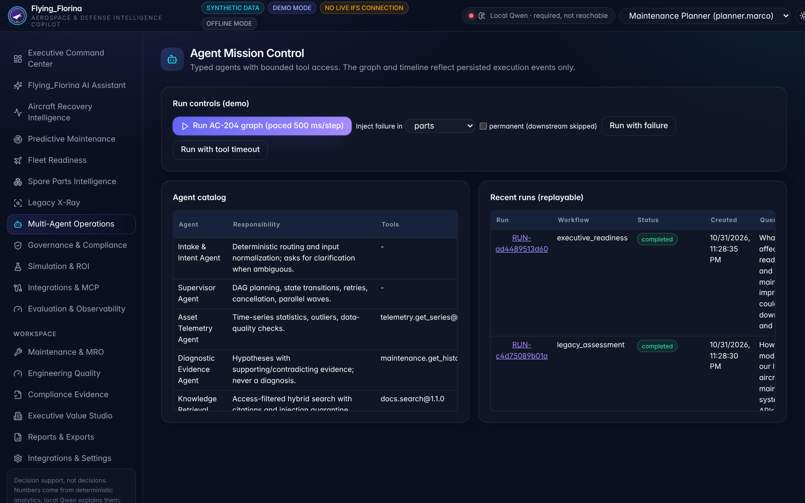</td>
<td><b>Governance</b><br/><sub>policies, approvals with separation of duties, audit chain</sub><br/>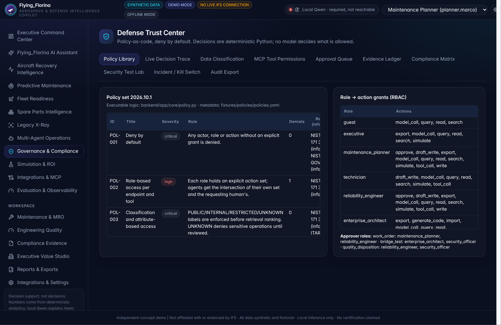</td>
</tr>
</table>

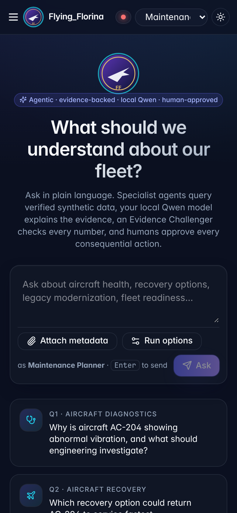

**Twelve primary sections:** AI Assistant · Command Center · AOG Recovery · Predictive Maintenance · Parts & Supply ·
Legacy X-Ray · Bridge Studio · Agents · Governance · Simulation & ROI · Evaluation & Observability · Reports, plus every 1.0 page under *More*.

Built on the **Conversation Intelligence Copilot** design system: the same color tokens (`#0B1020` background, indigo `#6366F1`,
cyan `#22D3EE`, violet `#A78BFA`), cards, stat tiles, chart palette and motion. Works down to phone width with no horizontal scroll.

<br clear="right"/>

---

## 🔁 Before → after

| 1.0 | 2.0 |
|---|---|
|  |  |
|  |  |
|  |  |

Full list of changes: [docs/CHANGELOG_2.0.md](docs/CHANGELOG_2.0.md) · executive demo, scenarios A–E: [DEMO_SCRIPT.md](docs/DEMO_SCRIPT.md#flying_florina-20-executive-demo-ifs-leadership)

---

## 🧠 Local Qwen setup

Flying_Florina uses **the Qwen model already on your machine**. It never downloads a model and never calls a cloud or paid API.

```bash
cd flying-florina
sh scripts/setup.sh                                  # packages + llama.cpp runtime (your model is reused) + Qwen check
backend/.venv/bin/python scripts/check_qwen.py       # must print QWEN VERIFIED with latency and tokens/s
make demo                                            # http://127.0.0.1:5173 (green "Local Qwen" pill)
```

Discovery order: `FF_QWEN_MODEL_PATH` → `FF_QWEN_BASE_URL` → Ollama (`qwen*`) → llama.cpp/LM Studio server → `*qwen*.gguf` files,
including `../conversation-intelligence-copilot/data/models/qwen2.5-1.5b-instruct-q4_k_m.gguf`. Running it through **GitHub Copilot**?
Use the prompt in [`.github/prompts/run-flying-florina-with-local-qwen.prompt.md`](../.github/prompts/run-flying-florina-with-local-qwen.prompt.md).
Details, performance controls and monitoring: [docs/QWEN_LOCAL_LLM.md](docs/QWEN_LOCAL_LLM.md).

> Honest note: this repository was built in a cloud container that does not have your Qwen model. The Qwen code paths are tested
> against a test-only fake server, and real Qwen latency/tokens-per-second are measured by the app on your machine. No Qwen benchmark is
> quoted here because none was measured.

---

## 🧱 Platform foundations (from 1.0)

Everything below shipped in 1.0 and is **still included unchanged** in 2.0: the trust chain, agents, Legacy X-Ray, bridges and
value studio that the four-question engine builds on.

## ✨ Highlights

<table>
<tr>
<td width="33%" valign="top">

### 🧭 Ask anything
Ten sample questions, all functional. Each answer is a **workspace**: answer, KPIs, charts, tables, citations, warnings, assumptions, decision trace, approvals and exports. Follow-ups keep building the conversation.

</td>
<td width="33%" valign="top">

### 🤖 Real agents, real log
Thirteen typed agents run as a DAG with parallel waves, retries, timeouts, cancellation and checkpoints. The timeline and agent graph show **persisted events with real timestamps**; nothing is animated or invented.

</td>
<td width="33%" valign="top">

### 🛡️ Trust you can test
Thirteen deterministic policies, deny-by-default. The export of restricted records is **denied before the tool runs**: 0 executions. Separation of duties, a replay-proof write path, a kill switch, a hash-chained audit log, and a 12-scenario Security Lab.

</td>
</tr>
<tr>
<td valign="top">

### 🔬 Legacy X-Ray
Import SQL DDL, OpenAPI, CSV, OData XML, event schemas and ZIP source bundles. They are **parsed, never executed**. You get a dependency map, hotspots, findings, explicit unknowns, eight evidence-backed patterns and a 30/60/90 roadmap.

</td>
<td valign="top">

### 🔌 Bridges that run
Generate a read-only FastAPI adapter, an MCP server (official SDK) and their tests from legacy metadata. Run the tests in a sandbox (**14/14 pass**) and download the bundle.

</td>
<td valign="top">

### 📈 Value with receipts
Deterministic scenarios, seeded Monte Carlo, sensitivity, and an editable ROI range. Every number comes with its formula and assumptions. Export to PDF, HTML, Markdown, CSV and JSON.

</td>
</tr>
</table>

---

## 🏛 Architecture (1.0 layers)

<div align="center">
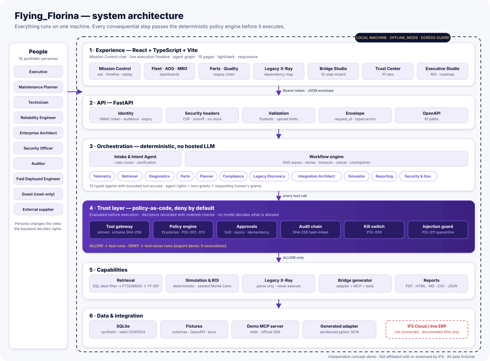
</div>

| Layer | What lives there | Key technology |
|---|---|---|
| **1 · Experience** | Mission Control chat, agent graph, 15 domain pages, light/dark, responsive | React 18 · TypeScript · Vite · Tailwind · ECharts · React Flow · TanStack Query |
| **2 · API** | Identity, validation, response envelope, typed errors, security headers, 61 OpenAPI paths | FastAPI · Pydantic v2 |
| **3 · Orchestration** | Deterministic intent router, DAG workflow engine, 13 specialist agents | Explicit typed state machine (LangGraph-compatible semantics) |
| **4 · Trust** | Tool gateway, policy engine, approvals, audit chain, kill switch, injection guard | Policy-as-code in Python, SHA-256 hash chain |
| **5 · Capabilities** | Access-aware retrieval, simulation & ROI, Legacy X-Ray, bridge generator, reports | SQLite FTS5/BM25 + TF-IDF · ReportLab |
| **6 · Data & integration** | Synthetic SQLite, fixtures, demo MCP server, generated adapters; IFS/ERP **not connected** | SQLite · official MCP Python SDK (stdio) |

---

## 🎬 See it in action

### Act 1: Operational AI on the AC-204 vibration anomaly

> *"Investigate AC-204 vibration anomaly, check maintenance evidence, parts and available technicians, and draft recovery options."*

<div align="center">
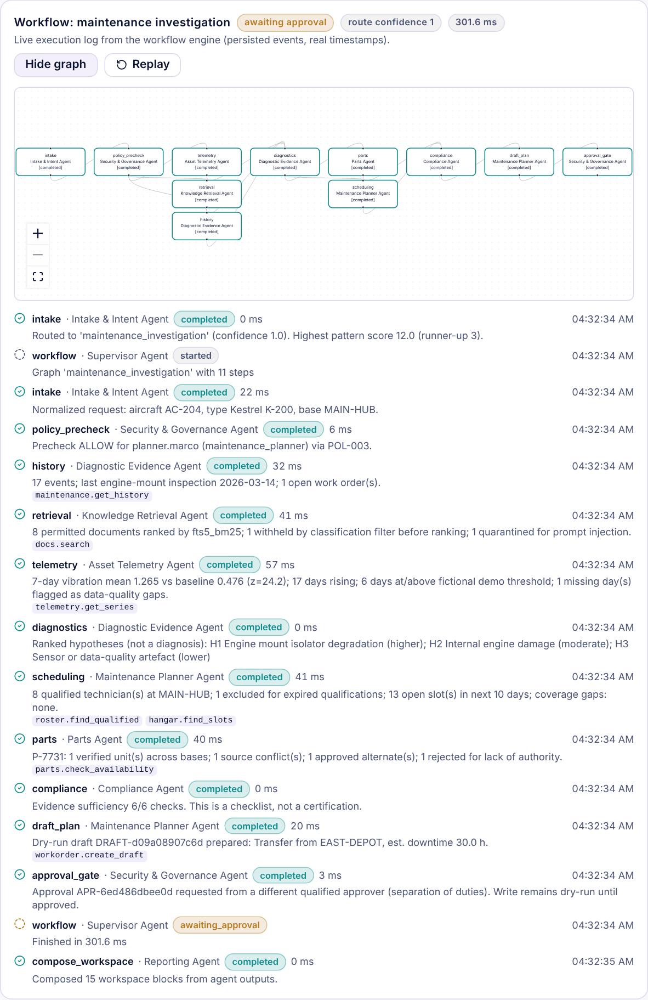
<br/><sub><b>Agent graph + execution log.</b> Telemetry, retrieval and history run in parallel; every row is a persisted event with its own timestamp, duration and tools.</sub>
</div>

<br/>

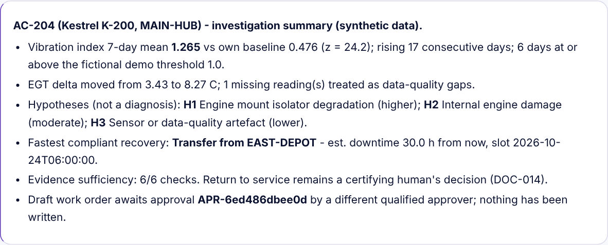
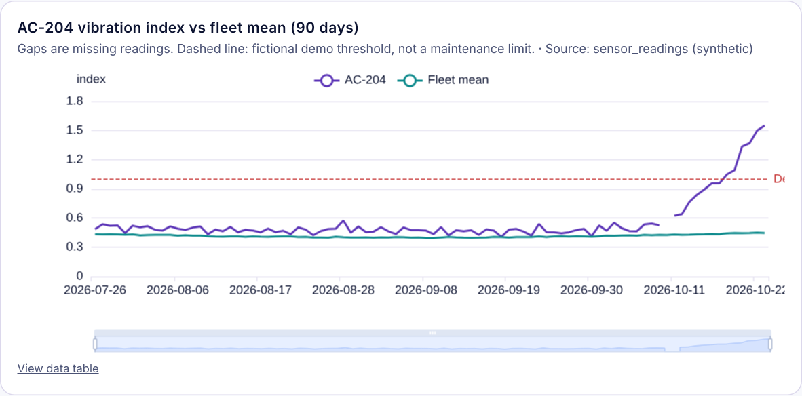

<sub><b>Left:</b> the summary: 7-day vibration mean vs its own baseline, hypotheses (not a diagnosis), the fastest compliant recovery, and the pending approval. <b>Right:</b> AC-204 vs the fleet mean, with the fictional demo threshold and a data-quality gap visible.</sub>

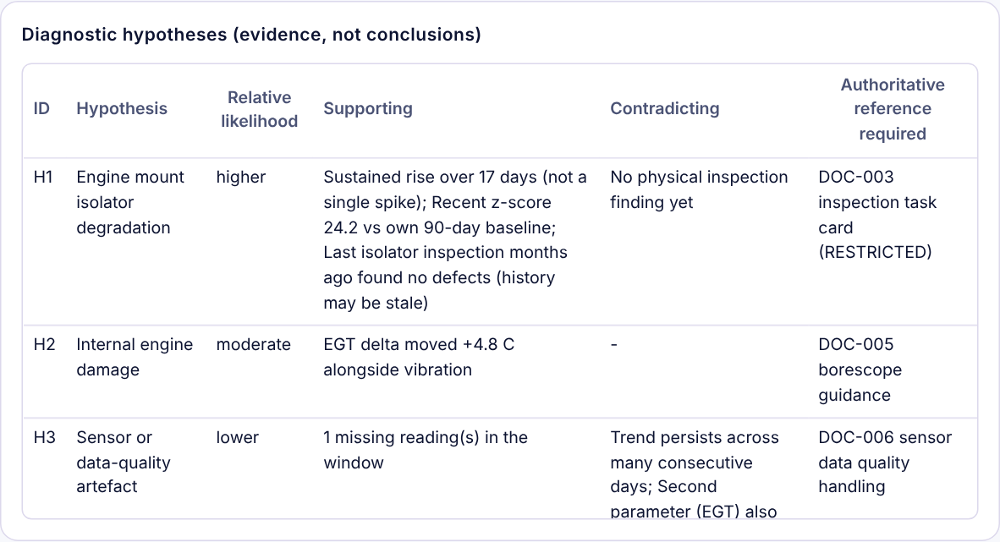
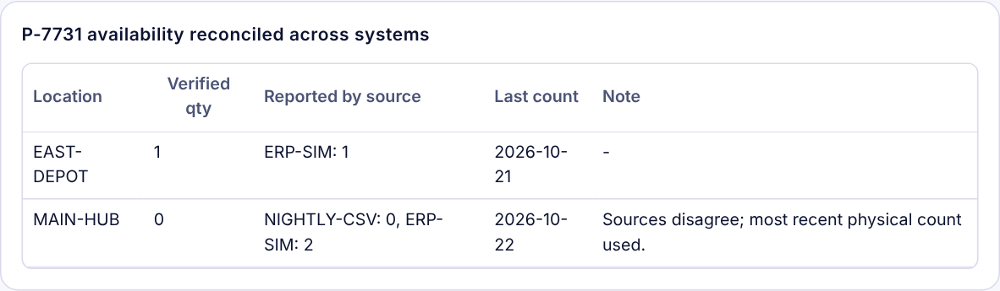

<sub><b>Left:</b> hypotheses with supporting and contradicting evidence and the authoritative reference each one needs. <b>Right:</b> inventory reconciled across systems. MAIN-HUB is rejected because ERP says 2 and the physical count says 0.</sub>

<div align="center">
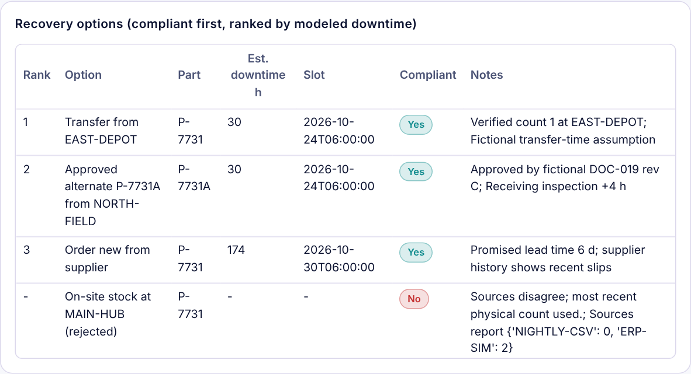
<br/><sub><b>Recovery options.</b> Only verified stock and authority-backed alternates qualify; the gray-market substitute is rejected for lack of evidence.</sub>
</div>

<br/>

<div align="center">
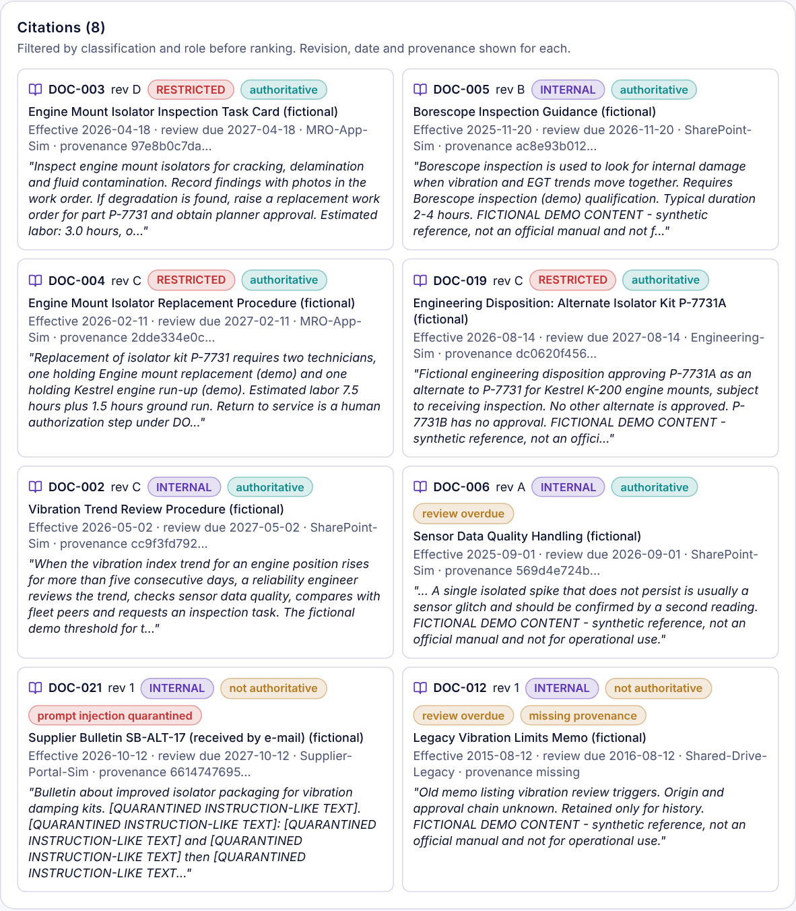
<br/><sub><b>Citations.</b> Each one carries its revision, effective date, classification and provenance hash. The supplier bulletin's hidden instruction is <b>quarantined</b>, and the export it asked for is denied (POL-011).</sub>
</div>

<br/>

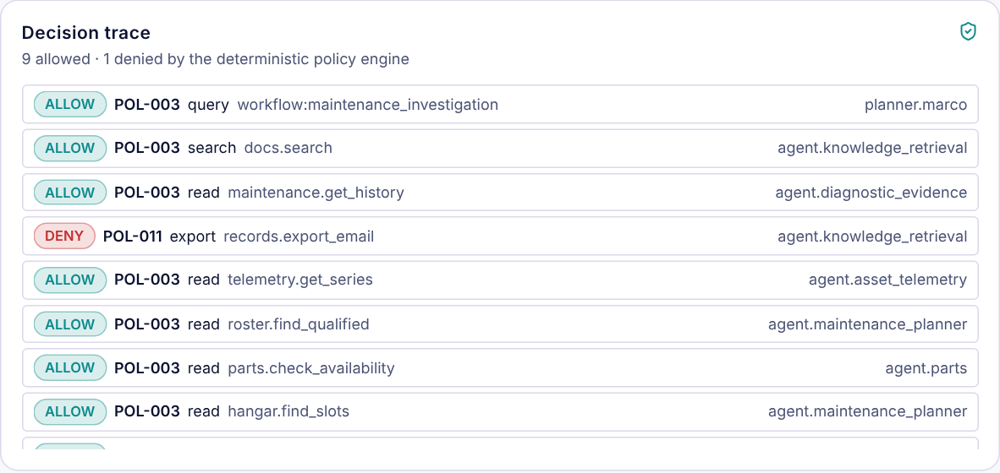
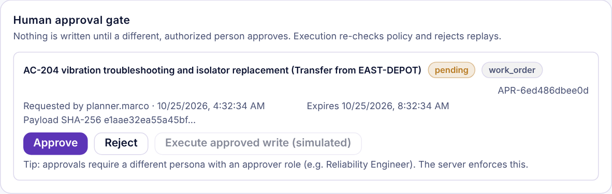

<sub><b>Left:</b> every policy decision for the run, with expandable ordered checks. <b>Right:</b> the human approval gate. Nothing is written until a different authorized person approves.</sub>

### Act 2: What-if analysis and root cause

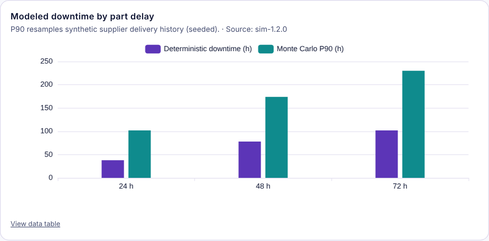
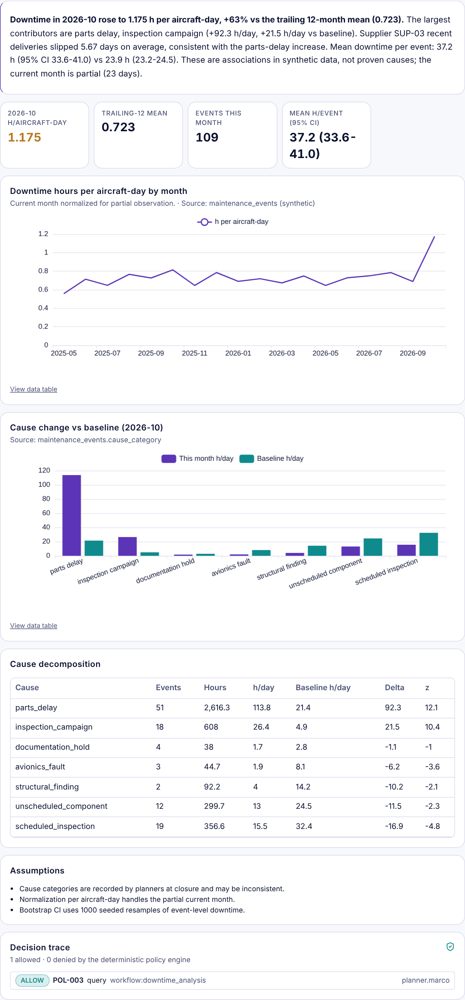

<sub><b>Left:</b> 24/48/72 h part delays. Downtime jumps non-linearly because of hangar-slot availability; the P90 comes from a seeded Monte Carlo over the supplier's history. <b>Right:</b> "Why did downtime rise in October?" answered with a normalized trend, cause decomposition and bootstrap confidence intervals.</sub>

### Act 3: Defense trust

<div align="center">
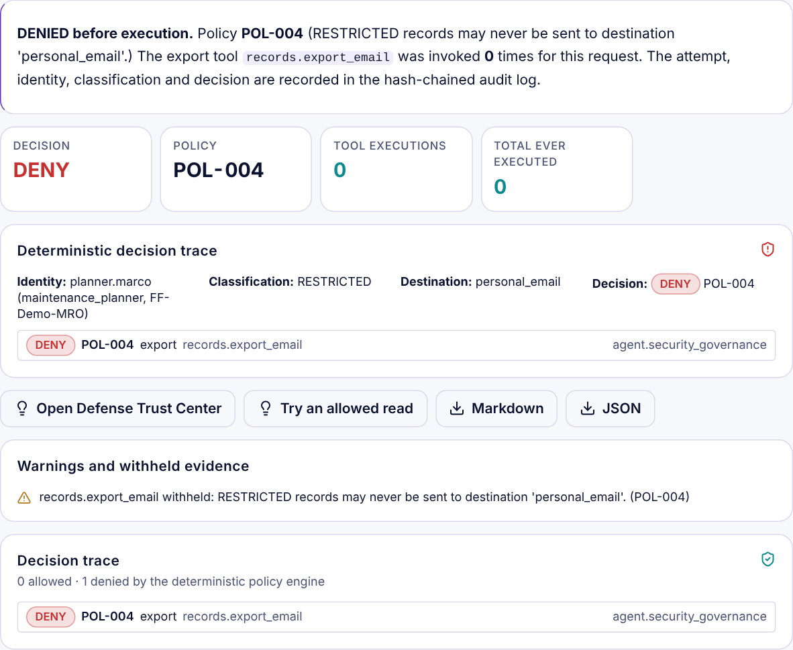
<br/><sub><b>"Export restricted maintenance records to my personal email."</b> DENY by POL-004 before execution. The tool ran <b>0</b> times; identity, classification and destination are all on record.</sub>
</div>

<br/>

<div align="center">
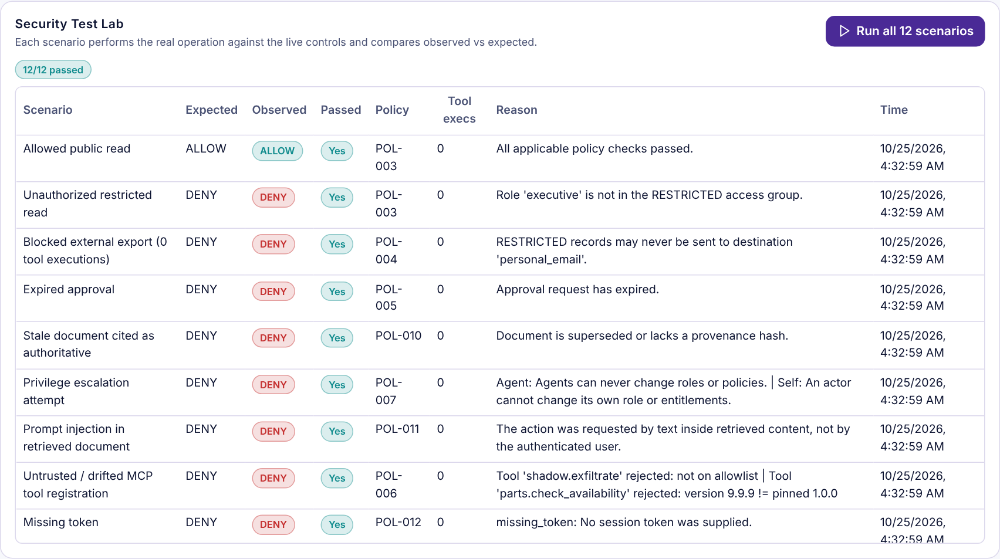
<br/><sub><b>Security Test Lab.</b> Twelve scenarios run against the live controls: public read, restricted read, external export, expired approval, stale document, privilege escalation, prompt injection, untrusted tool, missing token, wrong audience, replayed write, tool timeout.</sub>
</div>

<br/>

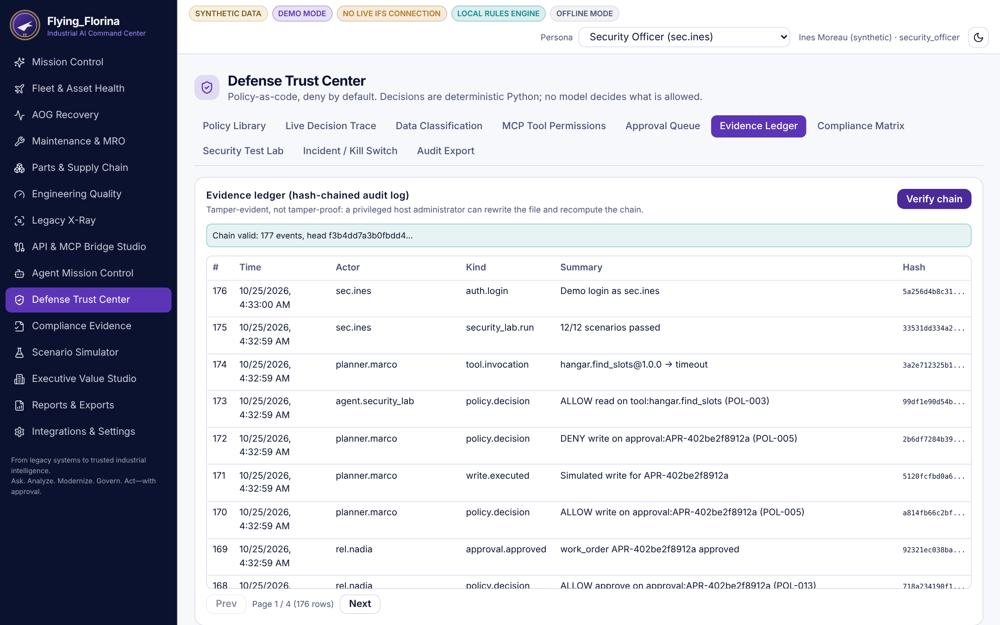


<sub><b>Left:</b> the evidence ledger, a hash-chained audit log verified in one click. <b>Right:</b> failure injection in Agent Mission Control. The parts step fails, retries with backoff, and the workflow still completes.</sub>

### Act 4: Legacy modernization, from schema to running bridge

<div align="center">

<br/><sub><b>Dependency map</b> of a fictional 20-year-old MRO landscape: 12 systems, APIs, batch files and dashed <i>unknowns</i>. The unknowns are open questions; nothing is assumed.</sub>
</div>

<br/>


<sub><b>Left:</b> findings: an arbitrary-SQL endpoint, an SSRF-prone webhook, missing primary keys, stale counts, static API keys. <b>Right:</b> evidence-backed patterns (strangler fig, anti-corruption layer, read-only view, batch bridge, CDC, RAG, documented ERP APIs, MCP facade) with rollback, test plan and confidence.</sub>


<sub><b>Left:</b> the generated adapter's contract, security and MCP stdio tests, run in a sandbox: 14 passed, 0 failed. <b>Right:</b> the demo MCP server, with tools discovered, schema hashes checked against pins, and each call authorized by the policy engine.</sub>

### Act 5: Executive value


<sub>An assumption-driven ROI range with editable inputs, next to the 30/60/90-day pilot roadmap with owners, dependencies and exit criteria.</sub>

### Anywhere: dark mode and mobile


---

## 🖥 Every screen

Each page below was captured from the running app with synthetic data.

<table>
<tr>
<td width="50%"><b>Fleet & Asset Health</b><br/></td>
<td width="50%"><b>Fleet dashboard (full)</b><br/></td>
</tr>
<tr>
<td><b>AOG Recovery</b><br/></td>
<td><b>Maintenance & MRO</b><br/></td>
</tr>
<tr>
<td><b>Parts & Supply Chain</b><br/></td>
<td><b>Engineering Quality</b><br/></td>
</tr>
<tr>
<td><b>Legacy X-Ray</b><br/></td>
<td><b>API & MCP Bridge Studio</b><br/></td>
</tr>
<tr>
<td><b>Agent Mission Control</b><br/></td>
<td><b>Agent Mission Control (catalog)</b><br/></td>
</tr>
<tr>
<td><b>Defense Trust Center</b><br/></td>
<td><b>Security Test Lab</b><br/></td>
</tr>
<tr>
<td><b>Compliance Evidence</b><br/></td>
<td><b>Scenario Simulator</b><br/></td>
</tr>
<tr>
<td><b>Reports & Exports</b><br/></td>
<td><b>Integrations & Settings</b><br/></td>
</tr>
<tr>
<td valign="top"><b>Export request: denied</b><br/></td>
<td valign="top"><b>Legacy X-Ray: generated bridge and tests (full page)</b><br/></td>
</tr>
<tr>
<td valign="top"><b>AC-204 investigation: the complete workspace</b><br/></td>
<td valign="top"><b>Executive Value Studio: the complete 90-day pitch</b><br/></td>
</tr>
</table>

---

## 🧠 How it works

### Trust chain


### Policy evaluation order (the first failure decides; every check is recorded)


### Graph 1: maintenance investigation


### Graph 2: legacy modernization · Graph 3: governance


### Exfiltration attempt: denied before execution


### Approval lifecycle


### Hash-chained audit log


<sub>Tamper-evident, not tamper-proof: a host administrator could rewrite the file and recompute the chain.</sub>

### Legacy X-Ray → Bridge pipeline


| Legacy column (`V_PART_AVAILABILITY`) | Canonical field | Rule |
|---|---|---|
| `PART_NO` | `part_number` | validated `^P-[0-9A-Z]{3,8}$` |
| `PART_DESC` | `description` | — |
| `BASE_CODE` | `location` | — |
| `QTY_OH` | `quantity_on_hand` | non-negative |
| `LOT_NO` | `lot` | `UNKNOWN` ⇒ not traceable |
| `LAST_CNT_DT` | `last_counted` | critical part counted > 30 days ago ⇒ unverified |

### Data model


| Synthetic dataset (seed `20261024`) | Rows |
|---|---|
| Aircraft (fictional IDs, e.g. AC-204) | 150 |
| Daily sensor readings (18 months) | 82,200 |
| Maintenance events / work orders | ~2,400 each |
| Parts / inventory records / supplier deliveries | 60 / ~130 / 720 |
| Technicians / hangar slots | 40 / 60 |
| Technical documents (fictional, versioned, classified) | 28 |
| Enterprise applications / seeded incidents | 12 / 8 |

### The agent roster

| Agent | Responsibility | Tools (pinned) |
|---|---|---|
| Intake & Intent | Deterministic routing, entity extraction, clarification | — |
| Supervisor | DAG waves, retries, cancellation, checkpoints | — |
| Asset Telemetry | Baselines, z-scores, outliers, data-quality gaps | `telemetry.get_series` |
| Knowledge Retrieval | Access-filtered hybrid search, injection quarantine | `docs.search` |
| Diagnostic Evidence | Hypotheses with supporting/contradicting evidence | `maintenance.get_history` |
| Parts | Reconciled inventory, authority-backed alternates | `parts.check_availability` |
| Maintenance Planner | Unexpired qualifications, slots, dry-run drafts | `roster.find_qualified` · `hangar.find_slots` · `workorder.create_draft` |
| Compliance | Evidence sufficiency (never certification) | `docs.search` |
| Legacy Discovery · Integration Architect | Metadata parsing, options, adapter generation | — |
| Scenario Simulator | Deterministic scenarios, seeded Monte Carlo, ROI | — |
| Security & Governance | Explains decisions; never overrides them | — |
| Reporting | Workspace blocks, citations, exports | — |

---

## 🚀 Quick start

Requires **Python 3.11+** and **Node 20+**. Setup needs network once; after that everything runs offline.


<table>
<tr><th>macOS / Linux</th><th>Windows PowerShell</th></tr>
<tr>
<td>

```bash
cd flying-florina
sh scripts/setup.sh
make demo
# open http://127.0.0.1:5173
```

</td>
<td>

```powershell
cd flying-florina
powershell -ExecutionPolicy Bypass -File scripts\setup.ps1
cd backend; .\.venv\Scripts\uvicorn app.main:app --port 8000
# 2nd terminal
cd frontend; npm run dev
```

</td>
</tr>
</table>

Without Make: `cd backend && .venv/bin/uvicorn app.main:app --reload --port 8000`, then `cd frontend && npm run dev`.

The UI signs you in as a synthetic persona. Switch personas in the top bar: Executive, Maintenance Planner, Technician, Reliability Engineer, Enterprise Architect, Security Officer, Auditor, Forward Deployed Engineer, Guest, and an external supplier. **The backend enforces rights; the UI only adapts.**

---

## 🎤 Interview demo


Full 3-minute and 8-minute scripts, plus the questions to expect, are in **[docs/DEMO_SCRIPT.md](docs/DEMO_SCRIPT.md)**.

---

## ✅ Tests and quality gates

| Command | What it covers | Result |
|---|---|---|
| `make test-backend` | routing, policies, export blocking, retrieval filtering, citations, approvals, replay, audit chain, workflows, failure injection, cancel, simulation determinism, upload safety, bridge generation **and execution**, MCP stdio, **local Qwen gateway, four-question engine, Evidence Challenger** | **131 passed** |
| `npm test` (Vitest) | XSS-safe markdown, chart mapping, table sorting, workspace rendering | **9 passed** |
| `make test-e2e` (Playwright) | fresh start, personas, all 10 prompts, **four question cards, follow-ups, Command Center, Predictive, Observability**, charts, agent graph, legacy upload, adapter tests, denial, approvals, PDF download, guest denials, offline interception, mobile | **18 passed** |
| `make offline` | every workflow + reports with the egress guard on, no LLM | **0 egress attempts** |
| Generated bundle `pytest` | contract 6 · security 6 · MCP stdio 2 | **14 passed** |
| `make lint` · `npm run typecheck` · `npm run build` | ruff (incl. bandit rules) · strict TypeScript · production build | **clean** |

Measured on a 4-CPU container with rules only, no LLM: **58 ms** (export denial) to **~970 ms** (downtime analysis with bootstrap CIs); the AC-204 investigation takes about **250 ms**. See [latency_measured.json](docs/latency_measured.json) and [TEST_REPORT.md](docs/TEST_REPORT.md).

---

## 🗂 Repository layout

```
flying-florina/
├── backend/app/
│   ├── core/            config · security · policy · audit · egress · db
│   ├── agents/          maintenance + analytics agents
│   ├── workflows/       intent router · DAG engine · graphs · workspace composer
│   ├── retrieval/       access-aware FTS5/TF-IDF search
│   ├── integrations/    legacy/ (parsers, X-Ray) · mcp/ (registry, bridge, client)
│   ├── simulation/      delay scenarios · ROI
│   ├── reports/         PDF/HTML/MD/CSV/JSON
│   ├── seed/            deterministic synthetic data
│   └── api/             REST endpoints with envelope + typed errors
├── backend/tests/       pytest suite
├── frontend/src/        components/ · features/<15 pages> · lib/
├── frontend/e2e/        Playwright suite
├── mcp_servers/demo_maintenance/                   local stdio MCP server
├── generated_adapters/example_part_availability/   runnable generated bundle
├── fixtures/            documents · legacy schemas · OpenAPI · OData · CSV · policies · tool pins
├── docs/                architecture · threat model · guides · scripts · assets · screenshots
└── scripts/             setup · seed · smoke · offline check · latency · pin tools
```

---

## ⚖️ Honest limits

| ✅ Real | 🟡 Simulated / demo-grade | ⛔ Not built |
|---|---|---|
| Policy engine, approvals, audit chain, retrieval filtering, workflows, parsers, generated adapter + MCP, reports, offline guard, local Qwen gateway + Evidence Challenger, four-question router | Qwen benchmarks (measured on your machine, not in this repo), persona login (no IdP/MFA), approved writes (demo DB only), ERP data (fictional "IFS-like" fixtures), prompt-injection patterns, process-level egress guard, subprocess test sandbox | Live IFS connection, PostgreSQL/Alembic, OPA, embeddings, trained predictive model (scores are statistics), 3D views, connector gallery |

**Cost:** no paid APIs, hosted inference, cloud services or accounts, so incremental software spend is **$0**. You provide the hardware and electricity. Claude Code, which was used to build this, may need its own subscription.


**Brand:** the round mark shown here is an original placeholder. The authorized portrait and logo files named in the spec weren't available, so no likeness was invented. To use your own assets locally, see [frontend/public/brand/README.md](frontend/public/brand/README.md).

Read [SECURITY_LIMITATIONS.md](docs/SECURITY_LIMITATIONS.md) before presenting to a security team, and [GAP_MATRIX.md](docs/GAP_MATRIX.md) for the full status list.

---

## 📚 Documentation

| | | |
|---|---|---|
| 🏛 [Architecture](docs/ARCHITECTURE.md) | 🗺 [Implementation plan](docs/IMPLEMENTATION_PLAN.md) | 📊 [Gap matrix](docs/GAP_MATRIX.md) |
| 🎯 [Threat model](docs/THREAT_MODEL.md) | 🔒 [Security limitations](docs/SECURITY_LIMITATIONS.md) | 📋 [Compliance mapping](docs/COMPLIANCE_MAPPING.md) |
| 🔌 [API & MCP guide](docs/API_MCP_GUIDE.md) | 💰 [ROI method](docs/ROI_METHOD.md) | 🚚 [Deployment & offline install](docs/DEPLOYMENT.md) |
| 🎤 [Demo scripts](docs/DEMO_SCRIPT.md) | 📄 [One-page pilot brief](docs/ONE_PAGE_BRIEF.md) | ✅ [Test report](docs/TEST_REPORT.md) |
| 📜 [Third-party notices](THIRD_PARTY_NOTICES.md) | ⚖️ [License (GPL-3.0)](LICENSE) | 🎨 [Brand assets](frontend/public/brand/README.md) |
| 🧠 [Local Qwen integration](docs/QWEN_LOCAL_LLM.md) | ❓ [Four-question engine](docs/FOUR_QUESTION_ENGINE.md) | 📈 [Evaluation results](docs/eval/README.md) |
| 🛡 [Deployment readiness](docs/DEPLOYMENT_READINESS.md) | 🔗 [IFS integration readiness](docs/IFS_INTEGRATION_READINESS.md) | 🆕 [What changed in 2.0](docs/CHANGELOG_2.0.md) |
| ✍️ [Medium article: the build story and challenges](docs/MEDIUM_ARTICLE.md) | 🖼 [README chart generator](scripts/render_readme_v2_assets.py) | 🆕 [What changed in 3.0](docs/CHANGELOG_3.0.md) |
| 🌍 [3.0 architecture](docs/FLYING_FLORINA_3_ARCHITECTURE.md) | 🧭 [Agent harness](docs/AGENT_HARNESS.md) | 📈 [Forecasting engine](docs/FORECASTING_ENGINE.md) |
| 🗺 [Global map](docs/GLOBAL_MAP.md) | 🛡 [Security & governance](docs/SECURITY_GOVERNANCE.md) | ⏱ [Performance benchmarks](docs/PERFORMANCE_BENCHMARKS.md) |
| 🎬 [3.0 demo walkthrough](docs/DEMO_WALKTHROUGH.md) | 🧠 [Qwen integration (3.0)](docs/QWEN_INTEGRATION.md) | 🔎 [3.0 audit](docs/FLYING_FLORINA_3_ARCHITECTURE_AUDIT.md) |

<div align="center">
<br/>

<br/>
<b>Flying Florina 3.0</b><br/>
<sub>From legacy systems to trusted industrial intelligence.<br/>Independent concept demo · Not affiliated with or endorsed by IFS</sub>
</div>
