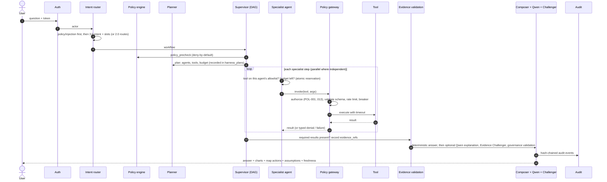

# Agent harness

Flying Florina 3.0 does not let agents run free: every 3.0 request runs inside a governed harness built on the existing typed DAG
engine (`app/workflows/engine.py`). Code: `backend/app/harness/`.

## Specialist agents (registry: `AGENTS` in `harness/core.py`)

| Agent | Reuses (2.0) | Tool allowlist |
|---|---|---|
| Aerospace Engineering Agent | Diagnostic Evidence Agent | docs.search, telemetry.get_series, visual.capabilities |
| Component Prognostics Agent | — | forecast.components, forecast.series, twin.unit |
| Maintenance Intelligence Agent | Maintenance Planner Agent | maintenance.get_history, roster.find_qualified, hangar.find_slots |
| Supply Chain Forecast Agent | Parts Agent | supply.delay_impact, global.map_state, parts.check_availability, forecast.components |
| Digital Twin Agent | — | twin.unit |
| Geospatial Intelligence Agent | — | global.map_state |
| Operational Resilience Agent | Scenario Simulator Agent | resilience.simulate, supply.delay_impact |
| Compliance Evidence Agent | Compliance Agent | docs.search |
| Knowledge Retrieval Agent | Document Retrieval Agent | docs.search, memory.recall |
| Forecast Evaluation Agent | — | forecast.evaluation |
| Software Change Impact Agent | — | changeimpact.analyze |
| Governance and Audit Agent | Security & Governance Agent | harness.trace |

Agents act on behalf of the human: their effective rights are the intersection of the agent role and the human's role (existing POL
logic). An agent asking for a tool outside its allowlist is stopped by the harness *before* the gateway (`blocked_by_harness`).

## Tools (typed contracts, pinned)

11 new tools in `harness/tools.py`, each a Pydantic input model whose JSON-schema SHA-256 is pinned in
`fixtures/policies/tool_allowlist.yaml` (a changed schema refuses to register). Actions: `read` for queries, `simulate` for
supply/resilience (guests and auditors cannot simulate).

## Adaptive orchestration and budgets

| Request | Specialists | Budget (tool calls / wall s) |
|---|---|---|
| Supplier delays on the map, accuracy, trace, memory, visual capabilities, change impact | 1 | 2 / 30-120 |
| Shortages, component degradation, forecast evidence | 2 | 3-4 / 120-150 |
| Demand forecast (forecast + history + held-out accuracy) | 2 (3 tools) | 4 / 150 |
| Supplier-delay impact (supply + resilience) | 2 | 4 / 180 |

Budgets are enforced: the tool-call budget is reserved atomically under the run lock (a test caught parallel steps slipping under
the limit before this fix); exceeding it halts the run with status `budget_exceeded` and a stated reason. Engine timeouts, retries
with backoff, cancellation and checkpointing are unchanged from 2.0. Infinite loops are impossible by construction (finite DAG).

## Evidence validation

The last specialist step checks that every *required* tool result exists, writes `evidence_refs`, and closes the plan with
usage (`tool_calls`, `tool_denials`, `wall_s`, `missing_evidence`). Missing evidence is reported to the user as a warning; the answer
covers only what was retrieved.

## Verified by tests (`backend/tests/test_harness.py`)

* All 12 suggested 3.0 questions route to their workflow and complete.
* Unauthorized tool calls are blocked and never executed (auditor → `supply.delay_impact` denied by policy; Digital Twin Agent →
  supply tool blocked by the harness allowlist).
* Budgets: `budget_tool_calls=1` halts a two-specialist plan with `budget_exceeded`.
* Failed tools produce safe errors (injected timeout → warning, no stack trace in the answer).
* Missing evidence is reported.
* Human approvals cannot be bypassed (Q2 recovery still stops at `awaiting_approval`).
* Conversation history survives an application restart and only its owner can delete it.
* Agent traces match actual executions: every planned agent appears in the recorded events.
* Simple requests use fewer agents than complex ones.

## Control Tower

`/control-tower` reads only recorded rows: execution graph and per-step attempts/retries/durations, the event timeline, governance
(allowed/blocked/pending approvals/validation failures), model performance (`llm_calls` + OS: latency, tokens, CPU, memory, queue
depth, cache hit rate), agent evaluation (task success, evidence coverage, tool-call reliability, Evidence Challenger pass rate,
forecast quality, failure rate) and recovery (failed runs, retries, escalations, partial results). There is no simulated activity.
