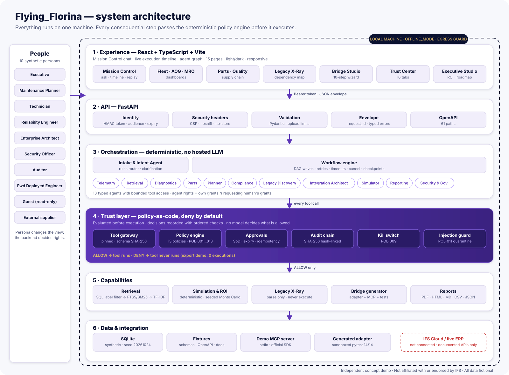
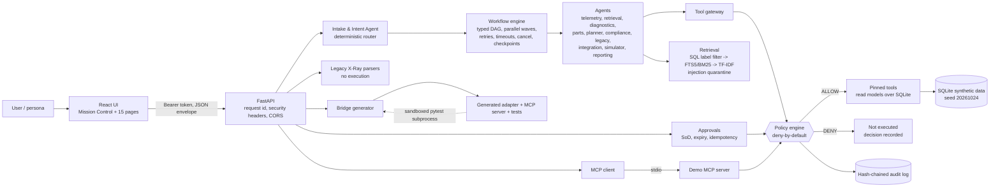

# Architecture

## Components

## Trust boundaries

| # | Boundary | Control |
|---|---|---|
| 1 | Browser → API | HMAC-signed token in `Authorization` header (audience + expiry), strict CORS, security headers, input validation, upload limits |
| 2 | API → workflow | Intent routing is deterministic; exfiltration intents are matched first and cannot be outscored |
| 3 | Agent → tool | Gateway: policy evaluated **before** execution; agent rights = own grants ∩ requesting human's; schema validation, rate limit, circuit breaker, timeout; redacted invocation log |
| 4 | Retrieved text → agent | Label/role filter in SQL before ranking; instruction-like text quarantined; any action it requests is evaluated with `instruction_source=retrieved_content` and denied (POL-011) |
| 5 | Tool registry | Name + version + input-schema SHA-256 pinned in `fixtures/policies/tool_allowlist.yaml`; mismatches cannot register |
| 6 | MCP | Demo server verifies a token with audience `ff-mcp-demo` and runs the same policy engine per call. MCP is an interface, not the boundary |
| 7 | Generated code | Created from vetted templates; static checks without execution; runtime tests only on explicit request by a permitted role, in a subprocess with minimal env, no proxies, timeout |
| 8 | Uploads | Extension allowlist, size limit, binary rejection, ZIP traversal/symlink/bomb checks, XML DTD/entity rejection, parse-only |
| 9 | Process → network | OFFLINE_MODE egress guard blocks non-loopback sockets and DNS |

## Data model

One SQLite file (`backend/data/flying_florina.db`) holds both the synthetic operational data
(aircraft, telemetry, maintenance events, work orders, parts, inventory per system of record, suppliers,
deliveries, technicians, hangar slots, documents + FTS index, applications, incidents) and the governance
records (policy decisions, tool invocations, approvals, write log, audit chain, workflow runs/events,
reports, simulations, legacy imports, bridge bundles). Every KPI is computed from these tables by
`app/services/data.py`, so fleet totals, drilldowns, parts and work orders agree.

## Workflow graphs

* **Graph 1 – maintenance:** intake → policy precheck → [telemetry ‖ retrieval ‖ history] → diagnostics → [parts ‖ scheduling] → compliance → draft plan → approval gate → (human) approve → execute simulated write → audit.
* **Graph 2 – legacy:** precheck → metadata import → dependency graph → risk classification → integration options → target architecture → adapter generation → static contract tests → security review.
* **Graph 3 – governance:** identity + policy evaluation → deny → no tool execution → audit → response.
* Others: scenario comparison, downtime analysis, recovery options, document freshness, executive pitch, parts status, fleet overview, quality investigation.

The UI's agent graph and timeline are drawn from persisted `workflow_events`; nothing is animated or invented.
An optional, disclosed "demo pacing" delay can be enabled per run.

## Why not LangGraph / Alembic / PostgreSQL

LangGraph was not installed; the explicit state machine in `app/workflows/engine.py` provides the same
observable semantics. Schema creation is idempotent DDL rather than Alembic migrations, and SQLite is the
only database implemented. These are listed in the gap matrix.
