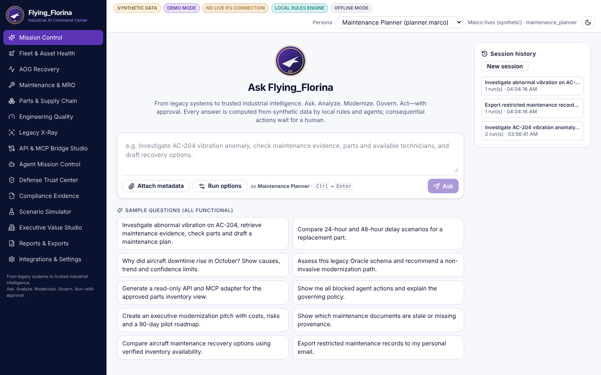
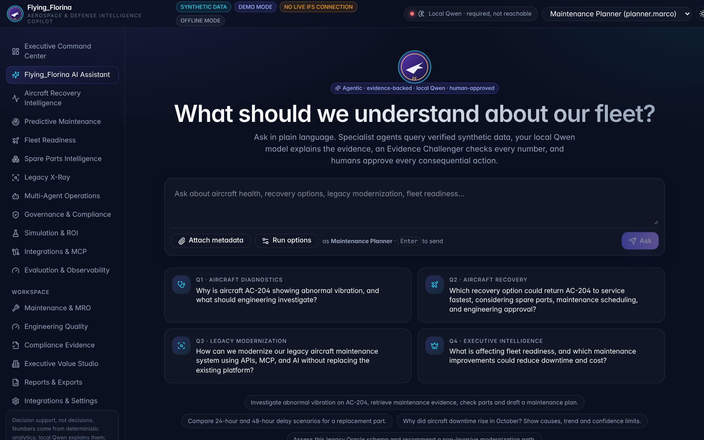
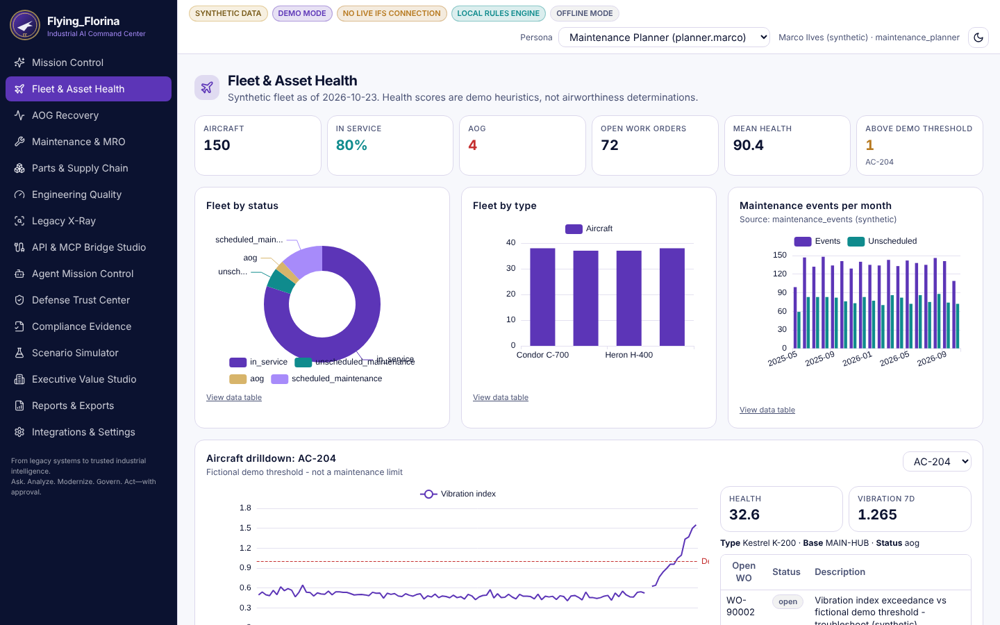
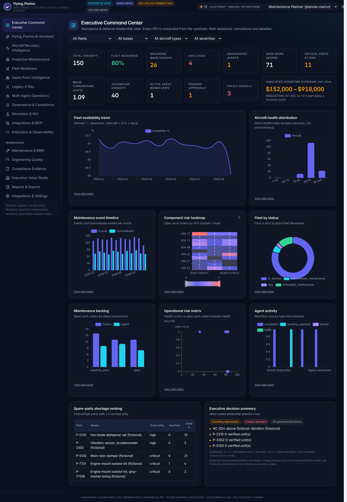
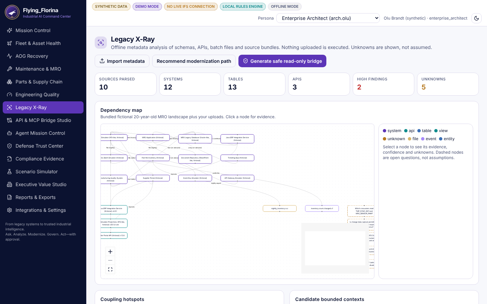
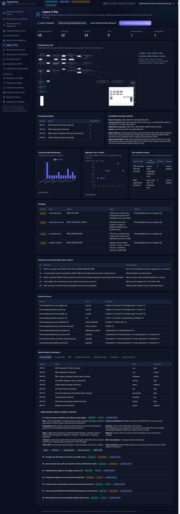
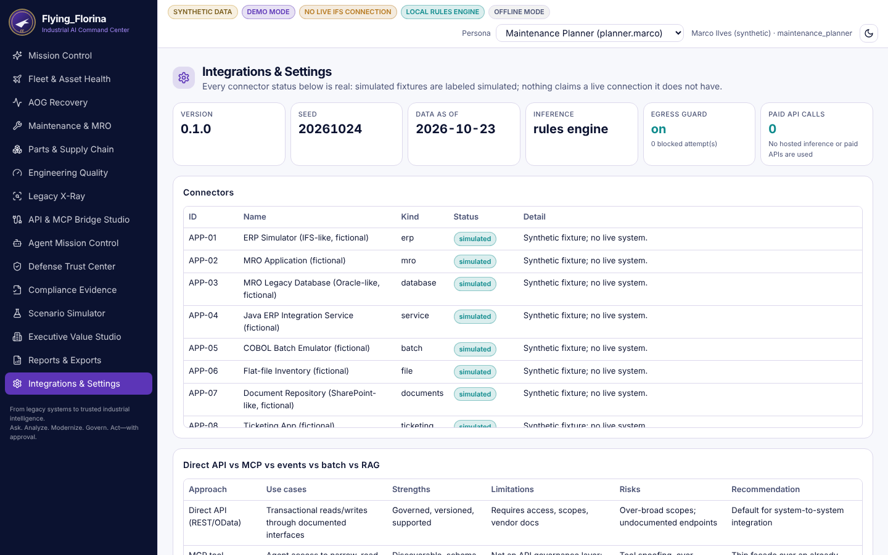
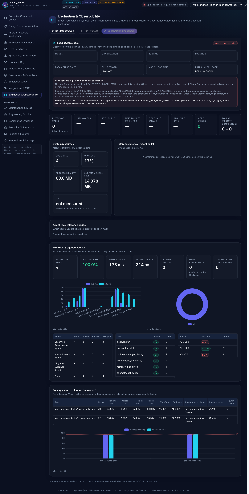

# Flying_Florina 2.0: what changed

Enhancement of the existing application (nothing rebuilt, no functionality removed, every pre-2.0 route still works).

## Highlights

1. **Local Qwen as the language engine.** A governed gateway discovers your existing Qwen (Ollama, llama.cpp server, LM Studio, or a
   `.gguf` such as the Copilot's `qwen2.5-1.5b-instruct-q4_k_m.gguf`), required by default, with no external fallback. See [QWEN_LOCAL_LLM.md](QWEN_LOCAL_LLM.md).
2. **Four-question engine.** Hybrid router (policy → greeting → follow-up → rules → semantic → Qwen → fallback), new specialist graphs
   for diagnostics, recovery and executive readiness, and **Qwen explanation → Evidence Challenger → Governance validation** after every
   workflow. See [FOUR_QUESTION_ENGINE.md](FOUR_QUESTION_ENGINE.md).
3. **Measured evaluation.** Dev, held-out v1 and fresh held-out v2 sets; harness and results in [eval/README.md](eval/README.md).
4. **Conversation Intelligence Copilot design system.** Same tokens, layout, cards, stat tiles, chart palette and motion; 12 primary
   sections; Local Qwen status pill.
5. **New pages.** Executive Command Center, Predictive Maintenance (labelled statistical scores + Qwen explanation), Evaluation &
   Observability (Qwen telemetry, live test, benchmark, workflow reliability, evaluation).
6. **Modernization Blueprint** export and modernization analytics in Legacy X-Ray.
7. **Readiness docs**: [DEPLOYMENT_READINESS.md](DEPLOYMENT_READINESS.md), [IFS_INTEGRATION_READINESS.md](IFS_INTEGRATION_READINESS.md).

## Before → after

| Before (1.0) | After (2.0) |
|---|---|
|  |  |
|  |  |
|  |  |
|  |  |

## Test and build results (build machine, 2026-10-31)

| Suite | Result |
|---|---|
| Backend pytest | **131 passed** (was 102; +gateway, four-question, insights tests) |
| Vitest | 9 passed |
| Playwright e2e | **18 passed** (was 13; +four cards, follow-up, command center, predictive, observability) |
| Lint / typecheck / build | clean |
| Offline check | 0 egress attempts |
| Four-question eval (no Qwen on build machine) | held-out v2: 95.8% routing, macro-F1 0.958 |

The build machine is a cloud container without your Qwen model, so the Qwen paths were tested with a **test-only** fake Ollama server
(`backend/tests/fake_ollama.py`) and the app correctly reported "required, not reachable" there. Real Qwen latency, tokens/s and the
unsupported-claim rate are measured when you run it on your machine.

## Known limitations

* Qwen inference, its benchmarks and the Qwen-routed share of the evaluation were not measured in this build environment.
* Four routing misses remain on held-out v2 (see eval README); follow-ups without a reference word can be missed.
* Predictive scores are deterministic statistics (z-scores); there is no trained model and no accuracy claim.
* Executive levers and ROI are assumption-driven models, not measured savings.
* Security limitations from 1.0 still apply (demo identity, process-level egress guard, tamper-evident audit).

## Roadmap

1. Measure Qwen on target hardware; tune `FF_QWEN_THREADS` / GPU layers; add token streaming to the UI.
2. Embeddings (local) for the semantic router and retrieval, under the same filter-before-rank rule.
3. A labelled outcome dataset so predictive models can be trained and evaluated honestly.
4. Enterprise IdP, container sandboxing, externally anchored audit.
5. With customer authorization: documented IFS projections behind the adapter layer.
