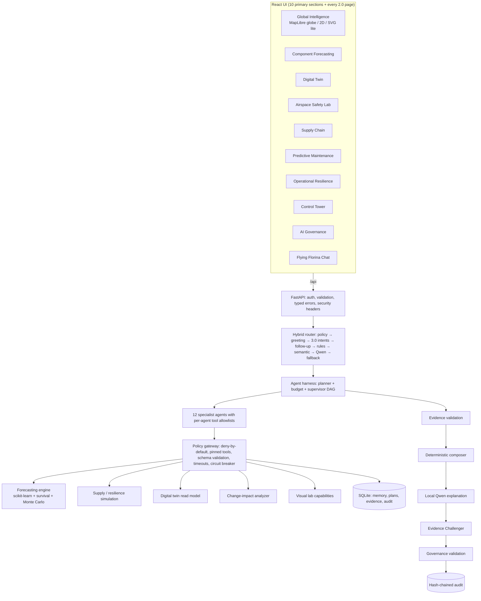

# Flying Florina 3.0 — architecture

**Global Aerospace Predictive Intelligence & Resilience Platform.** An enhancement of Flying_Florina 2.0: every 1.0/2.0 page,
API, workflow, policy and test is still present. The phase-0 inventory is in
[FLYING_FLORINA_3_ARCHITECTURE_AUDIT.md](FLYING_FLORINA_3_ARCHITECTURE_AUDIT.md).

> Independent concept demo, not affiliated with or endorsed by IFS. All operational data is synthetic and labelled as such.

## System view

## Request path (the governed harness)

USER REQUEST → **authentication** (signed demo token) → **intent classification** (hybrid router) → **policy engine** (precheck step)
→ **task planner** (template plan sized to the request + budget) → **supervisor** (DAG engine: waves, retries, timeouts, cancellation,
checkpoints) → **specialist agents** → **authorized tools** (policy gateway) → **evidence validation** → **human approval when required**
→ **response generation** (deterministic composer, then Qwen explanation checked by the Evidence Challenger) → **audit logging**.
Details: [AGENT_HARNESS.md](AGENT_HARNESS.md).

## Where each kind of work happens

| Work | Done by | Never done by |
|---|---|---|
| Structured retrieval | SQL over SQLite | the language model |
| Forecasts, intervals, RUL, risk, anomalies | scikit-learn, Weibull MLE, seeded Monte Carlo ([FORECASTING_ENGINE.md](FORECASTING_ENGINE.md)) | the language model |
| Supply-chain and resilience outcomes | deterministic simulation with stated assumptions | the language model |
| Map rendering | MapLibre GL / SVG with bundled Natural Earth outlines ([GLOBAL_MAP.md](GLOBAL_MAP.md)) | any tile or map API |
| Authorization, approvals, budgets | policy engine, harness, approval service | the language model |
| Explanations, ambiguous-intent classification | local Qwen ([QWEN_INTEGRATION.md](QWEN_INTEGRATION.md)) | any cloud API |

## Persistence (SQLite, versioned migrations)

Base schema (1.0/2.0) plus forward-only migrations recorded in `schema_migrations` (`app/core/migrations.py`):

| Migration | Tables |
|---|---|
| 1 | `forecast_runs` (model version, dataset, data hash, fit time, metrics) |
| 2 | `messages`, `messages_fts`, `conversation_summaries`, `user_preferences` |
| 3 | `saved_scenarios`, `evidence_refs`, `visual_analyses` (hash + result only, never pixels) |
| 4 | `harness_plans` (agents, tools, budget, usage, outcome per run) |

Entities required by the brief map as: users → `users`; conversations → `sessions` + `conversation_summaries`; messages → `messages`;
agent executions → `workflow_runs` + `workflow_events` + `harness_plans`; tool invocations → `tool_invocations`; forecast runs →
`forecast_runs`; simulation scenarios → `simulations` + `saved_scenarios`; component records → `g_units`, `g_unit_weeks`, `g_unit_events`;
inventory snapshots → `g_inventory`; evidence references → `evidence_refs`; approval requests → `approvals`; audit events →
`audit_events`; user preferences → `user_preferences`.

## Code map (new in 3.0)

| Path | Purpose |
|---|---|
| `backend/app/global_intel/dataset.py` | Seeded synthetic global dataset (12 facilities, 8 suppliers, 20 categories, 104 weeks) |
| `backend/app/global_intel/forecast.py` | Forecasting engine, evaluation, inventory simulation, result cache |
| `backend/app/global_intel/simulate.py` | Supplier-delay impact and resilience scenarios |
| `backend/app/harness/` | `core.py` (registry, budgets, planner steps, evidence validation), `workflows.py` (12 graphs + composers), `tools.py` (11 typed tools), `intents.py` (3.0 router stage + slots), `memory.py` |
| `backend/app/engineering/change_impact.py` | Static change-impact analysis of this repository |
| `backend/app/visual/lab.py` | Capability-honest visual analysis lab |
| `backend/app/api/routes_global.py`, `routes_harness.py` | 3.0 APIs |
| `frontend/src/features/global/`, `frontend/src/features/v3/` | 3.0 pages |
| `deploy/k8s/` | Kubernetes reference manifests |

## Deployment modes

A — local workstation, B — Docker Compose, C — Kubernetes reference. See [DEPLOYMENT.md](DEPLOYMENT.md). SQLite keeps the backend
single-writer (one replica); the PostgreSQL migration path is documented there.
