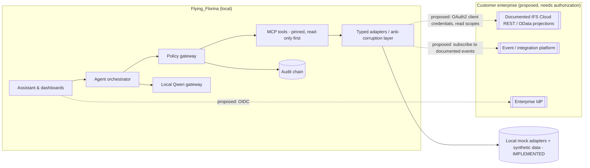

# IFS integration readiness (proposal)

Flying_Florina is designed as a possible **extension** to an existing IFS customer environment: an evidence-and-governance layer next to
IFS Cloud, not a replacement for IFS Cloud or IFS's Industrial AI capabilities. **No IFS system, private API, customer data or IFS source
code was accessed.** Every IFS-facing element below is a proposal that needs IFS access, documentation and validation.

| Capability | Implemented today | Proposed (requires IFS access and validation) |
|---|---|---|
| Maintenance / work orders | Synthetic work orders; approval-bound simulated write into the demo DB | Read via documented projections; writes only through IFS-approved APIs with customer approval workflows |
| Assets / aircraft | Synthetic fleet and telemetry | Asset/equipment projections as documented for the customer's version |
| Inventory | Reconciliation across simulated ERP, CSV and supplier portal | Inventory part in stock projections (names in the fixture are fictional placeholders) |
| Scheduling | Synthetic hangar slots and rosters | Customer scheduling interfaces |
| Governance | Policy engine, approvals, audit in Flying_Florina | Propagate audit references to customer systems |
| API contracts | Generated read-only adapter (OpenAPI) + MCP tool, tested against synthetic data | Contract tests against an IFS-provided sandbox |
| OData | Parser for OData-like metadata (fixture) | Use only where the customer's IFS version supports it |
| Events | Event schema fixture parsed | Event-driven sync via documented integration options |
| AuthN/AuthZ | Demo tokens; audience/scope checks in adapters | OAuth2/OIDC with least-privilege scopes, per-call authorization |
| Rate limits & errors | Gateway rate limit, timeouts, circuit breakers, typed errors | Respect documented IFS limits; idempotent retries only |
| Data sync | None (read-through) | Controlled, auditable synchronization |

No endpoint URL, projection name or capability in this document is presented as a real IFS API.
