# Flo & Jerry — Food Copilot 2.0

### Agentic AI for end-to-end food manufacturing, explained so anyone can follow it

> **Read this first.** This is a **portfolio prototype**, not a product, and **everything in it is made up on purpose**. The company (*Food Beverage Food Care*), its products, sales, warehouses and customers are all synthetic. Payments are fake ("mock"), and no real money, email or delivery is involved. A banner on every screen repeats this. A demo that pretends to be real data misleads people, so this one says plainly that it is not.

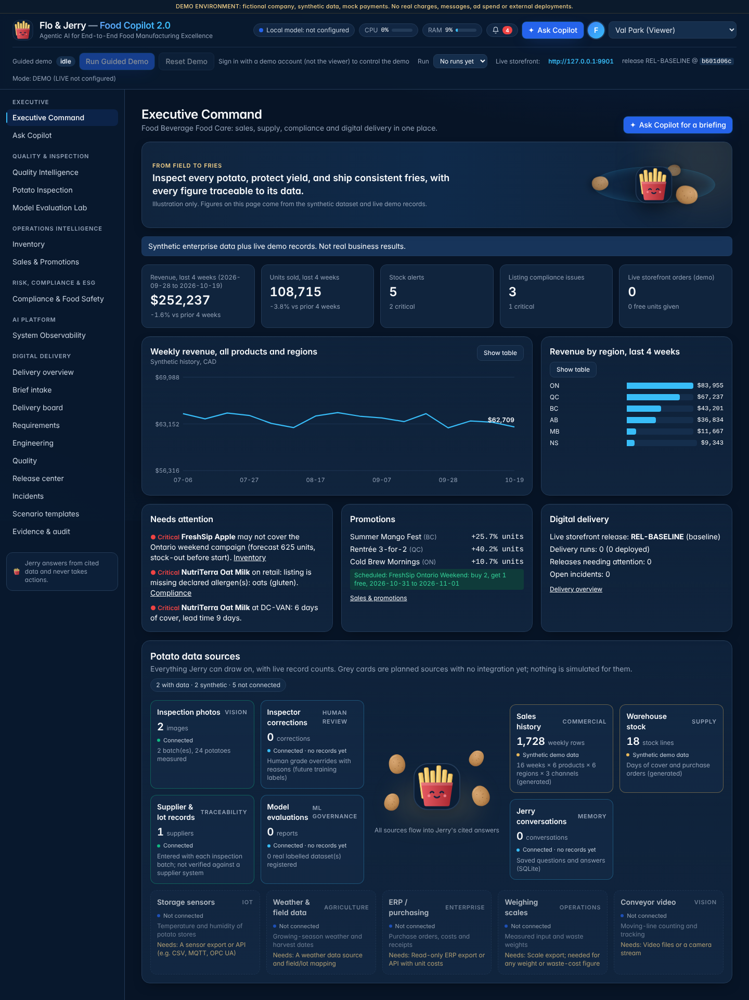

---

## Table of contents

1. [What is this, in one minute?](#1-what-is-this-in-one-minute)
2. [Words you will meet (plain-English glossary)](#2-words-you-will-meet-plain-english-glossary)
3. [A guided tour with pictures](#3-a-guided-tour-with-pictures)
4. [Run it on your own computer, step by step](#4-run-it-on-your-own-computer-step-by-step)
5. [Connect your own local Qwen model (optional)](#5-connect-your-own-local-qwen-model-optional)
6. [How Ask Copilot answers a question](#6-how-ask-copilot-answers-a-question)
7. [How potato inspection works, step by step](#7-how-potato-inspection-works-step-by-step)
8. [How the app remembers conversations (SQLite memory)](#8-how-the-app-remembers-conversations-sqlite-memory)
9. [The digital delivery workspace: three true stories](#9-the-digital-delivery-workspace-three-true-stories)
10. [How everything fits together (architecture)](#10-how-everything-fits-together-architecture)
11. [Measured results: real numbers, and what was not measured](#11-measured-results-real-numbers-and-what-was-not-measured)
12. [Why we did it this way, and why not the alternatives](#12-why-we-did-it-this-way-and-why-not-the-alternatives)
13. [Honesty rules this project follows](#13-honesty-rules-this-project-follows)
14. [Limits: what this is not](#14-limits-what-this-is-not)
15. [Learn by doing: exercises](#15-learn-by-doing-exercises)
16. [Where everything lives (repository map)](#16-where-everything-lives-repository-map)
17. [More documentation](#17-more-documentation)

---

## 1. What is this, in one minute?

Imagine a food company's control room. Managers want quick, **trustworthy** answers:

* "Do we have enough apple juice for this weekend's promotion?"
* "Did last month's discount make money, or only sell more bottles?"
* "Is any product label missing an allergen?"
* "In this photo of potatoes, which ones are bad, and why?"
* "Why did the website's checkout break yesterday?"

**Flo & Jerry** is a web application that answers questions like these. *Flo* is the product's persona and *Jerry* is its friendly robot mascot (the little blue robot in the top-left corner).

It is built on three ideas:

| Idea | What it means in practice | Why it matters |
|---|---|---|
| **Every number has a receipt** | Each figure in an answer is tagged like `[S1]`, pointing to the exact data it came from. | You can check the answer yourself instead of trusting a chatbot. |
| **It says "I don't know"** | Ask about the weather in Paris and it replies "I can't answer that". | A system that guesses confidently is dangerous in a business. |
| **It never acts on its own** | Ask it to "approve the release" and it refuses: it is read-only. | Important decisions stay with the right person. |

---

## 2. Words you will meet (plain-English glossary)

| Word | Plain meaning | Everyday comparison |
|---|---|---|
| **Copilot** | An assistant that helps you, while you stay in charge | A GPS that suggests routes; you still drive |
| **LLM (large language model)** | A program trained on lots of text that can write sentences | A very well-read autocomplete |
| **Qwen** | A family of LLMs you can run on your own computer | A writer who lives in your house instead of in the cloud |
| **Local model server** | A program on your computer (Ollama, LM Studio) that runs the LLM | The writer's desk |
| **Deterministic** | Same input → always the same output, by fixed rules | A calculator, not a poet |
| **Citation `[S1]`** | A label showing where a fact came from | A footnote in a book |
| **SQLite** | A small database stored in a single file | A very organised notebook |
| **Synthetic data** | Data that is invented on purpose for demos and tests | Plastic food in a shop window |
| **Segmentation** | Finding which pixels in a photo belong to an object | Tracing around each potato with a pen |
| **Heuristic** | A rule of thumb, not a proven measurement | "Dark spots are probably bad" |
| **Threshold** | A cut-off number used to decide | "Above 4% dark area means Not Good" |
| **Precision / recall / F1** | Scores for how well a detector finds things (explained in [section 11](#11-measured-results-real-numbers-and-what-was-not-measured)) | A fishing net's catch quality |
| **Agent** | A piece of software that does one job, step by step, and records what it did | A worker with a logbook |
| **Release / deploy / rollback** | Publishing a new version of the website / switching back to the old one | Swapping a shop sign / putting the old sign back |
| **API** | The doorway one program uses to ask another for data | A restaurant's order window |
| **CPU / RAM** | The computer's brain effort / its short-term memory | How hard the chef works / how big the counter is |

---

## 3. A guided tour with pictures

All screenshots are **real captures of the running app** taken by automated browser tests (Playwright). They use the synthetic data.

### 3.1 The frame around every page

At the top of every page:

* **Brand** "Flo & Jerry — Food Copilot 2.0" with the subtitle *Agentic AI for End-to-End Food Manufacturing Excellence*.
* **Local model pill:** whether your local Qwen is connected ("not configured" means the app is answering with its built-in rules only).
* **CPU and RAM pills:** **measured live** on the computer running the app, every 5 seconds. They are never typed-in numbers.
* **Bell:** notifications built from real alerts (low stock, missing allergens, an injected fault).
* **Ask Copilot** button, the **"F" avatar** (a placeholder for Flo's portrait until one is supplied; see [section 14](#14-limits-what-this-is-not)) and the **account picker**.

On the left, a grouped menu: *Executive*, *Quality & Inspection*, *Operations Intelligence*, *Risk, Compliance & ESG*, *AI Platform* and *Digital Delivery*.

The same page at laptop width (1280 pixels) wraps neatly:

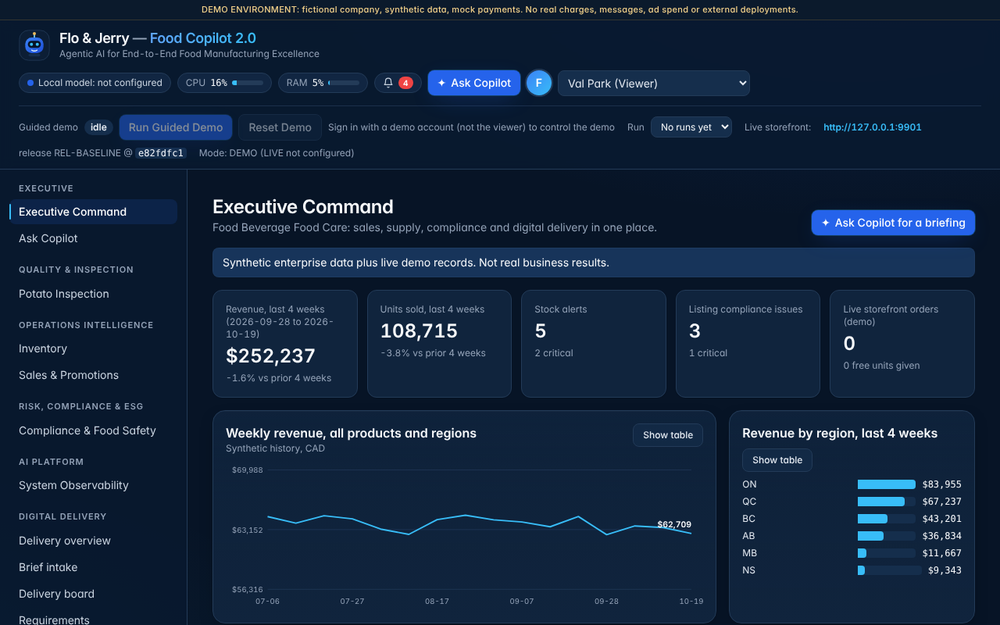

### 3.2 Executive Command (home)


What you see, from top to bottom:

1. **Five headline numbers:** revenue and units sold in the last 4 weeks (compared with the 4 weeks before), stock alerts, listing-compliance issues, and live demo-shop orders.
2. **Weekly revenue chart** (16 weeks) and **revenue by region**. Every chart has a **"Show table"** button, so the numbers can be read without the picture (this helps screen-reader users too).
3. **Needs attention:** for example, *FreshSip Apple may not cover the Ontario weekend campaign*.
4. **Promotions** and **Digital delivery** status.

### 3.3 Ask Copilot

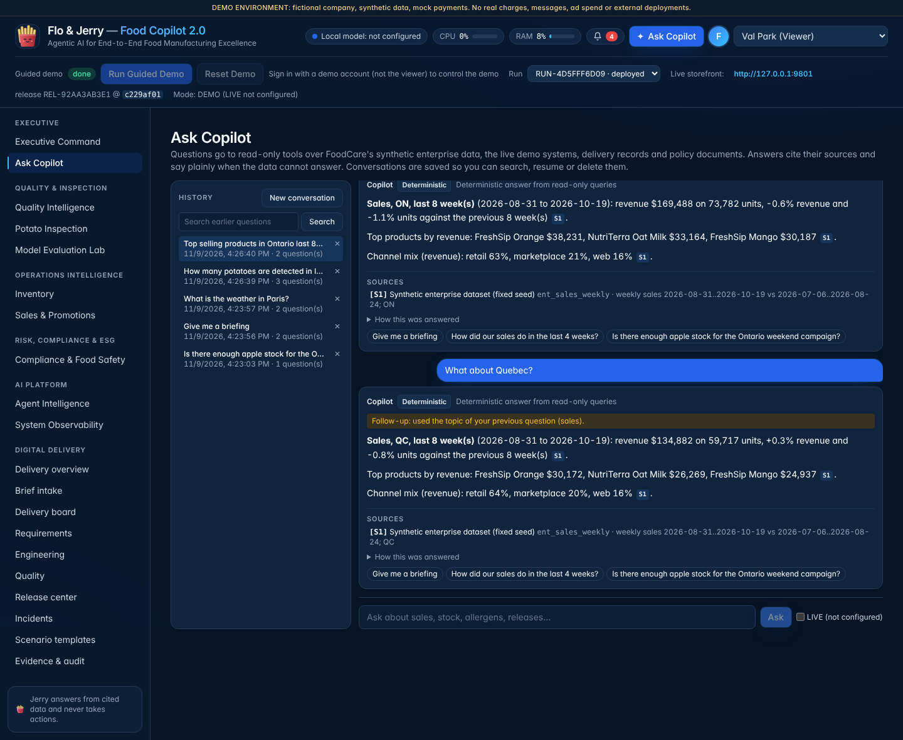

* **Left panel, History:** every conversation is saved. You can **search** earlier questions, **resume** a conversation, or **delete** it.
* **Follow-up questions:** "Top selling products in Ontario last 8 weeks" and then just "What about Quebec?" works. The yellow note says the copilot reused the topic of your previous question.
* **Sources box** under each answer lists `[S1]`, `[S2]`… with the exact table or document used.
* **"How this was answered"** opens the list of tools the copilot ran (for example `sales_summary(window=8, province=QC)`).

The drawer version opens from any page:

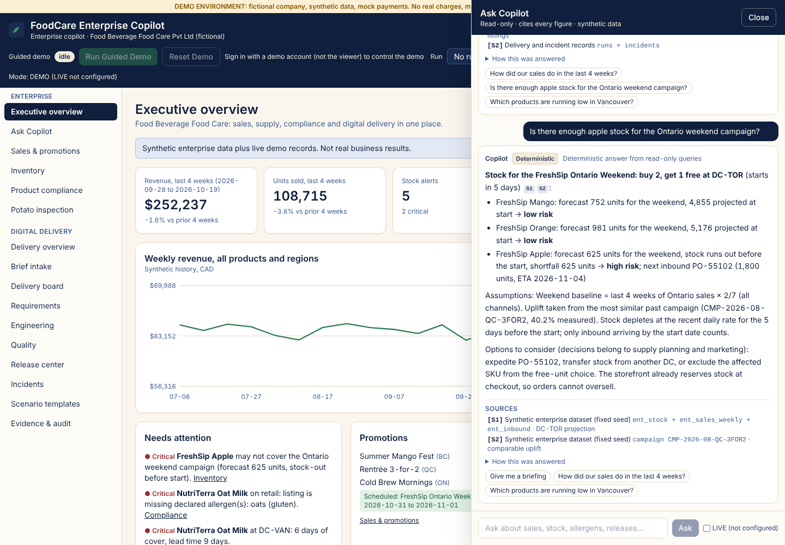

### 3.4 Potato Inspection studio

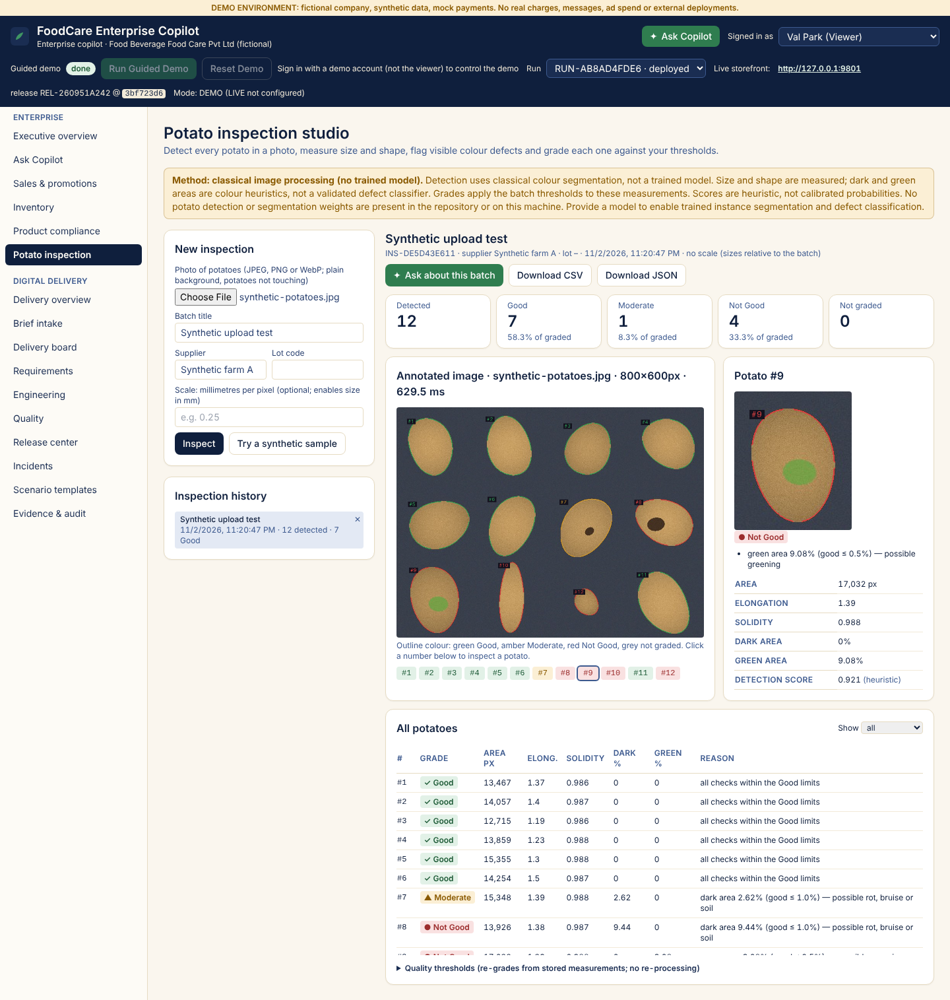

1. **Upload a photo** (JPEG, PNG or WebP), or click **"Try a synthetic sample"** (a drawn picture with known answers, labelled as not a photo).
2. The app finds **every potato**, numbers it (#1, #2, …) and outlines it in **green (Good)**, **amber (Moderate)**, **red (Not Good)** or **grey (not graded)**.
3. The five **summary tiles** count how many were detected and graded.
4. Click a number to see **one potato close up**, with the exact **reasons** for its grade and its measurements.
5. **Download CSV / JSON** reports. **Quality thresholds** can be changed, and the whole batch re-grades instantly.
6. The orange box at the top states the method honestly: *classical image processing, not a trained AI model*. [Section 7](#7-how-potato-inspection-works-step-by-step) explains what that means.

### 3.5 Asking about the inspection

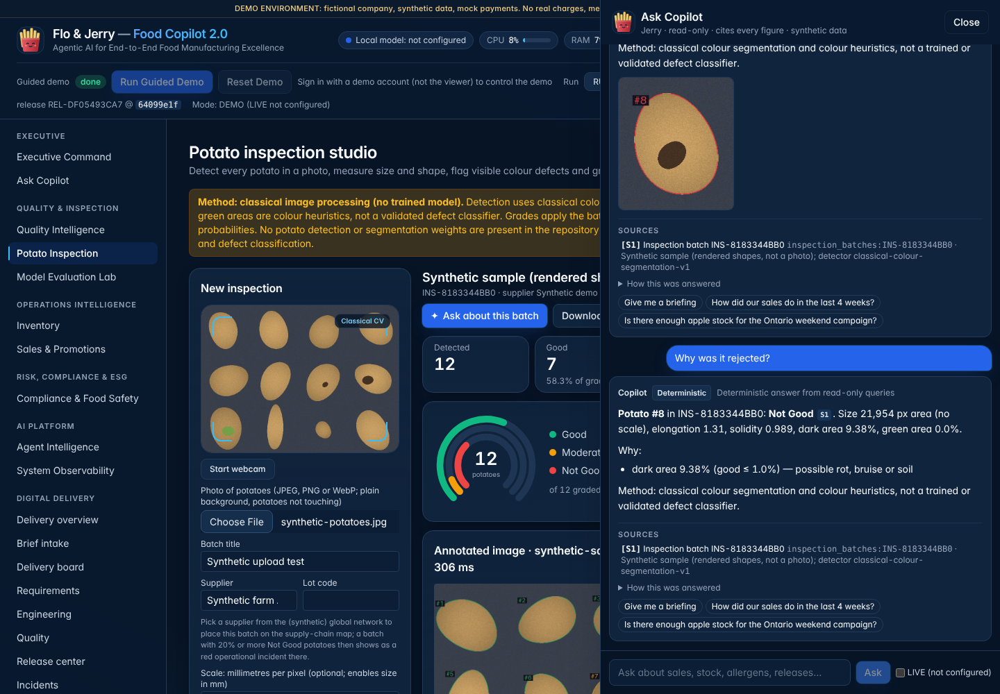

"Show me potato #8" returns its close-up. Then "Why was it rejected?" works because the copilot remembers that "it" means potato #8. Every answer ends with the method disclaimer.

### 3.6 Sales, inventory, compliance

| Sales & promotions | Inventory | Compliance & food safety |
|---|---|---|
| 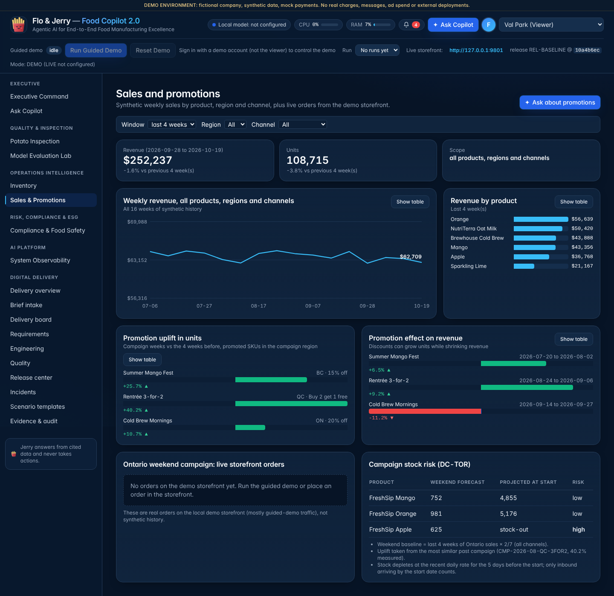 | 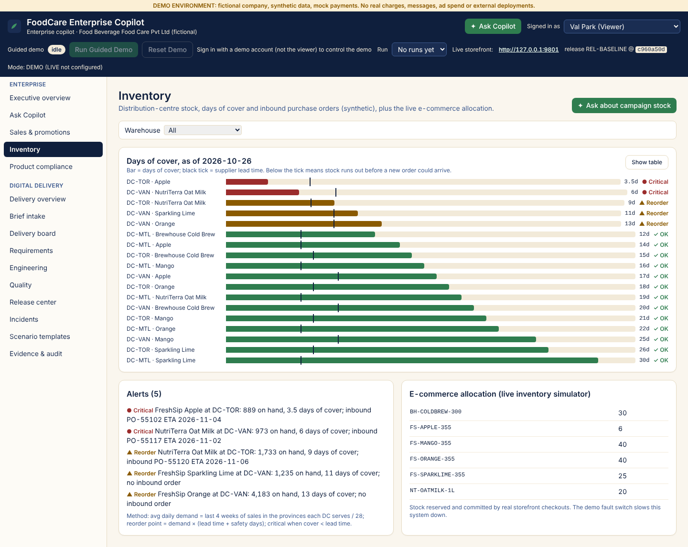 | 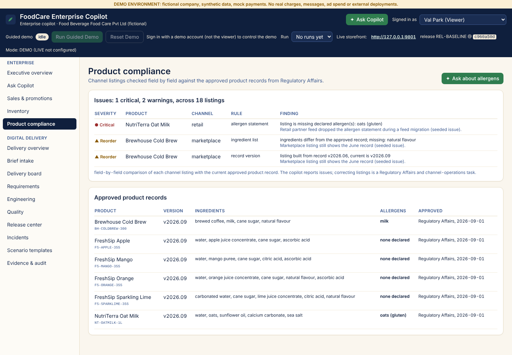 |
| Promotion **uplift is measured** from sales before and after. One discount sold 10.7% more units but **lost 11.2% revenue**. | **Days of cover** (how long stock lasts) against the supplier's **lead time** (how long a reorder takes). | Every shop listing is compared, field by field, with the approved recipe. A retail feed is **missing "oats (gluten)"**. |

### 3.7 System Observability

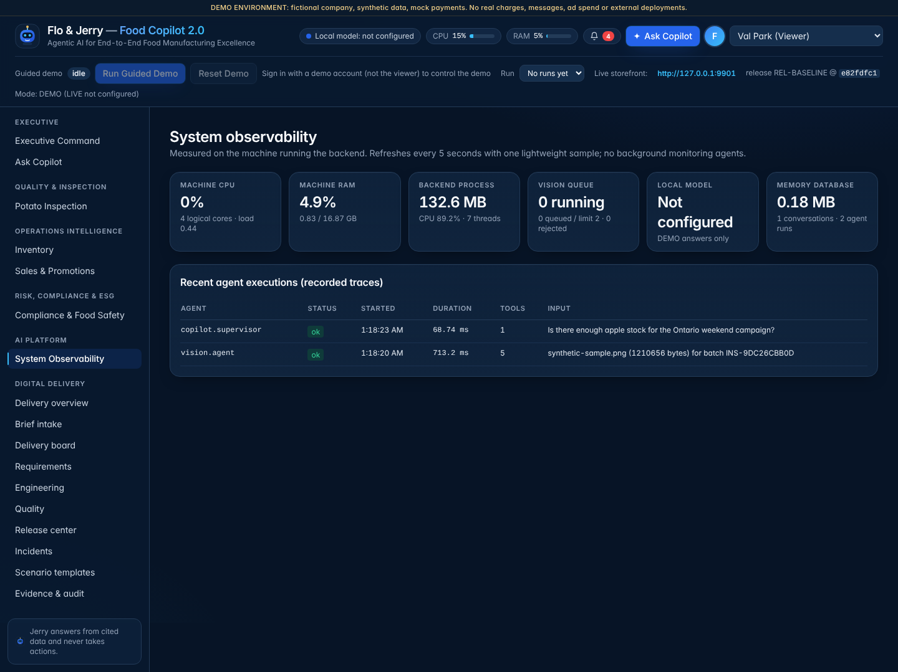

This page shows only **measured** information: machine CPU and RAM, the app's own memory use, the image-inspection queue, the local-model queue, the size of the memory database, and a list of **recent agent runs**. Click a run to see each step and how many milliseconds it took.

### 3.8 Digital delivery workspace

| Clarify the brief | Tests catch a bug | Incident evidence |
|---|---|---|
| 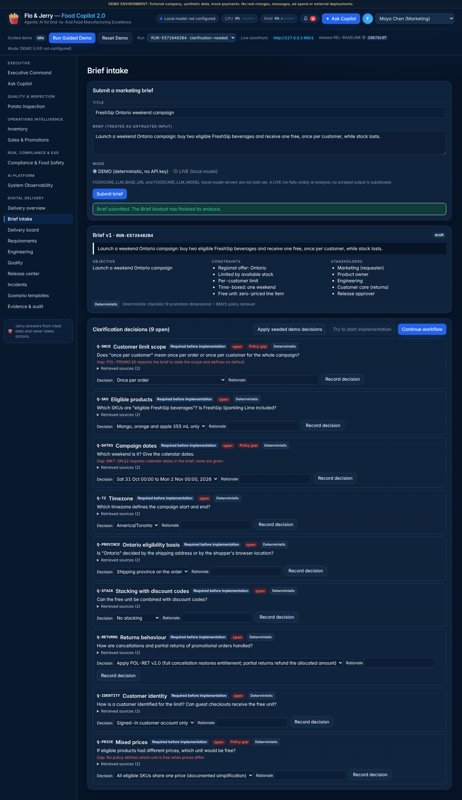 | 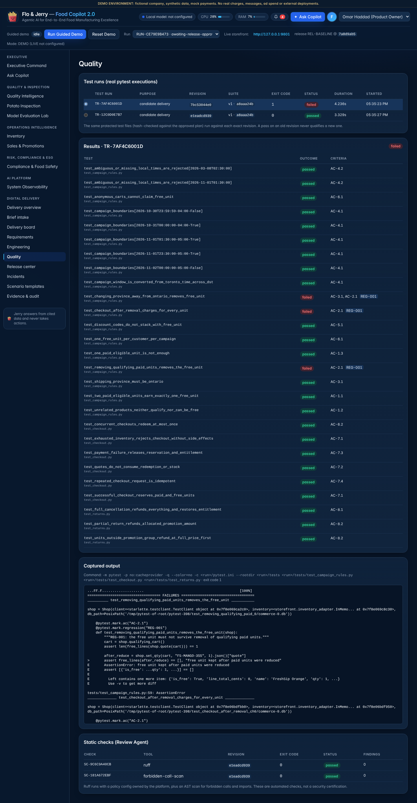 | 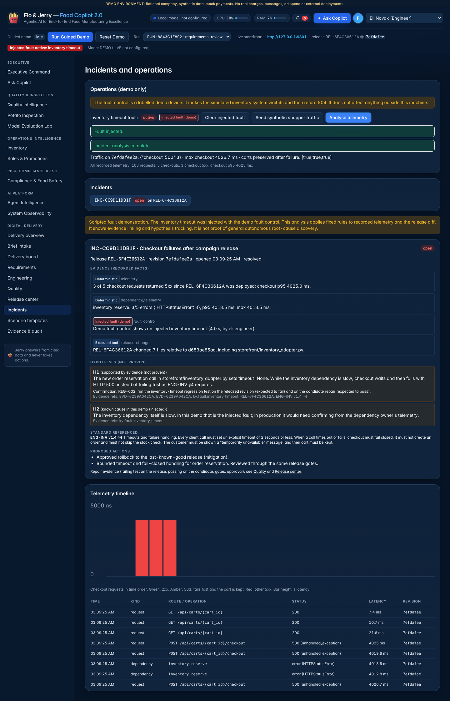 |

[Section 9](#9-the-digital-delivery-workspace-three-true-stories) tells these three stories in detail.

---

## 4. Run it on your own computer, step by step

### 4.1 What you need (and why)

| Tool | Why it is needed | How to check |
|---|---|---|
| **git** | Every version of the demo shop is stored as a git commit | `git --version` |
| **Python 3.11+** | The server is written in Python | `python3 --version` |
| **uv** | Installs the exact Python package versions listed in `uv.lock` | `uv --version` |
| **Node.js 20+ and npm** | Builds the web interface | `node --version` |

**Mac users:** git comes with Apple's *Command Line Tools*. If `git --version` shows a pop-up, or "xcrun: error", run `xcode-select --install`, accept, wait for it to finish, then try again. *Why:* without git, the app cannot create the demo shop's history, and start-up stops with a clear message.

### 4.2 Start

```bash
git clone https://github.com/florina787/Data-sets.git
cd Data-sets
git checkout claude/new-session-pahp8j
cd foodcare-copilot
scripts/start.sh
```

The first start installs the pinned packages and builds the interface (a few minutes). After that:

* **App:** <http://127.0.0.1:8700>
* **Demo shop (FreshSip storefront):** <http://127.0.0.1:8801>

If a port is busy because an older copy is still running: `lsof -t -i :8700 -i :8801 | xargs kill`.

### 4.3 Or let GitHub Copilot in VS Code run it

Open the `foodcare-copilot` folder in VS Code, switch Copilot Chat to **Agent** mode and paste the prompt from [docs/RUN_WITH_GITHUB_COPILOT.md](docs/RUN_WITH_GITHUB_COPILOT.md). Copilot automatically reads `.github/copilot-instructions.md`, which tells it the commands and the rules: no model downloads, no second model server, no pushing. You can also use **Terminal → Run Task…** and choose a "Flo & Jerry" task.

### 4.4 Sign in

Pick a demo account in the top-right picker. They are local test accounts, not real logins:

| Account | Role | Allowed to | Why the limits exist |
|---|---|---|---|
| `val.viewer` | Viewer | Look, ask, inspect images | Read-only access is the safe default |
| `maya.marketing` | Marketing | Submit briefs, answer clarification questions | Marketing owns the business rules |
| `omar.product` | Product owner | Approve requirements | Freezes the test plan |
| `eli.engineer` | Engineer | Run checks, inject demo faults | Engineers build and test |
| `rina.release` | Release approver | Approve, deploy, roll back | The person who ships should not be the person who built it |

The server checks permissions on **every action**, not just in the screen. A rejected attempt (for example, the engineer approving a release) gets an HTTP 403 error and is written to the audit log.

### 4.5 Useful commands

```bash
scripts/reset_demo.sh     # back to a clean demo (your saved conversations and inspections are kept)
scripts/test.sh           # code checks, 84 backend tests, interface build
npm run e2e               # 5 browser tests that click through the app
.venv/bin/python scripts/eval_vision.py --synthetic 20   # measure the potato detector on drawn test images
```

---

## 5. Connect your own local Qwen model (optional)

**The app works fully without any AI model.** Answers are then written by fixed rules ("deterministic"). If you want natural-language answers, you can connect a model that **already runs on your computer**.

### 5.1 How it connects

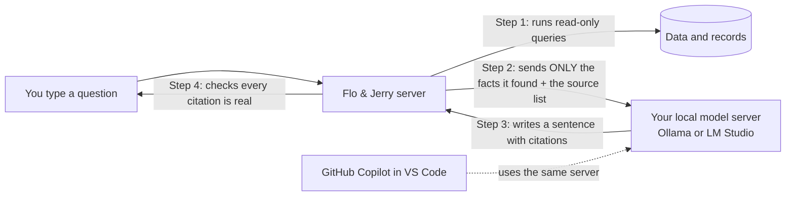

* FoodCare **does not download or start any model**. It talks to the server you already run.
* If GitHub Copilot in VS Code uses Qwen through Ollama, both programs share **the same model instance**. Nothing is loaded twice.
* **GitHub Copilot itself has no API that other apps can call.** That is why the app connects to Ollama or LM Studio directly.

### 5.2 Steps

1. Find your model name. With Ollama, run `ollama list` (for example `qwen2.5:7b-instruct`).
2. Start the app with two settings:

```bash
FOODCARE_LLM_BASE_URL=http://127.0.0.1:11434/v1 \
FOODCARE_LLM_MODEL=qwen2.5:7b-instruct \
scripts/start.sh
```

LM Studio's address is usually `http://127.0.0.1:1234/v1`.

3. In Ask Copilot, tick **LIVE**. Answers written by the model say *"Written by the local model from the cited data"*.

### 5.3 Built-in protections (and why)

| Protection | Default | Why |
|---|---|---|
| One request to the model at a time | `FOODCARE_LLM_CONCURRENCY=1` | A local model uses most of your CPU or GPU; two at once makes both slow |
| At most 4 waiting; then a polite "busy" | `FOODCARE_LLM_QUEUE_SIZE=4` | Better to say "busy" than to freeze |
| Time limit per answer | 60 s | A stuck model must not hang the app |
| **Stop** button | — | Closes the connection so the model stops generating |
| Prompt size cap | 6,000 characters | Keeps answers fast. The app **never changes your model's context size** |
| Only the last 3 exchanges are sent | `FOODCARE_MEMORY_CONTEXT_TURNS=3` | Sending the whole history would be slow and costly |
| Cache of identical prompts | 64 entries | Asking the same thing twice costs nothing |
| Citation check | always | An answer with missing or invented `[S#]` labels is thrown away and the rule-based answer is shown instead, with a notice |

The full settings list is in [docs/LOCAL_LLM_AND_MEMORY.md](docs/LOCAL_LLM_AND_MEMORY.md).

---

## 6. How Ask Copilot answers a question

### 6.1 The journey of one question

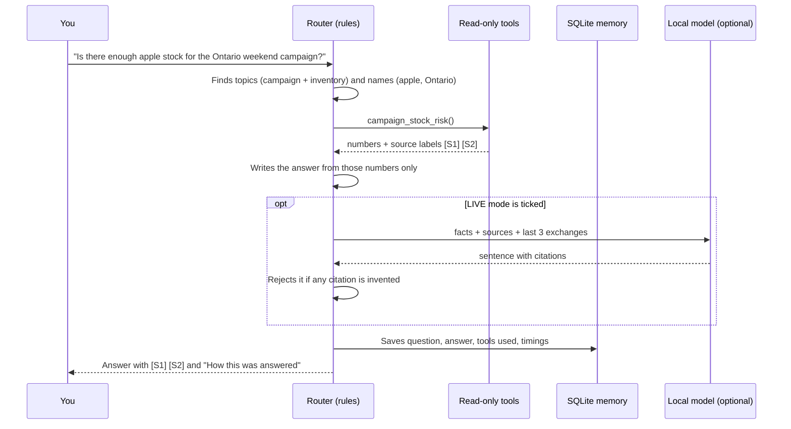

### 6.2 A real answer, unedited

> **Stock for the FreshSip Ontario Weekend: buy 2, get 1 free at DC-TOR** (starts in 5 days) [S1][S2]
> * FreshSip Mango: forecast 752 units for the weekend, 4,855 projected at start → **low risk**
> * FreshSip Orange: forecast 981 units, 5,176 projected at start → **low risk**
> * FreshSip Apple: forecast 625 units, stock runs out before the start, shortfall 625 units → **high risk**; next inbound PO-55102 (1,800 units, ETA 2026-11-04)
>
> Assumptions: weekend baseline = last 4 weeks of Ontario sales × 2/7; uplift taken from the most similar past campaign (40.2%, measured)…

Notice three things: it **shows its assumptions**, it **offers options but leaves the decision to people**, and the 40.2% is **measured from sales history**, not typed in.

### 6.3 What it can talk about

| Topic | Example question |
|---|---|
| Sales | "How did our sales do in the last 4 weeks?" |
| Promotions | "How did past promotions perform?" |
| Stock | "Which products are running low in Vancouver?" |
| Campaign risk | "Is there enough apple stock for the Ontario weekend campaign?" |
| Compliance | "Which listings have allergen issues?" |
| Potato inspection | "Which potatoes failed inspection?", "Show me potato #12", "Why was it rejected?", "Compare this batch with the previous batch", "Which supplier provided these potatoes?" |
| Software delivery | "Why is the release blocked?" |
| Incidents | "What happened in the checkout incident?" |
| Policies | "What does the returns policy say about partial returns?" |

### 6.4 What it refuses, and why

| You ask | It answers | Why |
|---|---|---|
| "What is the weather in Paris?" | "I can't answer that from FoodCare's data… I won't guess." | No data, so no answer. Guessing would look just as confident as a real answer. |
| "Approve the release" | "I'm read-only, so I can't do that." | A chat box is not a safe place to give orders. Approvals happen in the workflow screens, by the right role. |
| "What is the financial impact of this potato batch?" | "Not calculated from inspections yet…" | Money figures need real cost inputs and formulas. An AI must not invent them. |

---

## 7. How potato inspection works, step by step

### 7.1 The pipeline, like a recipe

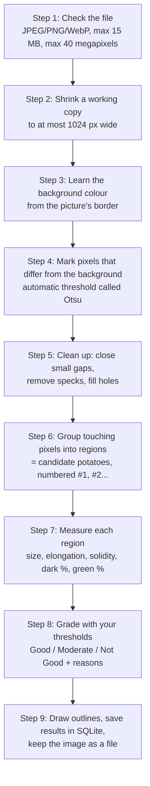

Each step is timed and stored, so the System Observability page can show exactly where the time went.

### 7.2 What each measurement means

| Measurement | Plain meaning | Why it matters |
|---|---|---|
| **Area / length × width** | How big it is. In pixels, or in millimetres if you give the scale (mm per pixel) | Processors buy potatoes in size ranges |
| **Elongation** | Long side ÷ short side. 1.0 = round, 3.0 = very long | Odd shapes waste material when peeled or cut |
| **Solidity** | How "filled in" the outline is (1.0 = perfectly smooth and convex) | Knobs and cracks lower it |
| **Dark area %** | Share of the potato's surface much darker than its own average | *Possible* rot, bruise or soil |
| **Green area %** | Share of greenish pixels | *Possible* greening, which can indicate solanine, a natural toxin |
| **Detection score** | A rough 0–1 confidence based on contrast and shape | **Heuristic**, not a calibrated probability |

### 7.3 Default grading thresholds (you can change them)

| Check | Good if | Moderate if | Otherwise |
|---|---|---|---|
| Length (with a scale) | 45–110 mm | within 15% of that range | Not Good |
| Size vs batch median (no scale) | ≥ 60% | ≥ 40% | Not Good |
| Elongation | ≤ 1.9 | ≤ 2.4 | Not Good |
| Solidity | ≥ 0.93 | ≥ 0.86 | Not Good |
| Dark area | ≤ 1% | ≤ 4% | Not Good |
| Green area | ≤ 0.5% | ≤ 3% | Not Good |

**The rule:** a potato gets the **worst** grade of all its checks, and the answer lists the checks responsible. These defaults are demonstration values, **not an industry standard**, so set your own.

Potatoes **cut off by the photo's edge** and regions that **look like two touching potatoes** are **not graded**. Grading half a potato, or two potatoes as one, would produce wrong answers.

### 7.4 Why "classical image processing" and not AI? (the honest answer)

* **Fact:** there is no potato detection or defect model anywhere in this repository or on the build machine. The two computer-vision notebooks in the repository root are a generic ImageNet classifier and an OCR (text reading) example.
* **Fact:** you asked not to download model weights without approval, and that rule was followed.
* **So:** detection uses classical colour segmentation, a method with no training at all. It is **real and measurable for size and shape**, but its dark and green "defects" are **rules of thumb**. A dark patch can be rot, a bruise, soil or a shadow, and the app cannot tell which.
* **Therefore** the app never calls it "AI defect detection". Every screen, report and copilot answer says *"not a trained or validated defect classifier"*.
* **Upgrade path:** the code has a `Detector` interface. A trained instance-segmentation model can be plugged in later without changing the rest of the app.

### 7.5 What it handles well, and what it doesn't

| Works | Does not work (yet) |
|---|---|
| Potatoes on a plain, contrasting background | Busy backgrounds, conveyor belts, strong shadows |
| Separated potatoes | Touching or piled potatoes (flagged, not split) |
| Size and shape | Telling rot from soil from bruise |
| Photos | Video tracking and counting (planned) |

---

## 8. How the app remembers conversations (SQLite memory)

### 8.1 What is stored, and where

Everything lives in one file, `var/memory/memory.db`. It **survives restarts and "Reset Demo"**.

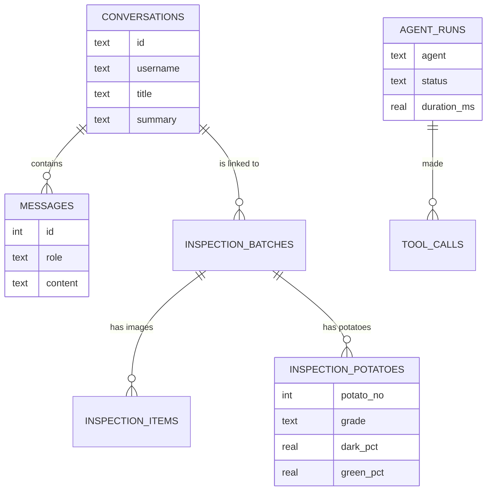

* **Pictures are not stored inside the database.** Only a *file reference* and a checksum are, and the image itself sits next to it as a normal file. *Why:* databases get slow and fragile when stuffed with large files.
* **Privacy:** you only ever see, search, resume or delete **your own** conversations and inspections. Another user's ID returns "not found".

### 8.2 How it stays fast and safe

| Feature | What it does | Why |
|---|---|---|
| **Full-text search (FTS5)** | Finds old questions in about 5 ms | Searching every message one by one would grow slower over time |
| **Bounded context** | Only the last 3 exchanges + a short summary of older questions go to the model | Fast answers, and less risk of old, irrelevant text confusing the model |
| **Rolling summary** | After 20 messages, older *questions* are summarised by a plain rule, with no AI involved | No hidden AI cost in the background |
| **Retention** | Conversations untouched for 180 days are deleted | Keeps the file small and respects privacy |
| **Backups** | Daily copy, the newest 5 kept | Protection against mistakes |
| **Self-repair** | If the file is damaged at start-up, it is set aside and the newest healthy backup is restored | One corrupted file should not lose all history |
| **Versioned migrations** | Database changes are numbered and fingerprinted | An accidentally edited change is detected, not silently applied |

---

## 9. The digital delivery workspace: three true stories

The original part of this project manages software changes to a demo online shop called **FreshSip**. It uses **real tools**: git, Python tests (pytest), code checks (ruff), and real web-server processes.

Marketing asks: *"Launch a weekend Ontario campaign: buy two eligible FreshSip beverages and receive one free, once per customer, while stock lasts."*

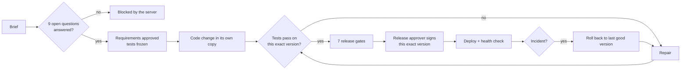

**Story A: ask before building.** The one-sentence brief hides nine questions. For example: *once per order or once per campaign?* Which time zone is "the weekend"? The company policy has no answer for some of them, and those are shown as **policy gaps**. The server **refuses to start** until each question has a recorded decision. *Why:* building on a guess is how expensive mistakes start.

**Story B: tests catch a free-juice bug.** The first code version lets a customer keep the free drink after removing a paid one. A real test fails (exit code 1). The fix makes the **same, locked tests** pass. Tests are locked when requirements are approved, so nobody can "fix" a failure by editing the test.

**Story C: a broken checkout.** A labelled demo fault slows the inventory service. The new code had **no time limit** (`timeout=None`), so checkouts hang and fail. The incident page separates **evidence** (measured facts) from **hypotheses** (likely explanations, marked "not proven"). The team rolls back, repairs, re-tests and re-deploys. The app says openly that the fault was injected and the analysis follows fixed rules. It does **not** claim an AI found the cause.

The detailed walk-through is in [docs/SCENARIO_GUIDE.md](docs/SCENARIO_GUIDE.md).

---

## 10. How everything fits together (architecture)

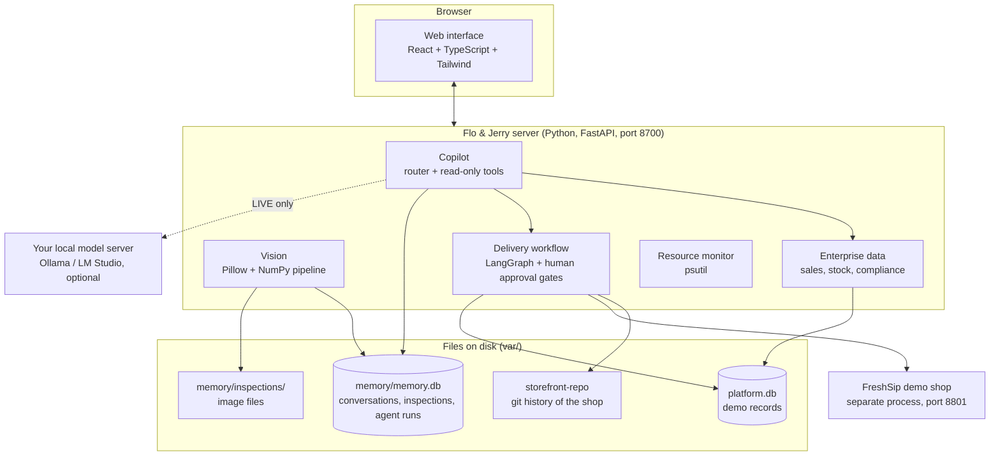

| Part | Technology | Why this one |
|---|---|---|
| Web interface | React, TypeScript, Vite, Tailwind | Widely used, fast to build, and type checking catches mistakes early |
| Server | Python + FastAPI | Simple, quick, and good for data and AI work |
| Workflow with human approvals | LangGraph | It can **pause** a workflow until a person decides, and resume later |
| Databases | SQLite | One file, no server to install. Right-sized for one machine (see [section 12](#12-why-we-did-it-this-way-and-why-not-the-alternatives)) |
| Image maths | Pillow + NumPy | Small and standard. **No model weights** |
| CPU and RAM | psutil | Works on Mac, Linux and Windows. Macs have no `/proc` file system to read these from |
| Charts | Hand-made SVG | No heavy chart library. Every chart has a table view and tooltips |

---

## 11. Measured results: real numbers, and what was not measured

All numbers below were **measured**, on 2026-11-02 and 2026-11-03, in a cloud container with 4 CPU cores, using the synthetic data. Your computer will give different numbers.

### 11.1 Speed

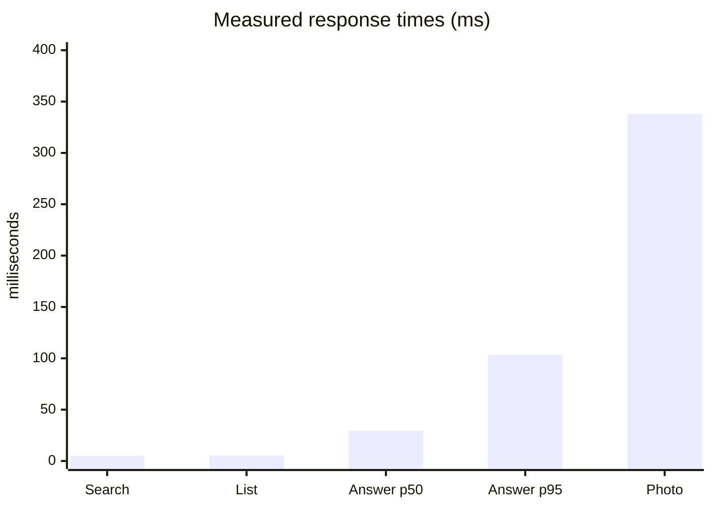

Bars, left to right: history search (p50), conversation list (p50), copilot answer (p50 and p95), and inspecting one 960 × 720 photo (average). *p50* means half of the requests were faster than this; *p95* means 95 out of 100 were faster.

| Measurement | Result |
|---|---|
| App memory (RAM) when idle | 98 MB (81 MB before the image libraries were added) |
| App memory after 60 answers and 60 searches | 99 MB, so it did not grow |
| Copilot answer (rule-based, no model) | p50 29.5 ms, p95 103.5 ms |
| History search | p50 5.1 ms |
| Inspecting one 960 × 720 image | about 340 ms on average |
| Restart time | 1.8 s |
| Conversations kept after a restart | 30 of 30 |

### 11.2 Potato detector accuracy, on **drawn** test images only

Twenty synthetic images, 240 drawn potatoes with known answers:

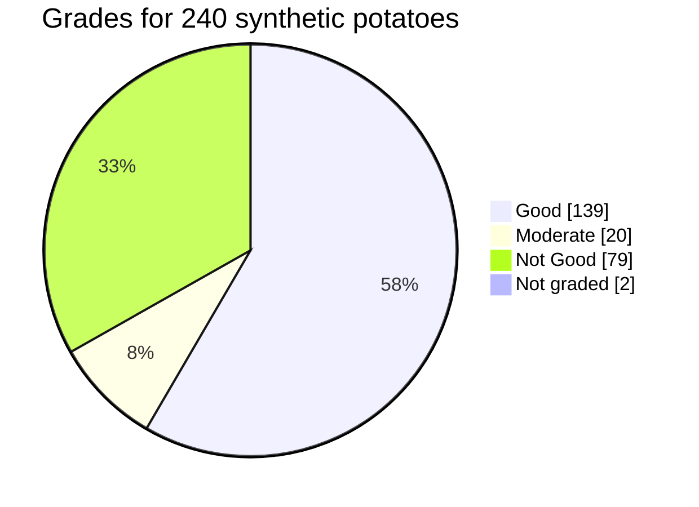

| Score | Result | Plain meaning |
|---|---|---|
| **Precision** | 1.0 | Of everything it called a potato, 100% were potatoes |
| **Recall** | 1.0 | Of all potatoes drawn, it found 100% |
| **F1** | 1.0 | A single score combining the two |
| **Grade agreement** | 99.2% (238 of 240) | The two misses were left "not graded" instead of being given the expected grade |

**Why these numbers do NOT prove real-world accuracy:** the test images are smooth drawn ovals on a plain background, which is easy on purpose. Real potatoes have soil, shadows, odd shapes, and they touch each other. **Accuracy on real photos has not been measured.** To measure it, label some real photos and run `scripts/eval_vision.py --dataset your_folder`. The script's header explains the label format.

### 11.3 Tests

| Test suite | Count | Result |
|---|---|---|
| Backend (Python) | 84 | all pass |
| Browser, clicking through the real app | 5 | all pass |
| Of which use a **mock** model server instead of real Qwen | 14 | pass (no real Qwen run in the cloud) |

---

## 12. Why we did it this way, and why not the alternatives

| Decision | ✅ Why we chose it | ❌ Why not the alternative |
|---|---|---|
| **Rules first, AI second** | Rule-based answers are instant, free, repeatable and testable | An AI-only copilot can invent numbers that look exactly as convincing as real ones |
| **Citations on every number** | Anyone can verify an answer | "Trust me" answers don't survive an audit |
| **Read-only copilot** | No accidental approvals or deletions from a chat box | Chat commands are ambiguous ("approve it": approve what?) |
| **Reuse your local Qwen** | No extra downloads, no second model eating your RAM, data stays on your machine | A cloud AI API sends company data off-site and costs money per question |
| **No new model downloaded** | You asked for approval first; weights can be gigabytes | Silent downloads surprise users and fill disks |
| **Classical vision for now** | Works today with no training data; size and shape are real measurements | Calling colour rules "AI defect detection" would be false |
| **SQLite** | One file, no setup, very fast on one machine | PostgreSQL is better for many servers at once; the code has an interface ready for it. **Never share one SQLite file across several Kubernetes copies**, because it can corrupt |
| **Images stored as files, not in the database** | Database stays small and fast | Large blobs make backups and queries slow |
| **One image and one model request at a time** | Protects your laptop's CPU and RAM | Running many at once makes everything slow and can crash a small machine |
| **"Busy" instead of waiting forever** | You get a clear answer immediately | Endless spinners hide problems |
| **Measured CPU/RAM only** | Numbers you can trust | Hard-coded "healthy" dashboards are decoration, not monitoring |
| **psutil added** | Works on Mac, where `/proc` doesn't exist | Reading `/proc` would only work on Linux |
| **No multipart upload library** | Images are sent as the raw request body, so no extra dependency | An extra package for one feature adds maintenance |
| **Navy design via shared colour tokens** | Every page restyled consistently without rewriting screens | Hand-editing hundreds of classes is error-prone |
| **Synthetic data everywhere** | Safe to share publicly | Real company data in a demo is a privacy and legal risk |

---

## 13. Honesty rules this project follows

Every item the app shows carries one of these labels:

| Label | Meaning |
|---|---|
| **Executed tool result** | A real command ran and its result was captured |
| **Deterministic calculation** | Fixed rules applied to recorded data |
| **Fixture / Selected demo decision** | Pre-written demo content, labelled as such |
| **Live AI output** | Written by the local model (LIVE mode only) |
| **Injected fault (demo)** | A failure caused on purpose to show incident handling |

And these rules are never broken:

1. **Never fabricate** money figures, savings or accuracy.
2. **Never present** colour heuristics as a trained AI model.
3. **Never substitute** scripted text and call it AI. If LIVE mode fails, the screen says so.
4. **Never act** from the chat box.
5. **Say what was not measured** (see [section 11](#11-measured-results-real-numbers-and-what-was-not-measured)).

---

## 14. Limits: what this is not

* **Not production software.** Real use would need company single sign-on, a managed database, monitored deployments and security reviews. See [docs/PRODUCTION_GAPS.md](docs/PRODUCTION_GAPS.md).
* **Not a validated potato grader.** It is a working pipeline whose defect rules have never been checked against real potatoes.
* **Not connected to real systems** (ERP, SAP, factory machines). All data is synthetic.
* **Not tested against a real Qwen model.** The cloud environment where it was built has no model. The connection is tested with a mock server, and you should try it on your own machine.
* **Flo's portrait** has not been supplied yet. The avatar shows an "F" placeholder. To use a portrait, save it as `apps/control-room/public/flo-portrait.jpg` and rebuild. No other image is substituted.
* **Not built yet (planned):** the AI Savings Intelligence dashboard (with transparent, formula-based simulations), manufacturing, supplier, agriculture, supply-chain and sustainability modules, the Architecture Intelligence Studio, the full agent harness with an agent graph, and video inspection.

---

## 15. Learn by doing: exercises

Each exercise teaches one idea. Try them in order.

| # | Do this | What you will learn |
|---|---|---|
| 1 | Ask "What is the weather in Paris?" | Why a trustworthy assistant refuses to guess |
| 2 | Ask "How did our sales do in the last 4 weeks?", then open **How this was answered** | Every answer comes from named tools with named inputs |
| 3 | Ask "Top selling products in Ontario last 8 weeks", then "What about Quebec?" | How follow-up context works, and that it is limited on purpose |
| 4 | Restart the app and open **History** | Persistent memory: your conversation is still there |
| 5 | In Potato Inspection, click **Try a synthetic sample**, then open a red potato | How a grade is explained by measurable reasons |
| 6 | Change **max dark pct good** to 50 and apply | Thresholds are business choices; the grade changes without re-processing the image |
| 7 | Click **Ask about this batch**, then "Show me potato #3", then "Why was it rejected?" | Pronoun follow-ups ("it") and image attachments |
| 8 | Ask "What is the financial impact of this batch?" | Why the system declines to invent money figures |
| 9 | Open **System Observability**, inspect a photo, then refresh | Each pipeline step is timed and recorded |
| 10 | Sign in as `eli.engineer` and try to approve a release in the Release center | Server-side permissions: the attempt is refused and audited |
| 11 | Run `scripts/eval_vision.py --synthetic 20` | How precision, recall and F1 are computed, and why synthetic scores are not proof |
| 12 | Upload a real photo of potatoes on a plain sheet of paper | Where classical vision works, and where it fails (shadows, touching potatoes) |

---

## 16. Where everything lives (repository map)

```
foodcare-copilot/
├── apps/control-room/          Web interface (React). Screens are in src/screens/
│   └── src/screens/            Executive, Copilot, Inspection, Observability, Sales, Inventory, ...
├── apps/storefront/            The FreshSip demo shop's web page
├── backend/app/
│   ├── copilot/                Question router + answer writer (router.py, engine.py)
│   ├── vision/                 Potato pipeline: segment.py, analyse.py, service.py, evaluate.py, synthetic.py
│   ├── memory/                 SQLite memory: schema.py (migrations), store.py, maintenance.py (backups)
│   ├── llm/local.py            Connection to your local model server (queue, timeout, cancel, cache)
│   ├── enterprise/             Synthetic sales, stock and compliance data + queries
│   ├── graph/, agents/         Delivery workflow (LangGraph) and its agents
│   ├── resources.py            Measured CPU / RAM (psutil)
│   └── main.py                 All web API endpoints
├── backend/tests/              84 automated tests
├── e2e/                        5 browser tests (Playwright) + a synthetic test image
├── fixtures/vision/            Default potato grading thresholds
├── fixtures/enterprise/        The fictional company's products, regions, warehouses
├── scripts/                    start, reset, test, eval_vision
└── docs/                       Detailed documents and all screenshots
```

---

## 17. More documentation

| Document | Read it to learn |
|---|---|
| [docs/RUN_WITH_GITHUB_COPILOT.md](docs/RUN_WITH_GITHUB_COPILOT.md) | How to have GitHub Copilot in VS Code start the app for you |
| [docs/LOCAL_LLM_AND_MEMORY.md](docs/LOCAL_LLM_AND_MEMORY.md) | Every local-model and memory setting, plus measured results |
| [docs/SCENARIO_GUIDE.md](docs/SCENARIO_GUIDE.md) | Click-by-click walk-through of the delivery stories |
| [docs/ARCHITECTURE.md](docs/ARCHITECTURE.md) | Deeper technical diagrams |
| [docs/AGENTS_AND_TOOLS.md](docs/AGENTS_AND_TOOLS.md) | What each agent and tool is allowed to do |
| [docs/SECURITY_AND_SANDBOX.md](docs/SECURITY_AND_SANDBOX.md) | How commands are restricted and secrets kept out |
| [docs/TEST_RESULTS.md](docs/TEST_RESULTS.md) | Exact test commands and results |
| [docs/PRODUCTION_GAPS.md](docs/PRODUCTION_GAPS.md) | What a real deployment would still need |
| [docs/IMPLEMENTATION_STATUS.md](docs/IMPLEMENTATION_STATUS.md) | Feature-by-feature status |

---

*Flo & Jerry — Food Copilot 2.0 is a portfolio prototype. All companies, products, people and figures in it are fictional.*
