<div align="center">

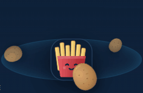

# Flo & Jerry — Food Copilot 2.0

### Agentic AI for end-to-end food manufacturing, explained so anyone can follow it


**Ask questions about sales, stock, compliance and potato quality, and get answers with receipts.**<br>
Runs on a laptop. Deploys to Kubernetes. Uses *your* local model, never a cloud AI.

[See it move](#-see-it-in-motion) · [Run it locally](#4-run-it-on-your-own-computer-step-by-step) · [🌍 Global supply maps](#20-global-supply-chain-intelligence-maps) · [Deploy to Kubernetes](#18-run-it-on-kubernetes-enterprise-integration) · [Token usage & metrics](#19-system-metrics-and-token-usage) · [Honesty rules](#13-honesty-rules-this-project-follows)

</div>

> **Read this first.** This is a **portfolio prototype**, not a product, and **everything in it is made up on purpose**. The company (*Food Beverage Food Care*), its products, sales, warehouses and customers are all synthetic. Payments are fake ("mock"), and no real money, email or delivery is involved. A banner on every screen repeats this. A demo that pretends to be real data misleads people, so this one says plainly that it is not.

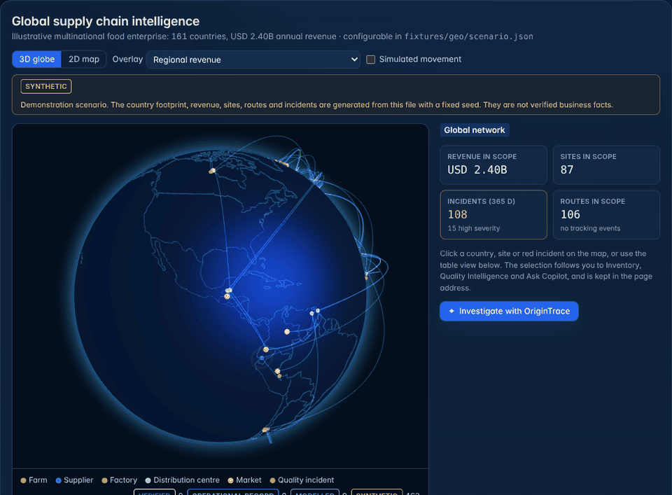

<sub>🎥 Full-quality video for presentations: <a href="docs/media/executive-presentation.mp4">executive-presentation.mp4</a> (31 s) · <a href="docs/media/globe.mp4">globe.mp4</a> · <a href="docs/media/map2d.mp4">map2d.mp4</a>. Every network figure on the globe is <b>synthetic and labelled so</b>.</sub>

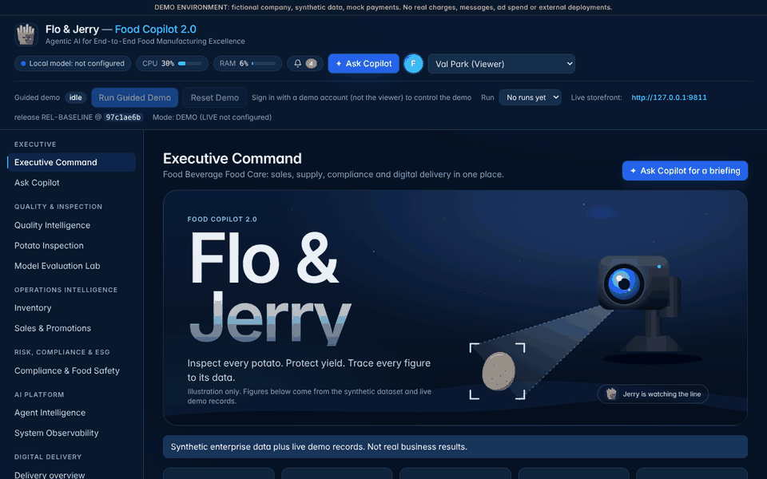

## 🎬 See it in motion

Every animation below is **a real recording of the running app**: a script (`e2e/record-media.mjs`) clicks through it in a browser, and `scripts/make_gifs.py` turns the frames into GIFs. Nothing is drawn by hand.

<table>
<tr>
<td width="50%" valign="top">

**🥔 Inspect a batch of potatoes**<br>
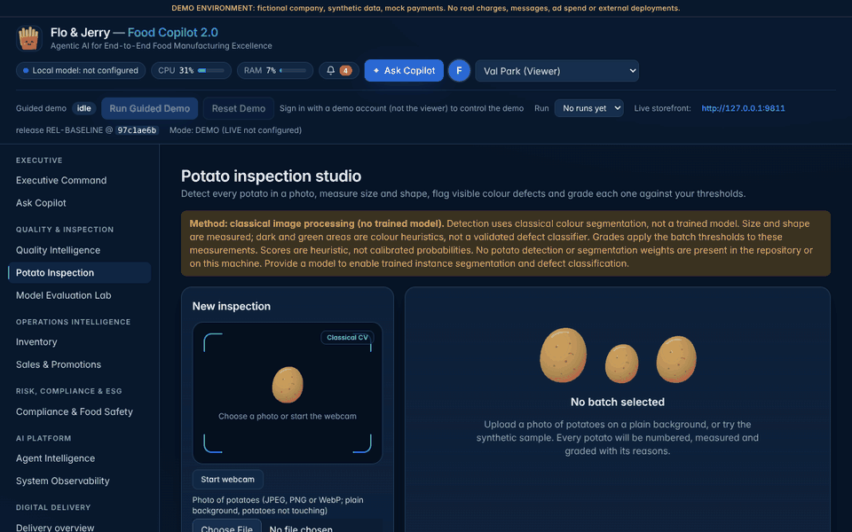
<sub>Upload a photo → every potato is found, numbered, measured and graded. Click one for its close-up and the reasons. (Synthetic drawn image.)</sub>

</td>
<td width="50%" valign="top">

**💬 Ask Copilot, get receipts**<br>
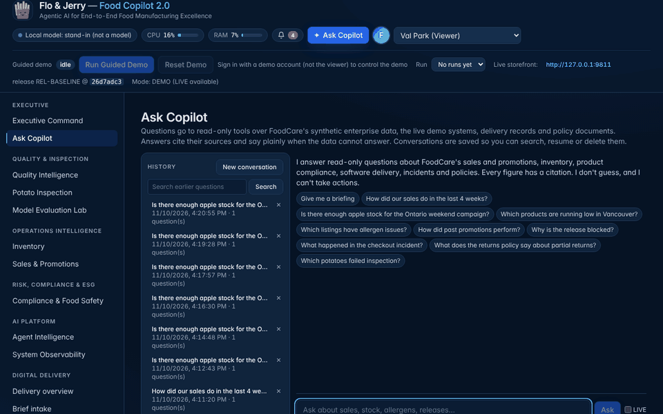
<sub>Type a question in plain English. Every number in the answer carries a citation such as <code>[S1]</code>, pointing to the data it came from.</sub>

</td>
</tr>
<tr>
<td width="50%" valign="top">

**🧠 Watch the agents think**<br>
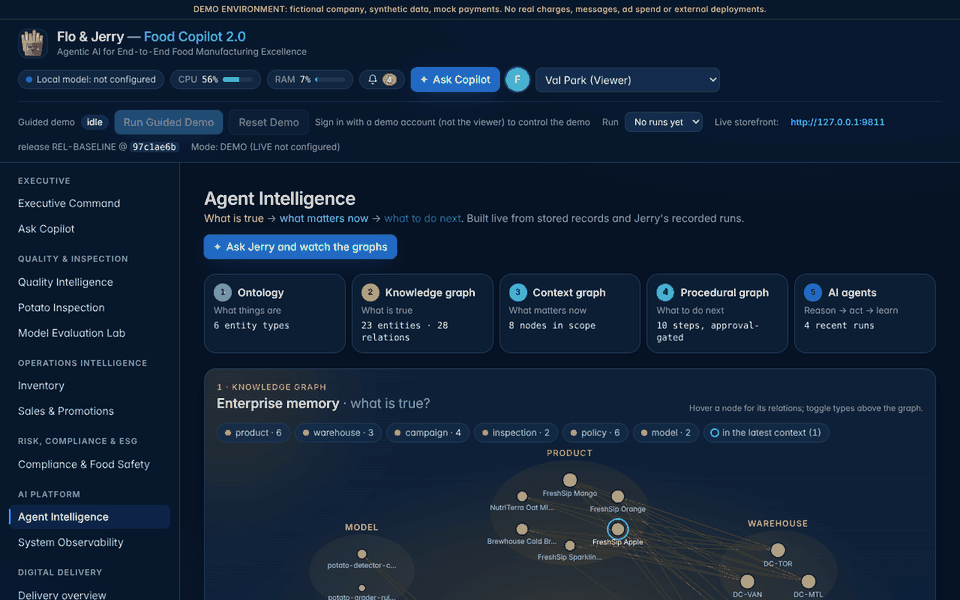
<sub>The knowledge, context and procedural graphs behind that answer, plus a timeline of every agent run.</sub>

</td>
<td width="50%" valign="top">

**🧭 A quick tour**<br>
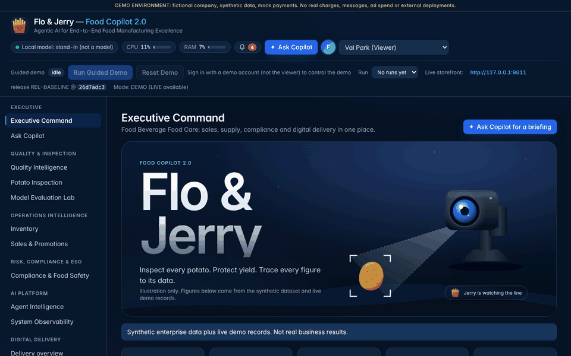
<sub>Executive Command → Quality Intelligence → Inspection → Inventory shelf → Agent Intelligence → Observability → Evaluation Lab.</sub>

</td>
</tr>
</table>

### What's new in this version

| | Feature | Where |
|---|---|---|
| 🌍 | **Global Supply Chain Intelligence maps**: 3D globe + 2D map, 161-country configurable scenario, red risk markers, drill-down to incident, 30/90/180-day risk bands, OriginTrace | [section 20](#20-global-supply-chain-intelligence-maps) |
| ☸️ | **Kubernetes-ready**: Dockerfile, Kustomize base, GKE and AKS overlays, Flux GitOps example, NetworkPolicy, non-root and read-only filesystem | [section 18](#18-run-it-on-kubernetes-enterprise-integration) |
| 📈 | **Prometheus `/metrics`** and a ready-made **Grafana dashboard** | [section 19](#19-system-metrics-and-token-usage) |
| 🔢 | **Token usage** per call, per purpose and per user, **as reported by your model server** (never estimated) | [section 19](#19-system-metrics-and-token-usage) |
| 🏭 | A research note on fitting into a large food manufacturer's platform, with sources and confidence labels | [docs/audits/GLOBAL_SUPPLY_CHAIN_MAPS_AUDIT.md](docs/audits/GLOBAL_SUPPLY_CHAIN_MAPS_AUDIT.md) | The audit done before building the maps: what existed, what was missing, and the decisions taken |
| [docs/MEDIUM_GLOBAL_SUPPLY_CHAIN_MAPS.md](docs/MEDIUM_GLOBAL_SUPPLY_CHAIN_MAPS.md) | A long-form article about building the maps (ready for Medium) |
| [docs/MCCAIN_INTEGRATION.md](docs/MCCAIN_INTEGRATION.md) |

---

## Table of contents

1. [What is this, in one minute?](#1-what-is-this-in-one-minute)
2. [Words you will meet (plain-English glossary)](#2-words-you-will-meet-plain-english-glossary)
3. [A guided tour with pictures](#3-a-guided-tour-with-pictures)
4. [Run it on your own computer, step by step](#4-run-it-on-your-own-computer-step-by-step)
5. [Connect your own local Qwen model (optional)](#5-connect-your-own-local-qwen-model-optional)
6. [How Ask Copilot answers a question](#6-how-ask-copilot-answers-a-question)
7. [How potato inspection works, step by step](#7-how-potato-inspection-works-step-by-step)
8. [How the app remembers conversations (SQLite memory)](#8-how-the-app-remembers-conversations-sqlite-memory)
9. [The digital delivery workspace: three true stories](#9-the-digital-delivery-workspace-three-true-stories)
10. [How everything fits together (architecture)](#10-how-everything-fits-together-architecture)
11. [Measured results: real numbers, and what was not measured](#11-measured-results-real-numbers-and-what-was-not-measured)
12. [Why we did it this way, and why not the alternatives](#12-why-we-did-it-this-way-and-why-not-the-alternatives)
13. [Honesty rules this project follows](#13-honesty-rules-this-project-follows)
14. [Limits: what this is not](#14-limits-what-this-is-not)
15. [Learn by doing: exercises](#15-learn-by-doing-exercises)
16. [Where everything lives (repository map)](#16-where-everything-lives-repository-map)
17. [More documentation](#17-more-documentation)
18. [Run it on Kubernetes (enterprise integration)](#18-run-it-on-kubernetes-enterprise-integration)
19. [System metrics and token usage](#19-system-metrics-and-token-usage)
20. [Global Supply Chain Intelligence maps](#20-global-supply-chain-intelligence-maps)

---

## 1. What is this, in one minute?

Imagine a food company's control room. Managers want quick, **trustworthy** answers:

* "Do we have enough apple juice for this weekend's promotion?"
* "Did last month's discount make money, or only sell more bottles?"
* "Is any product label missing an allergen?"
* "In this photo of potatoes, which ones are bad, and why?"
* "Why did the website's checkout break yesterday?"

**Flo & Jerry** is a web application that answers questions like these. *Flo* is the product's persona and *Jerry* is its friendly mascot: the smiling fries carton in the top-left corner and in the copilot panel.

It is built on three ideas:

| Idea | What it means in practice | Why it matters |
|---|---|---|
| **Every number has a receipt** | Each figure in an answer is tagged like `[S1]`, pointing to the exact data it came from. | You can check the answer yourself instead of trusting a chatbot. |
| **It says "I don't know"** | Ask about the weather in Paris and it replies "I can't answer that". | A system that guesses confidently is dangerous in a business. |
| **It never acts on its own** | Ask it to "approve the release" and it refuses: it is read-only. | Important decisions stay with the right person. |

---

## 2. Words you will meet (plain-English glossary)

| Word | Plain meaning | Everyday comparison |
|---|---|---|
| **Copilot** | An assistant that helps you, while you stay in charge | A GPS that suggests routes; you still drive |
| **LLM (large language model)** | A program trained on lots of text that can write sentences | A very well-read autocomplete |
| **Qwen** | A family of LLMs you can run on your own computer | A writer who lives in your house instead of in the cloud |
| **Local model server** | A program on your computer (Ollama, LM Studio) that runs the LLM | The writer's desk |
| **Deterministic** | Same input → always the same output, by fixed rules | A calculator, not a poet |
| **Citation `[S1]`** | A label showing where a fact came from | A footnote in a book |
| **SQLite** | A small database stored in a single file | A very organised notebook |
| **Synthetic data** | Data that is invented on purpose for demos and tests | Plastic food in a shop window |
| **Segmentation** | Finding which pixels in a photo belong to an object | Tracing around each potato with a pen |
| **Heuristic** | A rule of thumb, not a proven measurement | "Dark spots are probably bad" |
| **Threshold** | A cut-off number used to decide | "Above 4% dark area means Not Good" |
| **Precision / recall / F1** | Scores for how well a detector finds things (explained in [section 11](#11-measured-results-real-numbers-and-what-was-not-measured)) | A fishing net's catch quality |
| **Agent** | A piece of software that does one job, step by step, and records what it did | A worker with a logbook |
| **Release / deploy / rollback** | Publishing a new version of the website / switching back to the old one | Swapping a shop sign / putting the old sign back |
| **API** | The doorway one program uses to ask another for data | A restaurant's order window |
| **CPU / RAM** | The computer's brain effort / its short-term memory | How hard the chef works / how big the counter is |

---

## 3. A guided tour with pictures

All screenshots are **real captures of the running app** taken by automated browser tests (Playwright). They use the synthetic data.

### 3.1 The frame around every page

At the top of every page:

* **Brand** "Flo & Jerry — Food Copilot 2.0" with the subtitle *Agentic AI for End-to-End Food Manufacturing Excellence*.
* **Illustrations:** Jerry (a smiling fries carton), potatoes and fries are **original vector drawings made for this project**, not copied artwork. *Why:* stock illustrations and packaging mockups carry licences and other companies' branding.
* **Local model pill:** whether your local Qwen is connected ("not configured" means the app is answering with its built-in rules only).
* **CPU and RAM pills:** **measured live** on the computer running the app, every 5 seconds. They are never typed-in numbers.
* **Bell:** notifications built from real alerts (low stock, missing allergens, an injected fault).
* **Ask Copilot** button, the **"F" avatar** (a placeholder for Flo's portrait until one is supplied; see [section 14](#14-limits-what-this-is-not)) and the **account picker**.

On the left, a grouped menu: *Executive*, *Quality & Inspection*, *Operations Intelligence*, *Risk, Compliance & ESG*, *AI Platform* and *Digital Delivery*.

The same page at laptop width (1280 pixels) wraps neatly:


### 3.2 Executive Command (home)


What you see, from top to bottom:

1. **Cinematic hero:** a night-sky panel with a giant "Flo & Jerry" wordmark and an original inspection camera whose glass "eye" scans a potato inside corner brackets. It is decoration only and shows no data. The starfield is static, so it costs nothing to draw.
2. **Five headline numbers:** revenue and units sold in the last 4 weeks (compared with the 4 weeks before), stock alerts, listing-compliance issues, and live demo-shop orders.
3. **Weekly revenue chart** (16 weeks) and **revenue by region**. Every chart has a **"Show table"** button, so the numbers can be read without the picture (this helps screen-reader users too).
4. **Needs attention:** for example, *FreshSip Apple may not cover the Ontario weekend campaign*.
5. **Promotions** and **Digital delivery** status.
6. **Potato data sources:** one card per source that feeds Jerry, each with a **live record count** from the database. Green-dot cards have data, gold-dot cards are synthetic demo data, and grey dashed cards are **planned sources that are not connected** (storage sensors, weather, ERP, weighing scales, conveyor video). Each grey card says exactly what it would need. *Why:* you can see at a glance which answers rest on real records and which cannot be given yet.

### 3.3 Ask Copilot


* **Left panel, History:** every conversation is saved. You can **search** earlier questions, **resume** a conversation, or **delete** it.
* **Follow-up questions:** "Top selling products in Ontario last 8 weeks" and then just "What about Quebec?" works. The yellow note says the copilot reused the topic of your previous question.
* **Sources box** under each answer lists `[S1]`, `[S2]`… with the exact table or document used.
* **"How this was answered"** opens the list of tools the copilot ran (for example `sales_summary(window=8, province=QC)`).

The drawer version opens from any page:


### 3.4 Potato Inspection studio


Before you choose a batch, the studio shows an empty state with drawn potatoes and a one-line explanation:

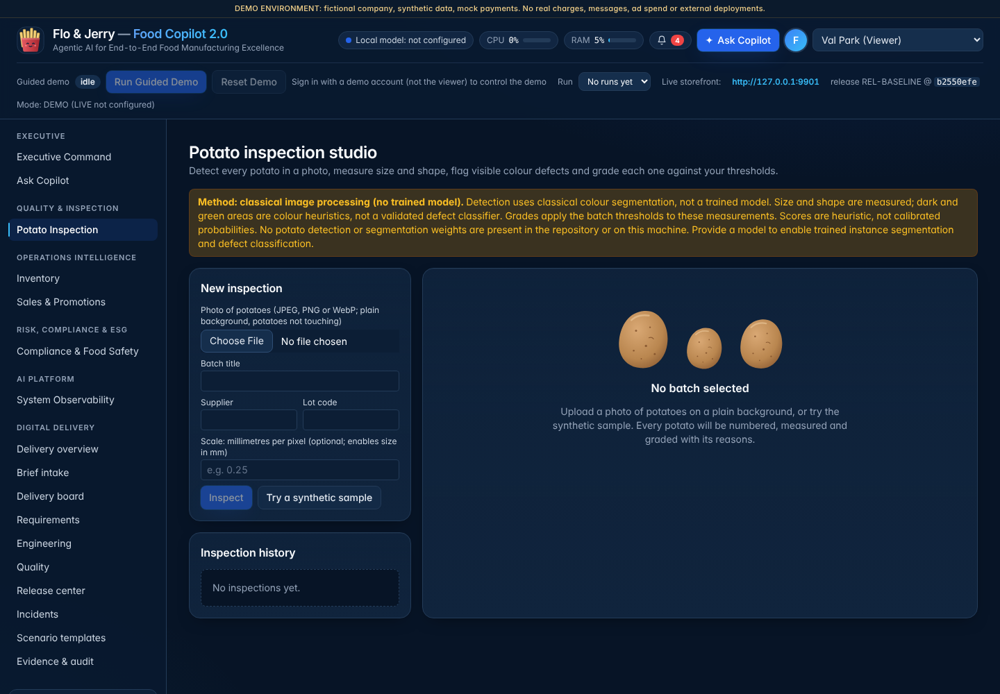

1. **Upload a photo** (JPEG, PNG or WebP), or click **"Try a synthetic sample"** (a drawn picture with known answers, labelled as not a photo).
2. The app finds **every potato**, numbers it (#1, #2, …) and outlines it in **green (Good)**, **amber (Moderate)**, **red (Not Good)** or **grey (not graded)**.
3. The five **summary tiles** count how many were detected and graded.
4. Click a number to see **one potato close up**, with the exact **reasons** for its grade and its measurements.
5. **Download CSV / JSON** reports. **Quality thresholds** can be changed, and the whole batch re-grades instantly.
6. The orange box at the top states the method honestly: *classical image processing, not a trained AI model*. [Section 7](#7-how-potato-inspection-works-step-by-step) explains what that means.

**Scanner panel:** the capture area works like a phone camera viewfinder. You can choose a photo, or click **Start webcam**, then **Capture photo**, to take a picture with your computer's camera. The snapshot goes through exactly the same pipeline. The badge says **Classical CV**, not "AI", because no trained model is used.

**Quality rings:** three rings show the share of graded potatoes that are Good (green), Moderate (amber) and Not Good (red), with the potato count in the middle. The same numbers appear as text next to the rings.

### 3.5 Asking about the inspection


"Show me potato #8" returns its close-up. Then "Why was it rejected?" works because the copilot remembers that "it" means potato #8. Every answer ends with the method disclaimer.

### 3.6 Sales, inventory, compliance

| Sales & promotions | Inventory | Compliance & food safety |
|---|---|---|
|  | 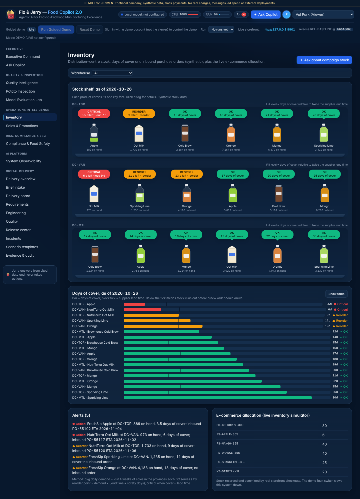 |  |
| Promotion **uplift is measured** from sales before and after. One discount sold 10.7% more units but **lost 11.2% revenue**. | A **stock shelf** per warehouse: each product is drawn on the shelf with **one floating tag** showing its most important fact (Critical, Reorder or OK, plus days of cover). The fill level shows days of cover relative to twice the supplier's lead time. Click a tag for on-hand stock, demand and inbound orders. Below it: **days of cover** against **lead time** for every product. | Every shop listing is compared, field by field, with the approved recipe. A retail feed is **missing "oats (gluten)"**. |

### 3.7 Quality Intelligence

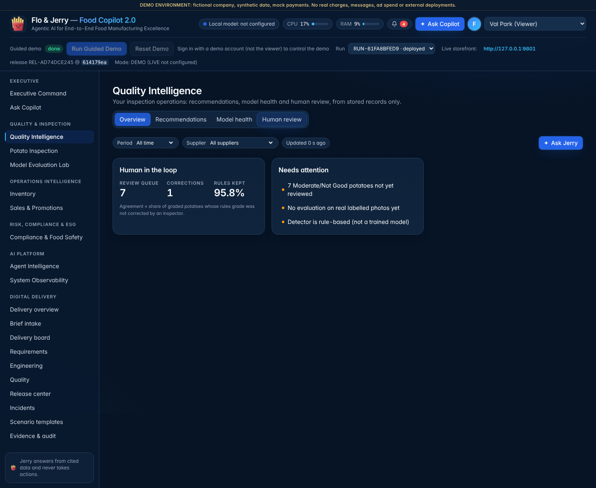

A dashboard over **your own inspection records**, with four tabs (Overview, Recommendations, Model health, Human review) and filters for period and supplier:

* **Inspection recommendations:** worst potatoes first, each with its top finding, its detection score (labelled *heuristic, not calibrated*) and a suggested action. Rejecting a potato always says **"needs approval"**: the system suggests, a person decides.
* **Model health:** the latest recorded evaluation, with a **SYNTHETIC** badge when it was measured on drawn images.
* **Human in the loop:** the review queue (Moderate and Not Good potatoes nobody has reviewed yet), the number of corrections, and how often inspectors kept the rules' grade.
* **Quality trend:** the share graded Good per batch, oldest to newest.
* **Needs attention:** for example *"No evaluation on real labelled photos yet"*.

### 3.8 Agent Intelligence: knowledge, context and procedural graphs

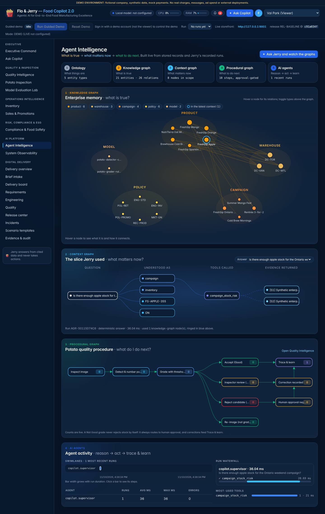

This page shows **how Jerry thinks**, in four layers, following the idea *what is true → what matters now → what do I do next*:

| Layer | Plain meaning | What you see | Where the data comes from |
|---|---|---|---|
| **Semantic spine** | The five layers at a glance | Ontology → Knowledge → Context → Procedure → Agents, each with a live count | All of the below |
| **1. Knowledge graph** *(what is true)* | Everything the company "knows", and how things connect | Clusters of products, warehouses, campaigns, suppliers, inspection batches, policies and models, with lines for real relationships (*stocked at*, *promotes*, *supplied by*, *inspected by*, *evaluated on*). Hover a node to see its links; click a type to hide it. | Sales, stock, campaign, inspection, policy and model tables |
| **2. Context graph** *(what matters now)* | The small slice of knowledge **one answer actually used** | Question → what Jerry understood (intents, entities) → the tools it ran → the evidence it returned. The knowledge nodes it touched are ringed in blue in graph 1. Pick any earlier answer from the menu. | Recorded with **every** answer by the supervisor agent (`agent_runs`) |
| **3. Procedural graph** *(what do I do next)* | The rules for what happens to each potato | Inspect → detect → grade → accept, review, re-image, or reject. **Reject always leads to human approval**, and corrections feed *Trace & learn*. Each step shows a live count; steps the latest answer touched are outlined. | Inspection results and corrections |
| **4. Agent activity** *(reason → act → learn)* | What the agents actually did, and how long it took | Swimlanes per agent over time, a step-by-step timing breakdown of any run, per-agent statistics and the most-used tools | Every recorded agent run and tool call |

*Why it matters:* a trustworthy agent should not just answer. It should show **what it knew, what it looked at, which rule it followed and what it did**. *Why not use a graph database?* At this size, SQLite and plain tables are faster and simpler; the graphs are computed on request from the same records.

### 3.9 System Observability


This page shows only **measured** information: machine CPU and RAM, the app's own memory use, the image-inspection queue, the local-model queue, the size of the memory database, and a list of **recent agent runs**. Click a run to see each step and how many milliseconds it took.

**Local-model token usage** (new). This panel shows how many tokens your local model read (*prompt*) and wrote (*completion*), per day and per purpose. It also shows cache hits, latency, and how many calls came back **without** a count. Choose 24 hours, 7 days or 30 days, and tick "Only my calls" to see just your own.

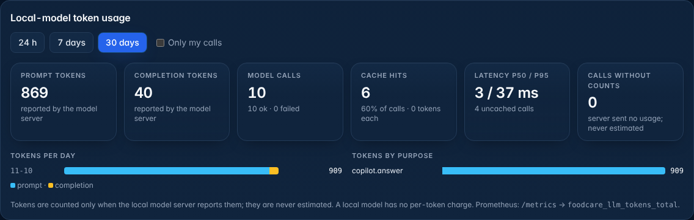

<sub>In this screenshot the figures come from a <b>stand-in test server</b> used only for the capture (not Qwen, not a model), so the numbers are tiny. With your own Qwen the same panel shows your real counts.</sub>

* **Why "never estimated"?** A common shortcut divides characters by 4 to guess tokens. That guess is off by 20–50% for code, numbers and non-English text, and it *looks* exact on a dashboard. So if the server doesn't report a count, the app shows "Calls without counts" and leaves the number empty.
* **Why no dollar figure?** A model running on your own machine has no per-token price. Turning tokens into money needs your organisation's own internal rate, so the app doesn't invent one.

### 3.10 Model Evaluation Lab

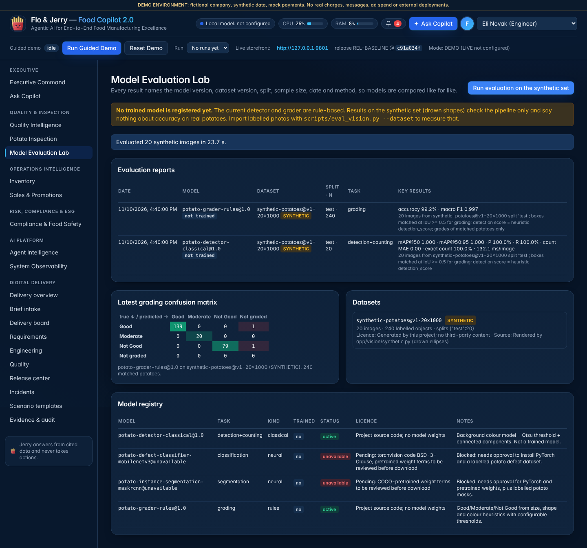

This page answers the question **"how good is the model, really?"**, honestly:

* **Model registry:** every model, with a **Trained? yes/no** column. Today both potato components say **no**, because they are rules, not trained neural networks. Planned neural models are listed as **unavailable**, with what they need.
* **Datasets:** each one shows its licence and source, a **SYNTHETIC** badge when the images are drawn, and the results of the leakage check.
* **Evaluation reports:** each row names the model version, dataset version, split, sample size, date and method, with detection mAP, precision, recall, counting error and grading accuracy.
* **Confusion matrix:** rows are the true grades and columns the predicted ones. The green diagonal is correct, red cells are mistakes.
* **Run evaluation on the synthetic set:** re-measures the current pipeline (engineer, product owner or release approver).

*Why it matters:* a number such as "99% accurate" means nothing without knowing **which data it was measured on**. Here, every score carries its receipt.

### 3.11 Inspector corrections (human in the loop)

In the potato detail panel, **Correct this grade** lets an inspector override the rules' grade **with a required reason**. The original grade is kept next to the correction, the change is written to the audit log, the batch summary updates, and Jerry mentions the correction when asked about that potato. *Why:* the rules can mistake soil for rot; a person should be able to fix that, and the record should show who did and why. Corrections also become labelled examples for training a future model.

### 3.12 Digital delivery workspace

| Clarify the brief | Tests catch a bug | Incident evidence |
|---|---|---|
|  |  |  |

[Section 9](#9-the-digital-delivery-workspace-three-true-stories) tells these three stories in detail.

---

## 4. Run it on your own computer, step by step

### 4.1 What you need (and why)

| Tool | Why it is needed | How to check |
|---|---|---|
| **git** | Every version of the demo shop is stored as a git commit | `git --version` |
| **Python 3.11+** | The server is written in Python | `python3 --version` |
| **uv** | Installs the exact Python package versions listed in `uv.lock` | `uv --version` |
| **Node.js 20+ and npm** | Builds the web interface | `node --version` |

**Mac users:** git comes with Apple's *Command Line Tools*. If `git --version` shows a pop-up, or "xcrun: error", run `xcode-select --install`, accept, wait for it to finish, then try again. *Why:* without git, the app cannot create the demo shop's history, and start-up stops with a clear message.

### 4.2 Start

```bash
git clone https://github.com/florina787/Data-sets.git
cd Data-sets
git checkout claude/new-session-pahp8j
cd foodcare-copilot
scripts/start.sh
```

The first start installs the pinned packages and builds the interface (a few minutes). After that:

* **App:** <http://127.0.0.1:8700>
* **Demo shop (FreshSip storefront):** <http://127.0.0.1:8801>

If a port is busy because an older copy is still running: `lsof -t -i :8700 -i :8801 | xargs kill`.

**Seeing the old light-green "FoodCare Enterprise Copilot" page, or a red "Failed to fetch" box?**

* *Old page:* your copy is out of date. Run `git checkout claude/new-session-pahp8j && git pull`, then start again. The current app is the navy "Flo & Jerry" one.
* *"Failed to fetch":* the web page loaded, but the server behind it (port 8700) is not running. It crashed or never started. Look at the terminal where you ran `scripts/start.sh` for the first error.
* *Windows / a very new Python (for example 3.15):* some pinned packages have no ready-made install files for brand-new Python versions, so installing them asks for Microsoft C++ build tools. The repository includes a `.python-version` file (3.13), so `uv` downloads and uses Python 3.13 automatically. If an old `.venv` folder was created with another version, delete `.venv` and run `scripts/setup.sh` again. On Windows, run the scripts from **Git Bash** or WSL.

### 4.3 Or let GitHub Copilot in VS Code run it

Open the `foodcare-copilot` folder in VS Code, switch Copilot Chat to **Agent** mode and paste the prompt from [docs/RUN_WITH_GITHUB_COPILOT.md](docs/RUN_WITH_GITHUB_COPILOT.md). Copilot automatically reads `.github/copilot-instructions.md`, which tells it the commands and the rules: no model downloads, no second model server, no pushing. You can also use **Terminal → Run Task…** and choose a "Flo & Jerry" task.

### 4.4 Sign in

Pick a demo account in the top-right picker. They are local test accounts, not real logins:

| Account | Role | Allowed to | Why the limits exist |
|---|---|---|---|
| `val.viewer` | Viewer | Look, ask, inspect images | Read-only access is the safe default |
| `maya.marketing` | Marketing | Submit briefs, answer clarification questions | Marketing owns the business rules |
| `omar.product` | Product owner | Approve requirements | Freezes the test plan |
| `eli.engineer` | Engineer | Run checks, inject demo faults | Engineers build and test |
| `rina.release` | Release approver | Approve, deploy, roll back | The person who ships should not be the person who built it |

The server checks permissions on **every action**, not just in the screen. A rejected attempt (for example, the engineer approving a release) gets an HTTP 403 error and is written to the audit log.

### 4.5 Useful commands

```bash
scripts/reset_demo.sh     # back to a clean demo (your saved conversations and inspections are kept)
scripts/test.sh           # code checks, 118 backend tests, interface build
npm run e2e               # 7 browser tests that click through the app
.venv/bin/python scripts/eval_vision.py --synthetic 20   # measure the potato detector on drawn test images
```

---

## 5. Connect your own local Qwen model (optional)

**The app works fully without any AI model.** Answers are then written by fixed rules ("deterministic"). If you want natural-language answers, you can connect a model that **already runs on your computer**.

### 5.1 How it connects

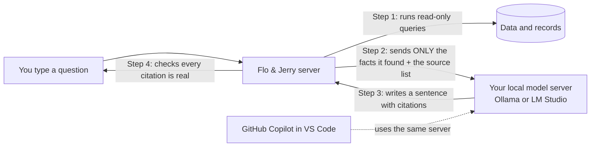

* FoodCare **does not download or start any model**. It talks to the server you already run.
* If GitHub Copilot in VS Code uses Qwen through Ollama, both programs share **the same model instance**. Nothing is loaded twice.
* **GitHub Copilot itself has no API that other apps can call.** That is why the app connects to Ollama or LM Studio directly.

### 5.2 Steps

1. Find your model name. With Ollama, run `ollama list` (for example `qwen2.5:7b-instruct`).
2. Start the app with two settings:

```bash
FOODCARE_LLM_BASE_URL=http://127.0.0.1:11434/v1 \
FOODCARE_LLM_MODEL=qwen2.5:7b-instruct \
scripts/start.sh
```

LM Studio's address is usually `http://127.0.0.1:1234/v1`.

3. In Ask Copilot, tick **LIVE**. Answers written by the model say *"Written by the local model from the cited data"*.

### 5.3 Built-in protections (and why)

| Protection | Default | Why |
|---|---|---|
| One request to the model at a time | `FOODCARE_LLM_CONCURRENCY=1` | A local model uses most of your CPU or GPU; two at once makes both slow |
| At most 4 waiting; then a polite "busy" | `FOODCARE_LLM_QUEUE_SIZE=4` | Better to say "busy" than to freeze |
| Time limit per answer | 60 s | A stuck model must not hang the app |
| **Stop** button | — | Closes the connection so the model stops generating |
| Prompt size cap | 6,000 characters | Keeps answers fast. The app **never changes your model's context size** |
| Only the last 3 exchanges are sent | `FOODCARE_MEMORY_CONTEXT_TURNS=3` | Sending the whole history would be slow and costly |
| Cache of identical prompts | 64 entries | Asking the same thing twice costs nothing |
| Citation check | always | An answer with missing or invented `[S#]` labels is thrown away and the rule-based answer is shown instead, with a notice |

The full settings list is in [docs/LOCAL_LLM_AND_MEMORY.md](docs/LOCAL_LLM_AND_MEMORY.md).

---

## 6. How Ask Copilot answers a question

### 6.1 The journey of one question

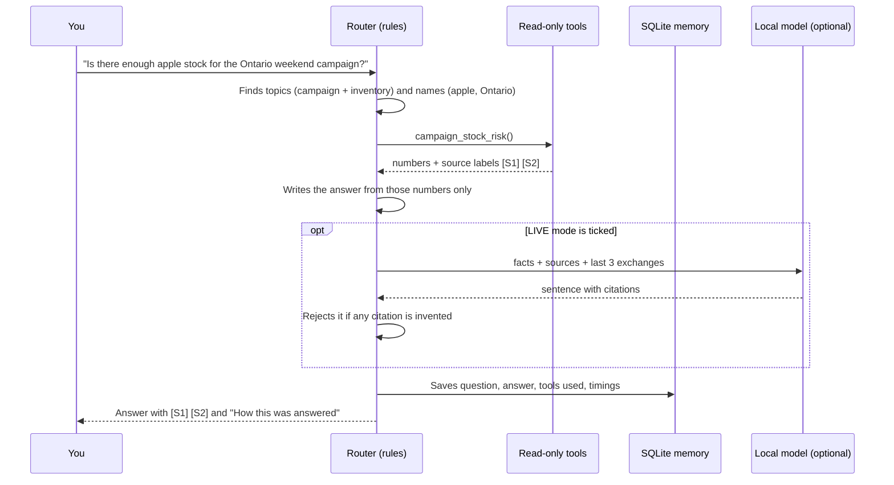

### 6.2 A real answer, unedited

> **Stock for the FreshSip Ontario Weekend: buy 2, get 1 free at DC-TOR** (starts in 5 days) [S1][S2]
> * FreshSip Mango: forecast 752 units for the weekend, 4,855 projected at start → **low risk**
> * FreshSip Orange: forecast 981 units, 5,176 projected at start → **low risk**
> * FreshSip Apple: forecast 625 units, stock runs out before the start, shortfall 625 units → **high risk**; next inbound PO-55102 (1,800 units, ETA 2026-11-04)
>
> Assumptions: weekend baseline = last 4 weeks of Ontario sales × 2/7; uplift taken from the most similar past campaign (40.2%, measured)…

Notice three things: it **shows its assumptions**, it **offers options but leaves the decision to people**, and the 40.2% is **measured from sales history**, not typed in.

### 6.3 What it can talk about

| Topic | Example question |
|---|---|
| Sales | "How did our sales do in the last 4 weeks?" |
| Promotions | "How did past promotions perform?" |
| Stock | "Which products are running low in Vancouver?" |
| Campaign risk | "Is there enough apple stock for the Ontario weekend campaign?" |
| Compliance | "Which listings have allergen issues?" |
| Potato inspection | "Which potatoes failed inspection?", "Show me potato #12", "Why was it rejected?", "Compare this batch with the previous batch", "Which supplier provided these potatoes?" |
| Software delivery | "Why is the release blocked?" |
| Incidents | "What happened in the checkout incident?" |
| Policies | "What does the returns policy say about partial returns?" |

### 6.4 What it refuses, and why

| You ask | It answers | Why |
|---|---|---|
| "What is the weather in Paris?" | "I can't answer that from FoodCare's data… I won't guess." | No data, so no answer. Guessing would look just as confident as a real answer. |
| "Approve the release" | "I'm read-only, so I can't do that." | A chat box is not a safe place to give orders. Approvals happen in the workflow screens, by the right role. |
| "What is the financial impact of this potato batch?" | "Not calculated from inspections yet…" | Money figures need real cost inputs and formulas. An AI must not invent them. |

---

## 7. How potato inspection works, step by step

### 7.1 The pipeline, like a recipe

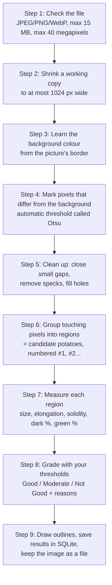

Each step is timed and stored, so the System Observability page can show exactly where the time went.

### 7.2 What each measurement means

| Measurement | Plain meaning | Why it matters |
|---|---|---|
| **Area / length × width** | How big it is. In pixels, or in millimetres if you give the scale (mm per pixel) | Processors buy potatoes in size ranges |
| **Elongation** | Long side ÷ short side. 1.0 = round, 3.0 = very long | Odd shapes waste material when peeled or cut |
| **Solidity** | How "filled in" the outline is (1.0 = perfectly smooth and convex) | Knobs and cracks lower it |
| **Dark area %** | Share of the potato's surface much darker than its own average | *Possible* rot, bruise or soil |
| **Green area %** | Share of greenish pixels | *Possible* greening, which can indicate solanine, a natural toxin |
| **Detection score** | A rough 0–1 confidence based on contrast and shape | **Heuristic**, not a calibrated probability |

### 7.3 Default grading thresholds (you can change them)

| Check | Good if | Moderate if | Otherwise |
|---|---|---|---|
| Length (with a scale) | 45–110 mm | within 15% of that range | Not Good |
| Size vs batch median (no scale) | ≥ 60% | ≥ 40% | Not Good |
| Elongation | ≤ 1.9 | ≤ 2.4 | Not Good |
| Solidity | ≥ 0.93 | ≥ 0.86 | Not Good |
| Dark area | ≤ 1% | ≤ 4% | Not Good |
| Green area | ≤ 0.5% | ≤ 3% | Not Good |

**The rule:** a potato gets the **worst** grade of all its checks, and the answer lists the checks responsible. These defaults are demonstration values, **not an industry standard**, so set your own.

Potatoes **cut off by the photo's edge** and regions that **look like two touching potatoes** are **not graded**. Grading half a potato, or two potatoes as one, would produce wrong answers.

### 7.4 Why "classical image processing" and not AI? (the honest answer)

* **Fact:** there is no potato detection or defect model anywhere in this repository or on the build machine. The two computer-vision notebooks in the repository root are a generic ImageNet classifier and an OCR (text reading) example.
* **Fact:** you asked not to download model weights without approval, and that rule was followed.
* **So:** detection uses classical colour segmentation, a method with no training at all. It is **real and measurable for size and shape**, but its dark and green "defects" are **rules of thumb**. A dark patch can be rot, a bruise, soil or a shadow, and the app cannot tell which.
* **Therefore** the app never calls it "AI defect detection". Every screen, report and copilot answer says *"not a trained or validated defect classifier"*.
* **Upgrade path:** the code has a `Detector` interface. A trained instance-segmentation model can be plugged in later without changing the rest of the app.

### 7.5 What it handles well, and what it doesn't

| Works | Does not work (yet) |
|---|---|
| Potatoes on a plain, contrasting background | Busy backgrounds, conveyor belts, strong shadows |
| Separated potatoes | Touching or piled potatoes (flagged, not split) |
| Size and shape | Telling rot from soil from bruise |
| Photos | Video tracking and counting (planned) |

---

## 8. How the app remembers conversations (SQLite memory)

### 8.1 What is stored, and where

Everything lives in one file, `var/memory/memory.db`. It **survives restarts and "Reset Demo"**.

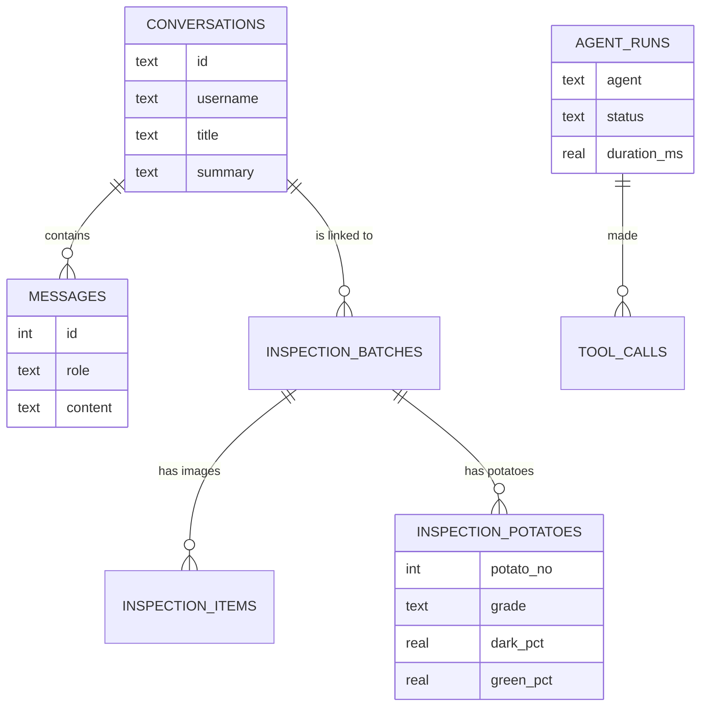

* **Pictures are not stored inside the database.** Only a *file reference* and a checksum are, and the image itself sits next to it as a normal file. *Why:* databases get slow and fragile when stuffed with large files.
* **Privacy:** you only ever see, search, resume or delete **your own** conversations and inspections. Another user's ID returns "not found".

### 8.2 How it stays fast and safe

| Feature | What it does | Why |
|---|---|---|
| **Full-text search (FTS5)** | Finds old questions in about 5 ms | Searching every message one by one would grow slower over time |
| **Bounded context** | Only the last 3 exchanges + a short summary of older questions go to the model | Fast answers, and less risk of old, irrelevant text confusing the model |
| **Rolling summary** | After 20 messages, older *questions* are summarised by a plain rule, with no AI involved | No hidden AI cost in the background |
| **Retention** | Conversations untouched for 180 days are deleted | Keeps the file small and respects privacy |
| **Backups** | Daily copy, the newest 5 kept | Protection against mistakes |
| **Self-repair** | If the file is damaged at start-up, it is set aside and the newest healthy backup is restored | One corrupted file should not lose all history |
| **Versioned migrations** | Database changes are numbered and fingerprinted | An accidentally edited change is detected, not silently applied |

---

## 9. The digital delivery workspace: three true stories

The original part of this project manages software changes to a demo online shop called **FreshSip**. It uses **real tools**: git, Python tests (pytest), code checks (ruff), and real web-server processes.

Marketing asks: *"Launch a weekend Ontario campaign: buy two eligible FreshSip beverages and receive one free, once per customer, while stock lasts."*

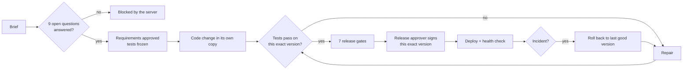

**Story A: ask before building.** The one-sentence brief hides nine questions. For example: *once per order or once per campaign?* Which time zone is "the weekend"? The company policy has no answer for some of them, and those are shown as **policy gaps**. The server **refuses to start** until each question has a recorded decision. *Why:* building on a guess is how expensive mistakes start.

**Story B: tests catch a free-juice bug.** The first code version lets a customer keep the free drink after removing a paid one. A real test fails (exit code 1). The fix makes the **same, locked tests** pass. Tests are locked when requirements are approved, so nobody can "fix" a failure by editing the test.

**Story C: a broken checkout.** A labelled demo fault slows the inventory service. The new code had **no time limit** (`timeout=None`), so checkouts hang and fail. The incident page separates **evidence** (measured facts) from **hypotheses** (likely explanations, marked "not proven"). The team rolls back, repairs, re-tests and re-deploys. The app says openly that the fault was injected and the analysis follows fixed rules. It does **not** claim an AI found the cause.

The detailed walk-through is in [docs/SCENARIO_GUIDE.md](docs/SCENARIO_GUIDE.md).

---

## 10. How everything fits together (architecture)

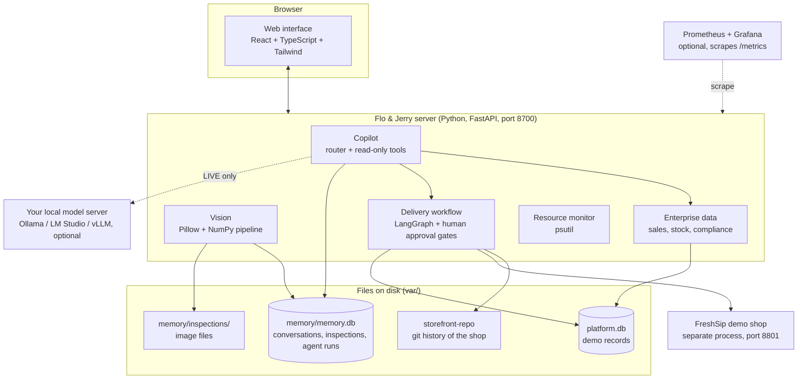

| Part | Technology | Why this one |
|---|---|---|
| Web interface | React, TypeScript, Vite, Tailwind | Widely used, fast to build, and type checking catches mistakes early |
| Server | Python + FastAPI | Simple, quick, and good for data and AI work |
| Workflow with human approvals | LangGraph | It can **pause** a workflow until a person decides, and resume later |
| Databases | SQLite | One file, no server to install. Right-sized for one machine (see [section 12](#12-why-we-did-it-this-way-and-why-not-the-alternatives)) |
| Image maths | Pillow + NumPy | Small and standard. **No model weights** |
| CPU and RAM | psutil | Works on Mac, Linux and Windows. Macs have no `/proc` file system to read these from |
| Charts | Hand-made SVG | No heavy chart library. Every chart has a table view and tooltips |
| Metrics | Prometheus text format, written by hand (`observability.py`) | Any Prometheus / Grafana stack can read it, and no extra library is needed |
| Deployment | Docker + Kustomize (GKE / AKS overlays) + Flux | Plain Kubernetes YAML works on any cloud; see [section 18](#18-run-it-on-kubernetes-enterprise-integration) |

---

## 11. Measured results: real numbers, and what was not measured

All numbers below were **measured**, on 2026-11-02 and 2026-11-03, in a cloud container with 4 CPU cores, using the synthetic data. Your computer will give different numbers.

### 11.1 Speed

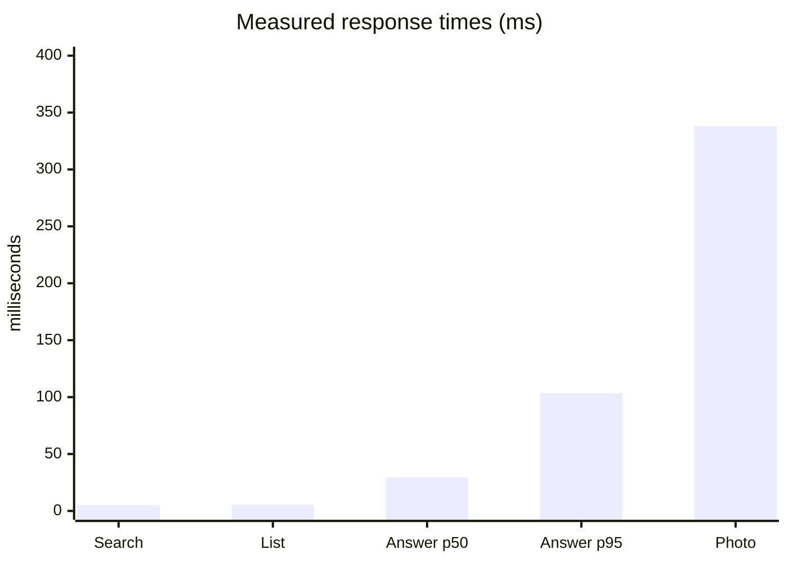

Bars, left to right: history search (p50), conversation list (p50), copilot answer (p50 and p95), and inspecting one 960 × 720 photo (average). *p50* means half of the requests were faster than this; *p95* means 95 out of 100 were faster.

| Measurement | Result |
|---|---|
| App memory (RAM) when idle | 98 MB (81 MB before the image libraries were added) |
| App memory after 60 answers and 60 searches | 99 MB, so it did not grow |
| Copilot answer (rule-based, no model) | p50 29.5 ms, p95 103.5 ms |
| History search | p50 5.1 ms |
| Inspecting one 960 × 720 image | about 340 ms on average |
| Restart time | 1.8 s |
| Conversations kept after a restart | 30 of 30 |

### 11.2 Potato detector accuracy, on **drawn** test images only

Twenty synthetic images, 240 drawn potatoes with known answers:

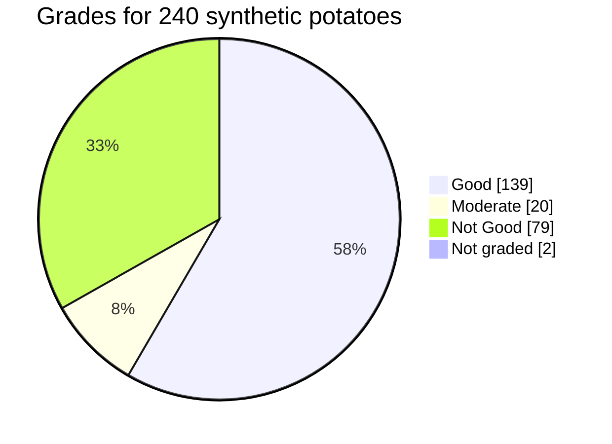

| Score | Result | Plain meaning |
|---|---|---|
| **Precision** | 1.0 | Of everything it called a potato, 100% were potatoes |
| **Recall** | 1.0 | Of all potatoes drawn, it found 100% |
| **F1** | 1.0 | A single score combining the two |
| **Grade agreement** | 99.2% (238 of 240) | The two misses were left "not graded" instead of being given the expected grade |

**Why these numbers do NOT prove real-world accuracy:** the test images are smooth drawn ovals on a plain background, which is easy on purpose. Real potatoes have soil, shadows, odd shapes, and they touch each other. **Accuracy on real photos has not been measured.** To measure it, label some real photos in COCO format and run `scripts/eval_vision.py --dataset your_folder --license "..." --source "..."`. The script's header explains the format; [docs/DATASET_LICENSES.md](docs/DATASET_LICENSES.md) explains the rules.

### 11.3 Tests

| Test suite | Count | Result |
|---|---|---|
| Backend (Python) | 118 | all pass |
| Browser, clicking through the real app | 9 | all pass |
| Of which use a **mock** model server instead of real Qwen | 17 | pass (no real Qwen run in the cloud) |
| Of which check the Kubernetes files against the app | 6 | pass |

---

## 12. Why we did it this way, and why not the alternatives

| Decision | ✅ Why we chose it | ❌ Why not the alternative |
|---|---|---|
| **Rules first, AI second** | Rule-based answers are instant, free, repeatable and testable | An AI-only copilot can invent numbers that look exactly as convincing as real ones |
| **Citations on every number** | Anyone can verify an answer | "Trust me" answers don't survive an audit |
| **Read-only copilot** | No accidental approvals or deletions from a chat box | Chat commands are ambiguous ("approve it": approve what?) |
| **Reuse your local Qwen** | No extra downloads, no second model eating your RAM, data stays on your machine | A cloud AI API sends company data off-site and costs money per question |
| **No new model downloaded** | You asked for approval first; weights can be gigabytes | Silent downloads surprise users and fill disks |
| **Classical vision for now** | Works today with no training data; size and shape are real measurements | Calling colour rules "AI defect detection" would be false |
| **SQLite** | One file, no setup, very fast on one machine | PostgreSQL is better for many servers at once; the code has an interface ready for it. **Never share one SQLite file across several Kubernetes copies**, because it can corrupt |
| **Images stored as files, not in the database** | Database stays small and fast | Large blobs make backups and queries slow |
| **One image and one model request at a time** | Protects your laptop's CPU and RAM | Running many at once makes everything slow and can crash a small machine |
| **"Busy" instead of waiting forever** | You get a clear answer immediately | Endless spinners hide problems |
| **Measured CPU/RAM only** | Numbers you can trust | Hard-coded "healthy" dashboards are decoration, not monitoring |
| **psutil added** | Works on Mac, where `/proc` doesn't exist | Reading `/proc` would only work on Linux |
| **No multipart upload library** | Images are sent as the raw request body, so no extra dependency | An extra package for one feature adds maintenance |
| **Navy design via shared colour tokens** | Every page restyled consistently without rewriting screens | Hand-editing hundreds of classes is error-prone |
| **Synthetic data everywhere** | Safe to share publicly | Real company data in a demo is a privacy and legal risk |

---

## 13. Honesty rules this project follows

Every item the app shows carries one of these labels:

| Label | Meaning |
|---|---|
| **Executed tool result** | A real command ran and its result was captured |
| **Deterministic calculation** | Fixed rules applied to recorded data |
| **Fixture / Selected demo decision** | Pre-written demo content, labelled as such |
| **Live AI output** | Written by the local model (LIVE mode only) |
| **Injected fault (demo)** | A failure caused on purpose to show incident handling |

And these rules are never broken:

1. **Never fabricate** money figures, savings or accuracy.
2. **Never present** colour heuristics as a trained AI model.
3. **Never substitute** scripted text and call it AI. If LIVE mode fails, the screen says so.
4. **Never act** from the chat box.
5. **Say what was not measured** (see [section 11](#11-measured-results-real-numbers-and-what-was-not-measured)).

---

## 14. Limits: what this is not

* **Not production software.** Real use would need company single sign-on, a managed database, monitored deployments and security reviews. See [docs/PRODUCTION_GAPS.md](docs/PRODUCTION_GAPS.md).
* **Not a validated potato grader.** It is a working pipeline whose defect rules have never been checked against real potatoes.
* **Not connected to real systems** (ERP, SAP, factory machines). All data is synthetic.
* **Not tested against a real Qwen model.** The cloud environment where it was built has no model. The connection is tested with a mock server, and you should try it on your own machine.
* **Flo's portrait** has not been supplied yet. The avatar shows an "F" placeholder. To use a portrait, save it as `apps/control-room/public/flo-portrait.jpg` and rebuild. No other image is substituted.
* **Not built yet (planned):** the AI Savings Intelligence dashboard (with transparent, formula-based simulations), manufacturing, supplier, agriculture, supply-chain and sustainability modules, the Architecture Intelligence Studio, the full agent harness with an agent graph, and video inspection.

---

## 15. Learn by doing: exercises

Each exercise teaches one idea. Try them in order.

| # | Do this | What you will learn |
|---|---|---|
| 1 | Ask "What is the weather in Paris?" | Why a trustworthy assistant refuses to guess |
| 2 | Ask "How did our sales do in the last 4 weeks?", then open **How this was answered** | Every answer comes from named tools with named inputs |
| 3 | Ask "Top selling products in Ontario last 8 weeks", then "What about Quebec?" | How follow-up context works, and that it is limited on purpose |
| 4 | Restart the app and open **History** | Persistent memory: your conversation is still there |
| 5 | In Potato Inspection, click **Try a synthetic sample**, then open a red potato | How a grade is explained by measurable reasons |
| 6 | Change **max dark pct good** to 50 and apply | Thresholds are business choices; the grade changes without re-processing the image |
| 7 | Click **Ask about this batch**, then "Show me potato #3", then "Why was it rejected?" | Pronoun follow-ups ("it") and image attachments |
| 8 | Ask "What is the financial impact of this batch?" | Why the system declines to invent money figures |
| 9 | Open **System Observability**, inspect a photo, then refresh | Each pipeline step is timed and recorded |
| 10 | Sign in as `eli.engineer` and try to approve a release in the Release center | Server-side permissions: the attempt is refused and audited |
| 11 | Run `scripts/eval_vision.py --synthetic 20` | How precision, recall and F1 are computed, and why synthetic scores are not proof |
| 12 | Upload a real photo of potatoes on a plain sheet of paper | Where classical vision works, and where it fails (shadows, touching potatoes) |

---

## 16. Where everything lives (repository map)

```
foodcare-copilot/
├── apps/control-room/          Web interface (React). Screens are in src/screens/
│   └── src/screens/            Executive, Copilot, Inspection, Observability, Sales, Inventory, ...
├── apps/storefront/            The FreshSip demo shop's web page
├── backend/app/
│   ├── copilot/                Question router + answer writer (router.py, engine.py)
│   ├── vision/                 Potato pipeline: segment.py, analyse.py, service.py, evaluate.py, synthetic.py
│   ├── memory/                 SQLite memory: schema.py (migrations), store.py, maintenance.py (backups)
│   ├── llm/local.py            Connection to your local model server (queue, timeout, cancel, cache)
│   ├── enterprise/             Synthetic sales, stock and compliance data + queries
│   ├── graph/, agents/         Delivery workflow (LangGraph) and its agents
│   ├── resources.py            Measured CPU / RAM (psutil)
│   ├── observability.py        Prometheus /metrics + token-usage report
│   └── main.py                 All web API endpoints
├── backend/tests/              118 automated tests
├── e2e/                        Browser tests (Playwright), a synthetic test image, record-media.mjs (README GIFs)
├── fixtures/vision/            Default potato grading thresholds
├── fixtures/enterprise/        The fictional company's products, regions, warehouses
├── apps/control-room/src/components/geo/   SupplyMap (shared), Globe3D (Three.js), Map2D (d3-geo), GeoChip
├── backend/app/geo.py          Synthetic global network, risk simulation, OriginTrace data
├── fixtures/geo/               scenario.json (161 countries, revenue…) + countries.json (Natural Earth)
├── deploy/k8s/                 Kubernetes: base, overlays/gke, overlays/aks, ServiceMonitor, Grafana dashboard
├── deploy/flux/                Flux GitOps example
├── Dockerfile                  Container image (non-root; optional lean build without PyTorch)
├── scripts/                    start, reset, test, eval_vision, make_gifs
└── docs/                       Detailed documents and all screenshots
```

---

## 17. More documentation

| Document | Read it to learn |
|---|---|
| [docs/MODEL_EVALUATION.md](docs/MODEL_EVALUATION.md) | Every metric, current results, and how to evaluate on your own photos |
| [docs/MODEL_LICENSES.md](docs/MODEL_LICENSES.md), [docs/DATASET_LICENSES.md](docs/DATASET_LICENSES.md), [docs/THIRD_PARTY_NOTICES.md](docs/THIRD_PARTY_NOTICES.md) | Licences of models, datasets and every dependency (no copyleft found) |
| [docs/FOODCARE_ARCHITECTURE.md](docs/FOODCARE_ARCHITECTURE.md) | Vision, evaluation and review architecture, and what each unbuilt capability needs |
| [docs/RUN_WITH_GITHUB_COPILOT.md](docs/RUN_WITH_GITHUB_COPILOT.md) | How to have GitHub Copilot in VS Code start the app for you |
| [docs/LOCAL_LLM_AND_MEMORY.md](docs/LOCAL_LLM_AND_MEMORY.md) | Every local-model and memory setting, plus measured results |
| [docs/SCENARIO_GUIDE.md](docs/SCENARIO_GUIDE.md) | Click-by-click walk-through of the delivery stories |
| [docs/ARCHITECTURE.md](docs/ARCHITECTURE.md) | Deeper technical diagrams |
| [docs/AGENTS_AND_TOOLS.md](docs/AGENTS_AND_TOOLS.md) | What each agent and tool is allowed to do |
| [docs/SECURITY_AND_SANDBOX.md](docs/SECURITY_AND_SANDBOX.md) | How commands are restricted and secrets kept out |
| [docs/TEST_RESULTS.md](docs/TEST_RESULTS.md) | Exact test commands and results |
| [docs/audits/GLOBAL_SUPPLY_CHAIN_MAPS_AUDIT.md](docs/audits/GLOBAL_SUPPLY_CHAIN_MAPS_AUDIT.md) | The audit done before building the maps: what existed, what was missing, and the decisions taken |
| [docs/MEDIUM_GLOBAL_SUPPLY_CHAIN_MAPS.md](docs/MEDIUM_GLOBAL_SUPPLY_CHAIN_MAPS.md) | A long-form article about building the maps (ready for Medium) |
| [docs/MCCAIN_INTEGRATION.md](docs/MCCAIN_INTEGRATION.md) | Research note: how a large food manufacturer's platform looks from public sources, and how this app plugs into it |
| [docs/PRODUCTION_GAPS.md](docs/PRODUCTION_GAPS.md) | What a real deployment would still need |
| [docs/IMPLEMENTATION_STATUS.md](docs/IMPLEMENTATION_STATUS.md) | Feature-by-feature status |

---

## 18. Run it on Kubernetes (enterprise integration)

Large food manufacturers run their software on **Kubernetes**: a system that keeps containers running, restarts them when they crash, and lets one team operate hundreds of apps the same way. This repository includes everything needed to drop Flo & Jerry into such a cluster.

> **In plain words:** a *container* is the app packed in a box with everything it needs. *Kubernetes* is the warehouse robot that keeps the boxes running. *Kustomize* is a set of labelled instructions for the robot. *GKE* (Google) and *AKS* (Microsoft Azure) are two companies that rent out such robots.

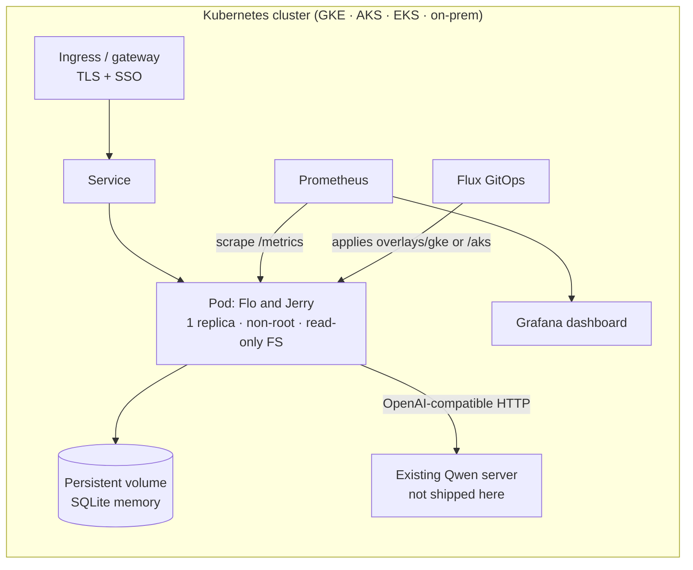

### 18.1 What is included

| File | What it does | Why |
|---|---|---|
| `Dockerfile` | Builds the web UIs, then a small Python image that runs as user 10001 | Non-root containers are a baseline security rule in most clusters |
| `--build-arg WITH_TORCH=0` | A "lean" image without PyTorch | The classical inspection doesn't need it, and it saves a lot of space |
| `--secret id=corp_ca,...` | Trusts a corporate proxy's certificate **during the build only** | Factory networks usually inspect TLS traffic; the certificate never ends up inside the image |
| `deploy/k8s/base/` | Namespace (Pod Security `restricted`), Deployment, Service, ConfigMap, volume, NetworkPolicy, ServiceAccount | One copy of the truth for every cloud |
| `deploy/k8s/overlays/gke` and `/aks` | Choose the right disk type per cloud (`standard-rwo` / `managed-csi`) | The only real difference between the two clouds here |
| `deploy/k8s/components/servicemonitor` | Optional `ServiceMonitor` for the Prometheus Operator | Clusters that use the operator ignore scrape annotations |
| `deploy/k8s/monitoring/grafana-dashboard.json` | Import into Grafana: tokens, calls, p95 latency, errors, CPU, queues | So the operations team sees the app the same way they see everything else |
| `deploy/flux/foodcare-copilot.yaml` | Flux watches git and applies the overlay | "GitOps": the cluster changes only when git changes, which leaves an audit trail |

### 18.2 Deploy in four steps

```bash
docker build -t <registry>/foodcare-copilot:0.1.0 . && docker push <registry>/foodcare-copilot:0.1.0
# edit deploy/k8s/base/kustomization.yaml (registry) and configmap.yaml (FOODCARE_LLM_BASE_URL / _MODEL)
kubectl label namespace <qwen-namespace> foodcare.io/llm-server=true     # the only place the pod may call
kubectl apply -k deploy/k8s/overlays/gke                                  # or overlays/aks
```

### 18.3 Verified, not just written

* The **lean image was built and run** in this repository's test environment the same way the manifest runs it: read-only filesystem, all Linux capabilities dropped, user 10001. `/api/health`, `/metrics`, the web UI and the git-backed demo shop all worked.
* `backend/tests/test_k8s_manifests.py` checks that:
  * every YAML file parses;
  * the app runs as **one replica with `Recreate`** (two copies must never write the same SQLite file);
  * the probes point at `/api/health`;
  * the NetworkPolicy has **no general internet egress** (no cloud AI APIs, by design);
  * the ConfigMap only sets variables the app actually reads;
  * **every metric the Grafana dashboard asks for is really exported**.
* **Not verified:** a run on a real GKE or AKS cluster. No cluster was available.

### 18.4 Why it is built this way, and why not the alternatives

| Choice | Why | Why not the alternative |
|---|---|---|
| **One replica** | Memory lives in SQLite, a single file that suits a single writer | Running several copies would need PostgreSQL first. Pretending otherwise would corrupt data |
| **Kustomize** rather than a Helm chart | It is built into `kubectl`, so there is no extra tool to trust or install | Helm is popular, and job postings in this industry mention it. The base maps 1:1 to a chart if a platform team requires one |
| **Cloud-neutral base + thin overlays** | Public job postings for a large potato processor name GKE *and* Azure | Betting on one cloud would make the integration useless on the other |
| **NetworkPolicy allowing only DNS and the model namespace** | The app must never reach a cloud AI service | An open egress would allow it silently |

Read the full research note, with sources and confidence labels, in [docs/MCCAIN_INTEGRATION.md](docs/MCCAIN_INTEGRATION.md).

---

## 19. System metrics and token usage

### 19.1 `/metrics`: the app's health in a format every ops team reads

Open `http://127.0.0.1:8700/metrics` and you'll see lines like:

```text
foodcare_llm_tokens_total{model="Qwen2.5-7B-Instruct",purpose="copilot.answer",type="prompt"} 18234
foodcare_http_request_duration_seconds_bucket{method="POST",route="/api/copilot/ask",le="0.5"} 41
foodcare_vision_jobs_queued 0
```

(The numbers above only illustrate the format.)

| Family | Examples | Answers the question |
|---|---|---|
| Health | `foodcare_up`, `foodcare_uptime_seconds` | Is it alive? |
| Web traffic | `foodcare_http_requests_total`, `..._duration_seconds` (histogram) | How busy is it, and how slow is each **route**? |
| Resources | process and machine CPU, resident memory | Is it starving the computer? |
| Local model | `foodcare_llm_requests_total`, `foodcare_llm_tokens_total`, `foodcare_llm_cache_hits_total`, queue depth, in flight | How much is the model used, and by what? |
| Work | agent runs, tool calls, vision queue, memory-database size | What is the app doing? |

**Privacy:** metric labels never contain usernames, questions or answers. Routes are recorded as templates (`/api/inspections/{id}`), so one label never turns into thousands. Turn the endpoint off with `FOODCARE_METRICS_ENABLED=0`.

### 19.2 Token usage: counted honestly

1. When the app calls your model, it asks the server to report usage (`stream_options.include_usage`, part of the OpenAI-compatible API that vLLM, llama.cpp, LM Studio and recent Ollama all follow).
2. Each call is saved in the memory database (`llm_usage` table) with its purpose, status, latency, cache flag and the **reported** token counts.
3. Cache hits are saved too, with zero tokens, because no model work was done.
4. If the server reports nothing, the count stays empty and the call is counted under "calls without counts". **No guessing.**

See it in three places: the **System Observability** page ([section 3.9](#39-system-observability)), `GET /api/llm/usage?days=30&mine=true`, or Grafana.

| Setting | Default | What it does |
|---|---|---|
| `FOODCARE_LLM_STREAM_USAGE` | `1` | Ask the model server for token counts (set `0` for an old server that rejects the field) |
| `FOODCARE_METRICS_ENABLED` | `1` | Serve `/metrics` |
| `FOODCARE_BIND_HOST` | `127.0.0.1` | The address the server listens on. A laptop stays private; containers set `0.0.0.0` |

---

## 20. Global Supply Chain Intelligence maps

> **One-line summary:** a spinning 3D globe (and a light 2D map) that shows where a food company's farms, suppliers, factories, warehouses and markets are, how they connect, where quality problems happened, how much money depends on each place, and what the next 30, 90 and 180 days *might* bring, with **every number labelled by where it came from**.


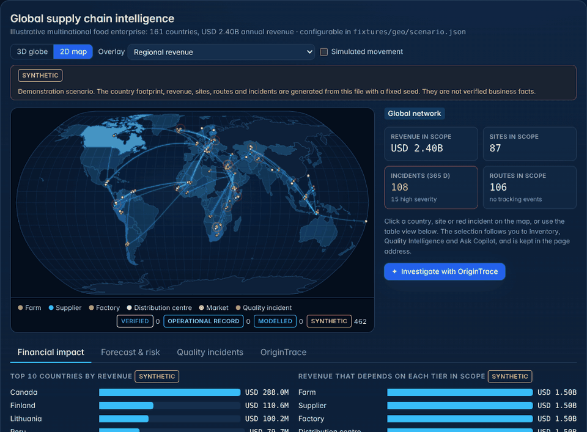

🎥 Videos: [executive-presentation.mp4](docs/media/executive-presentation.mp4) (31 s, for slides) · [globe.mp4](docs/media/globe.mp4) · [map2d.mp4](docs/media/map2d.mp4). All were recorded in a real browser by `e2e/record-media.mjs`, and nothing was drawn by hand.

### 20.1 Read this first: what is real and what is not

The brief asked for "an illustrative multinational food enterprise serving 161 countries with billion-dollar revenue". **That company does not exist in this app's data.** Before writing any code, an [audit](docs/audits/GLOBAL_SUPPLY_CHAIN_MAPS_AUDIT.md) checked the repository and found no coordinates, no farms, no factories, no routes and no tracking events. So the global network is a **configurable synthetic scenario**, and the app says so everywhere:

| Label (badge colour) | Meaning | Where you will see it now |
|---|---|---|
| **Verified** (green) | Confirmed enterprise data | **Nowhere: the count is 0**, and the legend shows that zero on purpose |
| **Operational record** (cyan) | Something that really happened *in this app*, such as your own potato inspection | Your inspection batches placed on the map (see 20.8) |
| **Modelled** (blue) | A calculation about the future, with uncertainty | The 30/90/180-day risk bands |
| **Synthetic** (gold) | Invented for the demo from a fixed recipe | Countries, revenue, sites, routes, historical incidents |

*Why so strict?* A beautiful globe is persuasive. If it showed invented revenue per country without a label, someone could put that number in a board deck. The gold banner above the map reads: *"Demonstration scenario… They are not verified business facts."*

### 20.2 Words you will meet

| Word | Plain meaning |
|---|---|
| **Node / site** | One place on the map: a farm, supplier, factory, distribution centre or market |
| **Arc / route** | The curved line between two sites, meaning "this one supplies that one" |
| **Tier** | The step in the chain: farm → supplier → factory → distribution centre → market |
| **Overlay** | Which number colours the countries: revenue, exposure, supplier quality, or incidents |
| **Exposure** | How much yearly revenue would be hurt if this place stopped working |
| **Drill-down** | Clicking deeper: world → country → site → individual incident |
| **Monte Carlo** | Running the future 400 times with dice, then looking at the spread of results |
| **Percentile band (P10–P90)** | "In 8 out of 10 simulated futures, the result landed inside this range" |
| **Tracking event** | A real scan saying "this truck or container is here now". **There are none**, so moving dots are only shown when you switch on *Simulated movement*, which carries a SIMULATED badge |

### 20.3 Where the map appears (one component, not three dashboards)

The same `SupplyMap` component is reused, each time opening on the most useful tab:

| Page | Title on the page | Opens on | Colours countries by |
|---|---|---|---|
| **Executive Command** | Global supply chain intelligence | Financial impact | Regional revenue |
| **Inventory** (the supply-chain page) | Supply chain network, forecast & risk | Forecast & risk | Financial exposure |
| **Quality Intelligence** | Geographic quality incidents | Quality incidents | Operational risk |
| **Ask Copilot / Agent Intelligence** | (no map) OriginTrace answers, recorded as agent runs | — | — |

*Why not a new "Supply Chain" or "Financial Impact" page?* The audit found that Inventory already *is* the supply-chain page, and that revenue already lives on Executive Command. New pages would have duplicated them, so Financial Impact and Forecast & Risk became **tabs** of the shared map.

### 20.4 How to use it, click by click

1. Open **Executive Command** and scroll to *Global supply chain intelligence*. The globe slowly turns. Drag it to rotate and scroll to zoom. The rotation stops as soon as you touch it.
2. **Hover** over a dot to see the site's tier, country, revenue dependent on it, on-time %, quality pass %, and the words "SYNTHETIC site (approximate location)".
3. **Click a country** (or use *Table view → Select*). The camera flies there in about 1.4 seconds. The breadcrumb reads `Global network › Peru`, and the four KPI cards switch to that country.
4. **Click a site.** Its whole chain lights up in gold, from the farms upstream to the markets downstream, and everything else fades.
5. **Click a red dot** (a quality incident). The breadcrumb grows to `… › GEO-INC-0041`, and a red box shows what happened, when, how severe it was, and the lot number.
6. Use the tabs under the map:
   * **Financial impact:** the top countries by revenue, and the revenue that depends on each tier, with the formula written underneath.
   * **Forecast & risk:** three bars for 30, 90 and 180 days. The shaded part is the uncertainty range and the gold line is the median.
   * **Quality incidents:** a list of incidents (click one to fly to it) and a small chart of incidents per month (recurrence).
   * **OriginTrace:** every path from the selected site back to a farm.
7. Press **Investigate with OriginTrace**. The copilot answers in writing, with citations.
8. Now open **Inventory** or **Quality Intelligence**. Your selection is still there: the gold chip in the header shows `Peru › GEO-MAR-04`, and the address bar holds `?geo=c:604|n:GEO-MAR-04`. Reload or share the link and it is kept. Press ✕ on the chip to clear it everywhere.

### 20.5 How the synthetic network is built (the recipe)

Everything comes from `fixtures/geo/scenario.json` and a fixed random seed, so it is the same on every computer and every run. `backend/app/geo.py` does this:

1. **Countries.** It takes the 173 countries in Natural Earth's public-domain world map, removes three disputed or non-sovereign territories (W. Sahara, Fr. S. Antarctic Lands, Falkland Is.), keeps the home country (Canada, id 124), and draws the other 160 at random with the seed. That makes **161**.
2. **Revenue per country.** The home country gets a fixed share (12%). The other countries share the remainder in proportions drawn from a *log-normal* distribution, which gives a few big markets and many small ones, as in real life. The amounts are rounded and then corrected so they add up to **exactly** the configured USD 2,400,000,000. A test checks this to the dollar.
3. **Sites.**
   * 30 markets go into the 30 biggest-revenue countries.
   * 12 distribution centres, 9 factories, 14 suppliers and 22 farms are spread across the larger countries.
   * Each site is placed **near its country's centre**, with a little random wobble. That is why the tooltip says "approximate location": no real address is ever implied.
4. **Links.** Every farm supplies its nearest supplier, and every supplier its nearest factory. Each factory feeds its 2 nearest distribution centres, and each centre feeds its 2 nearest markets. Any site left without a supplier is linked to the closest one. The transport mode (road / rail / sea) and lead time follow from the distance.
5. **Money that depends on each site.** A market carries its country's revenue, split if the country has several markets. Walking *upstream*, each site carries the revenue of everything it feeds, split evenly between that site's suppliers. Only countries that have a market site are traced this way (USD 1.50B of USD 2.40B), and the UI says so.
6. **A year of incidents.** For each non-market site, the number of incidents in the last 365 days is drawn from a Poisson distribution (about 1.6 a year on average, varying by site). Each gets a date, a type (bruising, greening, soft rot, temperature excursion…), a severity and a lot number such as `SYN-LOT-22389`.

### 20.6 How the 30/90/180-day risk simulation works

There is no crystal ball here. It is a stated model, and the method text is shown on the screen:

1. **How often does each site have problems?** If a site had 3 incidents last year, we don't know its true rate exactly. It might really be 2 or 5. So each run *draws* a plausible rate (a Gamma distribution centred on the history).
2. **How many problems in the next N days?** Each run rolls a Poisson count for 30, 90 or 180 days.
3. **How bad is each one?** Each run draws a disruption length (a log-normal distribution with a median of 3 days). The loss is the disrupted days × the site's dependent revenue ÷ 365.
4. **Repeat 400 times**, sort the results, and report the 10th, 50th and 90th percentiles.

**Worked example (whole network, default scenario):** in the next 30 days the median run has **7 incidents** (in 8 of 10 runs, between 4 and 11) and **USD 7.6M** of revenue exposed (USD 2.6M–14.8M). At 180 days it is 44 incidents (35–54) and USD 46.9M (USD 34.1M–65.6M). The exposure band is USD 12.2M wide at 30 days and USD 31.5M wide at 180 days. A test checks that the bands never shrink with the horizon, because more time means more uncertainty. *A wider band means "we are less sure", not "more danger".*

### 20.7 OriginTrace

There was no "OriginTrace AI" in the repository, so it was built **on top of the existing copilot**, not as a separate agent. Questions such as *"OriginTrace: trace GEO-SUP-04 back to the farm"* or *"What is the supply chain exposure in Peru?"* go to a new `origin_trace` intent. It answers from the network with:

* the upstream paths;
* the downstream reach;
* the revenue dependent on the site;
* the incident recurrence;
* the modelled 30/90/180-day risk with ranges;
* `[S1]` / `[S2]` citations to the synthetic scenario and to the simulation.

Each answer is saved as an agent run, so it shows up on **Agent Intelligence**. Existing questions (sales, stock and so on) are routed exactly as before, and a test proves it.

### 20.8 Putting your real inspections on the map

On **Potato Inspection**, the *Supplier* box now suggests the network's supplier names. If you inspect a batch with one of those names and 20% or more of its potatoes are graded Not Good, the batch appears on the map as a red **operational record** at that supplier. **Only you** see it: another user, or someone signed out, sees no trace of your batch, and a test checks both cases. (Full multi-company "tenant" isolation is a planned later phase; see 20.12.)

### 20.9 Speed, motion and accessibility (measured)

| Fact | Value | How it was measured |
|---|---|---|
| First render of the globe | ~440–510 ms | `data-render-ms` in a headless browser with *software* WebGL; a real GPU is faster |
| Extra download for the 3D globe | 128 kB gzip | Loaded **only** when a map with 3D view is on screen (Vite code-splitting) |
| World borders | 38 kB gzip | Natural Earth 1:110m, also loaded on demand. No map tiles, no API key, no paid service |
| Network data | 87 sites, 106 routes, 108 synthetic incidents | `/api/geo/network`, cached once per signed-in user |
| Off-screen cost | ~0 | The render loop pauses when the globe is scrolled away or the tab is hidden |

* **Reduced motion.** If your computer asks for less motion, the app starts on the 2D map, does not rotate, and makes camera moves instant. No pulsing rings appear. A test checks this.
* **No WebGL, or a phone.** The 2D map is the default under 768 px wide. If WebGL fails, the app falls back to 2D on its own. A test checks that a 390 px phone screen never scrolls sideways.
* **Keyboard and screen readers.** *Table view* lists every country and site with a **Select** button. The map has a text description, and every chart has a text alternative.

### 20.10 Why these choices, and why not the alternatives

| Choice | Why | Why not the alternative |
|---|---|---|
| **Three.js** for the globe | Full control of glow, atmosphere and arcs; MIT licence; works offline | **deck.gl** GlobeView is still marked experimental and is heavier. **MapLibre** needs map *tiles*: hosted tiles usually need an account or a paid plan, which the brief ruled out |
| **d3-geo** SVG for 2D | Tiny, crisp at any size, accessible, works without a GPU | A second WebGL map would double the cost and still fail on the same machines |
| **One `SupplyMap` component** | Fix a bug once and every page gets the fix | Separate maps per page drift apart |
| **Selection in the URL** | Survives reloads, the back button and shared links | Memory-only state is lost on reload |
| **Synthetic per-country split** (your choice) | Shows the full experience at 161-country scale | Real per-country figures do not exist here; inventing them without labels would be fabrication |
| **Static arcs by default** | There are 0 tracking events, so nothing is really moving | Always-on flowing dots would imply live shipments that don't exist |

### 20.11 Change the scenario

Edit `fixtures/geo/scenario.json`, or point `FOODCARE_GEO_SCENARIO` at your own copy:

| Key | Default | Meaning |
|---|---|---|
| `countries` | `161` | Countries in the footprint (1–170) |
| `annual_revenue`, `currency` | `2400000000`, `USD` | Total revenue that is split across countries |
| `home_country`, `home_revenue_share` | `124` (Canada), `0.12` | The home market and its fixed share |
| `network` | 22 farms, 14 suppliers, 9 factories, 12 DCs, 30 markets | How many sites of each tier |
| `incidents_per_site_year`, `history_days` | `1.6`, `365` | How many synthetic incidents to generate |
| `disruption_days_median` | `3.0` | The typical length of a disruption in the simulation |
| `seed` | `2026` | Change it to get a different but equally reproducible world |

### 20.12 Tested, and not yet done

* **Backend (7 tests, `test_geo.py`):**
  * the scenario can be configured, and revenue adds up to the dollar;
  * every item carries a provenance label and **0 are marked verified**;
  * the country filter keeps only that country and its direct links;
  * every trace reaches a farm;
  * the risk bands are ordered, reproducible and widen with the horizon;
  * inspections show only for their owner;
  * OriginTrace answers with citations, and old intents are unchanged.
* **Browser (2 tests, `e2e/geo.spec.ts`):**
  * the drill-down from country to site, and the forecast and trace tabs;
  * the selection survives moving to another page and a reload;
  * OriginTrace works from the map;
  * Quality Intelligence opens on incidents, and clearing the selection removes it from the URL;
  * the render budget is met;
  * reduced motion starts on 2D, and a phone width never scrolls sideways.
* **Not done yet:**
  * multi-tenant isolation, which needs a `tenant_id` on every table and is a separate phase you approved for later;
  * real coordinates or routes (none exist);
  * live shipment tracking (no source is connected).

---

*Flo & Jerry — Food Copilot 2.0 is a portfolio prototype. All companies, products, people and figures in it are fictional.*
