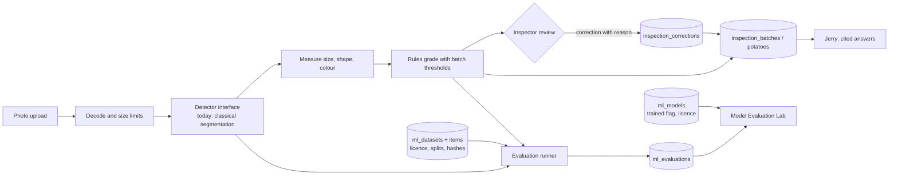

# FoodCare architecture: vision, evaluation and governance

| Layer | Where | Notes |
|---|---|---|
| Detector interface | `backend/app/vision/service.py` (`Detector`) | A trained model plugs in here without other changes |
| Storage-free analysis | `vision.service.analyse_bytes` | Same code path as stored batches; used by evaluations |
| Registry | `backend/app/ml/registry.py` | Models, datasets, evaluations; `trained` flag is explicit |
| Datasets | `backend/app/ml/datasets.py` | COCO import, licence required, group-aware split, near-duplicate merge, checksum verification |
| Metrics | `backend/app/ml/metrics.py` | Detection, counting, classification, segmentation, calibration |
| Human review | `vision.service.correct_potato` | The rules' grade is kept; the correction wins; audited; summary updated |
| Database | `var/memory/memory.db` (migrations 1-5) | Images stay as files; SQLite stores references |

## Not built yet (and what each needs)
| Capability | Needs |
|---|---|
| Neural classification (MobileNetV3 / ResNet18) | Approval to install PyTorch and torchvision (CPU), a decision on pretrained weights, and labelled potato defect photos |
| Detection / instance segmentation (Faster/Mask R-CNN) | The same as above, plus box and mask labels |
| Video counting with tracking | Video files of potatoes on a conveyor or table; an IoU tracker will be written in-project (no new dependency) |
| French-fries inspection | Labelled fries images; physical lengths need a calibration target |
| Predictions (rejection, yield, spoilage, demand) | Historical records with real outcomes. Demand forecasting can use the existing synthetic sales, clearly labelled |
| Financial intelligence | Verified unit costs and measured waste quantities. Demo figures will be labelled synthetic |
| Equipment anomaly detection | Sensor data. Without it, only an explicitly labelled simulation |
