<div align="center">

# 🏥 MedAccess AI — Dr. Christina Copilot

### Smarter Healthcare Access. Shorter Waits. Better Choices.


*A multi-agent AI copilot that helps patients find potentially earlier medical appointments,<br/>and an AI-driven software lifecycle that keeps it honest.*

</div>

> **⚠️ DEMONSTRATION DATA — NOT LIVE APPOINTMENT AVAILABILITY.**
> Every facility, appointment and user is fictional. No real provider is connected, no appointment is ever booked,
> and deployments in the SDLC demo are simulated. **Christina is a virtual AI assistant, not a licensed physician.**

---

## 📑 Contents

1. [Why this exists](#-why-this-exists)
2. [At a glance](#-at-a-glance)
3. [System architecture](#-system-architecture)
4. [The patient journey](#-the-patient-journey)
5. [The agent workflow (LangGraph)](#-the-agent-workflow-langgraph)
6. [How availability is verified](#-how-availability-is-verified)
7. [Booking: handoff, not fabrication](#-booking-handoff-not-fabrication)
8. [Safety, privacy and the agent harness](#-safety-privacy-and-the-agent-harness)
9. [Knowledge with citations (RAG)](#-knowledge-with-citations-rag)
10. [The AI-SDLC Command Center](#-the-ai-sdlc-command-center)
11. [Data model](#-data-model)
12. [Deployment and CI/CD](#-deployment-and-cicd)
13. [Screenshots](#-screenshots)
14. [Quick start](#-quick-start)
15. [Testing](#-testing)
16. [Repository layout](#-repository-layout)
17. [Status and limitations](#-status-and-limitations)

---

## 💡 Why this exists

My best friend had to wait three months for an MRI. The appointment existed, but nobody could answer one question:
**is there an earlier, eligible appointment somewhere else?** That information is scattered across phone lines,
booking pages and referral rules. MedAccess AI brings it together, and it is designed above all **never to overstate
what it knows**.

📖 Full story: [*My best friend had to wait three months for an MRI*](https://medium.com/@florinaregius/my-best-friend-had-to-wait-three-months-for-an-mri-142bbc859bdc)

---

## 🔭 At a glance

| | Healthcare Access Intelligence | Enterprise AI-SDLC |
|---|---|---|
| **Who** | Patients, through Dr. Christina | Engineers, product owners, release approvers |
| **What** | Find, verify, compare and hand off earlier appointments | Requirement → architecture → code → test → release → monitoring |
| **Engine** | LangGraph patient graph: 22 nodes, 20 agents | LangGraph SDLC graph: 15 stages, 8 agents |
| **Human gates** | Radius expansion, booking handoff | Requirement clarification, production release |
| **Proof** | 129 backend tests, 29 QA scenarios, 7 e2e browser tests | Injected defect detected, root cause confirmed, fix released |

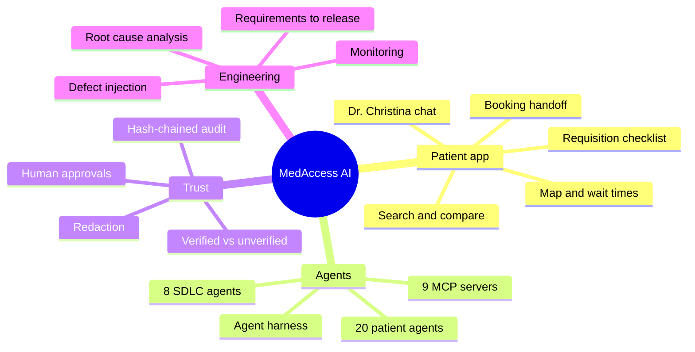

---

## 🏗️ System architecture

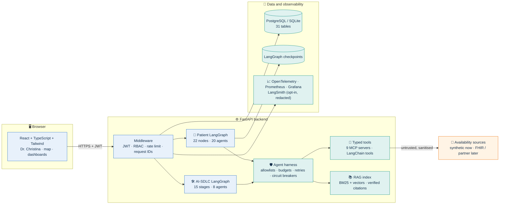

**Design rule:** LLMs are optional and never make safety-relevant decisions. Distance, dates, verification,
eligibility, ranking and booking transitions are deterministic Python with Pydantic-typed inputs and outputs.

---

## 🧑‍⚕️ The patient journey

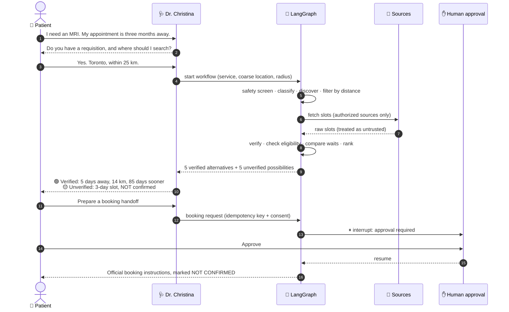

---

## 🧭 The agent workflow (LangGraph)

An explicit `StateGraph` with conditional branches, durable checkpoints and two human interrupts.

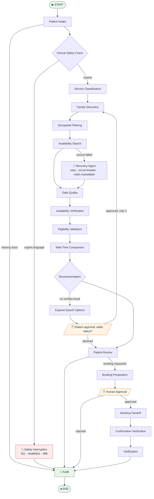

### The 20 patient agents

| Group | Agents | Responsibility |
|---|---|---|
| 🎛️ **Control** | Supervisor · Human Approval · Recovery | Run the graph, enforce budgets and checkpoints, pause for people, recover from failures |
| 🗣️ **Understand** | Patient Intake · Clinical Safety · Service Classification | Collect the minimum needed, screen for emergencies, map requests to services |
| 🔎 **Find** | Facility Discovery · Geospatial Intelligence · Availability Search | Find facilities, filter by distance (2–100 km), query authorized sources |
| ⚖️ **Judge** | Availability Verification · Requisition Eligibility · Wait-Time Intelligence · Recommendation | Verify, check eligibility, compute waits, rank in separate tiers |
| 🤝 **Act** | Booking Assistance · Notification · RAG Knowledge | Prepare handoffs, send consent-gated reminders, answer with citations |
| 🛡️ **Guard** | Data Quality · Privacy and Security · Audit · Monitoring | Catch bad data, minimise and redact, record everything, watch health |

--- a17[Human Approval] --- a20[Recovery]
    end
    subgraph Understand["🗣️ Understand"]
        a2[Patient Intake] --- a3[Clinical Safety] --- a4[Service Classification]
    end
    subgraph Find["🔎 Find"]
        a5[Facility Discovery] --- a6[Geospatial Intelligence] --- a7[Availability Search]
    end
    subgraph Judge["⚖️ Judge"]
        a8[Availability Verification] --- a9[Requisition Eligibility] --- a10[Wait-Time Intelligence] --- a11[Recommendation]
    end
    subgraph Act["🤝 Act"]
        a12[Booking Assistance] --- a13[Notification] --- a14[RAG Knowledge]
    end
    subgraph Guard["🛡️ Guard"]
        a15[Data Quality] --- a16[Privacy and Security] --- a18[Audit] --- a19[Monitoring]
    end
```

---

## ✅ How availability is verified

Every slot is classified by deterministic rules (`backend/app/services/verification.py`).

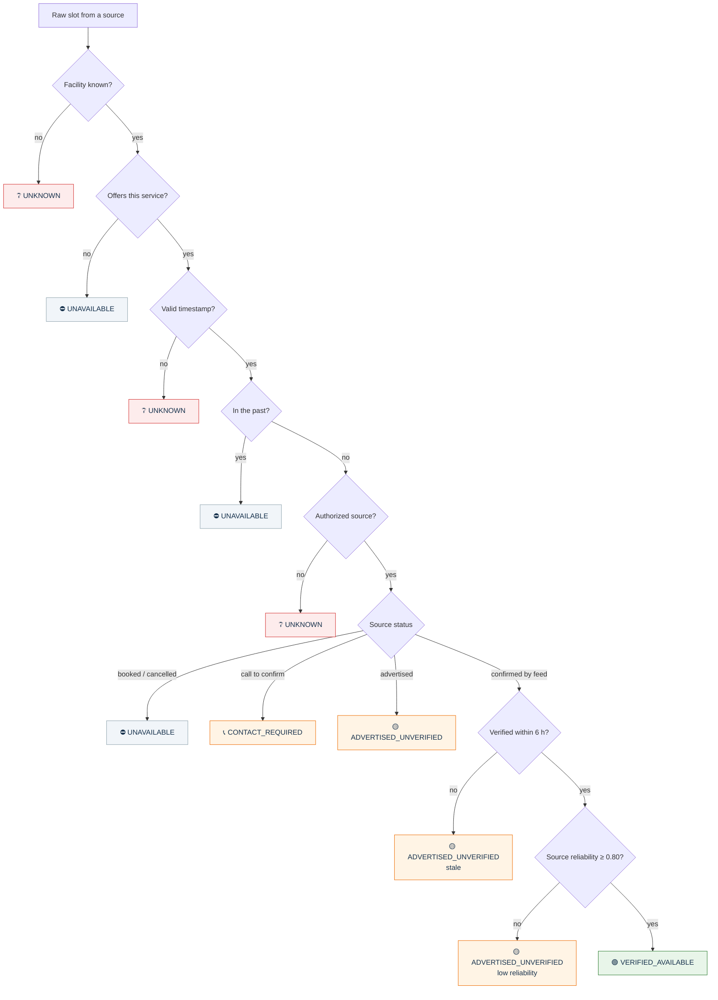

Synthetic records additionally display **`DEMO_SIMULATED`**. Results are then split into two tiers that never mix:

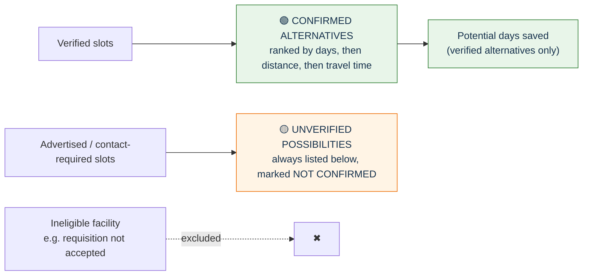

---

## 🤝 Booking: handoff, not fabrication

MedAccess AI never books on a patient's behalf. A booking reaches `PROVIDER_CONFIRMED` only through a verifiable
confirmation from an authorized live integration, which synthetic data can never produce (enforced by tests).

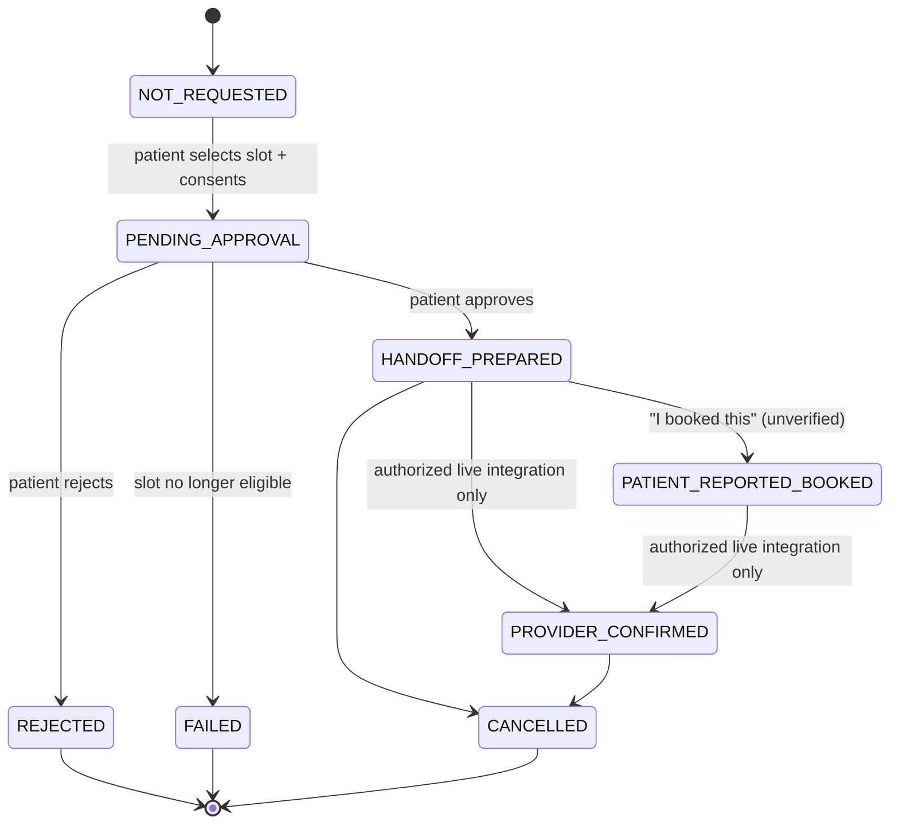

Booking requests are **idempotent**: the same idempotency key always returns the same request, never a duplicate.

---

## 🛡️ Safety, privacy and the agent harness

Every tool call made by any agent passes through the harness (`backend/app/harness/core.py`):

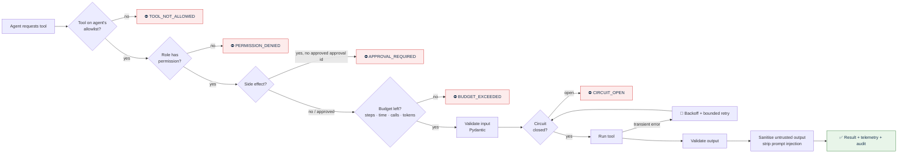

Privacy-by-design, from input to export:

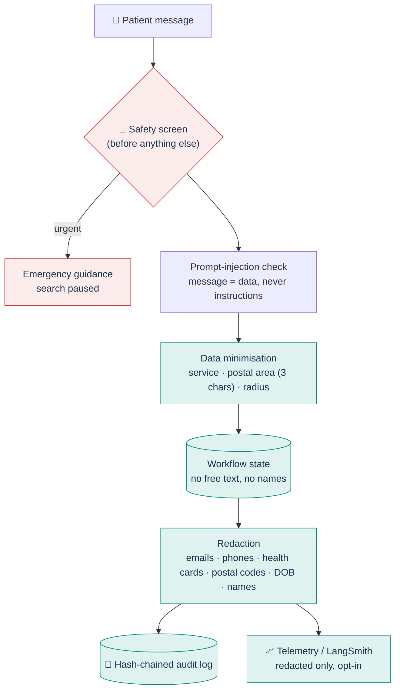

| Control | Where | Tested by |
|---|---|---|
| JWT auth + RBAC + object-level ownership | `security/auth.py`, routes | `tests/security/` |
| Human approval and separation of duties | `governance/approvals.py` | `tests/agents/`, `tests/security/` |
| Redaction before audit and tracing | `security/guards.py`, `telemetry/tracing.py` | `test_redaction`, `test_langsmith_redaction_hook` |
| Tamper-evident audit | `governance/audit.py` | `test_audit_log_is_redacted_and_tamper_evident` |
| No secrets in the frontend | build scan + Security Agent | e2e `no API keys or secrets in the served frontend` |
| Field encryption, startup secret checks | `security/crypto.py`, `config/settings.py` | `test_production_config_requires_secrets` |

---

## 📚 Knowledge with citations (RAG)

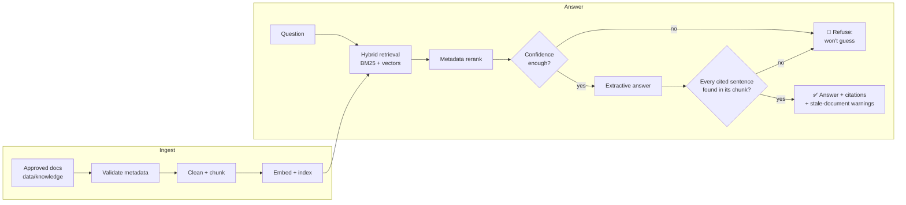

The knowledge base contains platform documentation, a summary of public Ontario help lines (verify at source) and
clearly labelled fictional facility documents. **No invented medical policies.**

---

## 🛠️ The AI-SDLC Command Center

**The 90-Day MRI Wait-Time Challenge** runs on a separate LangGraph: 15 stages, 8 engineering agents and 2 human checkpoints.

```mermaid
flowchart LR
    S1[1 · Business<br/>requirement] --> S2[2 · Ambiguity<br/>detection]
    S2 --> S3[/3 · ✋ Human<br/>clarification/]
    S3 --> S4[4 · Architecture] --> S5[5 · Development<br/>build 1.4.0]
    S5 --> S6[6 · QA<br/>29 scenarios] --> S7[7 · Simulation<br/>ground truth]
    S7 --> S8[8 · 💣 Injected defect<br/>build 1.5.0]
    S8 --> S9[9 · 📈 Monitoring<br/>anomaly detected]
    S9 --> S10[10 · 🔍 Root cause<br/>with evidence]
    S10 --> S11[11 · Fix<br/>build 1.5.1]
    S11 --> S12[12 · Regression<br/>+ security]
    S12 --> S13[/13 · ✋ Release<br/>approval/]
    S13 --> S14[14 · Deployment<br/>simulated]
    S14 --> S15[15 · Post-release<br/>monitoring]

    classDef gate fill:#FFF4E5,stroke:#ED6C02,color:#17324D
    classDef bad fill:#FDECEC,stroke:#D32F2F,color:#17324D
    classDef ok fill:#E8F5E9,stroke:#2E7D32,color:#17324D
    class S3,S13 gate
    class S8,S9 bad
    class S11,S12,S15 ok
```

### The injected defect, end to end

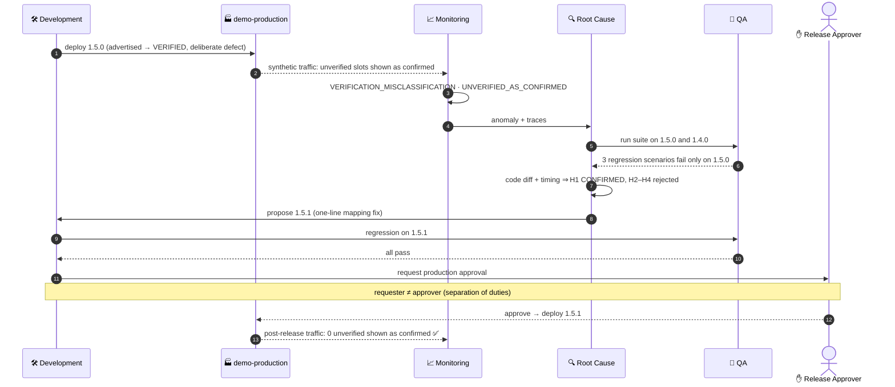

### Root-cause hypotheses are evidence-gated

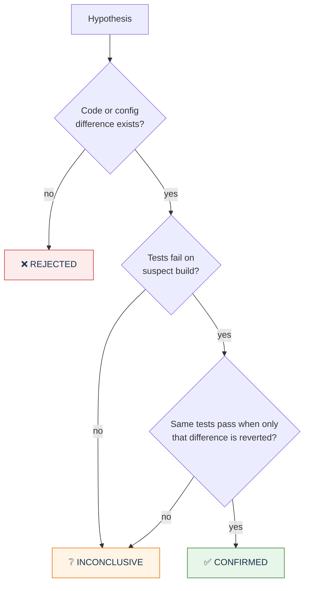

### Traceability chain

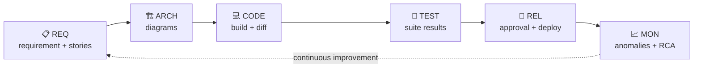

---

## 🗄️ Data model

31 tables in PostgreSQL (Alembic migration verified on PostgreSQL 16). Core relationships:

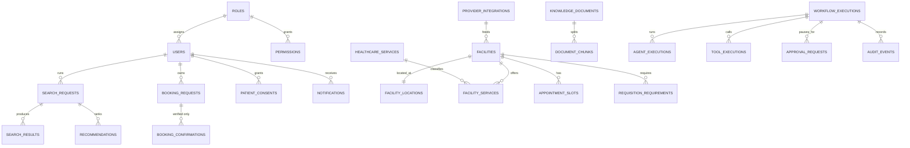

Also: `slot_verifications`, `model_usage`, `integration_errors`, `system_metrics`, `release_versions`,
`user_preferences`, `sdlc_artifacts`. All timestamps are UTC and shown in the facility's local time zone.

### Three separated data modes

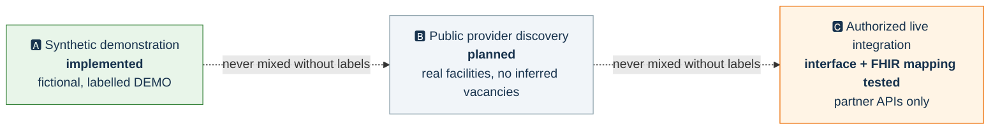

---

## 🚢 Deployment and CI/CD

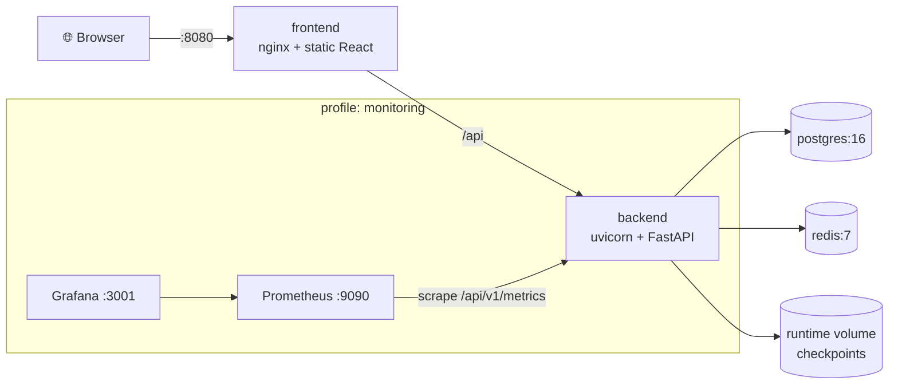

```mermaid
flowchart LR
    C[Commit] --> L[Lint · ruff] --> TC[Type check<br/>mypy · tsc]
    TC --> UT[Tests<br/>SQLite + PostgreSQL]
    UT --> SEC[Security<br/>pip-audit · npm audit · suites]
    SEC --> BLD[Build containers]
    BLD --> STG[Ephemeral staging<br/>docker compose]
    STG --> E2E[Playwright e2e]
    E2E --> GATE[/✋ GitHub environment<br/>approval/]
    GATE --> PROD[Production deploy<br/>no target configured]
    PROD --> POST[Post-deploy checks]

    classDef gate fill:#FFF4E5,stroke:#ED6C02,color:#17324D
    class GATE gate
```

---

## 📸 Screenshots

| Search results | Dr. Christina on mobile |
|---|---|
| 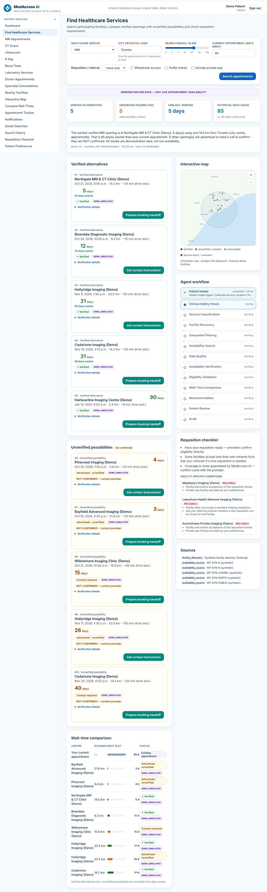 | 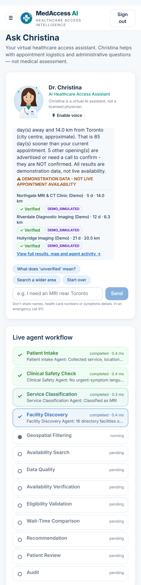 |
| **Booking handoff approval** | **AI-SDLC root cause** |
| 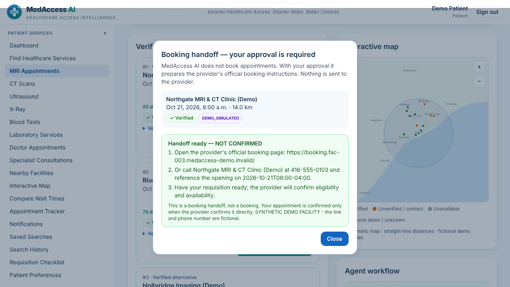 | 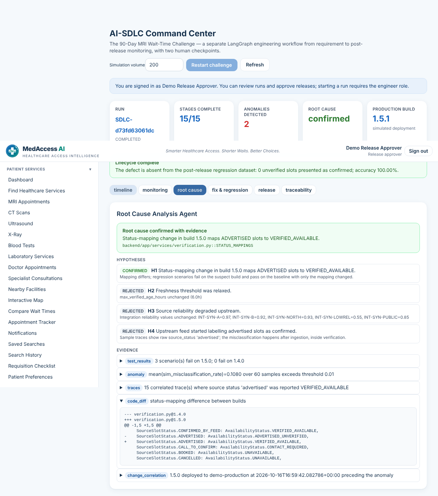 |

*Captured automatically by the Playwright end-to-end suite.*

---

## 🚀 Quick start

### Docker (recommended)

```bash
cd medaccess-ai
docker compose up --build                       # UI → http://localhost:8080 · API docs → http://localhost:8000/docs
docker compose --profile monitoring up --build  # + Prometheus :9090 · Grafana :3001
```

No API keys, cloud services or real patient data are needed. Sign in with a demo account on the start screen:

| Account | Can do |
|---|---|
| 🧑 Demo Patient | Chat with Christina, search, approve booking handoffs |
| 🛠️ Demo Engineer | Run the AI-SDLC challenge, QA, architecture, monitoring |
| ✅ Demo Release Approver | Approve production releases (separation of duties) |
| 🔑 Demo Administrator | Governance, administration, everything above |

> Behind a TLS-intercepting proxy, pass its CA as a BuildKit secret. See
> [deployment docs](docs/deployment/deployment-and-capacity.md).

### Local development

Requirements: Python 3.11+ (tested on 3.13) and Node 20+ (tested on 22).

```bash
cd medaccess-ai
python3 -m venv .venv && .venv/bin/pip install -r backend/requirements-dev.txt
(cd frontend && npm ci)
make backend    # API on :8000 (SQLite + synthetic data)
make frontend   # UI on http://localhost:5173
```

Optional settings live in `.env` (copy `.env.example`; it is git-ignored):

| Setting | Effect |
|---|---|
| `LLM_ENABLED=true` + `ANTHROPIC_API_KEY` | Christina rephrases replies with Claude; all decisions stay deterministic |
| `LANGSMITH_TRACING=true` + `LANGSMITH_API_KEY` | Exports **redacted** traces |
| `DATABASE_URL` | Use PostgreSQL instead of SQLite |

Keys stay on the backend. The frontend never sees them.

---

## 🧪 Testing

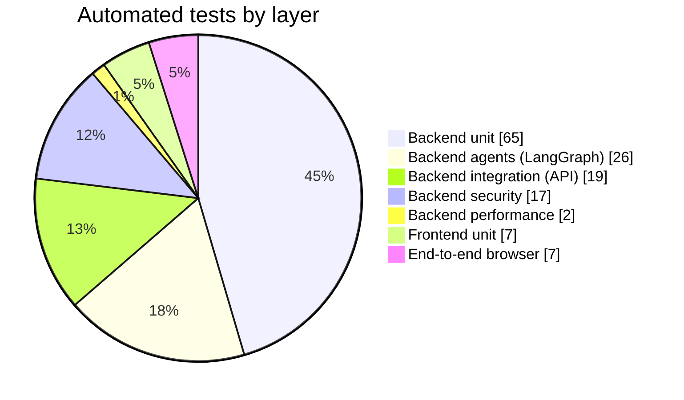

```bash
make test          # pytest (129) + JUnit report at sdlc/qa/pytest-report.xml + vitest (7)
make lint typecheck
TEST_DATABASE_URL=postgresql+psycopg://user:pw@localhost/medaccess .venv/bin/python -m pytest   # same suite on PostgreSQL
cd frontend && npm run build && npm run preview & npx playwright test   # e2e, desktop + mobile
```

| Evidence | Result |
|---|---|
| Backend tests | **129 passed** on SQLite and PostgreSQL 16 |
| QA Agent scenarios | **29/29** pass on 1.4.0 and 1.5.1; 3 fail on defective 1.5.0 (as designed) |
| End-to-end (Chromium, desktop + Pixel 7) | **7 passed** on dev servers and on the full Docker stack |
| Load test (one worker) | ~6.5 searches/s, p95 ≈ 204 ms at concurrency 1 |

---

## 🗂️ Repository layout

```text
medaccess-ai/
├── backend/app/
│   ├── api/            FastAPI routes + middleware
│   ├── agents/         agent catalogue (20 patient + 8 SDLC) and node logic
│   ├── graphs/         LangGraph StateGraphs: patient_graph.py, sdlc_graph.py
│   ├── harness/        allowlists, permissions, budgets, retries, circuit breakers
│   ├── tools/ mcp/     typed tools, 9 MCP servers, LangChain StructuredTools
│   ├── services/       geo, verification, eligibility, ranking, booking, synthetic data
│   ├── integrations/   availability adapters (synthetic, FHIR, partner interface)
│   ├── rag/            retrieval with citation verification
│   ├── copilot/        Dr. Christina conversation engine, optional LLM layer
│   ├── sdlc_engine/    requirements, architecture, QA, simulation, monitoring, RCA, security, release
│   └── governance/ security/ telemetry/ models/ database/ config/
├── backend/migrations/ Alembic (31 tables)
├── frontend/src/       React + TypeScript + Tailwind
├── tests/              unit · integration · agents · security · performance
├── data/knowledge/     approved knowledge base
├── sdlc/               artifacts generated by the SDLC agents
├── infrastructure/     nginx · Prometheus/Grafana · Kubernetes starter · load test
├── docs/               architecture · api · security · deployment · user-guide
└── docker-compose.yml
```

📘 More docs: [Architecture](docs/architecture/overview.md) · [API](docs/api/README.md) ·
[Security & privacy](docs/security/security-privacy.md) · [Deployment & capacity](docs/deployment/deployment-and-capacity.md) ·
[Demo walkthrough](docs/user-guide/demo-walkthrough.md) · [Implementation status](IMPLEMENTATION_STATUS.md)

---

## 📊 Status and limitations

| Area | Status |
|---|---|
| Patient workflow, verification, ranking, approvals, booking handoff | 🟢 Implemented and tested |
| AI-SDLC lifecycle with injected defect | 🟢 Implemented (deployments simulated) |
| Docker, PostgreSQL, Prometheus, Grafana | 🟢 Verified locally |
| Real provider data (FHIR / partner APIs) | 🟡 Interface + FHIR mapping tested on synthetic data only |
| LLM rephrasing and LangSmith tracing | 🟡 Wired up, not exercised without credentials |
| OAuth 2.0 / OIDC login | ⚪ Planned (demo JWT login today) |
| CI on GitHub, Kubernetes | ⚪ Defined, not yet run |
| PHIPA privacy impact assessment, legal review, formal accessibility audit | ⚪ Required before any real patient data |

Full evidence for every claim: [IMPLEMENTATION_STATUS.md](IMPLEMENTATION_STATUS.md).

---

<div align="center">

**In an emergency, call 911. For health advice in Ontario, call Health811 (811).**

*MedAccess AI is a prototype built with synthetic data. Christina is a virtual AI assistant, not a licensed physician.*

</div>
