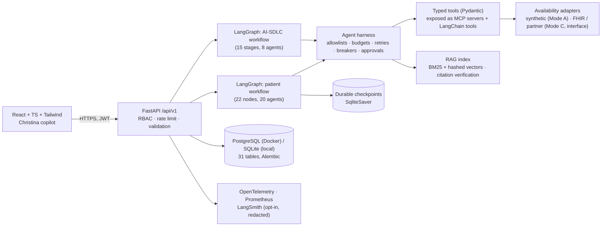

# MedAccess AI — Architecture

Live, code-generated versions of every diagram below are served by `GET /api/v1/sdlc/architecture`
and rendered in the **Architecture Explorer** page. The patient and SDLC workflow diagrams are produced by
`StateGraph.get_graph().draw_mermaid()` from the compiled LangGraphs, so they cannot drift from the code.

## 1. Components



| Layer | Location | Notes |
|---|---|---|
| API | `backend/app/main.py`, `backend/app/api/` | Error envelope `{"error":{code,message,request_id}}`, request IDs, security headers |
| Orchestration | `backend/app/graphs/` | `patient_graph.py`, `sdlc_graph.py`, typed state in `state.py` |
| Agents | `backend/app/agents/` | `registry.py` (catalogue), `patient_nodes.py` (node logic) |
| Harness | `backend/app/harness/core.py` | `AgentSpec`, `ToolSpec`, `RunContext`, `call_tool`, `CircuitBreaker` |
| Deterministic engines | `backend/app/services/` | geo, verification, eligibility, ranking, booking state machine, synthetic data |
| Tools / MCP | `backend/app/tools/`, `backend/app/mcp/servers.py` | 9 logical MCP servers; stdio entrypoint via MCP Python SDK |
| RAG | `backend/app/rag/pipeline.py`, `data/knowledge/` | extractive answers, verified citations, staleness, refusal |
| Copilot | `backend/app/copilot/` | Christina conversation state machine; optional LLM rephrasing |
| SDLC | `backend/app/sdlc_engine/` | requirements, architecture, QA, simulation, monitoring, RCA, security, release |
| Governance | `backend/app/governance/` | approvals, hash-chained audit, build registry |
| Telemetry | `backend/app/telemetry/` | Prometheus registry + rolling store (measured vs synthetic), OTel, LangSmith |

## 2. Patient workflow

```text
START → intake ─(missing input)→ audit
      → clinical_safety ─(urgent)→ safety_interruption → audit → END
      → service_classification → facility_discovery → geospatial
      → availability_search ─(source failed)→ recovery ─┐
                            └──────────────────────────→ data_quality
      → availability_verification → eligibility → wait_time → recommendation
      ─(no verified result)→ expand_search_options → expansion_approval [interrupt]
                                 ─(approved)→ facility_discovery (repeat search, max 2)
      → patient_review ─(booking requested)→ booking_preparation → human_approval [interrupt]
                                 ─(approved)→ booking_handoff → confirmation_verification → notification
      → audit → END
```

* **Deterministic decisions.** Distance, dates, verification status, eligibility, ranking and booking
  transitions are pure Python. LLMs (optional) only rephrase replies from redacted facts.
* **Durable human checkpoints.** `interrupt()` + `SqliteSaver`. Approval records are created *before*
  the interrupting node so a resumed node never duplicates side effects; `booking_handoff` is
  idempotent on the booking idempotency key.
* **No PHI in checkpoints.** Free text goes to the safety screen via the transient `RunContext.free_text`,
  never into graph state.
* **Execution controls** (`RunContext`): max graph steps, max wall-clock, max tool calls, token budget,
  per-agent retry limits, per-source circuit breakers, tool allowlists, role permissions, approval ids
  for side-effecting tools.

### Availability verification

| Source status | Rule | Result |
|---|---|---|
| `confirmed_by_provider_feed` | fresh (≤ 6 h) and source reliability ≥ 0.80 | `VERIFIED_AVAILABLE` |
| `confirmed_by_provider_feed` | stale or low-reliability source | `ADVERTISED_UNVERIFIED` |
| `advertised` | — | `ADVERTISED_UNVERIFIED` |
| `call_to_confirm` | — | `CONTACT_REQUIRED` |
| `booked` / `cancelled`, expired, wrong service | — | `UNAVAILABLE` |
| unknown facility, missing timestamp, unauthorized source | — | `UNKNOWN` |

Synthetic records additionally carry `display_status = DEMO_SIMULATED`. The ranking engine places verified
slots in the `CONFIRMED_ALTERNATIVE` tier and everything else in `UNVERIFIED_POSSIBILITY`; days-saved uses
verified alternatives only.

## 3. AI-SDLC workflow

Fifteen stages (`backend/app/graphs/sdlc_graph.py`), each writing an `sdlc_artifacts` row with a
traceability ref (`REQ-`, `ARCH-`, `CODE-`, `TEST-`, `REL-`, `MON-`). Human checkpoints: requirement
clarification (stage 3, `approval:engineering`) and production release (stage 13, `approval:release`,
requester ≠ approver).

The controlled defect is build **1.5.0**, whose status mapping sends `advertised → VERIFIED_AVAILABLE`.
Deployments switch the active build of in-process demo environments (`demo-staging`, `demo-production`);
they are labelled **simulated** everywhere.

## 4. Data modes

| Mode | Status | What it means |
|---|---|---|
| A — Synthetic demonstration | **Implemented** | `services/synthetic.py`, deterministic seed, fictional names/phones/`.invalid` URLs |
| B — Public provider discovery | Interface only | Would list real facilities + published booking instructions; never infers vacancies |
| C — Authorized live integration | Interface + FHIR mapping tested | `FhirSlotAdapter.map_bundle` tested on synthetic bundles; no live endpoint configured |

## 5. Persistence

31 tables (30 specified + `sdlc_artifacts`), Alembic migration `backend/migrations/versions/*_initial_schema.py`,
verified against PostgreSQL 16 and SQLite. Timestamps are UTC; display converts to the facility time zone
(`America/Toronto`). Search requests store only service, coarse location label and parameters.
