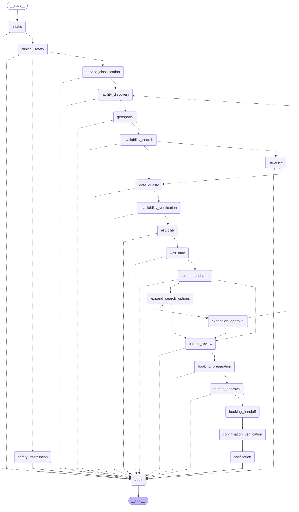
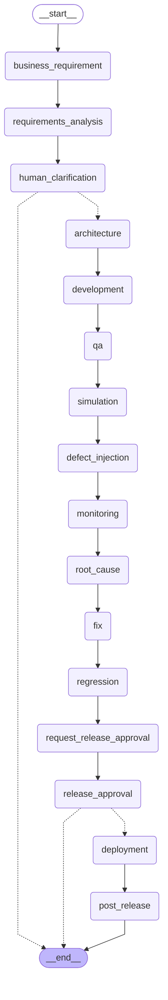
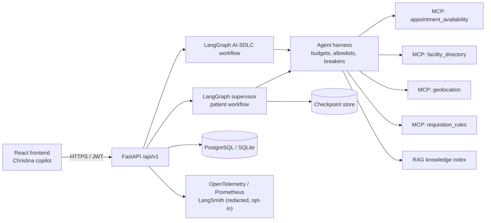
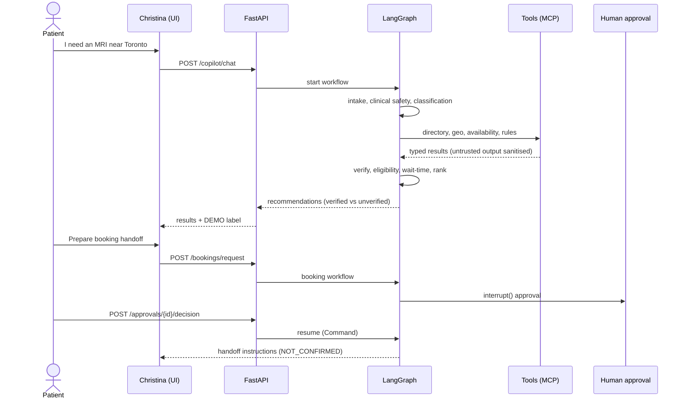
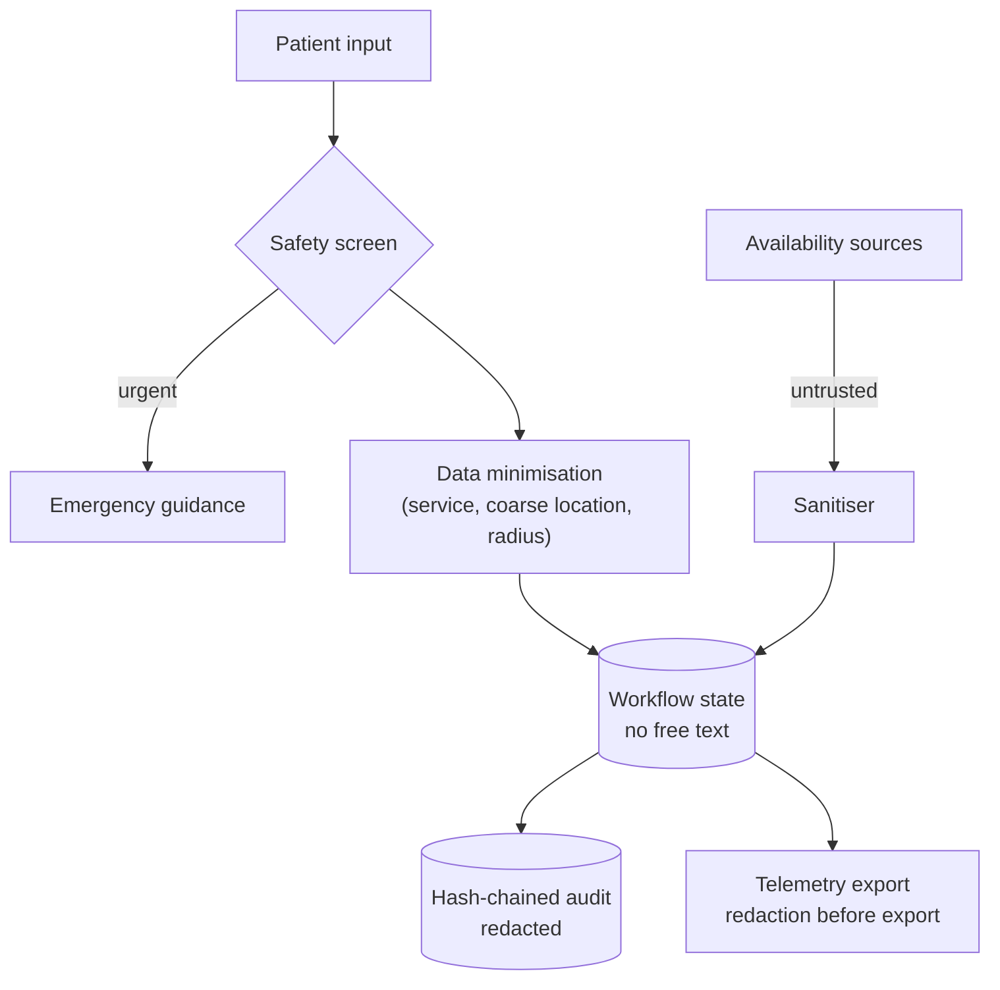
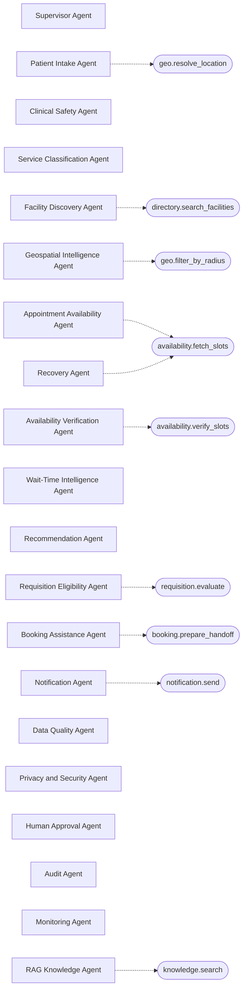
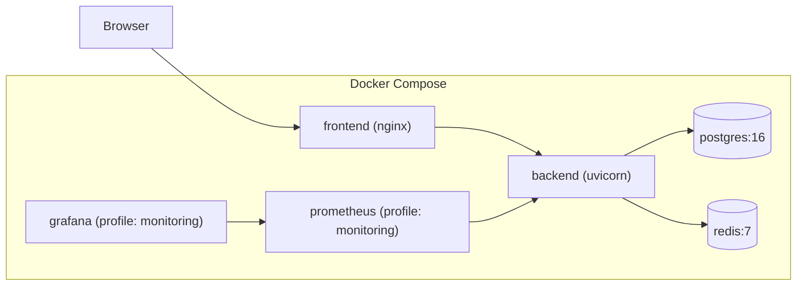
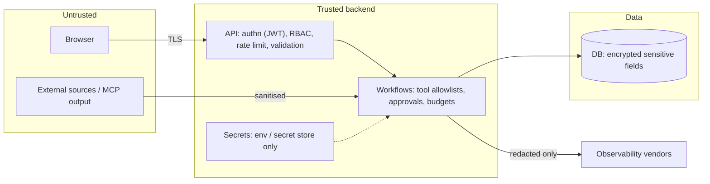

# Architecture diagrams (generated)
Regenerate with `python -m app.sdlc_engine.export`.

## Patient workflow (rendered from compiled LangGraph)

## AI-SDLC workflow (rendered from compiled LangGraph)

## High-level component architecture

## Search and booking-handoff sequence

## Data flow and privacy controls

## Agent-to-tool permissions (from registry)

## Local deployment (Docker Compose)

## Security boundaries

