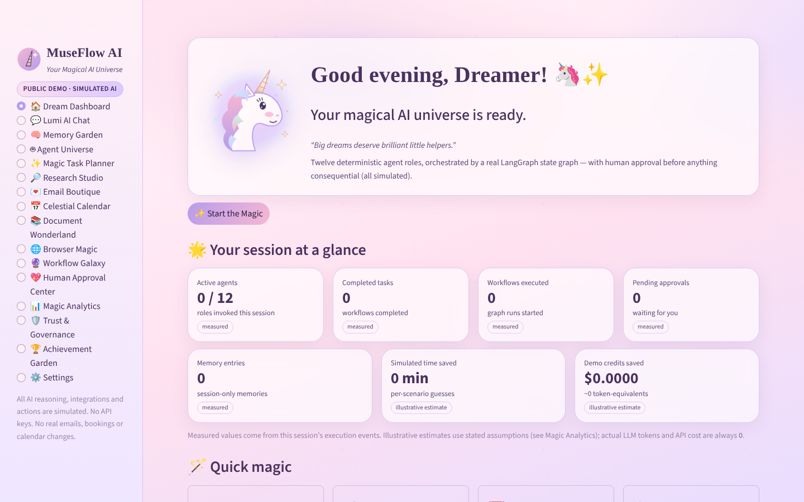
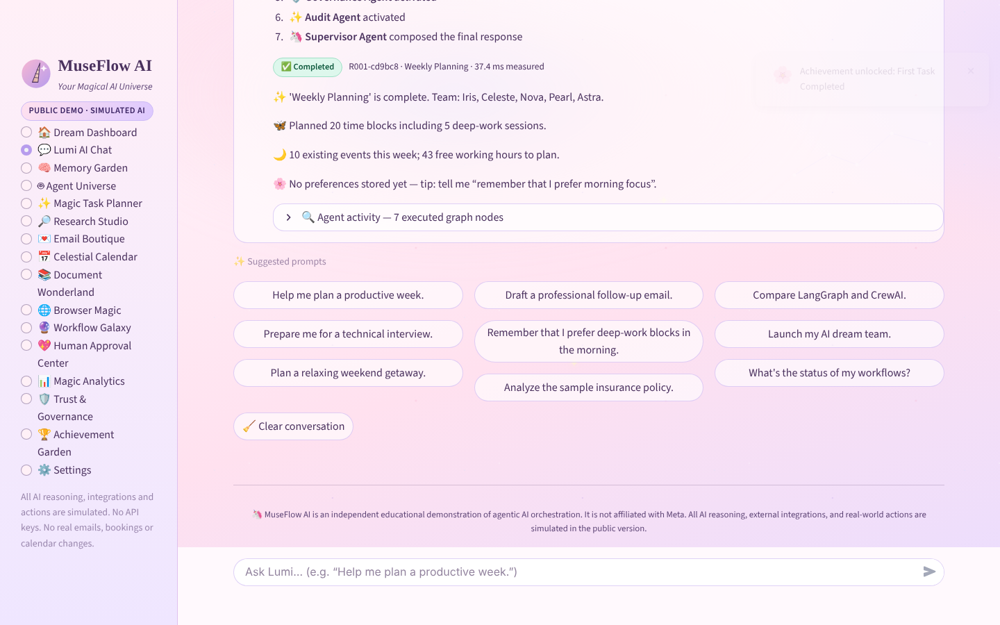
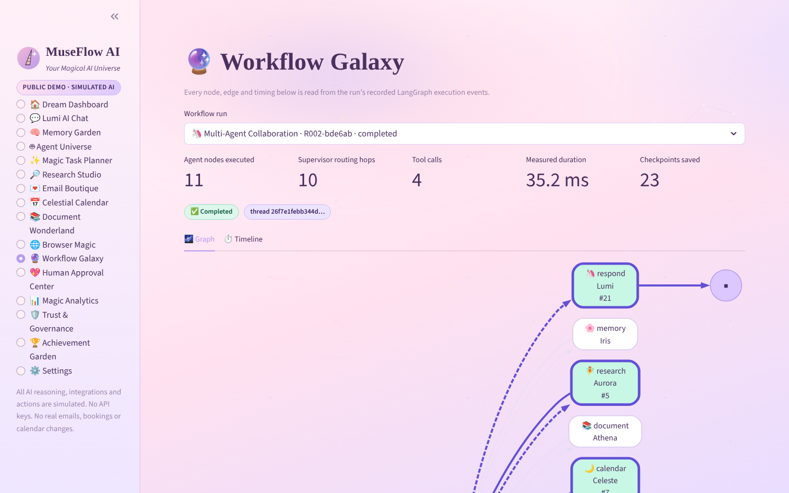
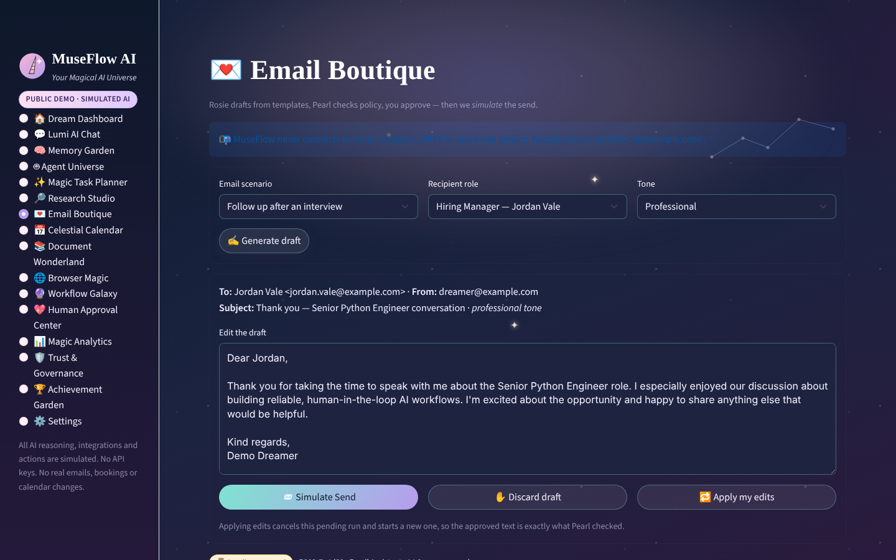

# 🦄 MuseFlow AI — Unicorn Edition
### Your Magical AI Universe ✨
*Dream it. Delegate it. Watch the magic happen.*

MuseFlow AI is an interactive Streamlit workspace that demonstrates **multi-agent orchestration,
human-in-the-loop approvals and agent observability** with a real **LangGraph `StateGraph`** —
wrapped in a pastel, holographic unicorn aesthetic.

> **PUBLIC DEMO · SIMULATED AI.** There are no LLM calls, API keys, external accounts or real-world
> actions. Every "agent" is a deterministic Python function that plays a role; LangGraph genuinely
> orchestrates them, and every trace you see comes from what actually executed.

> MuseFlow AI is an independent educational demonstration of agentic AI orchestration. It is not affiliated with Meta. All AI reasoning, external integrations, and real-world actions are simulated in the public version.



| Lumi AI Chat | Workflow Galaxy | Email Boutique (Midnight Mermaid) |
|---|---|---|
|  |  |  |

## Contents
[Features](#features) · [Architecture](#architecture) · [Agents](#agents) · [Scenarios](#demo-scenarios) ·
[Limitations](#demo-limitations) · [Security](#security-model) · [Install](#installation) ·
[Deploy](#deployment-streamlit-community-cloud) · [Testing](#testing) · [Status](#acceptance-status) · [Roadmap](#future-roadmap)

## Features

| Page | What it does |
|---|---|
| 🏠 Dream Dashboard | Hero with Lumi, KPIs from session state (each tagged *measured* or *illustrative*), 7 quick-magic cards |
| 💬 Lumi AI Chat | Deterministic intent engine (16 supported intents + an honest fallback), typing effect, suggested prompts, per-message agent activity, inline approvals, result artefacts |
| 🧠 Memory Garden | Add / edit / delete / search / clear session-only memories, shown as flowers; sensitive data is refused |
| 🤖 Agent Universe | 12 agent cards with live invocation counts; click to see capabilities, tools and run a featured workflow |
| ✨ Magic Task Planner | 5 scenarios × priority × target date × assignee → dependency graph (critical path highlighted), schedule, approval, task board |
| 🔎 Research Studio | 5 synthetic research scenarios with objective, agent plan, evidence, findings, recommendations, limitations, weighted matrix chart |
| 💌 Email Boutique | Scenario × recipient × 6 tones, editable drafts, **📨 Simulate Send** after approval, simulated outbox |
| 📅 Celestial Calendar | Month grid, week view, conflict detection with next-free-slot suggestion, approval before adding, weekly time-blocking |
| 📚 Document Wonderland | 6 synthetic documents (+ local .txt/.md upload): extractive summary, key fields, entities, action items, line-numbered evidence, redlines |
| 🌐 Browser Magic | 5 fictional-site scenarios: navigation, fixture page data, form filling, simulated retry, approval, simulated confirmation |
| 🔮 Workflow Galaxy | Graphviz view of the compiled graph with the executed path highlighted, measured timeline, state-transition table, node input/output inspector |
| 💖 Human Approval Center | All pending LangGraph interrupts; approve / reject / cancel inline or in a review dialog; decision history |
| 📊 Magic Analytics | Measured metrics (runs, invocations, durations, completion, approvals, error/retry rate, **0 LLM tokens, $0 cost**) vs illustrative estimates |
| 🛡️ Trust & Governance | Live checks (installed LLM SDKs, audit-chain integrity), tool allowlist, policy playground, policy decisions, audit log |
| 🏆 Achievement Garden | 8 achievements earned from real session interactions — no streaks, no nagging |
| ⚙️ Settings | 5 themes, animation intensity, reduced motion, avatar, chat style, typing effect, default workflow view, session reset |

**Design:** pastel glassmorphism, Playfair Display + DM Sans (system-font fallbacks), an original SVG
mascot (Lumi 🦄), CSS-only animated sky (stars, aurora, constellation, sparkles, bubbles), CSS confetti
for achievements. Animations use `pointer-events: none`, respect `prefers-reduced-motion` and the
in-app reduced-motion toggle. Every theme is unit-tested for WCAG AA text contrast. Chart colours are a
categorical palette validated for colour-vision deficiency, with direct value labels and table views.

## Architecture

```text
museflow-ai/
├── app.py                    # entry point: theme, sidebar, lazy page routing
├── ui/                       # Streamlit only — components, themes, animations, charts, pages
│   └── views/                # one module per page
├── services/                 # no Streamlit: DemoEngine, tools, stores, audit, metrics, validation
├── workflows/                # LangGraph: state, graph, routing, params, checkpoints, context
├── agents/                   # 12 deterministic agent roles + node wrapper
├── data/                     # synthetic fixtures (scenarios, documents, emails, calendar, agents)
├── assets/                   # unicorn.svg, logo.svg, styles.css
├── tests/                    # 115 pytest tests incl. Streamlit AppTest integration tests
└── docs/                     # ARCHITECTURE, SECURITY, DEMO_WALKTHROUGH, screenshots
```

```text
START → intent_router → supervisor ⇄ {planning, research, memory, email, calendar, document,
                                      browser, analytics, governance, approval, simulate_action, audit}
                         supervisor → respond → END
```

**LangGraph workflow in one paragraph:** `intent_router` validates the request and writes an agent
`queue`; the `supervisor` node's conditional edge always routes to the head of that queue. Agents
change the queue at run time — Planning recruits specialists, Governance inserts `approval` for
consequential tools (or denies), Approval inserts `simulate_action` only when a human approves —
and the supervisor enforces safety invariants on every hop. `approval` calls LangGraph's
`interrupt()`, so the run is checkpointed in a per-session `InMemorySaver` and later **resumed from
that checkpoint** with `Command(resume=…)`. State is a typed `MuseState`; each node emits one trace
event that drives the chat activity list, Workflow Galaxy, analytics and the hash-chained audit log.
Full details: [docs/ARCHITECTURE.md](docs/ARCHITECTURE.md).

## Agents

| Agent | Character | Responsibility (deterministic simulation) |
|---|---|---|
| Supervisor | 🦄 Lumi | Intent routing, queue routing with safety invariants, final response |
| Planning | 🦋 Nova | Dependency ordering, scheduling, time-blocking, dream-team recruitment |
| Research | 🧚 Aurora | Curated synthetic briefs, fictional destination ranking |
| Memory | 🌸 Iris | Session memory add/search, personalisation signals |
| Email | 💌 Rosie | Template + tone drafting, proposes simulated send |
| Calendar | 🌙 Celeste | Free slots, conflicts, suggestions, proposes simulated booking |
| Document | 📚 Athena | Extractive summary, fields, entities, evidence, redlines |
| Browser | 🧭 Wren | Fictional page reads, form fill, simulated retry, proposes simulated submit/booking |
| Analytics | 🔮 Stella | Weighted matrices, critical path, run metrics |
| Governance | 🛡️ Pearl | Allowlist, synthetic-recipient, sensitive-data and approval policies |
| Approval | 💖 Cora | LangGraph interrupt for human decisions; executes approved actions in simulation |
| Audit | ✨ Astra | SHA-256 hash-chained audit log |

## Demo scenarios

Routes below are the executed node sequences asserted by `tests/test_workflows.py`
(every route also starts with `intent_router` and ends with `respond`).

| # | Scenario | Executed agents |
|---|---|---|
| 1 | Interview preparation | Planning → Research → Document → Governance → Audit |
| 2 | Email assistant | Email → Governance → **Approval** → Simulate action → Audit |
| 3 | Weekly planning | Memory → Calendar → Planning → Governance → Audit |
| 4 | Research (LangGraph vs CrewAI) | Research → Analytics → Audit |
| 5 | Document analysis (insurance policy) | Document → Research → Governance → Audit |
| 6 | Travel planning | Research → Planning → Calendar → Governance → **Approval** → Simulate action → Audit |
| 7 | Simulated online booking | Browser (*retry*) → Browser → Governance → **Approval** → Simulate action → Audit |
| 8 | Personal memory | Memory → Audit |
| 9 | Project planning | Planning → Analytics → Governance → Audit (+ Approval when "schedule tasks" is ticked) |
| 10 | AI dream team | Planning → *specialists chosen at run time* → Governance → (**Approval** if email) → Audit |
| + | Memory recall · Schedule a meeting · Document redline | Memory → Audit · Calendar → Governance → Approval → … · Document → Governance → Approval → … |

Deviations from the original brief, on purpose: Weekly Planning and Travel Planning include a
Governance step (it decides whether approval is needed); Travel's approval is for holding the
fictional itinerary.

## Demo limitations

* **No language understanding.** Chat matches a fixed set of intents with keyword rules; anything
  else gets an honest "I only understand…" reply plus suggestions.
* **Synthetic everything.** Research, emails, calendars, documents, destinations, prices and websites
  are fixtures. Research reports are labelled *"Demo research — synthetic data, not live web
  results."* and cite only `SYN-*` fixture cards.
* **Document analysis is classic text processing** (term frequency, regex); it does not understand
  meaning.
* **Session-scoped.** Memories, runs, checkpoints and the audit log vanish on refresh, session expiry
  or server restart.
* **Estimates are illustrative.** Time saved, token-equivalents and cost avoidance use stated
  assumptions; actual LLM tokens and cost are always 0.
* Matrix scores in research briefs are illustrative opinions, not benchmarks.

## Security model

No API keys, no LLM SDKs, no HTTP clients, no connectors, no shell, no `eval`/`pickle`. Consequential
tools are simulated, allowlisted and gated by Governance **and** a human approval; visitor data is
isolated per session; all input is validated and all custom HTML escaped. See
[docs/SECURITY.md](docs/SECURITY.md) for the requirement-by-requirement table and the tests that
enforce each one.

## Installation

Requires Python 3.11+ (tested on 3.11 and 3.13).

```bash
cd museflow-ai
python -m venv .venv && source .venv/bin/activate
pip install -r requirements.txt
streamlit run app.py
```

No API key is needed — and you should never add one to this project.

## Deployment (Streamlit Community Cloud)

1. Push the repository to GitHub.
2. On [share.streamlit.io](https://share.streamlit.io) choose **Create app → Deploy a public app from GitHub**.
3. Repository: this repo · Branch: your branch · **Main file path: `museflow-ai/app.py`**.
4. Advanced settings → Python 3.11 or newer. **Leave Secrets empty.**
5. Deploy. `museflow-ai/requirements.txt` sits next to the entry point, so Community Cloud installs it automatically.

The app uses no Redis, database, Docker or cloud services. Memory use is small: fixtures are cached
read-only once per process (`functools.lru_cache`, callers get deep copies), and each visitor
session gets its own lightweight engine.

## Testing

```bash
pip install -r requirements-dev.txt
pytest
```

115 tests, including Streamlit `AppTest` integration tests that render every page and drive the chat
and approval flows. Every test runs with sockets patched to raise and with an import hook that fails
any import of an LLM SDK or HTTP client — so a newly introduced LLM integration fails the suite at
runtime, not just in a source scan.

| File | Covers |
|---|---|
| `test_agents.py` | Planning, CPM, matrices, ranking, calendar maths, email tones, document extraction |
| `test_workflows.py` | Real graph topology, routes for all scenarios, conditional edges, trace ↔ execution, tool-call recording, retry, error handling, unsupported intents, 17 intent cases |
| `test_approvals.py` | Approve / reject / cancel, resume validation, checkpoint restoration without restart, concurrent pending runs, approval-gated tools |
| `test_session_isolation.py` | Separate stores, checkpoints, runs and audit logs; no shared Streamlit caches; two AppTest sessions |
| `test_security.py` | Network / import guards, requirements, AST bans, secrets, escaping, sensitive data, param allowlists, uploads, injected rogue tool denied |
| `test_demo_mode.py` | Fixture integrity & immutability, metrics accuracy, achievements, theme contrast, assets & fallback, reduced motion, all pages, chat E2E, Simulate Send |

## Acceptance status

| Criterion | Status |
|---|---|
| Streamlit launches; navigation; all pages render | ✅ verified locally (`streamlit run`, headless Chromium) and in AppTest |
| Polished dashboard, themes, animations respecting reduced motion | ✅ verified visually (screenshots above) and by tests |
| Chat supports documented intents | ✅ tested |
| LangGraph executes real transitions; traces match execution | ✅ tested |
| Every agent has a functional simulation; ≥10 scenarios end to end | ✅ 13 scenarios tested |
| Approval & rejection; session isolation; analytics reflect state | ✅ tested |
| No API keys, no paid LLM calls, no real external actions | ✅ enforced by runtime guards + tests |
| Tests pass | ✅ 115 passed (Python 3.11.17 with pinned requirements, and 3.13) |
| Deployable to Streamlit Community Cloud | ⚠️ prepared (entry point, pinned requirements, config) but **not deployed** from this environment |

Not verified: screen-reader behaviour beyond semantic labels/alt text, and visual rendering in
Safari/Firefox (checked in Chromium only).

## Future roadmap

Designed-for, **not implemented** (and must stay out of the public build): real Claude API
integration in a separate private deployment, MCP servers, OAuth connectors, persistent per-tenant
memory, voice, background scheduling, real browser automation, mobile apps, enterprise SSO and
multi-tenant workspaces. The seams are `ToolRegistry`, `MuseContext`, `SessionCheckpointStore` and
`MemoryStore` — see [docs/ARCHITECTURE.md](docs/ARCHITECTURE.md#future-extensibility-not-implemented).
