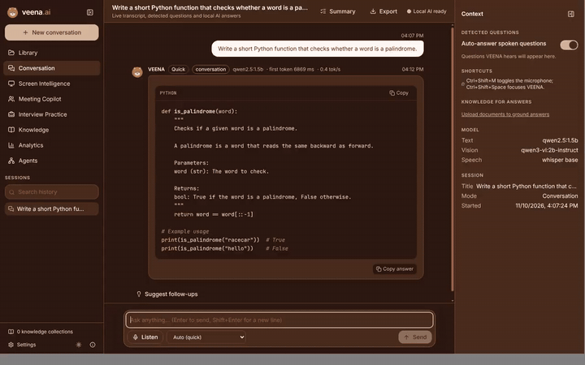
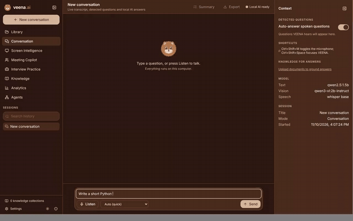
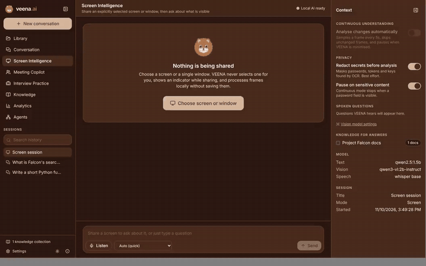
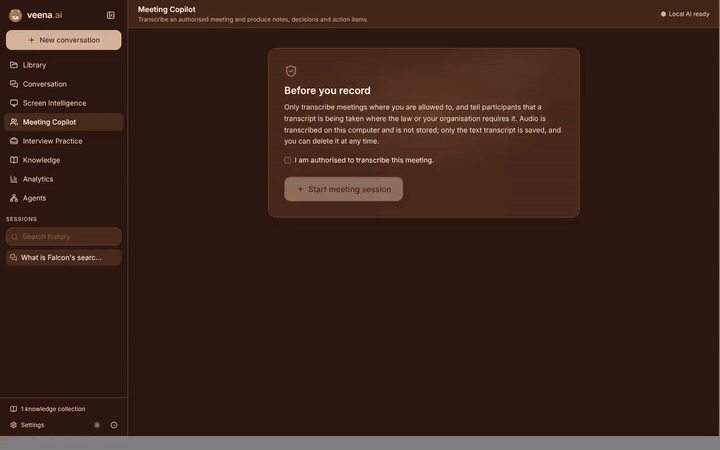
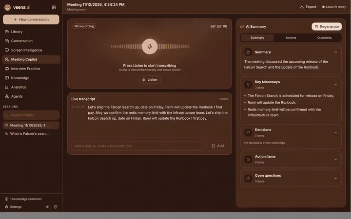
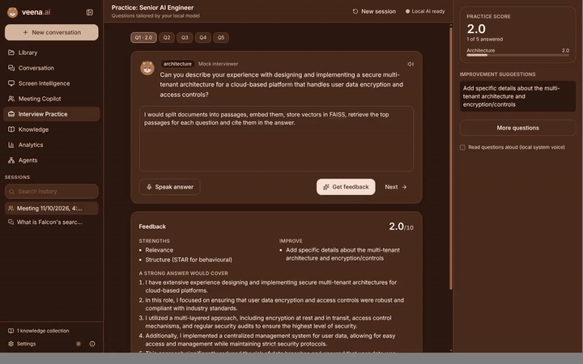
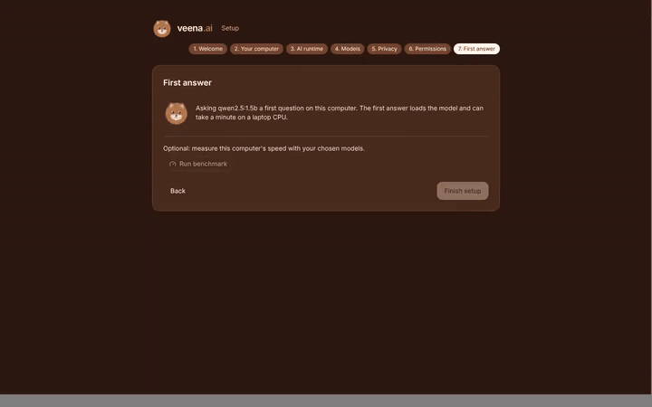
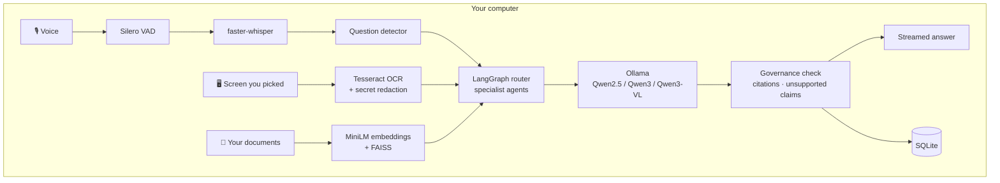

<p align="center">
  
</p>

<h1 align="center">Meet <i>VEENA.</i></h1>
<p align="center"><b>Your AI. Your computer. Your control.</b><br/>
A private AI companion for conversations, meetings, interview practice, documents and your screen.<br/>
It runs on your own computer, with open models. No account, no subscription, no API key.</p>

<p align="center">
  <a href="https://github.com/florina787/Data-sets/releases"></a>
</p>
<p align="center"><sub>
  Windows 10/11 · Mac with Apple Silicon · Linux x86_64 &nbsp;·&nbsp; Free &nbsp;·&nbsp; Installers are built and install-tested in CI; the first public release is not published yet.
</sub></p>

<p align="center">
  
</p>

<table>
<tr>
<td width="33%" valign="top"><b>Private by design</b><br/>Your conversations, documents, meetings and screens stay on your computer. Nothing is uploaded.</td>
<td width="33%" valign="top"><b>Free to use</b><br/>No subscription or account. Open models run on your own hardware.</td>
<td width="33%" valign="top"><b>Built to be checked</b><br/>Answers cite their sources, and names or figures the model invented are flagged.</td>
</tr>
</table>

### See it work

<table>
<tr>
<td width="50%"><b>Ask anything</b><br/></td>
<td width="50%"><b>Understands the screen you share</b><br/></td>
</tr>
<tr>
<td><b>Meeting notes from speech</b><br/></td>
<td><b>Interview practice with feedback</b><br/></td>
</tr>
<tr>
<td><b>Evidence for every answer</b><br/></td>
<td><b>Guided setup</b><br/></td>
</tr>
</table>
<sub>Recorded from the real app with real local models and synthetic sample data, by
<a href="apps/desktop/scripts/record-demos.mjs"><code>record-demos.mjs</code></a>. Model waits are shortened and long answers play faster;
on the 4-core, CPU-only recording machine answers take from seconds to a few minutes.</sub>

### Start in three steps

1. **Download** VEENA for your computer (from the [releases page](https://github.com/florina787/Data-sets/releases), once the beta is published).
2. **Open it.** Setup checks your computer and, with your permission, downloads the free local AI runtime and an Apache-2.0 model.
3. **Ask.** Setup says *"VEENA is ready."* only after the model has answered on your computer.

<p align="center">
  
  
  
  
</p>

## Why it exists

Commercial AI conversation copilots charge per hour or per month; Parakeet AI,
for example, lists **$38 per hour of use or $149.90 per month** for unlimited use
([pricing sources](docs/MEDIUM_ARTICLE.md#the-bill-that-started-this)). Every
part of that pipeline (speech recognition, screen reading, language models,
document search) now has a free, open model that runs on a laptop. VEENA.AI puts
those together.

| | Typical paid copilot | VEENA.AI |
|---|---|---|
| Monthly cost | $149.90 per seat (list price example) | **$0** |
| Account or API key | Required | **None** |
| Where audio, screens and notes go | Vendor servers | **Your disk only** |
| Works offline after setup | No | **Yes** |
| Trade-off | Money | Speed on weak hardware (see [benchmarks](#measured-performance)) |

**Read the story on Medium:**
- [Parakeet AI Costs $149.90 a Month. I Built a $0 Replacement](https://medium.com/@florinaregius/parakeet-ai-costs-149-90-c94b8c0b4661)
- [Google Released an Offline AI Meeting Assistant. So I Built My Own — and It Does More](https://medium.com/@florinaregius/google-released-an-offline-ai-meeting-assistant-so-i-built-my-own-and-it-does-more-69ee5622b5a9)

## A tour

<table>
<tr>
<td width="50%"><b>Talk or type, get local answers</b><br/>Streaming answers with code, tables and diagrams. The model, speed and answer style are shown on every reply.<br/></td>
<td width="50%"><b>Answers from your documents, with citations</b><br/>Click a citation to see the exact passage. If nothing matches, VEENA says so.<br/></td>
</tr>
<tr>
<td><b>You pick what it can see</b><br/>Capture only starts after you choose a screen or window in VEENA's own picker.<br/></td>
<td><b>Screen Intelligence</b><br/>Explain code, find errors, explain architecture, or summarise. A permanent "Sharing" pill has a Stop button. <i>Shown: a real answer from the 3B vision model on CPU; small models give short, sometimes shallow answers.</i><br/></td>
</tr>
<tr>
<td><b>Knowledge collections</b><br/>PDF, DOCX, TXT, Markdown, CSV and JSON, indexed locally with MiniLM and FAISS. Test retrieval scores directly.<br/></td>
<td><b>Meeting Copilot</b><br/>Summary, key points, decisions and action items from an authorised transcript.<br/></td>
</tr>
<tr>
<td><b>Interview Practice</b><br/>Generated questions for 8 roles, scored feedback, improvement tracking. For rehearsal only. <i>Shown: real feedback from the 1.5B model, which can be inconsistent.</i><br/></td>
<td><b>Analytics from real measurements</b><br/>Pipeline latency, per-model speed, question categories, practice scores. Nothing is estimated.<br/></td>
</tr>
<tr>
<td><b>Agent scorecard</b><br/>Every answer is measured along a semantic spine: ontology, knowledge graph, context graph, procedural graph. <i>Shown: real traces from the 1.5B model.</i><br/></td>
<td><b>It catches made-up facts</b><br/>Asked who built a project and what it costs, which its document never says, the 1.5B model answered "Anthropic, part of the Meta Group, $100,000 a month". The answer is flagged with exactly those claims.<br/></td>
</tr>
<tr>
<td><b>Hardware-aware setup</b><br/>Detects CPU, RAM, GPU and disk, recommends a profile, downloads free models, and benchmarks your machine.<br/></td>
<td><b>Settings and privacy</b><br/>Choose models, speech model, retention period; clear all history in one click.<br/></td>
</tr>
</table>

All screenshots were captured from the real app with real local models by
[`apps/desktop/scripts/screenshots.mjs`](apps/desktop/scripts/screenshots.mjs) and
[`screenshots-agents.mjs`](apps/desktop/scripts/screenshots-agents.mjs).

## Measuring the agents

> Knowledge graphs tell an agent what's true, context graphs tell it what matters now, and procedural graphs tell it what to do next.

VEENA scores **every answer** along that spine and keeps the result as a trace. The **Agents** page shows the totals.

| Layer | Question | What VEENA measures on each answer |
|---|---|---|
| **Ontology** | What things are | Entities in the answer, typed as names, acronyms, code identifiers and figures |
| **Knowledge graph** | What's true | **Facts backed:** share of those entities found in the material the agent was given (documents, screen, transcript, resume). Per collection, a graph of entities that appear together in a passage |
| **Context graph** | What matters now | The scoped subgraph of entities this turn was given, how much of it the answer **used**, and the share of retrieved passages it **cited** |
| **Procedural graph** | What to do next | The steps actually taken (Route → Read screen → Retrieve → Compose → Generate → Govern), checked against the steps the inputs called for and the allowed transitions |
| **Agent** | Acting, writing it back | Outcome: resolved, flagged, escalated (nothing matched, so the decision goes back to you), stopped or failed; per agent, per day |

<p align="center"></p>

How it is measured, and its limits:

* **Rules, not an AI judge.** Each number is computed by deterministic rules from the turn's real inputs and output, so it is fast, repeatable and explainable. Code is in [`backend/agents/spine.py`](backend/agents/spine.py).
* **Lexical.** An entity is "backed" when the same name or figure appears in what the agent was given. That catches invented names and numbers. It cannot tell whether a backed entity was used correctly, and it misses a proper noun that only appears as the first word of a sentence.
* **Only grounded turns get a fact score.** A general question with no documents, screen or transcript gets no "facts backed" number, because the model may simply know the answer.
* **Its own earlier answers are not evidence.** Otherwise an invention would count as backed the next time it was repeated.
* **It feeds governance.** An answer that states unbacked figures, or mostly unbacked names, gets an "unbacked claims" flag and counts as flagged.
* **Trace & learn is measurement, not self-training.** Traces drive the scorecard and the daily trend; VEENA does not rewrite its own prompts or procedures from them.

## How it works



No step leaves the machine. Details: [docs/ARCHITECTURE.md](docs/ARCHITECTURE.md).

| Speech | Screen | Documents | Models | App |
|---|---|---|---|---|
| faster-whisper + Silero VAD | Electron capture + Tesseract + Qwen3-VL | sentence-transformers + FAISS | Ollama (Apache-2.0 Qwen models) | Electron + React + FastAPI |

## Measured performance

Measured on a 4-vCPU cloud VM with **no GPU** (roughly a budget laptop).
Reproduce with `python -m tests.performance.run_benchmarks`; charts by
`python -m tests.performance.make_charts`.

<p align="center"></p>
<p align="center"></p>

Text answers start in about 0.2 s and stream at about 21 tokens/s; speech is
transcribed 2.6× faster than real time; analysing a full screenshot with the
vision model takes about a minute on CPU. Full table and caveats:
[docs/BENCHMARKS.md](docs/BENCHMARKS.md).

## Status

What has been built and verified, and how:

| Capability | State | Verified by |
|---|---|---|
| Local chat with streaming, stop, answer styles, Markdown/code/tables/Mermaid | Done | E2E against qwen2.5:1.5b |
| Microphone transcription, partials, question detection, auto-answer | Done | E2E with synthetic speech through Chromium's fake mic → real Whisper |
| System-audio capture | Windows only (Electron loopback) | Not exercised in automated tests |
| User-selected screen/window sharing, region crop, screenshot analysis | Done | E2E: real capture → OCR → qwen3-vl:2b-instruct |
| Refusal of screen capture without a user pick | Done | E2E |
| Continuous screen understanding with change detection and sensitive-content pause | Done | Integration tests (sensitive pause, redaction); the sampling loop itself is not covered by automated tests |
| Secret redaction in screenshots | Done, best effort | Integration test with real Tesseract |
| Documents (PDF, DOCX, TXT, MD, CSV, JSON) with citations and evidence checks | Done | E2E (real embeddings) + integration |
| LangGraph routing to specialist agents + governance checks | Done | Integration |
| Agent measurement: semantic spine (ontology, knowledge, context, procedural graphs), traces, scorecard | Done | Unit + integration; real-model run captured in the screenshots |
| Interview practice (8 roles, generated questions, scored feedback, analytics) | Done | Integration + real-model evaluation and offline check ([report](reports/REAL_MODEL_EVALUATION.md)) |
| Meeting copilot (notes, decisions, action items) | Done, small models misfile some action items | Integration + real-model evaluation and offline check ([report](reports/REAL_MODEL_EVALUATION.md)) |
| History search, export, delete, clear-all, retention | Done | Unit + integration + E2E |
| Hardware detection, profiles, model downloads, measured benchmark | Done | E2E (real benchmark) |
| Analytics and developer diagnostics from real measurements | Done | Integration |
| Installers | Windows NSIS, macOS DMG, Linux AppImage/deb; **unsigned** | CI installs the real installer, launches the installed app and uninstalls ([results](reports/CLEAN_INSTALL_TEST_RESULTS.md)) |
| Automatic AI runtime | Reuses Ollama or downloads the pinned official release (SHA-256 checked) with consent | Unit tests; real binary locally; CI first run on Windows, macOS and Linux |
| Licensed default models | All defaults Apache-2.0; non-commercial defaults blocked by a test | [Model licence audit](reports/MODEL_LICENSE_AUDIT.md) |
| Works offline after setup | Chat, documents, meetings, interview, screen, speech | Real models in a network-disconnected namespace ([audit](reports/SECURITY_AND_PRIVACY_AUDIT.md)) |
| Optional Piper TTS / Parakeet ASR / code sandbox | Not built | See limitations |

## Install (users)

1. Download VEENA.AI for your computer. *The first public release is not published yet; until it is, these
   links return "not found". Installers are built and install-tested by CI.*
   * **Windows 10/11:** [VEENA.AI-Windows-Setup.exe](https://github.com/florina787/Data-sets/releases/latest/download/VEENA.AI-Windows-Setup.exe)
   * **Mac with Apple Silicon (M1–M4):** [VEENA.AI-macOS-AppleSilicon.dmg](https://github.com/florina787/Data-sets/releases/latest/download/VEENA.AI-macOS-AppleSilicon.dmg). No Intel Mac build yet.
   * **Linux x86_64:** [VEENA.AI-Linux-x86_64.AppImage](https://github.com/florina787/Data-sets/releases/latest/download/VEENA.AI-Linux-x86_64.AppImage)
2. First launch. The beta builds are not code-signed yet, so the system warns once:
   * **Windows:** SmartScreen "Windows protected your PC" → **More info → Run anyway**.
   * **macOS:** drag VEENA.AI to Applications, then **right-click → Open → Open**.
3. Follow the setup wizard. It checks your computer, sets up the free local AI
   runtime (reusing Ollama if you have it, otherwise downloading it with your
   permission), downloads an Apache-2.0 model, and says **"VEENA is ready."**
   only after the model has answered on your computer. No terminal needed.

Full walkthrough: [customer installation guide](docs/CUSTOMER_INSTALLATION_GUIDE.md) ·
[hardware requirements](docs/HARDWARE_REQUIREMENTS.md) ·
[troubleshooting](docs/SUPPORT_AND_TROUBLESHOOTING.md) · [user guide](docs/USER_GUIDE.md).

### What it costs

No money is required. You do pay in resources:

* **Downloads:** the AI runtime (about 1.6 GB on Windows/Linux, 0.2 GB on macOS, unless you already have Ollama) and about 3–11 GB of models depending on profile (one time).
* **Disk:** the same, plus about 1.5 GB for the app (it bundles CPU PyTorch for embeddings).
* **Hardware time and electricity:** models run on your CPU/GPU. On the 4-core
  CPU-only test machine a text answer starts in about 0.2 s and streams at about
  21 tokens/s; a full-screen analysis with the licensed 2B vision model takes
  about 2.4 minutes. See [docs/BENCHMARKS.md](docs/BENCHMARKS.md) and
  [the real-model evaluation](reports/REAL_MODEL_EVALUATION.md).

## Feedback & Community

Your perspective matters. Every note is read.

* **Share feedback:** the [feedback page](site/feedback.html) on the VEENA website. It's a short form; email is
  optional. *It opens once the form is set up and the website is deployed.*
* **Join the conversation:** GitHub Discussions (General Discussion, Feature Requests, Product Feedback,
  Support & Issues). *Not enabled on this repository yet.*
* **Security problems:** report them privately: [SECURITY.md](SECURITY.md).

How feedback, community links and visitor counts are set up, and what each number means:
[feedback and community setup](docs/FEEDBACK_AND_COMMUNITY_SETUP.md) ·
[readiness report](reports/FEEDBACK_AND_ANALYTICS_READINESS.md).

## Develop

Requirements: Python 3.11+, Node 22+, Ollama. Optional: Tesseract, espeak-ng and
ffmpeg (for the speech tests).

```bash
cd veena-ai
./scripts/setup.sh            # Windows: .\scripts\setup.ps1
ollama pull qwen2.5:1.5b && ollama pull qwen3-vl:2b-instruct
cd apps/desktop && npm run dev
```

`npm run dev` compiles the Electron main process, starts the Vite dev server,
and launches Electron, which starts the backend from the repo's `.venv`.

### Tests

```bash
# Backend: deterministic suite (simulated LLM/embedder/ASR; real OCR and VAD) - runs in CI
.venv/bin/pytest -m "not ollama and not asr and not embeddings"
# Backend: real local models (needs Ollama models, downloads Whisper/MiniLM once)
.venv/bin/pytest -m "ollama or asr or embeddings"
# Frontend: unit/component tests, palette guard, types, lint
cd apps/desktop && npm test && npm run typecheck && npm run lint
# End to end: the real app + real backend + real models (Linux: under xvfb-run)
npm run build && npm run test:e2e
# Measured benchmarks
cd ../.. && .venv/bin/python -m tests.performance.run_benchmarks --asr tiny,base
```

Last local run: 116 backend tests (110 deterministic + 6 real-model), 15 frontend
tests, 9 E2E tests, all passing. Simulated components exist only in tests and
are labelled as such (`ScriptedLLM`, `HashEmbedder`, `FakeASR`).

### Build installers

`./scripts/build-installer.sh` builds for the current OS (PyInstaller cannot
cross-compile). [`.github/workflows/veena-ai-ci.yml`](../.github/workflows/veena-ai-ci.yml)
builds Windows, macOS and Linux installers and smoke-tests each packaged app.

## Layout

```
veena-ai/
├── apps/desktop/        Electron main + preload, React renderer, brand assets
├── backend/             FastAPI service (api, agents, llm, transcription, audio,
│                        vision, screen, rag, memory, security, analytics, models)
├── tests/               unit, integration, e2e (Playwright + Electron), performance
├── packaging/           PyInstaller spec and frozen-backend smoke test
├── scripts/             setup and build scripts
└── docs/                architecture, security, user guide, benchmarks, versions
```

Read next: [ARCHITECTURE](docs/ARCHITECTURE.md) · [SECURITY](docs/SECURITY.md) ·
[USER GUIDE](docs/USER_GUIDE.md) · [BENCHMARKS](docs/BENCHMARKS.md) ·
[TESTED VERSIONS](docs/TESTED_VERSIONS.md)

## Design

White, ivory, cream and five browns only: `#FFFFFF #FCFAF7 #F7F1E9 #EFE2D2
#D6B79B #B87848 #99613E #75462D #4A2C1C #2C1A12`. Tailwind's default palette
is removed, and a test fails if any other colour appears in the UI source.
Status is shown with shape and text, never traffic-light colours. The ginger
Persian cat is original artwork generated from one SVG source
(`apps/desktop/src/brand/catSvg.mjs`) for the app icon, favicon, installer art
and the animated in-app mascot (blink, listening, thinking; reduced motion respected).

## Known limitations

* **Speed on CPU:** a full-screen analysis takes about 2.4 minutes without a GPU
  (licensed qwen3-vl:2b-instruct; the research-only model it replaced took about
  one minute); Whisper partials arrive every 2–3 s on a 4-core CPU.
* **Unsigned builds:** Windows SmartScreen and macOS Gatekeeper warn on first launch.
  Code signing needs certificates the project does not have.
* **Platform coverage:** the full E2E suite with real models ran on Linux only. On
  Windows and macOS, CI installs the real installer, launches the installed app
  and runs a first-run test (runtime download, real model answer). CI runners are
  not consumer PCs; a manual test on everyday Windows and Mac machines is still
  needed ([results](reports/CLEAN_INSTALL_TEST_RESULTS.md)).
* **Fact check is lexical:** "facts backed" flags names and figures missing from
  the inputs; it cannot judge whether a backed name is used correctly. On
  screen-only answers it flags invented figures, not general terms.
* **System audio** capture is Windows only.
* **Redaction is best effort:** it masks only what OCR can read.
* **Scanned PDFs** without a text layer are not OCR'd at upload.
* **Not built:** Piper voice output (practice questions use the OS's own local
  voices instead), Parakeet ASR, and a code-execution sandbox. VEENA never
  executes code from screens or documents.
* **App size:** about 1.5 GB installed because embeddings use CPU PyTorch; an
  ONNX embedding path would cut this substantially.
* **Mid-size model accuracy:** small local models make mistakes; answers show
  their model, sources and governance notes so you can judge them.

## Launch and release documents

| Reports | Docs |
|---|---|
| [Release readiness (go / no-go)](reports/RELEASE_READINESS.md) | [Customer installation guide](docs/CUSTOMER_INSTALLATION_GUIDE.md) |
| [Production gap analysis](reports/PRODUCTION_GAP_ANALYSIS.md) | [Hardware requirements](docs/HARDWARE_REQUIREMENTS.md) |
| [Security and privacy audit](reports/SECURITY_AND_PRIVACY_AUDIT.md) | [Support and troubleshooting](docs/SUPPORT_AND_TROUBLESHOOTING.md) |
| [Clean-install test results](reports/CLEAN_INSTALL_TEST_RESULTS.md) | [Zero-cost deployment architecture](docs/ZERO_COST_DEPLOYMENT_ARCHITECTURE.md) |
| [Model licence audit](reports/MODEL_LICENSE_AUDIT.md) | [Free website deployment](docs/FREE_WEBSITE_DEPLOYMENT.md) |
| [Real-model evaluation](reports/REAL_MODEL_EVALUATION.md) | [Installer storage and delivery](docs/INSTALLER_STORAGE_AND_DELIVERY.md) |
| [Free-tier cloud research](reports/FREE_TIER_CLOUD_RESEARCH.md) | [Cloud migration strategy](docs/CLOUD_MIGRATION_STRATEGY.md) |
| [Free-tier cost simulation](reports/FREE_TIER_COST_SIMULATION.md) | [SaaS commercialization roadmap](docs/SAAS_COMMERCIALIZATION_ROADMAP.md) |

The public website lives in [`site/`](site) and deploys to GitHub Pages only when the owner runs it.

## Ethics

VEENA is a companion for your own conversations, learning and preparation. It
is not designed for, and must not be used for, covert assistance in interviews
or assessments that prohibit AI, or for recording people without the consent
the law requires. Capture is always visible and started by you.

## License

GPL-3.0-or-later, same as this repository.

---

<p align="center"><sub>© 2026 Florina Regius · VEENA.AI · <a href="https://github.com/florina787/Data-sets/tree/claude/amazing-babbage-qia83y/veena-ai/site">Website source</a> · <a href="SECURITY.md">Security</a> · <a href="CONTRIBUTING.md">Contributing</a></sub></p>
