<p align="center">
  
</p>

<h1 align="center">veena.ai</h1>
<p align="center"><b>Your intelligent conversation companion.</b><br/>
A local-first desktop AI copilot that listens, reads the screen you choose, answers from your documents, and runs entirely on your own computer.</p>

<p align="center">
  
  
  
  
  
</p>

<h3 align="center">Download</h3>
<p align="center">
  <a href="https://github.com/florina787/Data-sets/releases/latest/download/VEENA.AI-Windows-Setup.exe"></a>
  &nbsp;
  <a href="https://github.com/florina787/Data-sets/releases/latest/download/VEENA.AI-macOS-AppleSilicon.dmg"></a>
  &nbsp;
  <a href="https://ollama.com/download"><img alt="Get Ollama (free, required)" src="https://img.shields.io/badge/Also%20install-Ollama%20(free)-B87848?style=for-the-badge&labelColor=2C1A12&logo=data%3Aimage%2Fsvg%2Bxml%3Bbase64%2CPHN2ZyBmaWxsPSIjZmZmZmZmIiByb2xlPSJpbWciIHZpZXdCb3g9IjAgMCAyNCAyNCIgeG1sbnM9Imh0dHA6Ly93d3cudzMub3JnLzIwMDAvc3ZnIj48dGl0bGU%2BT2xsYW1hPC90aXRsZT48cGF0aCBkPSJNMTYuMzYxIDEwLjI2YS44OTQuODk0IDAgMCAwLS41NTguNDdsLS4wNzIuMTQ4LjAwMS4yMDdjMCAuMTkzLjAwNC4yMTcuMDU5LjM1My4wNzYuMTkzLjE1Mi4zMTIuMjkxLjQ0OC4yNC4yMzguNTEuMy44NzIuMjA1YS44Ni44NiAwIDAgMCAuNTE3LS40MzYuNzUyLjc1MiAwIDAgMCAuMDgtLjQ5OGMtLjA2NC0uNDUzLS4zMy0uNzgyLS43MjQtLjg5N2ExLjA2IDEuMDYgMCAwIDAtLjQ2NiAwem0tOS4yMDMuMDA1Yy0uMzA1LjA5Ni0uNTMzLjMyLS42NS42MzlhMS4xODcgMS4xODcgMCAwIDAtLjA2LjUyYy4wNTcuMzA5LjMxLjU5LjU5OC42NjcuMzYyLjA5NS42MzIuMDMzLjg3Mi0uMjA1LjE0LS4xMzYuMjE1LS4yNTUuMjkxLS40NDguMDU1LS4xMzYuMDU5LS4xNi4wNTktLjM1M2wuMDAxLS4yMDctLjA3Mi0uMTQ4YS44OTQuODk0IDAgMCAwLS41NjUtLjQ3MiAxLjAyIDEuMDIgMCAwIDAtLjQ3NC4wMDdabTQuMTg0IDJjLS4xMzEuMDcxLS4yMjMuMjUtLjE5NS4zODMuMDMxLjE0My4xNTcuMjg4LjM1My40MDcuMTA1LjA2My4xMTIuMDcyLjExNy4xMzYuMDA0LjAzOC0uMDEuMTQ2LS4wMjkuMjQzLS4wMi4wOTQtLjAzNi4xOTQtLjAzNi4yMjIuMDAyLjA3NC4wNy4xOTUuMTQzLjI1My4wNjQuMDUyLjA3Ni4wNTQuMjU1LjA1OS4xNjQuMDA1LjE5OC4wMDEuMjY0LS4wMy4xNjktLjA4Mi4yMTItLjIzNC4xNS0uNTI1LS4wNTItLjI0My0uMDQyLS4yOC4wODctLjM1NS4xMzctLjA4LjI4MS0uMjE5LjMyNC0uMzE0YS4zNjUuMzY1IDAgMCAwLS4xNzUtLjQ4LjM5NC4zOTQgMCAwIDAtLjE4MS0uMDMzYy0uMTI2IDAtLjIwNy4wMy0uMzU1LjEyNGwtLjA4NS4wNTMtLjA1My0uMDMyYy0uMjE5LS4xMy0uMjU5LS4xNDUtLjM5MS0uMTQzYS4zOTYuMzk2IDAgMCAwLS4xOTMuMDMyem0uMzktMi4xOTVjLS4zNzMuMDM2LS40NzUuMDUtLjY1NC4wODYtLjI5MS4wNi0uNjguMTk1LS45NTEuMzI4LS45NC40Ni0xLjU4OSAxLjIyNi0xLjc4NyAyLjExNC0uMDQuMTc2LS4wNDUuMjM0LS4wNDUuNTMgMCAuMjk0LjAwNS4zNTcuMDQzLjUyNC4yNjQgMS4xNiAxLjMzMiAyLjAxNyAyLjcxNCAyLjE3My4zLjAzMyAxLjU5Ni4wMzMgMS44OTYgMCAxLjExLS4xMjUgMi4wNjQtLjcyNyAyLjQ5My0xLjU3MS4xMTQtLjIyNi4xNjktLjM3Mi4yMi0uNjAyLjAzOS0uMTY3LjA0NC0uMjMuMDQ0LS41MjMgMC0uMjk3LS4wMDUtLjM1NS0uMDQ1LS41MzEtLjI4OC0xLjI5LTEuNTM5LTIuMzA0LTMuMDcyLTIuNDk3YTYuODczIDYuODczIDAgMCAwLS44NTUtLjAzMXptLjY0NS45MzdhMy4yODMgMy4yODMgMCAwIDEgMS40NC41MTRjLjIyMy4xNDguNTM3LjQ1OC42NzEuNjYyLjE2Ni4yNTEuMjYuNTA4LjMwMy44Mi4wMi4xNDMuMDEuMjUxLS4wNDMuNDgyLS4wOC4zNDUtLjMzMi43MDUtLjY3Mi45NTdhMy4xMTUgMy4xMTUgMCAwIDEtLjY4OS4zNDhjLS4zODIuMTIyLS42MzIuMTQ0LTEuNTI1LjEzOC0uNTgyLS4wMDYtLjY4Ni0uMDEtLjg1My0uMDQyLS41Ny0uMTA3LTEuMDIyLS4zMzQtMS4zNS0uNjgtLjI2NC0uMjgtLjM4NS0uNTM1LS40NS0uOTQ2LS4wMy0uMTkyLjAyNS0uNTA5LjEzNy0uNzc2LjEzNi0uMzI2LjQ4OC0uNzMuODM2LS45NjMuNDAzLS4yNjkuOTM0LS40NiAxLjQyMi0uNTEyLjE4Ny0uMDIuNTg2LS4wMi43NzMtLjAwMnptLTUuNTAzLTExYTEuNjUzIDEuNjUzIDAgMCAwLS42ODMuMjk4QzUuNjE3Ljc0IDUuMTczIDEuNjY2IDQuOTg1IDIuODE5Yy0uMDcuNDM2LS4xMTkgMS4wNC0uMTE5IDEuNTAzIDAgLjU0NC4wNjQgMS4yNC4xNTUgMS43MjEuMDIuMTA3LjAzMS4yMDIuMDIzLjIwOGE4LjEyIDguMTIgMCAwIDEtLjE4Ny4xNTIgNS4zMjQgNS4zMjQgMCAwIDAtLjk0OSAxLjAyIDUuNDkgNS40OSAwIDAgMC0uOTQgMi4zMzkgNi42MjUgNi42MjUgMCAwIDAtLjAyMyAxLjM1N2MuMDkxLjc4LjMyNSAxLjQzOC43MjcgMi4wNGwuMTMuMTk1LS4wMzcuMDY0Yy0uMjY5LjQ1Mi0uNDk4IDEuMTA1LS42MDUgMS43MzItLjA4NC40OTYtLjA5NS42MjktLjA5NSAxLjI5NCAwIC42Ny4wMDkuODAzLjA4OCAxLjI2Ni4wOTUuNTU1LjI4OCAxLjE0My41MDMgMS41MzQuMDcxLjEyOC4yNDMuMzkzLjI2NC40MDcuMDA3LjAwMy0uMDE0LjA2Ny0uMDQ2LjE0MWE3LjQwNSA3LjQwNSAwIDAgMC0uNTQ4IDEuODczYy0uMDYyLjQxNy0uMDcxLjU1Mi0uMDcxLjk5MSAwIC41Ni4wMzEuODMyLjE0OCAxLjI3OUwzLjQyIDI0aDEuNDc4bC0uMDUtLjA5MWMtLjI5Ny0uNTUyLS4zMjUtMS41NzUtLjA2OC0yLjU5Ny4xMTctLjQ3Mi4yNS0uODE5LjQ5OC0xLjI5NmwuMTQ4LS4yOXYtLjE3N2MwLS4xNjUtLjAwMy0uMTg0LS4wNTctLjI5M2EuOTE1LjkxNSAwIDAgMC0uMTk0LS4yNSAxLjc0IDEuNzQgMCAwIDEtLjM4NS0uNTQzYy0uNDI0LS45Mi0uNTA2LTIuMjg2LS4yMDgtMy40NTEuMTI0LS40ODYuMzI5LS45MTguNTQ0LTEuMTU0YS43ODcuNzg3IDAgMCAwIC4yMjMtLjUzMWMwLS4xOTUtLjA3LS4zNTUtLjIyNC0uNTIyYTMuMTM2IDMuMTM2IDAgMCAxLS44MTctMS43MjljLS4xNC0uOTYuMTE0LTIuMDA1LjY5LTIuODM0LjU2My0uODE0IDEuMzUzLTEuMzM2IDIuMjM3LTEuNDc1LjE5OS0uMDMzLjU3LS4wMjguNzc2LjAxLjIyNi4wNC4zNjcuMDI4LjUxMi0uMDQxLjE3OS0uMDg1LjI2OC0uMTkuMzc0LS40MzEuMDkzLS4yMTUuMTY1LS4zMzMuMzYtLjU3Ni4yMzQtLjI5LjQ2LS40ODkuODIyLS43MjkuNDEzLS4yNy44ODQtLjQ2NyAxLjM1Mi0uNTYxLjE3LS4wMzUuMjUtLjA0LjU2OS0uMDQuMzE5IDAgLjM5OC4wMDUuNTY5LjA0YTQuMDcgNC4wNyAwIDAgMSAxLjkxNC45OTdjLjExNy4xMDkuMzk4LjQ1Ny40ODguNjAyLjAzNC4wNTcuMDk1LjE3Ny4xMzIuMjY3LjEwNS4yNDEuMTk1LjM0Ni4zNzQuNDMuMTQuMDY4LjI4Ni4wODIuNTAzLjA0NS4zNDMtLjA1OC42MDctLjA1My45NDMuMDE2IDEuMTQ0LjIzIDIuMTQgMS4xNzMgMi41ODEgMi40MzcuMzg1IDEuMTA4LjI3NiAyLjI2Ny0uMjk2IDMuMTUzLS4wOTcuMTUtLjE5My4yNy0uMzMzLjQxOS0uMzAxLjMyMi0uMzAxLjcyMi0uMDAxIDEuMDUzLjQ5My41MzkuODAxIDEuODY2LjcwOCAzLjAzNi0uMDYyLjc3Mi0uMjYgMS40NjMtLjUzMyAxLjg1NGEyLjA5NiAyLjA5NiAwIDAgMS0uMjI0LjI1OC45MTYuOTE2IDAgMCAwLS4xOTQuMjVjLS4wNTQuMTA5LS4wNTcuMTI4LS4wNTcuMjkzdi4xNzhsLjE0OC4yOWMuMjQ4LjQ3Ni4zOC44MjMuNDk4IDEuMjk1LjI1MyAxLjAwOC4yMzEgMi4wMS0uMDU5IDIuNTgxYS44NDUuODQ1IDAgMCAwLS4wNDQuMDk4YzAgLjAwNi4zMjkuMDA5LjczMi4wMDloLjczbC4wMi0uMDc0LjAzNi0uMTM0Yy4wMTktLjA3Ni4wNTctLjMuMDg4LS41MTYuMDI5LS4yMTcuMDI5LTEuMDE2IDAtMS4yNTgtLjExLS44NzUtLjI5NS0xLjU3LS41OTctMi4yMjYtLjAzMi0uMDc0LS4wNTMtLjEzOC0uMDQ2LS4xNDEuMDA4LS4wMDUuMDU3LS4wNzQuMTA4LS4xNTIuMzc2LS41NjkuNjA3LTEuMjg0LjcyNC0yLjIyOC4wMzEtLjI2LjAzMS0xLjM3OCAwLTEuNjI4LS4wODMtLjY0NS0uMTgyLTEuMDgyLS4zNDgtMS41MjVhNi4wODMgNi4wODMgMCAwIDAtLjMyOS0uN2wtLjAzOC0uMDY0LjEzMS0uMTk0Yy40MDItLjYwNC42MzYtMS4yNjIuNzI3LTIuMDRhNi42MjUgNi42MjUgMCAwIDAtLjAyNC0xLjM1OCA1LjUxMiA1LjUxMiAwIDAgMC0uOTM5LTIuMzM5IDUuMzI1IDUuMzI1IDAgMCAwLS45NS0xLjAyIDguMDk3IDguMDk3IDAgMCAxLS4xODYtLjE1Mi42OTIuNjkyIDAgMCAxIC4wMjMtLjIwOGMuMjA4LTEuMDg3LjIwMS0yLjQ0My0uMDE3LTMuNTAzLS4xOS0uOTI0LS41MzUtMS42NTgtLjk4LTIuMDgyLS4zNTQtLjMzOC0uNzE2LS40ODItMS4xNS0uNDU1LS45OTYuMDU5LTEuOCAxLjIwNS0yLjExNiAzLjAxYTYuODA1IDYuODA1IDAgMCAwLS4wOTcuNzI2YzAgLjAzNi0uMDA3LjA2Ni0uMDE1LjA2NmEuOTYuOTYgMCAwIDEtLjE0OS0uMDc4QTQuODU3IDQuODU3IDAgMCAwIDEyIDMuMDNjLS44MzIgMC0xLjY4Ny4yNDMtMi40NTYuNjk4YS45NTguOTU4IDAgMCAxLS4xNDguMDc4Yy0uMDA4IDAtLjAxNS0uMDMtLjAxNS0uMDY2YTYuNzEgNi43MSAwIDAgMC0uMDk3LS43MjVDOC45OTcgMS4zOTIgOC4zMzcuMzE5IDcuNDYuMDQ4YTIuMDk2IDIuMDk2IDAgMCAwLS41ODUtLjA0MVptLjI5MyAxLjQwMmMuMjQ4LjE5Ny41MjMuNzU5LjY4MiAxLjM4OC4wMy4xMTMuMDYuMjQ0LjA2OS4yOTIuMDA3LjA0Ny4wMjYuMTUyLjA0MS4yMzMuMDY3LjM2NS4wOTguNzYuMTAyIDEuMjRsLjAwMi40NzUtLjEyLjE3NS0uMTE4LjE3OGgtLjI3OGMtLjMyNCAwLS42NDYuMDQxLS45NTQuMTI0bC0uMjM4LjA2Yy0uMDMzLjAwNy0uMDM4LS4wMDMtLjA1Ny0uMTQ0YTguNDM4IDguNDM4IDAgMCAxIC4wMTYtMi4zMjNjLjEyNC0uNzg4LjQxMy0xLjUwMS42OTYtMS43MTEuMDY3LS4wNS4wNzktLjA0OS4xNTcuMDEzem05LjgyNS0uMDEyYy4xNy4xMjYuMzU4LjQ2LjQ5OC44ODguMjguODU0LjM2IDIuMDI4LjIxMiAzLjE0NS0uMDE5LjE0LS4wMjQuMTUxLS4wNTcuMTQ0bC0uMjM4LS4wNmEzLjY5MyAzLjY5MyAwIDAgMC0uOTU0LS4xMjRoLS4yNzhsLS4xMTktLjE3OC0uMTE5LS4xNzUuMDAyLS40NzRjLjAwNC0uNjY5LjA2Ni0xLjE5LjIxNC0xLjc3Mi4xNTctLjYyMy40MzQtMS4xODUuNjgtMS4zODIuMDc4LS4wNjIuMDktLjA2My4xNTktLjAxMnoiLz48L3N2Zz4%3D" height="40" /></a>
</p>
<p align="center"><sub>
  Also for <a href="https://github.com/florina787/Data-sets/releases/latest/download/VEENA.AI-Linux-x86_64.AppImage">Linux (AppImage)</a> ·
  <a href="https://github.com/florina787/Data-sets/releases/latest">All files and checksums</a> ·
  Free · Unsigned builds: see <a href="#install-users">first launch</a>
</sub></p>

<p align="center">
  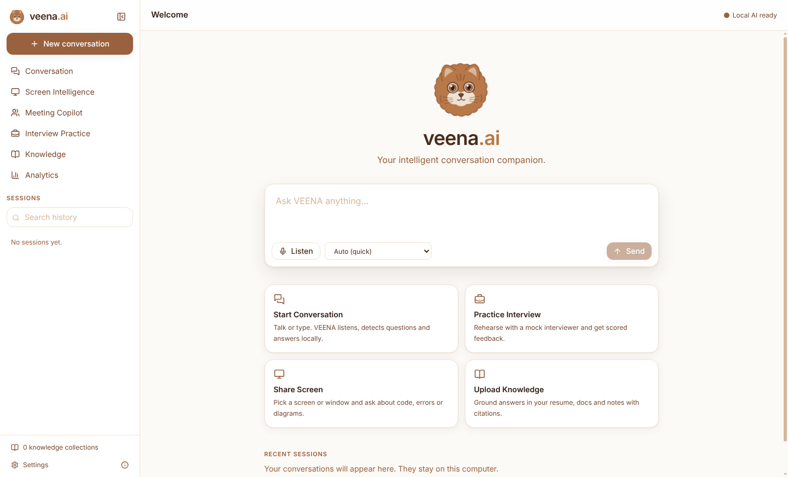
</p>

## Why it exists

Commercial AI conversation copilots charge per hour or per month; Parakeet AI,
for example, lists **$38 per hour of use or $149.90 per month** for unlimited use
([pricing sources](docs/MEDIUM_ARTICLE.md#the-bill-that-started-this)). Every
part of that pipeline (speech recognition, screen reading, language models,
document search) now has a free, open model that runs on a laptop. VEENA.AI puts
those together.

| | Typical paid copilot | VEENA.AI |
|---|---|---|
| Monthly cost | $149.90 per seat (list price example) | **$0** |
| Account or API key | Required | **None** |
| Where audio, screens and notes go | Vendor servers | **Your disk only** |
| Works offline after setup | No | **Yes** |
| Trade-off | Money | Speed on weak hardware (see [benchmarks](#measured-performance)) |

**Read the story on Medium:**
- [Parakeet AI Costs $149.90 a Month. I Built a $0 Replacement](https://medium.com/@florinaregius/parakeet-ai-costs-149-90-c94b8c0b4661)
- [Google Released an Offline AI Meeting Assistant. So I Built My Own — and It Does More](https://medium.com/@florinaregius/google-released-an-offline-ai-meeting-assistant-so-i-built-my-own-and-it-does-more-69ee5622b5a9)

## A tour

<table>
<tr>
<td width="50%"><b>Talk or type, get local answers</b><br/>Streaming answers with code, tables and diagrams. The model, speed and answer style are shown on every reply.<br/>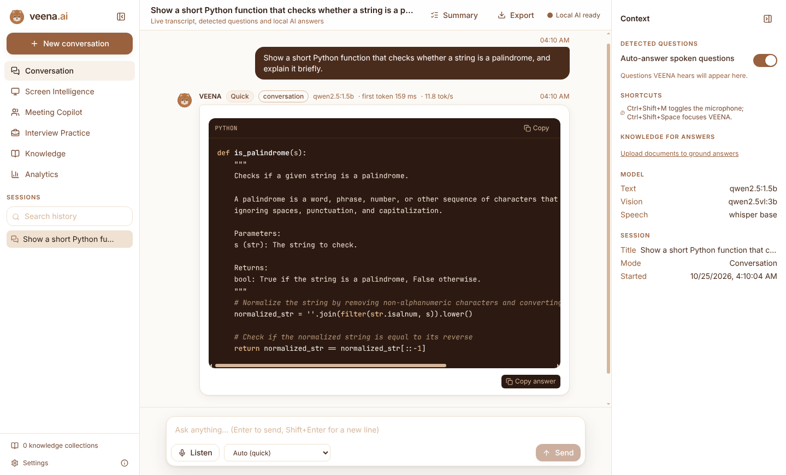</td>
<td width="50%"><b>Answers from your documents, with citations</b><br/>Click a citation to see the exact passage. If nothing matches, VEENA says so.<br/>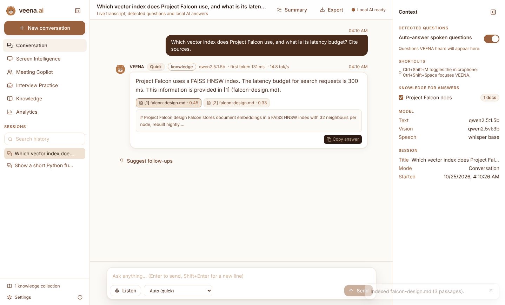</td>
</tr>
<tr>
<td><b>You pick what it can see</b><br/>Capture only starts after you choose a screen or window in VEENA's own picker.<br/>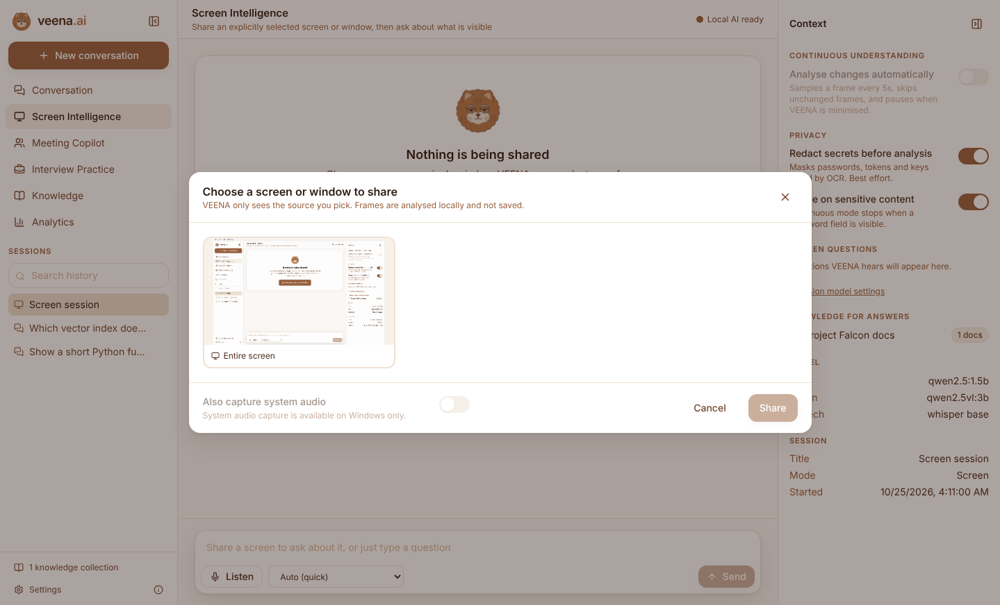</td>
<td><b>Screen Intelligence</b><br/>Explain code, find errors, explain architecture, or summarise. A permanent "Sharing" pill has a Stop button. <i>Shown: a real answer from the 3B vision model on CPU; small models give short, sometimes shallow answers.</i><br/>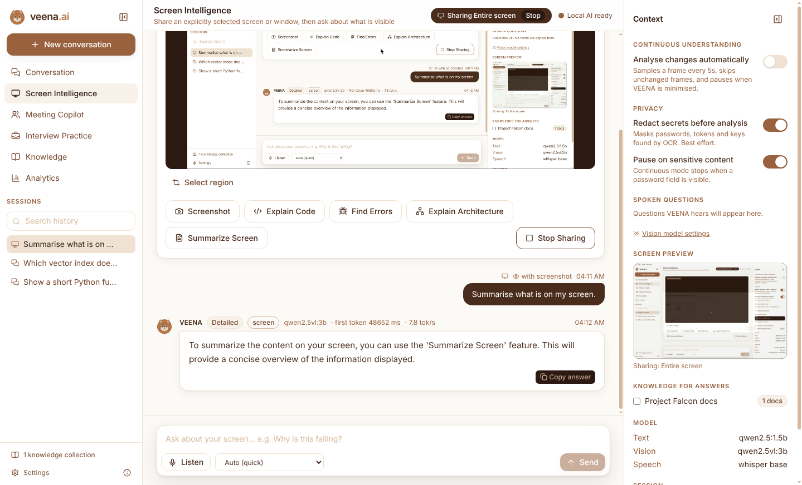</td>
</tr>
<tr>
<td><b>Knowledge collections</b><br/>PDF, DOCX, TXT, Markdown, CSV and JSON, indexed locally with MiniLM and FAISS. Test retrieval scores directly.<br/>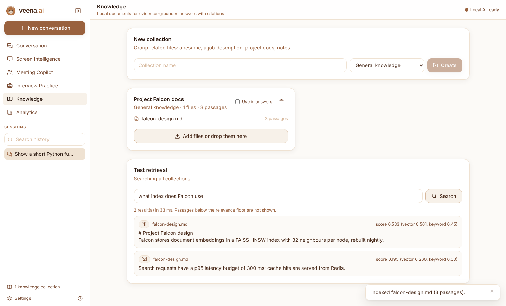</td>
<td><b>Meeting Copilot</b><br/>Summary, key points, decisions and action items from an authorised transcript.<br/>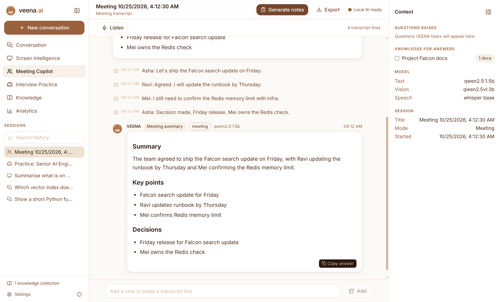</td>
</tr>
<tr>
<td><b>Interview Practice</b><br/>Generated questions for 8 roles, scored feedback, improvement tracking. For rehearsal only. <i>Shown: real feedback from the 1.5B model, which can be inconsistent.</i><br/>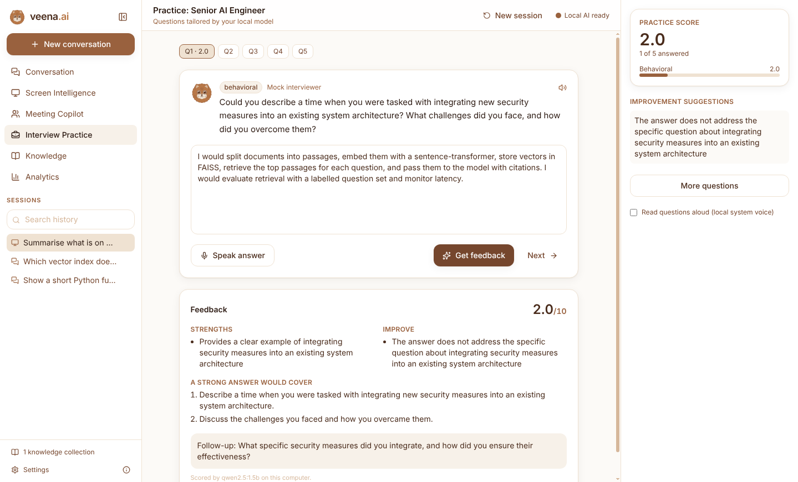</td>
<td><b>Analytics from real measurements</b><br/>Pipeline latency, per-model speed, question categories, practice scores. Nothing is estimated.<br/>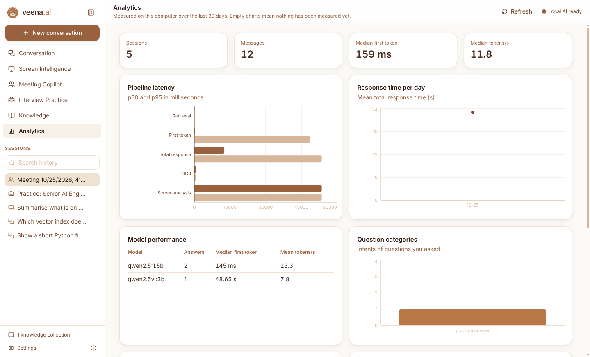</td>
</tr>
<tr>
<td><b>Agent scorecard</b><br/>Every answer is measured along a semantic spine: ontology, knowledge graph, context graph, procedural graph. <i>Shown: real traces from the 1.5B model.</i><br/>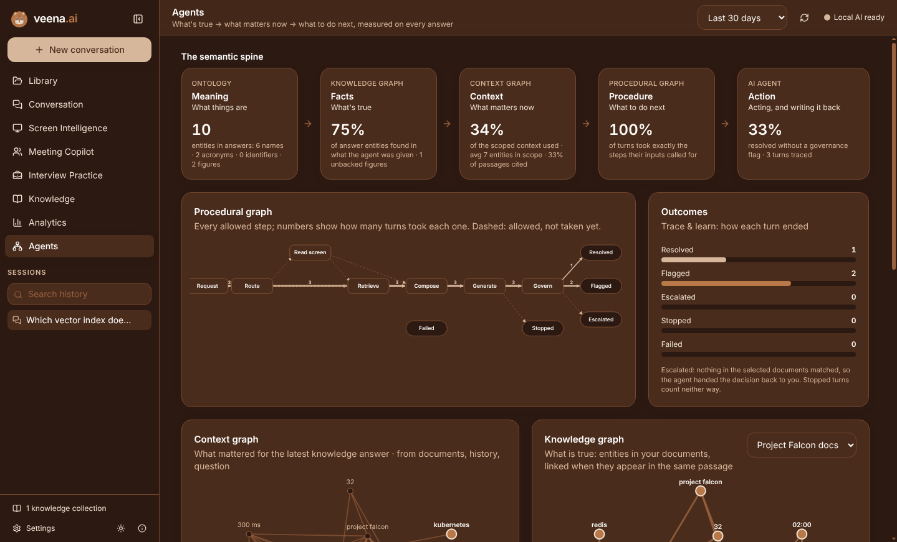</td>
<td><b>It catches made-up facts</b><br/>Asked who built a project its document never mentions, the 1.5B model named Anthropic, OpenAI and "10 engineers". The answer is flagged with exactly those words.<br/>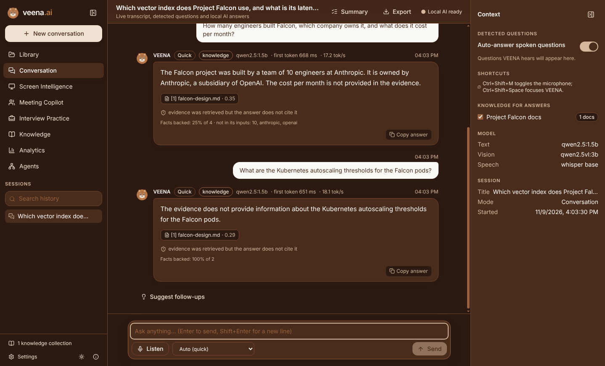</td>
</tr>
<tr>
<td><b>Hardware-aware setup</b><br/>Detects CPU, RAM, GPU and disk, recommends a profile, downloads free models, and benchmarks your machine.<br/>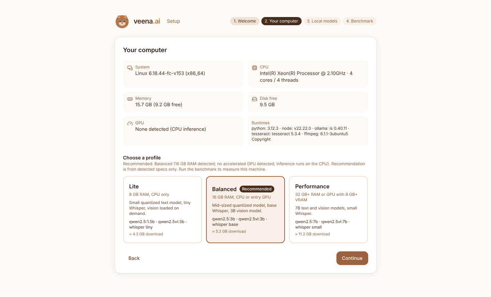</td>
<td><b>Settings and privacy</b><br/>Choose models, speech model, retention period; clear all history in one click.<br/>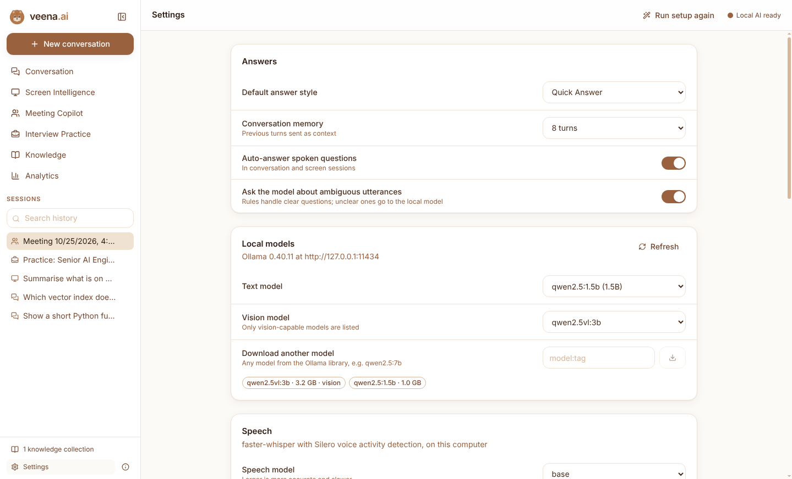</td>
</tr>
</table>

All screenshots were captured from the real app with real local models by
[`apps/desktop/scripts/screenshots.mjs`](apps/desktop/scripts/screenshots.mjs) and
[`screenshots-agents.mjs`](apps/desktop/scripts/screenshots-agents.mjs).

## Measuring the agents

> Knowledge graphs tell an agent what's true, context graphs tell it what matters now, and procedural graphs tell it what to do next.

VEENA scores **every answer** along that spine and keeps the result as a trace. The **Agents** page shows the totals.

| Layer | Question | What VEENA measures on each answer |
|---|---|---|
| **Ontology** | What things are | Entities in the answer, typed as names, acronyms, code identifiers and figures |
| **Knowledge graph** | What's true | **Facts backed:** share of those entities found in the material the agent was given (documents, screen, transcript, resume). Per collection, a graph of entities that appear together in a passage |
| **Context graph** | What matters now | The scoped subgraph of entities this turn was given, how much of it the answer **used**, and the share of retrieved passages it **cited** |
| **Procedural graph** | What to do next | The steps actually taken (Route → Read screen → Retrieve → Compose → Generate → Govern), checked against the steps the inputs called for and the allowed transitions |
| **Agent** | Acting, writing it back | Outcome: resolved, flagged, escalated (nothing matched, so the decision goes back to you), stopped or failed; per agent, per day |

<p align="center">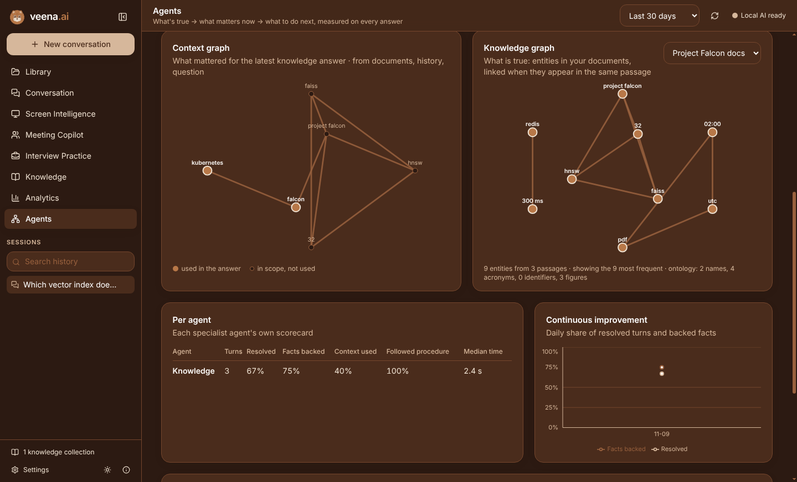</p>

How it is measured, and its limits:

* **Rules, not an AI judge.** Each number is computed by deterministic rules from the turn's real inputs and output, so it is fast, repeatable and explainable. Code is in [`backend/agents/spine.py`](backend/agents/spine.py).
* **Lexical.** An entity is "backed" when the same name or figure appears in what the agent was given. That catches invented names and numbers. It cannot tell whether a backed entity was used correctly, and it misses a proper noun that only appears as the first word of a sentence.
* **Only grounded turns get a fact score.** A general question with no documents, screen or transcript gets no "facts backed" number, because the model may simply know the answer.
* **Its own earlier answers are not evidence.** Otherwise an invention would count as backed the next time it was repeated.
* **It feeds governance.** An answer that states unbacked figures, or mostly unbacked names, gets an "unbacked claims" flag and counts as flagged.
* **Trace & learn is measurement, not self-training.** Traces drive the scorecard and the daily trend; VEENA does not rewrite its own prompts or procedures from them.

## How it works

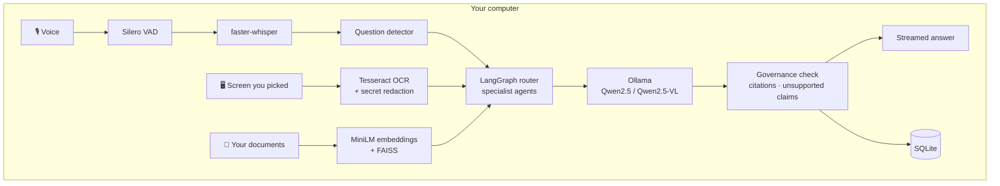

No step leaves the machine. Details: [docs/ARCHITECTURE.md](docs/ARCHITECTURE.md).

| Speech | Screen | Documents | Models | App |
|---|---|---|---|---|
| faster-whisper + Silero VAD | Electron capture + Tesseract + Qwen2.5-VL | sentence-transformers + FAISS | Ollama (Qwen2.5 family) | Electron + React + FastAPI |

## Measured performance

Measured on a 4-vCPU cloud VM with **no GPU** (roughly a budget laptop).
Reproduce with `python -m tests.performance.run_benchmarks`; charts by
`python -m tests.performance.make_charts`.

<p align="center">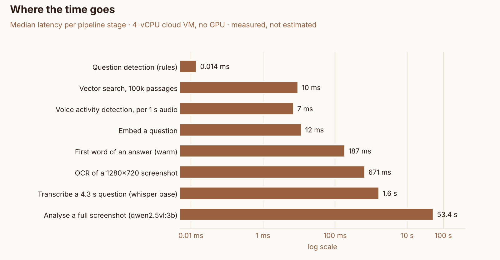</p>
<p align="center">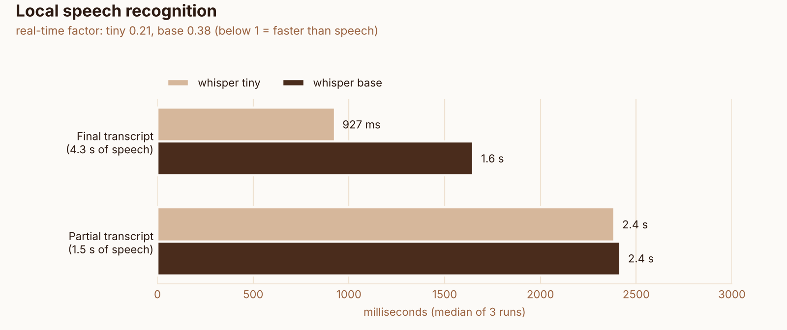</p>

Text answers start in about 0.2 s and stream at about 21 tokens/s; speech is
transcribed 2.6× faster than real time; analysing a full screenshot with the
vision model takes about a minute on CPU. Full table and caveats:
[docs/BENCHMARKS.md](docs/BENCHMARKS.md).

## Status

What has been built and verified, and how:

| Capability | State | Verified by |
|---|---|---|
| Local chat with streaming, stop, answer styles, Markdown/code/tables/Mermaid | Done | E2E against qwen2.5:1.5b |
| Microphone transcription, partials, question detection, auto-answer | Done | E2E with synthetic speech through Chromium's fake mic → real Whisper |
| System-audio capture | Windows only (Electron loopback) | Not exercised in automated tests |
| User-selected screen/window sharing, region crop, screenshot analysis | Done | E2E: real capture → OCR → qwen2.5vl:3b |
| Refusal of screen capture without a user pick | Done | E2E |
| Continuous screen understanding with change detection and sensitive-content pause | Done | Integration tests (sensitive pause, redaction); the sampling loop itself is not covered by automated tests |
| Secret redaction in screenshots | Done, best effort | Integration test with real Tesseract |
| Documents (PDF, DOCX, TXT, MD, CSV, JSON) with citations and evidence checks | Done | E2E (real embeddings) + integration |
| LangGraph routing to specialist agents + governance checks | Done | Integration |
| Agent measurement: semantic spine (ontology, knowledge, context, procedural graphs), traces, scorecard | Done | Unit + integration; real-model run captured in the screenshots |
| Interview practice (8 roles, generated questions, scored feedback, analytics) | Done | Integration (simulated model); not yet run end to end with a real model |
| Meeting copilot (notes, decisions, action items) | Done | Integration (simulated model); not yet run end to end with a real model |
| History search, export, delete, clear-all, retention | Done | Unit + integration + E2E |
| Hardware detection, profiles, model downloads, measured benchmark | Done | E2E (real benchmark) |
| Analytics and developer diagnostics from real measurements | Done | Integration |
| Installers | Windows NSIS, macOS DMG (unsigned), Linux AppImage/deb | CI builds all three and smoke-tests the packaged app on each OS |
| Optional Piper TTS / Parakeet ASR / code sandbox | Not built | See limitations |

## Install (users)

1. Install [Ollama](https://ollama.com/download) (free) and start it.
2. Download VEENA.AI for your computer:
   * **Windows 10/11:** [VEENA.AI-Windows-Setup.exe](https://github.com/florina787/Data-sets/releases/latest/download/VEENA.AI-Windows-Setup.exe)
   * **Mac with Apple Silicon (M1–M4):** [VEENA.AI-macOS-AppleSilicon.dmg](https://github.com/florina787/Data-sets/releases/latest/download/VEENA.AI-macOS-AppleSilicon.dmg). No Intel Mac build yet.
   * **Linux x86_64:** [VEENA.AI-Linux-x86_64.AppImage](https://github.com/florina787/Data-sets/releases/latest/download/VEENA.AI-Linux-x86_64.AppImage)
3. First launch. The builds are not code-signed, so the system warns once:
   * **Windows:** SmartScreen "Windows protected your PC" → **More info → Run anyway**.
   * **macOS:** drag VEENA.AI to Applications, then **right-click → Open → Open**.
4. Launch it. The setup wizard checks your hardware, recommends a profile,
   downloads models through Ollama, and benchmarks your machine.

Full walkthrough: [docs/USER_GUIDE.md](docs/USER_GUIDE.md).

### What it costs

No money is required. You do pay in resources:

* **Downloads:** about 1–11 GB of models depending on profile (one time).
* **Disk:** the same, plus about 1.5 GB for the app (it bundles CPU PyTorch for embeddings).
* **Hardware time and electricity:** models run on your CPU/GPU. On the 4-core
  CPU-only test machine a text answer starts in about 0.2 s and streams at about
  21 tokens/s; a screen analysis takes about a minute. See [docs/BENCHMARKS.md](docs/BENCHMARKS.md).

## Develop

Requirements: Python 3.11+, Node 22+, Ollama. Optional: Tesseract, espeak-ng and
ffmpeg (for the speech tests).

```bash
cd veena-ai
./scripts/setup.sh            # Windows: .\scripts\setup.ps1
ollama pull qwen2.5:1.5b && ollama pull qwen2.5vl:3b
cd apps/desktop && npm run dev
```

`npm run dev` compiles the Electron main process, starts the Vite dev server,
and launches Electron, which starts the backend from the repo's `.venv`.

### Tests

```bash
# Backend: deterministic suite (simulated LLM/embedder/ASR; real OCR and VAD) - runs in CI
.venv/bin/pytest -m "not ollama and not asr and not embeddings"
# Backend: real local models (needs Ollama models, downloads Whisper/MiniLM once)
.venv/bin/pytest -m "ollama or asr or embeddings"
# Frontend: unit/component tests, palette guard, types, lint
cd apps/desktop && npm test && npm run typecheck && npm run lint
# End to end: the real app + real backend + real models (Linux: under xvfb-run)
npm run build && npm run test:e2e
# Measured benchmarks
cd ../.. && .venv/bin/python -m tests.performance.run_benchmarks --asr tiny,base
```

Last local run: 116 backend tests (110 deterministic + 6 real-model), 15 frontend
tests, 9 E2E tests, all passing. Simulated components exist only in tests and
are labelled as such (`ScriptedLLM`, `HashEmbedder`, `FakeASR`).

### Build installers

`./scripts/build-installer.sh` builds for the current OS (PyInstaller cannot
cross-compile). [`.github/workflows/veena-ai-ci.yml`](../.github/workflows/veena-ai-ci.yml)
builds Windows, macOS and Linux installers and smoke-tests each packaged app.

## Layout

```
veena-ai/
├── apps/desktop/        Electron main + preload, React renderer, brand assets
├── backend/             FastAPI service (api, agents, llm, transcription, audio,
│                        vision, screen, rag, memory, security, analytics, models)
├── tests/               unit, integration, e2e (Playwright + Electron), performance
├── packaging/           PyInstaller spec and frozen-backend smoke test
├── scripts/             setup and build scripts
└── docs/                architecture, security, user guide, benchmarks, versions
```

Read next: [ARCHITECTURE](docs/ARCHITECTURE.md) · [SECURITY](docs/SECURITY.md) ·
[USER GUIDE](docs/USER_GUIDE.md) · [BENCHMARKS](docs/BENCHMARKS.md) ·
[TESTED VERSIONS](docs/TESTED_VERSIONS.md)

## Design

White, ivory, cream and five browns only: `#FFFFFF #FCFAF7 #F7F1E9 #EFE2D2
#D6B79B #B87848 #99613E #75462D #4A2C1C #2C1A12`. Tailwind's default palette
is removed, and a test fails if any other colour appears in the UI source.
Status is shown with shape and text, never traffic-light colours. The ginger
Persian cat is original artwork generated from one SVG source
(`apps/desktop/src/brand/catSvg.mjs`) for the app icon, favicon, installer art
and the animated in-app mascot (blink, listening, thinking; reduced motion respected).

## Known limitations

* **Speed on CPU:** vision analysis takes about a minute per screenshot without
  a GPU; Whisper partials arrive every 2–3 s on a 4-core CPU.
* **Unsigned builds:** Windows SmartScreen and macOS Gatekeeper warn on first launch.
  Code signing needs certificates the project does not have.
* **Platform coverage:** the full E2E suite with real models ran on Linux only. On
  Windows and macOS, CI verified the packaged app starts its bundled backend and
  renders, but no model answers were tested there (no Ollama on the runners) and
  the NSIS installer was built but not run.
* **System audio** capture is Windows only.
* **Redaction is best effort:** it masks only what OCR can read.
* **Scanned PDFs** without a text layer are not OCR'd at upload.
* **Not built:** Piper voice output (practice questions use the OS's own local
  voices instead), Parakeet ASR, and a code-execution sandbox. VEENA never
  executes code from screens or documents.
* **App size:** about 1.5 GB installed because embeddings use CPU PyTorch; an
  ONNX embedding path would cut this substantially.
* **Mid-size model accuracy:** small local models make mistakes; answers show
  their model, sources and governance notes so you can judge them.

## Ethics

VEENA is a companion for your own conversations, learning and preparation. It
is not designed for, and must not be used for, covert assistance in interviews
or assessments that prohibit AI, or for recording people without the consent
the law requires. Capture is always visible and started by you.

## License

GPL-3.0-or-later, same as this repository.
