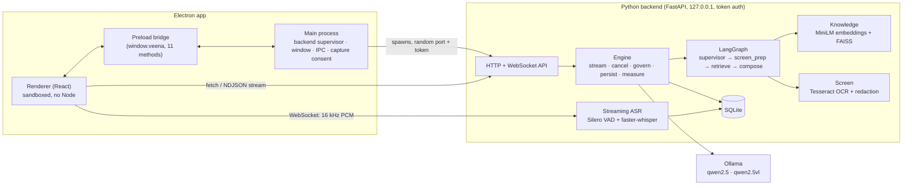

# VEENA.AI architecture

VEENA.AI is two local processes and some local tools. Nothing leaves the
computer except model downloads the user starts.



## Processes

| Process | Responsibility |
|---|---|
| Electron main (`apps/desktop/electron/main.ts`) | Starts the backend on a free loopback port with a random 256-bit token, restarts it up to 3 times if it crashes, owns the window, global shortcuts, file save dialogs, and screen-capture consent. |
| Preload (`electron/preload.ts`) | Exposes 11 narrow, typed methods as `window.veena`. No Node APIs reach the renderer. |
| Renderer (`apps/desktop/src`) | React UI. Talks to the backend directly over loopback HTTP/WebSocket with the bearer token. |
| Backend (`backend/`) | FastAPI service: orchestration, speech, screen analysis, retrieval, memory, metrics. Packaged as a PyInstaller executable. |
| Ollama | Runs the language and vision models. Installed separately by the user (free). |

## Request flow: a typed or spoken question

1. The renderer posts a **unified request** (`backend/agents/graph.py: UnifiedRequest`)
   to `POST /api/chat`: text, source, mode, answer style, optional screenshot,
   knowledge collections, recent transcript lines.
2. The engine stores the user message and runs the **LangGraph** graph:
   - `supervisor` routes deterministically: meeting → meeting agent; interview →
     coaching agent; image → screen agent (or code/architecture by intent);
     coding/architecture intents → specialists; selected collections → knowledge
     agent; otherwise the conversation agent.
   - `screen_prep` (only with an image): decode, resize, Tesseract OCR, redact
     secrets in pixels and text, flag sensitive content and injected instructions.
   - `retrieve` (only with collections or a resume): embed the query, search the
     FAISS index of each collection, rerank by 0.75 × cosine + 0.25 × keyword score,
     drop passages below the relevance floor.
   - `compose`: picks the model. Vision is used only if a screenshot is present
     **and** Ollama reports the installed model has the `vision` capability;
     otherwise the answer falls back to OCR text and says so. It builds the prompt:
     agent role, answer style and security rules in the system message;
     transcript, OCR, documents and resume wrapped as `<untrusted>` data blocks.
3. The engine streams tokens from Ollama as NDJSON (`accepted`, `meta`, `token`…,
   `done`). The client can stop generation (`POST /api/chat/{id}/cancel` or by
   aborting the request); closing the stream stops Ollama.
4. The **governance** check reviews the finished answer: citations to passages
   that do not exist, retrieved evidence that was not cited, no evidence for a
   knowledge question, and (in practice interviews) first-person experience or
   figures without a resume to back them.
5. The answer, citations, governance result and generation stats are stored in
   SQLite. Latencies go to the metrics table.

Simple text questions skip `screen_prep` and `retrieve` entirely, so only one
model call is made.

## Real-time audio pipeline

```
mic / system audio → AudioWorklet (16 kHz, 1024-sample frames, 8-byte timestamp)
  → WebSocket /ws/audio
  → bounded frame queue (drop-oldest, counted)
  → Silero VAD per 32 ms window → utterance state machine
      speech start (with 300 ms pre-roll) … partials every ~0.9 s if the ASR worker is idle
      700 ms silence → final (never dropped)
  → ASR worker thread (faster-whisper, int8 on CPU / float16 on CUDA)
  → events: vad, partial, final, discard, question
  → final transcript stored; question detector (rules → local-LLM escalation for ambiguous text)
  → renderer auto-answers in conversation/screen sessions
```

* Partials are best effort and skipped while ASR is busy; finals are queued and
  always processed. A final replaces the partials of its utterance, and a partial
  that finishes after its final is discarded.
* Duplicate questions (≥ 85 % similar within 90 s) are suppressed.
* The renderer drops frames instead of buffering when the socket is down or its
  send buffer exceeds 256 KB, reconnects with backoff, and falls back to the
  default microphone if the selected device disappears.

## Screen intelligence

* Sources are listed by the main process (`desktopCapturer`). The user must pick
  one in VEENA's picker; that selection is single use. The display-media
  handler refuses any `getDisplayMedia` call without it.
* The renderer keeps the stream in memory, shows a persistent "Sharing" pill
  with a Stop button, and grabs frames to a canvas (whole frame or a dragged
  region) as PNG.
* Continuous mode samples a frame every N seconds, computes a 256-bit
  difference hash, and only sends frames that changed by ≥ 12 bits. It pauses
  while the window is hidden or minimised, stops when the track ends
  (sharing stopped or permission revoked), and pauses when the backend reports
  sensitive content.
* Frames are never written to disk.

## Data model (SQLite)

`ChatSession`, `Message` (roles user / assistant / transcript), `Collection`,
`Document`, `Chunk` (its id is the FAISS vector id), `Setting`, `MetricEvent`,
`InterviewSession`, `InterviewTurn`. WAL journaling, foreign keys, and
`secure_delete` so deleted history is overwritten. A retention job deletes
sessions older than the configured number of days.

## Module map

| Path | Purpose |
|---|---|
| `backend/api/` | FastAPI app factory, routes, audio WebSocket, shared state |
| `backend/agents/` | LangGraph graph, engine, prompts, question detection, governance, interview, meeting |
| `backend/llm/` | Ollama client (streaming, pull, capabilities), model selection |
| `backend/transcription/` | Whisper wrapper, Silero/energy VAD, streaming transcriber |
| `backend/audio/` | PCM frame codec |
| `backend/vision/` | Tesseract OCR, image redaction |
| `backend/screen/` | Frame decoding, resizing, change detection |
| `backend/rag/` | Extraction, chunking, embeddings, FAISS index, knowledge base |
| `backend/memory/` | Tables, engine, store (sessions, settings, export, retention) |
| `backend/security/` | Token auth, path safety, prompt-injection guard, redaction |
| `backend/analytics/` | Metrics recording, summaries, resource usage |
| `backend/models/` | Hardware detection, profiles, benchmark |
| `apps/desktop/electron/` | Main process, backend supervisor, preload |
| `apps/desktop/src/` | React pages, components, stores, services, brand |
| `packaging/` | PyInstaller spec, frozen-backend entry and smoke test |
