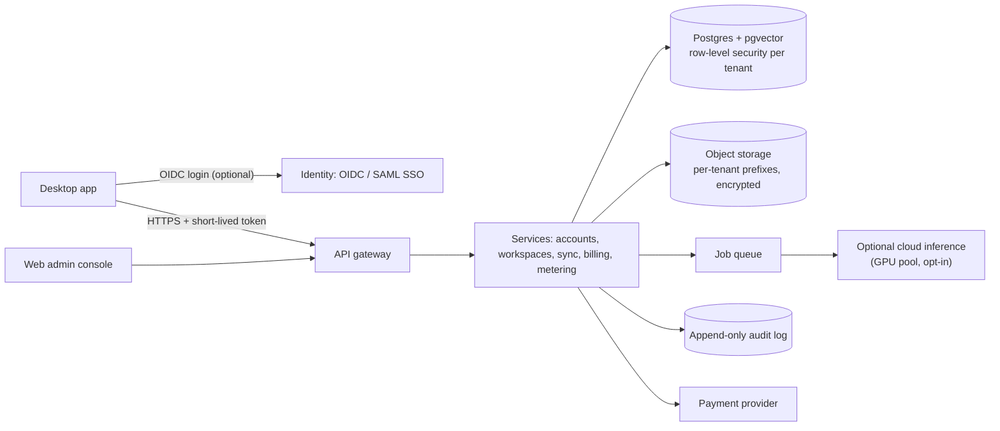

# SaaS commercialization roadmap

**Status: plan only. Nothing here is built, and none of it is required by the free local desktop release.** Start it only after the desktop beta passes customer acceptance (non-technical users install it and get answers unaided) and there is a budget: the free tiers researched in [FREE_TIER_CLOUD_RESEARCH.md](../reports/FREE_TIER_CLOUD_RESEARCH.md) cannot host a multi-tenant SaaS at 1,000+ users.

## Principles

1. **The local app stays free and complete.** Accounts, sync and cloud features are additions, never gates on local use.
2. **Customer data stays local unless the customer opts in**, per feature, with a clear record of what leaves the device.
3. **Tenant isolation is enforced in the database, not only in application code.**
4. **Every cloud action is auditable**: who, what, when, from which client.

## Target architecture

## Capabilities

| Capability | Design | Notes |
|---|---|---|
| Customer accounts | OIDC (email magic link + Google/Microsoft); no passwords stored | Desktop uses the system browser with PKCE |
| Organisation workspaces | `tenant_id` on every row; Postgres row-level security; per-tenant encryption keys for object storage | Isolation tests in CI: cross-tenant reads must fail |
| Role-based access | Owner, Admin, Member, Viewer; permissions checked in one policy module | Admin console for invites and roles |
| Subscription plans | Free (local only), Pro (sync, more devices), Team (workspaces, shared knowledge), Enterprise (SSO, audit export, data residency) | Prices to be set from cost data, not guessed |
| Payment processing | Hosted checkout from a payment provider; no card data touches VEENA servers | Webhooks verified by signature |
| Usage metering | Count only what is billed (seats, sync storage, cloud inference tokens); aggregate per tenant per day | No content in metering events |
| Customer administration | Support view of tenant status and usage only; no access to content without a logged, time-boxed customer grant | |
| Enterprise SSO | SAML 2.0 and OIDC; SCIM provisioning | |
| API keys | Per workspace, scoped, hashed at rest, shown once, rotatable | |
| Cloud inference | Opt-in per workspace; open-weight models with commercial licences on a GPU pool; the request records which model answered | Local inference stays the default |
| Tenant-aware RAG | Collections owned by a workspace; pgvector indexes filtered by tenant in the query and enforced by row-level security | Same governance and citation checks as desktop |
| Enterprise connectors | Read-only connectors (Drive, SharePoint, Confluence), each with an explicit admin grant and sync log | |
| Audit logs | Append-only, per tenant, exportable; covers logins, permission changes, data exports, connector grants, deletions | |
| Backup and recovery | Point-in-time recovery for Postgres; versioned object storage; tested restore every quarter; documented RPO/RTO | |
| Data deletion | Workspace deletion within 30 days, including backups past retention | Mirrors the desktop "clear all history" promise |

## Phases

| Phase | Scope | Exit criteria |
|---|---|---|
| 0 | Desktop beta (this release) | Customer acceptance test passed; signed installers |
| 1 | Accounts + encrypted personal sync (Option B) | Sync opt-in; no plaintext content on servers; deletion verified |
| 2 | Team workspaces, RBAC, shared knowledge, billing | Cross-tenant isolation tests pass; payment webhooks verified |
| 3 | Enterprise: SSO/SCIM, audit export, connectors, data residency | External security review before selling to enterprises |
| 4 | Optional cloud inference | Cost per 1,000 answers measured; model licences reviewed |

## Security work before any paid launch

A threat model per service; dependency and container scanning (already in CI for the desktop); secrets in a managed vault; and an independent penetration test. **No security certification is claimed until an actual audit has been done.**
