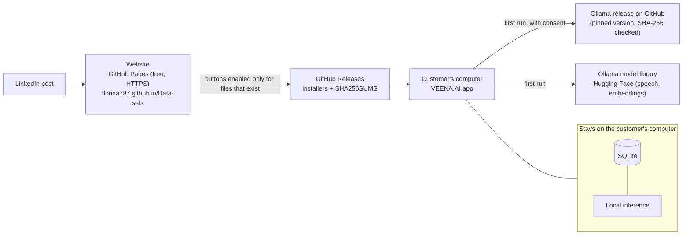

# Zero-cost deployment architecture

Chosen from the verified research in [reports/FREE_TIER_CLOUD_RESEARCH.md](../reports/FREE_TIER_CLOUD_RESEARCH.md): **Option A, free desktop distribution**. Target budget: CAD $0 per month.

| Layer | Service | Why | Cost | Can it bill? |
|---|---|---|---|---|
| Website | GitHub Pages, deployed by `.github/workflows/veena-ai-site.yml` | No new account, HTTPS, 100 GB/month soft limit | $0 | No |
| Installer hosting | GitHub Releases, created by `.github/workflows/veena-ai-ci.yml` (draft, then owner publishes) | 2 GiB per file, no stated bandwidth limit | $0 | No |
| Integrity | SHA-256 per installer + SHA256SUMS.txt in each release; CycloneDX SBOMs | Customers and reviewers can verify files | $0 | No |
| AI runtime | Downloaded by the app from Ollama's official release, pinned and checksum-verified | MIT licensed; bundling 1.5 GB into every installer would quadruple download size | $0 to the owner | No |
| AI inference | Customer's computer | No per-user cost; private by design | $0 to the owner | No |
| User data | Local SQLite, local FAISS indexes | Privacy promise; no cloud database needed | $0 | No |
| Update check | Customer's app reads GitHub's public releases API once a day (opt-out) | Notify only, never auto-installs | $0 | No |
| Analytics | None. GitHub shows release download counts per asset; Pages has no analytics | No tracking of customers | $0 | No |

## What is deliberately not used

- No cloud database, accounts, API servers or cloud inference: none are needed for the desktop product.
- No service with a payment method on file, so nothing can bill.
- No promotional credits (Azure, Google, AWS, Railway): they expire.

## Monitoring (free)

- **Release downloads:** each asset's `download_count` from `GET https://api.github.com/repos/florina787/Data-sets/releases` (public, no account).
- **Website availability:** the deploy job checks the live URL after every deployment.
- **Build health:** the CI workflow summary shows installer, first-run, signature and checksum results per OS.
